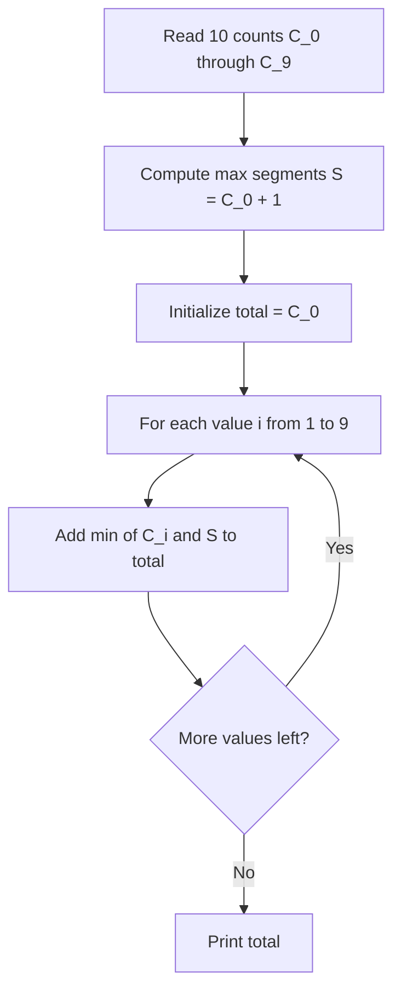

# A Chain of Memories in Castle Oblivion

> [!info] Document Metadata
> **Course:** `=this.course` | **Topic:** `=this.topic` | **Status:** `=this.status` | **Difficulty:** `=this.difficulty`

**Tags:** #[[Computer Science]] #[[CSALGCM]] #[[Algorithms and Complexity]] #[[HackerRank]] #[[Justice Arcana]] #[[Counting and Partitioning]]
---

## Problem Description

Riku is advancing through a long hallway of locked doors in the basement of Castle Oblivion using map cards holding integer values from $0$ to $9$. The first room's door accepts any card. Thereafter, whenever a card with value $X$ unlocks a door, the next door requires a card with a minimum value of $X + 1$.

Cards with value $0$ act as wild cards: a $0$ card can unlock any door regardless of the previous door's requirement, and playing a $0$ causes the next door to require a minimum card value of $1$ (or another wild card $0$). Playing a $9$ causes the next door to require at least $10$, meaning only a wild card $0$ can unlock that next door. Given the counts $C_0, C_1, \dots, C_9$ of cards Riku possesses for each value $0$ through $9$, find the maximum number of rooms Riku can unlock.

### Input Format
- A single line containing $10$ space-separated integers $C_0, C_1, \dots, C_9$, where $C_i$ is the number of map cards with value $i$ available to Riku.

### Output Format
Output a single integer representing the maximum number of rooms Riku can reach.

### Constraints
- $0 \le C_i \le 2 \cdot 10^6$ for all $0 \le i \le 9$
- $\sum_{i=0}^{9} C_i \le 2 \cdot 10^6$

### Sample Test Cases

**Sample Input 0**
```text
0 0 0 0 0 6 0 0 0 4
```

**Sample Output 0**
```text
2
```

*Explanation 0:* With $C_0 = 0$ wild cards, Riku can form only one strictly increasing sequence: e.g., card `5` followed by card `9`, unlocking $2$ rooms.

**Sample Input 1**
```text
1 13 2 0 0 0 0 0 0 1
```

**Sample Output 1**
```text
6
```

*Explanation 1:* Using the single wild card `0` to reset the chain yields two strictly increasing segments, such as `1 -> 2 -> 9 -> 0 -> 1 -> 2`, unlocking $6$ rooms.

**Sample Input 2**
```text
0 0 0 0 9 0 1 13 0 0
```

**Sample Output 2**
```text
3
```

*Explanation 2:* Without wild cards ($C_0 = 0$), Riku can use at most one copy of each available positive value (`4 -> 6 -> 7`), unlocking $3$ rooms.

---

## Approach & Intuition

- **Problem Abstraction:** Construct the longest valid sequence $a_1, a_2, \dots, a_m$ drawn from the multiset defined by counts $C_0, \dots, C_9$ such that for every consecutive pair $(a_j, a_{j+1})$, either $a_{j+1} = 0$ or $a_{j+1} \ge a_j + 1$.
- **Naive / Brute-Force Approach:** Explicitly simulating a greedy loop that picks the smallest valid card at each step until stuck (and resetting with `0` only when forced) takes $O\bigl(\sum C_i\bigr)$ steps up to $2 \cdot 10^6$ and must carefully handle when to play `0` vs. save it—a naive simulation without global structure can still run in $O(10 \cdot \sum C_i)$ or risk off-by-one errors on empty resets, whereas counting segments yields an exact closed-form $O(1)$ formula.
- **Optimal Strategy (Segment Partitioning & Tightness Proof):**
  1. *Upper Bound:* Consider any valid sequence containing $k \le C_0$ wild cards (`0`). Removing the $k$ wild cards splits the remaining non-zero cards into at most $k + 1 \le C_0 + 1$ contiguous non-wild segments (some possibly empty). Within any single non-wild segment, every transition satisfies $a_{j+1} \ge a_j + 1$, so values in that segment are **strictly increasing** and every value $i \in \{1, \dots, 9\}$ can appear at most once per segment. Hence, value $i$ appears at most $\min(C_i, C_0 + 1)$ times overall, bounding the total length by:
     $$\text{Answer} \le C_0 + \sum_{i=1}^{9} \min(C_i, C_0 + 1)$$
  2. *Constructive Achievability:* This upper bound is always achievable. Create $C_0 + 1$ buckets $B_1, B_2, \dots, B_{C_0 + 1}$. For each $i \in \{1, \dots, 9\}$, distribute $\min(C_i, C_0 + 1)$ copies of value $i$ into buckets $B_1, \dots, B_{\min(C_i, C_0 + 1)}$ in ascending order of $i$, and concatenate the buckets separated by the $C_0$ wild cards:
     $$B_1, \; 0, \; B_2, \; 0, \; \dots, \; 0, \; B_{C_0 + 1}$$
     Each bucket $B_j$ is strictly increasing in $\{1, \dots, 9\}$, every `0` is valid after any card (including `9` or another `0` if a bucket is empty), and any card $\ge 1$ is valid after `0`.

## Algorithm Walkthrough



## Step-by-Step Trace

Tracing **Sample Input 1** (`1 13 2 0 0 0 0 0 0 1`, so $C_0 = 1$ and $C_0 + 1 = 2$ segments):

| Card Value $i$ | Available Count $C_i$ | Segment Cap $C_0 + 1$ | Usable Cards $\min(C_i, 2)$ | Placement in $B_1 \mid 0 \mid B_2$ |
| :---: | :---: | :---: | :---: | :--- |
| `0` (Wild) | 1 | — | 1 | Separator between $B_1$ and $B_2$ |
| `1` | 13 | 2 | 2 | $1 \in B_1$, $1 \in B_2$ |
| `2` | 2 | 2 | 2 | $2 \in B_1$, $2 \in B_2$ |
| `3`–`8` | 0 | 2 | 0 | None |
| `9` | 1 | 2 | 1 | $9 \in B_1$ |

Total cards used: $1 + (2 + 2 + 1) = \mathbf{6}$ (e.g., `1, 2, 9, 0, 1, 2`).

## Complexity Analysis

| Metric | Complexity | Rationale |
| :--- | :--- | :--- |
| **Time** | $O(1)$ | Always iterates over the fixed set of $9$ non-zero card values (`cards[1:]`) regardless of the magnitude of $C_i \le 2 \cdot 10^6$. |
| **Space** | $O(1)$ | Stores only the fixed-length array of $10$ counts and accumulates a scalar sum. |

---

## Full Solution

```python
def solve(cards):
    # TODO: Compute and return answer here
    return cards[0] + sum(min(c, cards[0] + 1) for c in cards[1:])

cards = list(map(int,input().strip().split(" ")))
print("{}".format(solve(cards)))
```

## References & Navigation

- **Previous Problem:** [[03 - Logic The Unsundering]]
- **Next Problem:** [[05 - Problematizing the Problems 1]]
- **Parent Set:** [[[PS] Justice Arcana|Justice Arcana Index]]
- **Related Notes:** [[Greedy Algorithms Introduction]]
