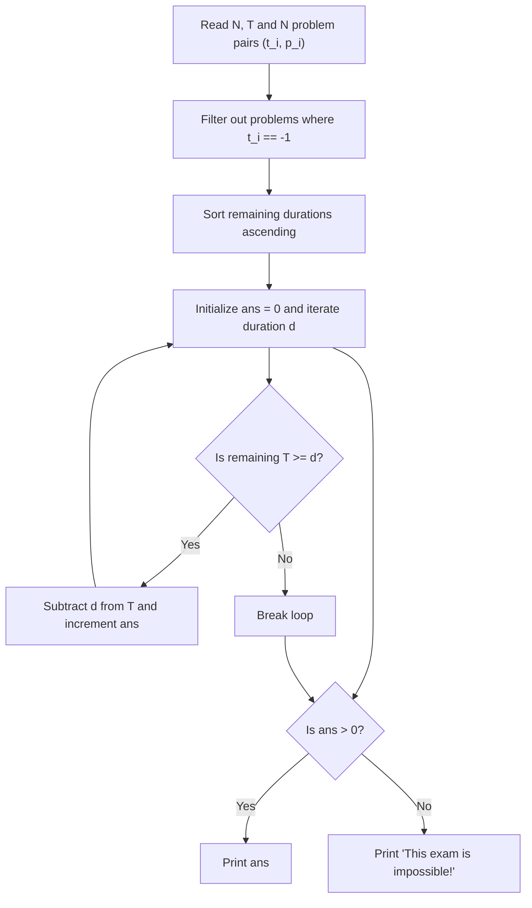

# Problematizing the Problems 1

> [!info] Document Metadata
> **Course:** `=this.course` | **Topic:** `=this.topic` | **Status:** `=this.status` | **Difficulty:** `=this.difficulty`

**Tags:** #[[Computer Science]] #[[CSALGCM]] #[[Algorithms and Complexity]] #[[HackerRank]] #[[Justice Arcana]] #[[Greedy Scheduling]]
---

## Problem Description

Given an exam consisting of $N$ problems and a strict time limit of $T$ minutes, each problem $i$ requires $t_i$ minutes to solve and awards $p_i$ points. Unsolvable problems are marked with $t_i = -1$.

Your objective is solely to maximize the **number of problems completed** within the time limit $T$. If not even a single problem can be completed within $T$, output `"This exam is impossible!"` (without quotes).

### Input Format
- The first line contains two space-separated integers $N$ and $T$, indicating the number of problems in the exam and the exam's time limit in minutes.
- The next $N$ lines each contain two space-separated integers $t_i$ and $p_i$, where $t_i$ is the number of minutes needed to complete the $i$-th problem ($t_i = -1$ if the problem cannot be solved) and $p_i$ is the number of points it is worth.

### Output Format
Output either a single integer $n$ denoting the maximum number of problems solvable within time $T$, or `"This exam is impossible!"` (without quotes) if zero problems can be completed within $T$.

### Constraints
- $1 \le N \le 10^5$
- $0 \le T \le 10^9$
- $0 \le t_i, p_i \le 10^4 \lor t_i = -1$

### Sample Test Cases

**Sample Input 0**
```text
5 29
3 8
7 9
7 2
6 6
7 4
```

**Sample Output 0**
```text
4
```

*Explanation 0:* Four problems can be completed in total time $3 + 6 + 7 + 7 = 23 \le 29$; attempting the fifth problem would require $23 + 7 = 30 > 29$.

**Sample Input 1**
```text
6 5
6 6
7 10
9 4
9 11
10 10
10 0
```

**Sample Output 1**
```text
This exam is impossible!
```

*Explanation 1:* Every problem requires strictly more than $T = 5$ minutes ($t_i > 5$), so no problem can be finished within the time limit.

---

## Approach & Intuition

- **Problem Abstraction:** Filter out unsolvable items ($t_i = -1$), leaving solvable durations $\{t_i \ge 0\}$. Find the maximum cardinality subset $S$ such that $\sum_{i \in S} t_i \le T$; point values $p_i$ do not affect the cardinality objective.
- **Naive / Brute-Force Approach:** Treating this as a $0/1$ knapsack problem over time capacity $T$ via dynamic programming requires $O(NT)$ time and space, which fails immediately for $T \le 10^9$ and is unnecessary because every item contributes uniform weight ($+1$ count) to the objective.
- **Optimal Strategy (Greedy Choice & Exchange Proof):** Sort all solvable problem times ($t_i \ne -1$) in non-decreasing order $t_{(1)} \le t_{(2)} \le \dots \le t_{(m)}$ and greedily solve items in this order while the remaining time budget satisfies $t \ge t_{(j)}$.
  - *Exchange Proof:* Suppose an optimal schedule completes $k$ problems. Let its durations in non-decreasing order be $t_{o_1} \le t_{o_2} \le \dots \le t_{o_k}$ with $\sum_{j=1}^k t_{o_j} \le T$. Since $t_{(j)}$ is the $j$-th smallest solvable duration overall, $t_{(j)} \le t_{o_j}$ holds for every $1 \le j \le k$. Consequently, $\sum_{j=1}^k t_{(j)} \le \sum_{j=1}^k t_{o_j} \le T$, so taking the $k$ fastest solvable problems always remains feasible and achieves at least as many completed problems as any optimal solution. If even $t_{(1)} > T$ (or no solvable problems exist), return `"This exam is impossible!"`.

## Algorithm Walkthrough



## Step-by-Step Trace

Tracing **Sample Input 0** ($N = 5$, $T = 29$, pairs `(3, 8), (7, 9), (7, 2), (6, 6), (7, 4)`):

Sorted solvable times: `[3, 6, 7, 7, 7]`.

| Step | Candidate Duration $t_i$ | Remaining Time Before | Fits ($T_{\text{rem}} \ge t_i$)? | Remaining Time After | Problems Solved (`ans`) |
| :---: | :---: | :---: | :---: | :---: | :---: |
| 1 | `3` | `29` | Yes | `26` | `1` |
| 2 | `6` | `26` | Yes | `20` | `2` |
| 3 | `7` | `20` | Yes | `13` | `3` |
| 4 | `7` | `13` | Yes | `6` | `4` |
| 5 | `7` | `6` | No (`6 < 7`) | `6` (break) | `4` |

Final output: `4`.

## Complexity Analysis

| Metric | Complexity | Rationale |
| :--- | :--- | :--- |
| **Time** | $O(N \log N)$ | Filtering $N$ pairs takes $O(N)$, sorting up to $N$ durations takes $O(N \log N)$, and the greedy scan takes $O(N)$. |
| **Space** | $O(N)$ | Stores the $N$ `(t_i, p_i)` tuples and the sorted list of solvable durations of length at most $N$. |

---

## Full Solution

```python
def solve(n,t,problems):
    # compute and return answer here
    ans = 0
    for time_needed in sorted(ti for ti, pi in problems if ti != -1):
        if t >= time_needed:
            t -= time_needed
            ans += 1
        else:
            break
    return ans if ans > 0 else "This exam is impossible!"

def main():
    n,t = list(map(int,input().strip().split(' ')))
    problems = [tuple(map(int,input().strip().split(" "))) for i in range(n)]
    print(solve(n,t,problems))

if __name__ == "__main__":
    main()
```

## References & Navigation

- **Previous Problem:** [[04 - A Chain of Memories in Castle Oblivion]]
- **Next Problem:** [[06 - Friendly Rhythm Game]]
- **Parent Set:** [[[PS] Justice Arcana|Justice Arcana Index]]
- **Related Notes:** [[Greedy Algorithms Introduction]]
