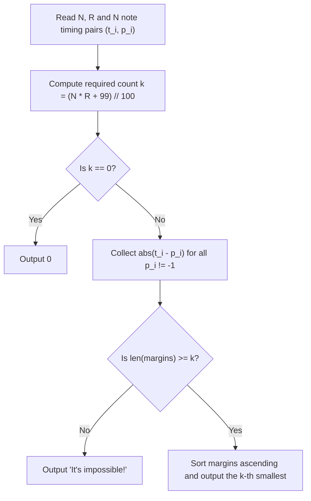

# Friendly Rhythm Game

> [!info] Document Metadata
> **Course:** `=this.course` | **Topic:** `=this.topic` | **Status:** `=this.status` | **Difficulty:** `=this.difficulty`

**Tags:** #[[Computer Science]] #[[CSALGCM]] #[[Algorithms and Complexity]] #[[HackerRank]] #[[Justice Arcana]] #[[Order Statistics]]
---

## Problem Description

In a rhythm game chart with $N$ notes, each note $i$ has a scheduled hit time $t_i$ (in milliseconds from chart start) and an actual player button-press time $p_i$. If the player missed the $i$-th note entirely, $p_i = -1$. Under a timing margin of $n$ milliseconds, a non-missed button press is graded `Perfect` if and only if $\vert t_i - p_i \vert \le n$.

To create an adaptive, friendly timing system based on the player's previous chart performance, determine the minimum non-negative integer timing margin $n$ (in milliseconds) such that at least $R\%$ of all $N$ notes in the chart are graded `Perfect`. If fewer than the required number of notes were pressed (so no finite margin can achieve $R\%$ `Perfect` notes), output `"It's impossible!"` (without quotes).

### Input Format
- The first line contains two space-separated integers $N$ and $R$, representing the number of notes in the chart and the target accuracy percentage.
- The next $N$ lines each contain two space-separated integers $t_i$ and $p_i$, where $t_i$ is the target time of the $i$-th note and $p_i$ is the player's press time in milliseconds ($p_i = -1$ if the note was a Miss).

### Output Format
Output a single integer $n$ representing the minimum margin in milliseconds such that at least $R\%$ of the $N$ button presses are graded `Perfect`, or `"It's impossible!"` (without quotes) if no such margin exists.

### Constraints
- $1 \le N \le 10^5$
- $0 \le R \le 100$
- $0 \le t_i, p_i \le 10^{12} \lor p_i = -1$ for all $1 \le i \le N$
- $t_i < t_{i+1}$ for all $1 \le i < N$
- $(p_i \ne -1 \land p_{i+1} \ne -1) \implies p_i < p_{i+1}$ for all $1 \le i < N$

### Sample Test Cases

**Sample Input 0**
```text
5 40
5 87
14 -1
22 271
25 628
46 -1
```

**Sample Output 0**
```text
249
```

*Explanation 0:* A $40\%$ target across $5$ notes requires at least $\lceil 5 \times 0.40 \rceil = 2$ `Perfect` notes. Ignoring misses ($-1$), the three hit notes have margins $\vert 87 - 5 \vert = 82$, $\vert 271 - 22 \vert = 249$, and $\vert 628 - 25 \vert = 603$. The $2$-nd smallest margin is $249$.

**Sample Input 1**
```text
6 62
11 251
28 261
66 -1
73 -1
80 666
86 929
```

**Sample Output 1**
```text
843
```

*Explanation 1:* A $62\%$ accuracy across $6$ notes requires $\lceil 6 \times 62 / 100 \rceil = \lceil 3.72 \rceil = 4$ `Perfect` notes. Two notes are misses; the four hit notes have error margins $240, 233, 586, 843$. Choosing $n = 843$ covers all four hit notes.

---

## Approach & Intuition

- **Problem Abstraction:** Compute the minimum integer count of `Perfect` notes required:
  $$k = \left\lceil \frac{N \cdot R}{100} \right\rceil = \left\lfloor \frac{N \cdot R + 99}{100} \right\rfloor$$
  Let $M = [\vert t_i - p_i \vert : 1 \le i \le N,\, p_i \ne -1]$ be the multiset of timing errors for all non-missed notes. Find the smallest integer $n \ge 0$ such that at least $k$ elements of $M$ satisfy $m \le n$.
- **Naive / Brute-Force Approach:** Linearly scanning candidate margins $n = 0, 1, 2, \dots$ and counting covered notes on each step can take up to $O(N \cdot \max \vert t_i - p_i \vert) \approx 10^{17}$ operations when $t_i, p_i \le 10^{12}$. Binary searching on $n \in [0, 10^{12}]$ costs $O(N \log(\max \vert t_i - p_i \vert))$ and is strictly slower than sorting $M$ directly.
- **Optimal Strategy (Greedy Selection via Order Statistics):**
  1. If $k = 0$ (i.e., $R = 0$), zero `Perfect` notes are needed, so a margin of $0$ ms suffices immediately—even if all $N$ notes were missed.
  2. Otherwise ($k \ge 1$), if $\vert M \vert < k$, no margin can ever grade $k$ notes as `Perfect` (misses cannot be recovered by widening $n$), so return `"It's impossible!"`.
  3. Notice that although $t_i$ and non-missed $p_i$ are strictly increasing, their absolute differences $\vert t_i - p_i \vert$ are not necessarily monotonic (as in Sample 1, where $240 > 233$). Sorting $M$ in non-decreasing order $m_{(1)} \le m_{(2)} \le \dots \le m_{(\vert M \vert)}$ places the $k$ most accurate presses first. Selecting $n = m_{(k)}$ (`margins[k - 1]`) includes at least $k$ notes, and any strictly smaller margin $n' < m_{(k)}$ includes at most $k - 1$ notes, proving optimality.

## Algorithm Walkthrough



## Step-by-Step Trace

Tracing **Sample Input 1** ($N = 6$, $R = 62$):

1. Required `Perfect` notes: $k = \lfloor (6 \times 62 + 99) / 100 \rfloor = \lfloor 471 / 100 \rfloor = 4$.
2. Filter misses and compute absolute errors:

| Note $i$ | Target $t_i$ | Press $p_i$ | Status | Timing Error $\vert t_i - p_i \vert$ |
| :---: | :---: | :---: | :--- | :---: |
| 1 | `11` | `251` | Hit | `240` |
| 2 | `28` | `261` | Hit | `233` |
| 3 | `66` | `-1` | Miss | Excluded |
| 4 | `73` | `-1` | Miss | Excluded |
| 5 | `80` | `666` | Hit | `586` |
| 6 | `86` | `929` | Hit | `843` |

3. Sorted margins: `[233, 240, 586, 843]`.
4. Since `len(margins) = 4 >= k = 4`, return `margins[4 - 1] = margins[3] = 843`.

## Complexity Analysis

| Metric | Complexity | Rationale |
| :--- | :--- | :--- |
| **Time** | $O(N \log N)$ | Computing non-missed error margins takes $O(N)$ time, and sorting up to $N$ error values takes $O(N \log N)$ time. |
| **Space** | $O(N)$ | Stores the $N$ `(t_i, p_i)` pairs in `times` and up to $N$ computed timing errors in `margins`. |

---

## Full Solution

```python
def solve(n,r,times):
    # compute for and return answer here
    k = (n * r + 99) // 100
    if k == 0:
        return 0
    margins = sorted(abs(ti - pi) for ti, pi in times if pi != -1)
    return margins[k - 1] if len(margins) >= k else "It's impossible!"
    
def main():
    n, r = list(map(int,input().strip().split(" ")))
    times = [list(map(int,input().strip().split(" "))) for i in range(n)]
    
    print(solve(n,r,times))

if __name__ == "__main__":
    main()
```

## References & Navigation

- **Previous Problem:** [[05 - Problematizing the Problems 1]]
- **Parent Set:** [[[PS] Justice Arcana|Justice Arcana Index]]
- **Related Notes:** [[Greedy Algorithms Introduction]]
