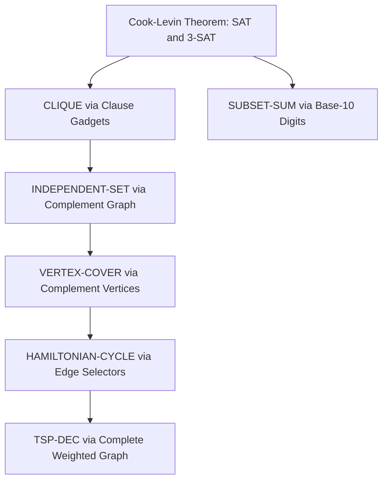

# Intractability and NP-Completeness

> [!info] Document Metadata
> - **Course:** CSALGCM
> - **Module:** Module 5 - Intractability
> - **Topic:** Intractability and NP-Completeness

**Tags:** #[[Computer Science]] #[[CSALGCM]] #[[Algorithms]] #[[Complexity Theory]] #[[Intractability and NP-Completeness]]

---

## Overview

Up to this point in **CSALGCM**, we have engineered efficient polynomial-time algorithms ($O(n \log n)$, $O(n^2)$, $O(V + E)$) using Divide and Conquer, Dynamic Programming, and Greedy strategies. Yet many fundamental computational problems—such as Boolean Satisfiability (**SAT**), **Traveling Salesperson (TSP)**, **Clique**, **Vertex Cover**, and **Graph Coloring**—have resisted every attempt to find polynomial-time exact algorithms.

Computational intractability theory formalizes *why* these problems appear fundamentally harder than sorting or shortest paths, classifies decision problems into rigorous complexity classes ($P, NP, \text{co-NP}, NP\text{-Complete}, NP\text{-Hard}$), and uses **polynomial-time reductions** ($\le_P$) to connect thousands of hard problems into an equivalent hardness hierarchy.

---

## Decision Problems vs. Optimization Problems

To classify complexity rigorously using formal languages $L \subseteq \{0, 1\}^*$, problems are recast as **decision problems** returning strictly YES or NO:

- **Optimization form (TSP):** Find a minimum-weight Hamiltonian cycle in weighted graph $G$.
- **Decision form (TSP-DEC):** Given $(G, k)$, does there exist a Hamiltonian cycle in $G$ of total weight $\le k$?

Because optimization can usually be reduced to a sequence of decision queries via binary search on $k$, proving the decision version intractable establishes intractability for the optimization version as well.

---

## Core Complexity Classes

1. **Class P (Polynomial Time):** Decision problems solvable by a deterministic Turing machine (or RAM algorithm) in time $O(n^k)$ for some constant $k \ge 0$, where $n$ is the bit length of the encoded input.
2. **Class NP (Nondeterministic Polynomial Time):** Decision problems for which a **YES** instance admits a concise polynomial-size proof (**certificate** $y$, $|y| = O(n^c)$) that can be **verified** deterministically in polynomial time. Equivalently, problems decided in polynomial time by a nondeterministic Turing machine.
   - Trivially, $P \subseteq NP$ because any problem solvable from scratch in polynomial time can ignore the certificate and solve directly during verification.
3. **Class co-NP:** Decision problems whose complements belong to $NP$—meaning every **NO** instance has a polynomial-time verifiable counterexample certificate (e.g., *TAUTOLOGY* is in $\text{co-NP}$ because an assignment falsifying a formula proves NO quickly).
4. **Class NP-Hard:** A problem $H$ (not necessarily in $NP$) such that *every* problem $L \in NP$ reduces to $H$ in polynomial time ($\forall L \in NP, L \le_P H$).
5. **Class NP-Complete (NPC):** A problem $C$ that satisfies BOTH conditions:
   - $C \in NP$ (verifiable in polynomial time), AND
   - $C$ is **NP-Hard** ($\forall L \in NP, L \le_P C$).

---

## Polynomial-Time Many-One Reductions ($\le_P$)

A decision problem $A$ is **polynomial-time reducible** to $B$ (written $A \le_P B$) if there exists a polynomial-time computable function $f$ mapping every input $x$ to $f(x)$ such that:

$$x \in A \iff f(x) \in B$$

**Critical Direction Warning:**
- If $A \le_P B$ and $B \in P$, then $A \in P$ ($A$ is no harder than $B$).
- Therefore, to prove a target problem $Y$ is **NP-Hard**, you MUST reduce **FROM a known NP-Complete problem $X$ TO $Y$** ($X \le_P Y$), never $Y \le_P X$! Reducing $Y \to X$ only shows $Y$ is at most as hard as $X$, which proves nothing about lower hardness.

---

## Canonical Reduction Chains & Classic NP-Complete Problems

### 1. The Cook-Levin Theorem (Origin of NP-Completeness)
Stephen Cook (1971) and Leonid Levin (1973) proved directly that **SAT** (Boolean Satisfiability of an arbitrary formula $\phi$) is NP-Complete by encoding the execution tableau of any nondeterministic polynomial-time Turing machine as a polynomial-size Boolean CNF formula. Restricting clauses to at most 3 literals gives **3-SAT**, which remains NP-Complete (whereas **2-SAT** is solvable in linear $O(V + E)$ time via strongly connected components!).

### 2. Graph Reductions Showcase
- **$\text{3-SAT} \le_P \text{CLIQUE}$:** For each clause $C_r = (\ell_{r,1} \lor \ell_{r,2} \lor \ell_{r,3})$, create 3 vertices in group $V_r$. Connect vertices in distinct clause groups unless one is the negation of the other ($x_i$ vs $\neg x_i$). The formula has a satisfying assignment if and only if the graph has a clique of size $k$ (number of clauses).
- **$\text{CLIQUE} \le_P \text{INDEPENDENT-SET}$:** $G$ has a clique of size $k$ if and only if its complement graph $\overline{G}$ has an independent set of size $k$.
- **$\text{INDEPENDENT-SET} \le_P \text{VERTEX-COVER}$:** In any graph $G = (V, E)$, $S \subseteq V$ is an independent set if and only if $V \setminus S$ is a vertex cover ($|V| - k$ cover iff $k$ independent set).

---

## Algorithmic Coping Strategies for Intractable Problems

When encountering an NP-Complete problem in practice, software engineers rely on four principal strategies:

1. **Special-Case Restriction:** Restrict input structure (e.g., 2-SAT $\in P$; Vertex Cover on trees or bipartite graphs $\in P$ by Kőnig's theorem).
2. **Pseudo-Polynomial Time & Bit-Length Awareness:** 0/1 Knapsack runs in $O(nW)$, which is exponential in the bit-encoding length $\log_2 W$ of capacity $W$ (**weakly NP-Complete**), unlike strongly NP-Complete TSP.
3. **Approximation Algorithms:** Compute a guaranteed near-optimal solution in polynomial time—for example, Vertex Cover admits a simple $O(V + E)$ **2-approximation** by picking both endpoints of maximal matchings, and Metric TSP admits a $1.5$-approximation (Christofides).
4. **Exact Pruning & Parameterization:** **Branch-and-Bound**, **Backtracking with constraint propagation**, and **Fixed-Parameter Tractable (FPT)** algorithms isolate exponential growth strictly to a small parameter $k$ (e.g., $O(2^k \cdot n)$).

---

## Multiple Choice Questions

1. What two criteria must a decision problem L satisfy to be classified as NP-Complete?
    - **A)** L is in P and L reduces to every problem in P
    - **B)** L is in NP and every problem in NP reduces to L in polynomial time
    - **C)** L requires exponential space and L is undecidable
    - **D)** L is in co-NP and L solves SAT in linear time

2. Suppose problem X is known to be NP-Complete and you want to prove a new decision problem Y is NP-Hard. Which reduction direction must you construct?
    - **A)** Reduce Y to X in polynomial time (Y <=_P X)
    - **B)** Reduce X to Y in polynomial time (X <=_P Y)
    - **C)** Reduce Y to a problem in P in exponential time
    - **D)** Show that Y has a verifier running in O(2^n) time

3. Which statement accurately summarizes the relationship between P, NP, and certificates?
    - **A)** P consists of problems with polynomial-time verifiers for NO instances only
    - **B)** NP consists of decision problems whose YES instances have polynomial-size certificates verifiable in polynomial time
    - **C)** NP stands for Non-Polynomial time and excludes P
    - **D)** Every problem in P lacks a deterministic verifier

4. Why is the Cook-Levin Theorem foundational to complexity theory?
    - **A)** It proved that P equals NP using 2-SAT
    - **B)** It established that SAT is NP-Complete directly from Turing machine computation tableaus, providing the first seed problem for reductions
    - **C)** It showed that Halting Problem instances reduce in polynomial time to Vertex Cover
    - **D)** It proved all optimization problems take at least O(n^3) time

5. How do the complexity of 2-SAT and 3-SAT compare?
    - **A)** Both 2-SAT and 3-SAT are NP-Complete
    - **B)** 2-SAT is solvable in polynomial time (via implication graphs), whereas 3-SAT is NP-Complete
    - **C)** 3-SAT is solvable in linear time, whereas 2-SAT is NP-Hard
    - **D)** Neither 2-SAT nor 3-SAT belongs to NP

6. If graph G = (V, E) contains an Independent Set S of size k, what structure must exist in G with respect to V \ S?
    - **A)** A Hamiltonian Cycle of length k
    - **B)** A Vertex Cover of size |V| - k
    - **C)** A Clique of size |V| - k in G itself
    - **D)** An Eulerian Circuit spanning S

7. If someone discovers a deterministic polynomial-time algorithm for 3-SAT, what immediate theoretical consequence follows?
    - **A)** NP-Complete problems remain strictly outside P
    - **B)** Every problem in NP can be solved in polynomial time (P = NP)
    - **C)** Only graph problems become polynomial-time solvable
    - **D)** Halting becomes decidable in polynomial time

8. Why is 0/1 Knapsack in O(nW) called a pseudo-polynomial algorithm rather than a true polynomial-time algorithm?
    - **A)** Because sorting item weights takes O(n^2) time
    - **B)** Because W is exponential in the number of bits b = log2(W) required to represent W in the input
    - **C)** Because it relies on floating-point rounding
    - **D)** Because n cannot exceed 32 on 64-bit processors

9. How does the standard Clique reduction map an undirected graph G to an equivalent Independent Set instance?
    - **A)** Take the complement graph G_bar where edges exist iff they were absent in G
    - **B)** Double every vertex and direct all edges away from the source
    - **C)** Remove all vertices of odd degree from G
    - **D)** Replace every triangle with a single hyperedge

10. Which strategy provides a provable polynomial-time approximation guarantee for an NP-Hard problem such as Vertex Cover?
    - **A)** Running brute-force enumeration for half the input vertices
    - **B)** Choosing both endpoints of any arbitrary edge in a maximal matching yields a 2-approximation in O(V + E) time
    - **C)** Reducing the instance to Halting Problem equivalence
    - **D)** Replacing Vertex Cover weights with random negative integers

### Answer Key & Explanations

1. **B)** By definition, a language $L$ is **NP-Complete** iff (1) $L \in NP$ and (2) $L$ is NP-Hard ($\forall A \in NP, A \le_P L$).
2. **B)** Reducing $X \le_P Y$ proves that a polynomial solver for $Y$ would solve the known NP-Complete problem $X$ in polynomial time, establishing that $Y$ is at least as hard as $X$.
3. **B)** A decision problem belongs to $NP$ iff YES instances have polynomial-length witnesses/certificates verifiable deterministically in polynomial time.
4. **B)** Before Cook and Levin proved SAT is NP-Complete via computation tableau encodings, no starting NP-Complete problem existed from which to build polynomial reductions.
5. **B)** 2-SAT clauses impose binary implications ($\neg a \lor b \equiv a \Rightarrow b$) solvable in $O(V + E)$ via SCCs, whereas 3-SAT encodes ternary branching constraints and is NP-Complete.
6. **B)** Since no edge has both endpoints inside an independent set $S$, every edge must touch at least one vertex in $V \setminus S$, making $V \setminus S$ a Vertex Cover of size $|V| - k$.
7. **B)** Because 3-SAT is NP-Complete, every problem $L \in NP$ reduces to 3-SAT in polynomial time; solving 3-SAT in polynomial time solves every problem in $NP$ in polynomial time ($P = NP$).
8. **B)** Complexity is measured against the input bit length; the numeric value $W$ can be $2^b$ relative to a $b$-bit integer input, making $O(nW)$ exponential in the input encoding size.
9. **A)** A subset $S \subseteq V$ has edges between all pairs in $G$ (a clique) iff no pair in $S$ shares an edge in the complement graph $\overline{G}$ (an independent set).
10. **B)** Any optimal vertex cover must include at least one endpoint from every disjoint edge in a maximal matching; taking both endpoints of those edges costs at most $2 \times \text{OPT}$ in $O(V + E)$ time.

## References & Navigation

- **Previous Topic:** [[Greedy Algorithms Introduction]]
- **Next Topic:** [[[REV] CSALGCM Comprehensive Finals Reviewer]]
- **Related Notes:** [[Complexity Analysis]], [[Divide and Conquer Introduction]], [[Dynamic Programming Introduction]]
