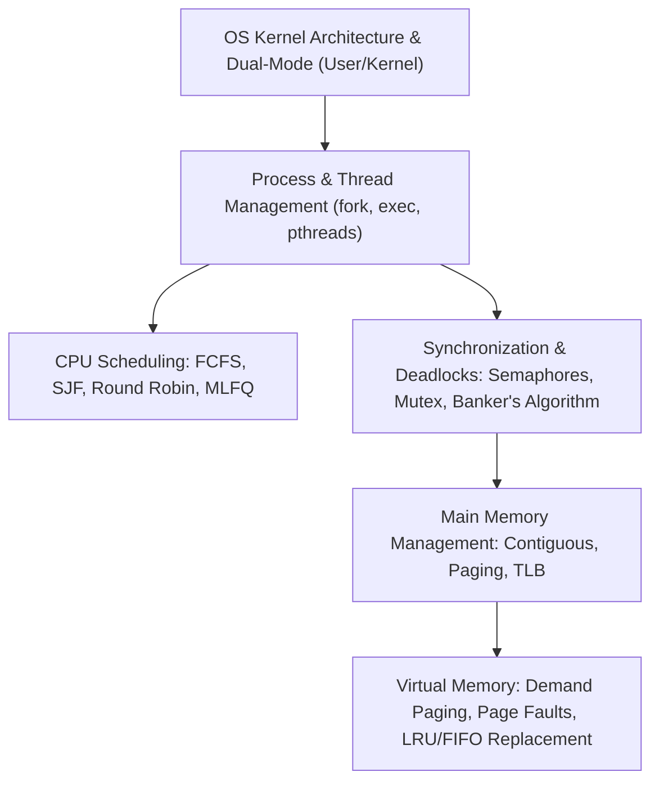
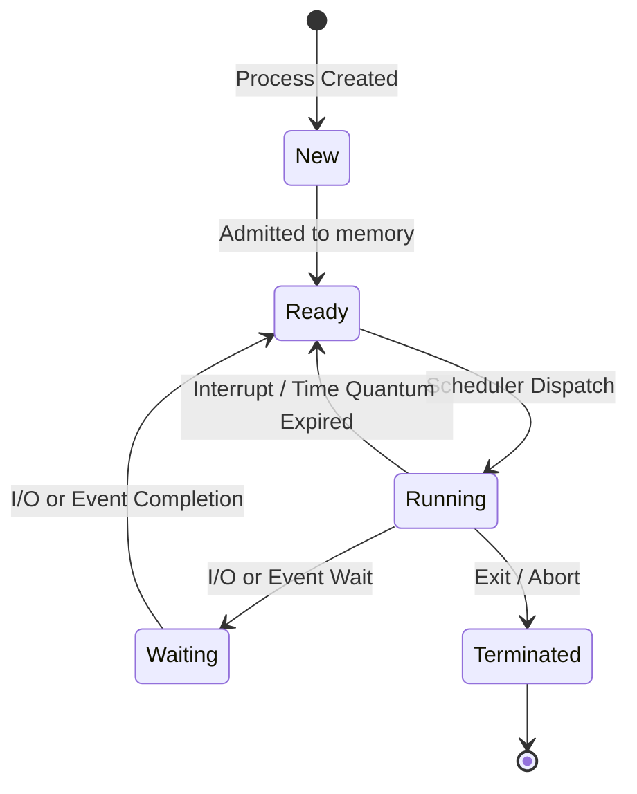

> [!info] Document Metadata
> - **Course:** `=this.course`
> - **Topic:** `=this.topic`
> - **Status:** `=this.status`

**Tags:** #[[Computer Science]] #[[CSOPESY]] #[[Operating Systems]] #[[Linux]] #[[Reviewer]] #[[Finals]]

---

# CSOPESY Comprehensive Finals Reviewer

## Overview

This reviewer consolidates Operating Systems Concepts and Architecture (CSOPESY). Core disciplines span OS structure (Dual-mode execution, User vs Kernel mode, system call interface), process management (Process Control Block - PCB, 5-state process lifecycle, process creation with `fork()` and `execvp()`, CPU scheduling: FCFS, SJF, Round Robin, Multilevel Feedback Queues), multithreading (POSIX pthreads, User vs Kernel threads), concurrency and process synchronization (Critical Section Problem, Peterson's algorithm, mutex locks, semaphores, classic synchronization problems: Producer-Consumer, Readers-Writers, Dining Philosophers), deadlock theory (Coffman conditions, Resource Allocation Graphs, Banker's Algorithm, deadlock detection and recovery), main memory management (contiguous allocation, internal vs external fragmentation, paging, multi-level page tables, TLB address translation), and virtual memory (demand paging, page faults, page replacement algorithms: FIFO, Optimal, LRU, Second-Chance, thrashing and working-set model).

---

## 1. Process 5-State Transition Lifecycle

---

## 2. Synchronization & Deadlock Matrix

### Coffman Conditions for Deadlock
All 4 conditions must hold simultaneously for a deadlock to exist:
1. **Mutual Exclusion**: At least one resource must be held in a non-shareable mode.
2. **Hold and Wait**: A process holds at least one resource and is waiting to acquire others held by competing processes.
3. **No Preemption**: Resources cannot be forcibly preempted; they must be voluntarily released by the holding process.
4. **Circular Wait**: A closed chain of processes $\{P_0, P_1, \dots, P_n\}$ exists where $P_0$ waits for $P_1$, and $P_n$ waits for $P_0$.

### Semaphore Primitives
- `wait(S)` / `sem_wait(&S)`: Decrements $S$. If $S < 0$, caller blocks on semaphore wait queue.
- `signal(S)` / `sem_post(&S)`: Increments $S$. If processes are blocked, unblocks one process to ready queue.

---

## 3. Virtual Memory & Page Replacement Algorithms

| Algorithm | Replacement Criteria | Vulnerability / Overhead | Hardware Requirements |
| :--- | :--- | :--- | :--- |
| **FIFO** | Replaces the oldest loaded page | **Bélády's Anomaly** (More frames can cause more page faults!) | Simple queue |
| **Optimal (OPT)** | Replaces page that will not be used for the longest future time | Theoretical benchmark only (Requires clairvoyance / future knowledge) | Impossible in general OS |
| **LRU** | Replaces page unreferenced for the longest past time | High hardware cost (Counters or stack per reference) | Timestamp registers / hardware stack |
| **Second Chance (Clock)** | Inspects circular buffer; checks Reference Bit ($0 \to$ replace, $1 \to 0$ and advance) | Approximates LRU with minimal $O(1)$ hardware overhead | 1 reference bit per PTE |

---

## 4. High-Yield Exam Checklist

- [ ] Does `fork()` create a duplicate child process with a separate copy of virtual address space? **YES** (Child returns 0, parent returns child PID).
- [ ] What is Bélády's Anomaly? The phenomenon where increasing the number of physical page frames results in an **increased** number of page faults under FIFO replacement.
- [ ] What is Thrashing? When a system spends more time servicing page faults and swapping pages than executing instructions (working set exceeds physical memory).
- [ ] Can a deadlock occur if any one of the 4 Coffman conditions is broken? **NO**, breaking any single condition prevents deadlock entirely.
- [ ] What happens on a Translation Lookaside Buffer (TLB) hit? Physical frame number is retrieved in $< 1$ ns, bypassing the multi-level page table memory walk.

---

## Multiple Choice Questions

1. What system call in POSIX Linux replaces the current process's memory, code, stack, and heap with a new executable program?
    - **A)** `fork()`
    - **B)** `execvp()`
    - **C)** `waitpid()`
    - **D)** `pthread_create()`

2. Which CPU scheduling algorithm provides the theoretical minimum average waiting time for a given set of stationary processes?
    - **A)** First-Come, First-Served (FCFS)
    - **B)** Round Robin (RR)
    - **C)** Shortest Job First (SJF / Shortest Remaining Time First)
    - **D)** Priority Scheduling with aging

3. Which page replacement algorithm can experience Bélády's Anomaly?
    - **A)** Least Recently Used (LRU)
    - **B)** Optimal (OPT)
    - **C)** First-In, First-Out (FIFO)
    - **D)** Least Frequently Used (LFU)

4. In the Banker's Algorithm for deadlock avoidance, a system state is considered "Safe" if:
    - **A)** No process is currently requesting any resource.
    - **B)** There exists at least one safe execution sequence of processes that allows all processes to finish without deadlocking.
    - **C)** All resource instances are currently free.
    - **D)** No process has been preempted.

5. In demand paging, what hardware mechanism allows the operating system to detect that a referenced page is not currently resident in physical RAM?
    - **A)** Dirty Bit
    - **B)** Valid / Invalid Bit in the Page Table Entry
    - **C)** Translation Lookaside Buffer (TLB) flush
    - **D)** Clock pointer bit

### Answer Key & Explanations

1. **B**. The `exec` family of system calls overlays the calling process image with a new executable binary without altering the PID. `fork()` clones the process.
2. **C**. SJF mathematically minimizes average waiting time by scheduling processes with the shortest burst lengths first.
3. **C**. FIFO can exhibit Bélády's anomaly because the oldest page in memory is replaced regardless of whether it is referenced frequently or recently. LRU and OPT are stack algorithms and are immune to Bélády's Anomaly.
4. **B**. A state is safe if the system can allocate resources to each process in some sequence up to its declared maximum need and still avoid deadlock.
5. **B**. When a virtual address is accessed whose PTE valid bit is set to $0$ (invalid), the MMU triggers a page fault hardware trap to the OS kernel.

## References & Navigation

- **Previous Topic:** [[CSARCH1]], [[CCPROG2]]
- **Next Topic:** None
- **Prerequisites:** [[Operating Systems]], Processes, Threads, CPU Scheduling, Semaphores, Paging
- **Cross-Curricular Connections:** [[LBYARCH]]
