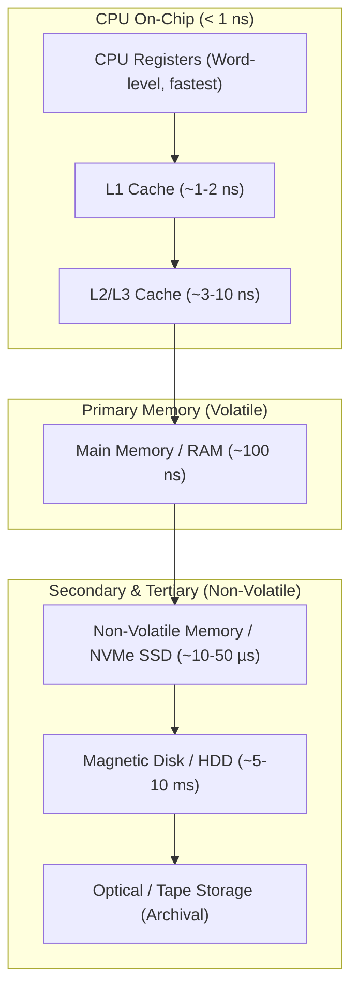
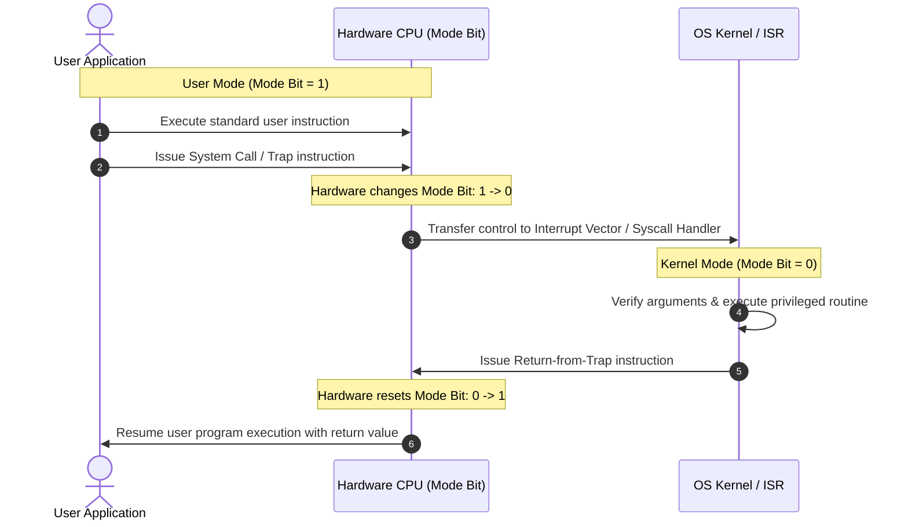

> [!info] Document Metadata
> - **Course:** `=this.course`
> - **Topic:** `=this.topic`
> - **Status:** `=this.status`

**Tags:** #[[Computer Science]] #[[CSOPESY]] #[[Operating Systems]] #[[01 - Introduction]]

---

# CSOPESY 01: Introduction to Operating Systems

## Overview
An **Operating System (OS)** is the fundamental software that manages computer hardware and provides a stable, consistent base for application programs. Its primary purpose is to provide a convenient and efficient environment for executing programs. 

Depending on the perspective, the role of an OS can be viewed in two ways:
1. **User View**: Focuses on ease of use and performance. For personal computers (PCs), the OS aims to maximize user productivity. For embedded systems (e.g., smart home devices, IoT), the OS is designed to run silently without human intervention.
2. **System View**: The OS acts as a **Resource Allocator** (managing the CPU, memory, and storage) and a **Control Program** (preventing errors, resolving conflicts, and preventing improper use of the computer).

At the heart of the OS is the **Kernel**—the core program that runs continuously in the background. Accompanying the kernel are **System Programs** (tools for managing the OS but not part of the kernel) and **Middleware** (frameworks providing additional services for application developers, such as databases and multimedia libraries).

---

## Key Concepts

### 1. Computer-System Organization and Hardware
Modern systems consist of one or more CPUs and multiple device controllers connected via a common bus. Each device controller oversees a specific type of hardware (e.g., disk drives, audio devices, displays). 
* **Device Drivers**: Software components that understand the specific device controller's intricacies. They provide the OS with a uniform interface, abstracting away the complex hardware details.

### 2. Interrupts and Hardware Signals
An **Interrupt** is the primary mechanism hardware uses to signal the CPU. When a device requires attention (e.g., a key is pressed, or a disk read completes), it triggers an interrupt.
* The CPU stops its current execution, saves its state (context), and transfers control to a dedicated **Interrupt Service Routine (ISR)**.
* **Interrupt Vector**: A memory table of function pointers mapping interrupt numbers to their respective ISRs.
* **Types of Interrupts**:
  * *Non-maskable*: Critical events that cannot be ignored (e.g., hardware failure, memory errors).
  * *Maskable*: Can be temporarily disabled by the CPU during critical operations.

### 3. Storage Hierarchy and Memory
Storage is organized hierarchically based on speed, size, cost, and volatility.
* **Registers & Cache**: Extremely fast, small, volatile, located within or near the CPU.
* **Main Memory (RAM/DRAM)**: Volatile storage. The only large storage directly accessible by the CPU.
* **Secondary Storage**: Non-volatile, cheaper, and larger capacity (e.g., Hard-Disk Drives (HDDs), Solid State Drives (SSDs), Nonvolatile Memory (NVM)).



### 4. Direct Memory Access (DMA)
For high-speed I/O devices, transferring data byte-by-byte via the CPU is highly inefficient. **DMA** solves this by allowing the device controller to transfer a block of data directly to or from main memory without CPU intervention. The CPU is only interrupted once per block, freeing it to do other work.

### 5. Dual-Mode Operation and Protection
To protect the system from malicious or buggy programs, hardware provides **Dual-Mode Operation**:
1. **User Mode**: Executing standard application code.
2. **Kernel Mode** (Supervisor mode): Executing OS code with full privileges.
A **mode bit** in the hardware tracks the current mode. **Privileged instructions** (like halting the CPU or modifying memory management registers) can only be executed in Kernel mode. When a user program needs OS services, it triggers a software interrupt (system call) which switches the CPU to Kernel mode.



### 6. Resource Management
* **Process Management**: The OS creates, schedules, and terminates processes. A process is a program in execution represented by a **Process Control Block (PCB)** containing its state, program counter, and CPU registers.
* **Memory Management**: The OS tracks which parts of memory are in use, allocates/deallocates space, and manages Virtual Memory—allowing programs larger than physical memory to execute.
* **Storage & File Management**: Provides a logical view of data via files and directories, mapping them onto physical secondary storage devices.

---

## Algorithms & Formulas

### Effective Memory Access Time (EAT)
When employing caching mechanisms (like TLBs or CPU caches), memory access time can be mathematically analyzed. Let $H$ be the hit ratio, $T_c$ be cache access time, and $T_m$ be main memory access time.
$$ EAT = H \times T_c + (1 - H) \times (T_c + T_m) $$
*Note: If the cache and memory are accessed simultaneously, the formula simplifies to $H \times T_c + (1 - H) \times T_m$.*

### Interrupt Overhead Calculation
If an interrupt occurs, the time lost is the overhead of context switching.
$$ \text{CPU Utilization} = 1 - \left( \frac{\text{Interrupt Frequency} \times \text{Context Switch Time}}{\text{Total Time}} \right) $$

---

## Code Examples

### Simulating an Interrupt Service Routine (ISR) in C
In a real OS, hardware interrupts are handled directly by assembly and kernel C code. Here is a high-level conceptual simulation of how an OS might index into an interrupt vector to handle a hardware signal.

```c
#include <stdio.h>

// Define function pointers for ISRs
typedef void (*ISR_Function)();

// Simulated ISRs
void handle_keyboard_interrupt() {
    printf("[Kernel] Keyboard interrupt processed. Keystroke saved.\n");
}

void handle_disk_interrupt() {
    printf("[Kernel] Disk I/O interrupt processed. Data ready.\n");
}

int main() {
    // 1. Initialize the Interrupt Vector Table (Array of function pointers)
    ISR_Function interrupt_vector[256];
    
    // Map specific interrupt numbers to their handlers
    interrupt_vector[33] = handle_keyboard_interrupt; // Keyboard typically IRQ1
    interrupt_vector[46] = handle_disk_interrupt;     // Disk typically IRQ14
    
    // 2. Simulate hardware triggering an interrupt
    int hardware_signal = 33; // User pressed a key
    
    printf("[CPU] Running user program...\n");
    printf("[CPU] Interrupt %d received! Saving state...\n", hardware_signal);
    
    // 3. Switch to Kernel Mode and execute the ISR
    interrupt_vector[hardware_signal](); // O(1) table lookup
    
    printf("[CPU] State restored. Resuming user program...\n");
    return 0;
}
```

---

## Multiple Choice Questions

1. Which of the following best describes the primary function of the Operating System's Kernel?
A) It is the firmware that initiates the boot process.
B) It is a framework that provides multimedia services for developers.
C) It is the core program that runs at all times, acting as the central controller and resource allocator.
D) It is an application program that manages user interfaces.

2. A device controller has finished transferring a block of data directly into main memory without utilizing the CPU. What mechanism has just been employed?
A) Direct Memory Access (DMA)
B) Interrupt-Driven I/O
C) Programmed Polling
D) Maskable Interruption

3. Which of the following hardware features is absolutely essential to prevent a malicious user program from executing privileged instructions (e.g., halting the processor)?
A) Caching
B) Direct Memory Access
C) Dual-Mode Operation (Mode Bit)
D) Non-volatile Memory

4. In a multitasking environment, how does the OS keep track of a suspended process's state (e.g., program counter, CPU registers) so it can be resumed later?
A) By storing it in the Interrupt Vector Table.
B) By using a Process Control Block (PCB).
C) By saving it to the bootstrap firmware.
D) By writing it sequentially to a character device.

5. A system has an L1 cache access time of 2ns and a main memory access time of 100ns. If the cache hit rate is 90% (and we assume sequential access on a miss), what is the Effective Access Time (EAT)?
A) 11.8 ns
B) 12.0 ns
C) 92.0 ns
D) 20.0 ns

### Answer Key & Explanations
1. **C**. The kernel is the foundational software running constantly, managing CPU, memory, and devices. (A) is the bootstrap program (BIOS/UEFI), and (B) describes middleware.
2. **A**. Direct Memory Access (DMA) allows the device controller to move data directly to/from memory, freeing the CPU from byte-by-byte transfer overhead.
3. **C**. Dual-Mode Operation distinguishes between User mode and Kernel mode, ensuring that unprivileged user programs cannot execute critical (privileged) machine instructions.
4. **B**. The PCB (Process Control Block) acts as the data structure repository for all information related to a specific process, enabling context switching.
5. **B**. Formula: $EAT = H(T_c) + (1-H)(T_c + T_m) = 0.90(2) + 0.10(2 + 100) = 1.8 + 10.2 = 12.0$ ns. (Note: Under parallel access, it would be $0.9(2) + 0.1(100) = 11.8$ ns, but standard conservative sequential models use 12.0 ns).

## References & Navigation

- **Previous Topic:** None
- **Next Topic:** [[CSOPESY 02 - Operating System Structure]]
- **Related Notes:** 
