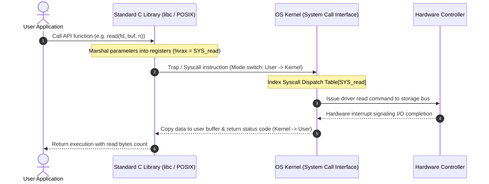
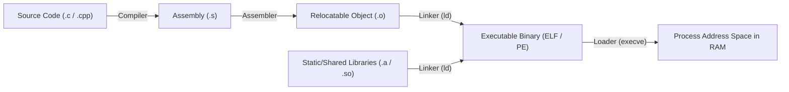
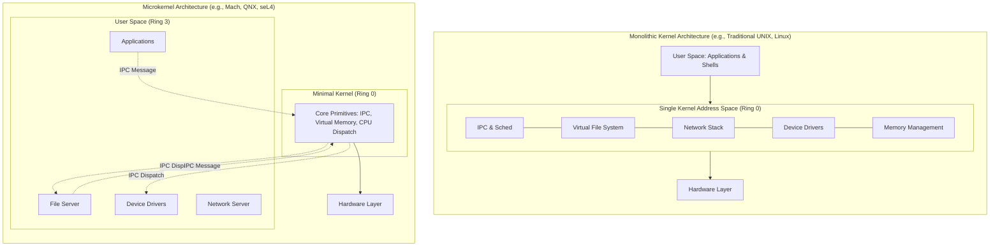

> [!info] Document Metadata
> - **Course:** `=this.course`
> - **Topic:** `=this.topic`
> - **Status:** `=this.status`

**Tags:** #[[Computer Science]] #[[CSOPESY]] #[[Operating Systems]] #[[02 - Operating System Structure]]

---

# CSOPESY 02: Operating System Structure

## Overview
An Operating System is fundamentally a massive piece of software composed of diverse structures, sub-systems, and interfaces. Understanding its structure involves analyzing the services it provides, how user applications interface with it, the compilation and linking lifecycle, and its architectural design patterns (like monolithic versus microkernel).

---

## Key Concepts

### 1. Operating System Services
OS services are divided into two main categories:
* **User Services**: Designed to make the system convenient to use.
  * *User Interface*: CLI (shells), GUI (desktop), Touch-screens.
  * *Program Execution*: Loading code into memory and running it.
  * *I/O Operations*: Safeguarding and handling physical hardware interactions.
  * *File-System Manipulation*: Managing directories, files, and ownership permissions.
  * *Communications*: Message passing and shared memory between processes.
  * *Error Detection*: Handling hardware faults (e.g., division by zero, corrupted memory).
* **System Efficiency Services**: Designed to keep the OS running optimally.
  * *Resource Allocation*: Distributing CPU cycles, RAM, and I/O devices.
  * *Accounting*: Tracking usage for quotas, billing, or profiling.
  * *Protection & Security*: Isolating processes and securing the system from malicious attacks.

### 2. System Calls & APIs
A **System Call** is a programmatic request made by a user-space application to the OS kernel to perform a privileged operation. 
* **API vs. System Call**: Programmers rarely invoke raw system calls. Instead, they use an **API** (Application Programming Interface, e.g., POSIX for Linux or Win32 for Windows). APIs are wrappers that are more portable and user-friendly. The system's **Run-Time Environment (RTE)** maps the API to the correct kernel system call.
* **Parameter Passing**: When invoking a system call, parameters must be passed to the kernel. Three methods exist:
  1. *Registers*: Fastest, but limited in capacity.
  2. *Block/Table in Memory*: Parameters are stored in an array, and the *address* of the array is passed via a single register. (Most common for large parameter sets).
  3. *Stack*: Parameters are pushed onto the process stack by the application and popped off by the OS kernel.



### 3. Linkers and Loaders
Code must be transformed from human-readable text into executable binary mapping to memory.
* **Compiler**: Turns source code into relocatable object files (`.o` or `.obj`).
* **Linker**: Combines these object files and required library files into a single binary executable (`.exe` or `.out`). It resolves cross-file references.
* **Loader**: Copies the executable from disk to main memory, setting up the process context to begin execution.
* **Dynamic Linking**: Instead of hard-wiring library code into the executable (static linking), the program loads a reference to a shared library (`.dll` or `.so`). This heavily reduces memory consumption since multiple programs can share one copy of the library in RAM.



### 4. OS Architectural Structures
* **Monolithic**: The entire kernel is one large static binary running in a single address space. It is incredibly fast (no overhead for inter-process communication within the OS) but fragile—one bug in a driver can crash the entire system (e.g., Classic Linux).
* **Layered**: The OS is broken into strict layers (Layer 0 is hardware, Layer N is UI). A layer can only use functions from lower layers. Great for debugging, but computationally inefficient due to heavy data traversal.
* **Microkernel**: Only absolute essentials (CPU scheduling, basic memory, IPC) stay in the kernel. Everything else (file systems, device drivers) runs in user space. Excellent security and stability, but heavy performance penalties due to constant message-passing context switches.
* **Modules (Loadable Kernel Modules)**: The core kernel is minimal, but it can dynamically load/unload specific services (modules) directly into the kernel address space at runtime. (Modern Linux, macOS).
* **Hybrid**: A combination of the above (e.g., macOS combining Mach microkernel with BSD monolithic components).



---

## Algorithms & Formulas

### Logical to Physical Address Relocation
During loading, a program compiled with logical addresses starting at `0x0000` must be relocated to a physical address (e.g., `0x4000`).
Let $B$ be the base physical address register assigned by the OS.
$$ \text{Physical Address} = \text{Logical Address} + B $$
*Validation Check*: If Logical Address $\ge$ Limit Register, a segmentation fault is thrown.

---

## Code Examples

### The Path from API to System Call
When you write `printf()` in C, you are not writing a system call. You are calling a standard C Library (libc) API.

```c
#include <stdio.h>
#include <unistd.h>

int main() {
    // High-Level API Call
    // Portable across any OS that supports standard C.
    // Behind the scenes, the C Standard Library buffers the text and formats it.
    printf("Hello via API!\n");

    // Low-Level System Call Wrapper (POSIX)
    // Specific to Unix-like operating systems.
    // The arguments are: file descriptor (1 = stdout), buffer string, length.
    // This immediately triggers an interrupt to trap into Kernel mode.
    write(1, "Hello via System Call!\n", 23);

    return 0;
}
```

### Parameter Passing via Block (Pseudo-assembly)
```asm
; Application wants to read a file. It creates a parameter block in memory.
; Block contents at memory address 0x8A00:
; [File Descriptor: 3] [Buffer Address: 0x9000] [Read Length: 512]

MOV EBX, 0x8A00    ; Store the ADDRESS of the parameter table in EBX
MOV EAX, 3         ; Store the System Call Number for 'read' in EAX
INT 0x80           ; Trigger Software Interrupt (Trap to Kernel Mode)
; Kernel reads EAX, sees it's a 'read'. 
; Kernel reads EBX, goes to 0x8A00, and fetches the 3 arguments safely.
```

---

## Multiple Choice Questions

1. Which of the following is an example of an Operating System service geared towards **system efficiency** rather than user convenience?
    - **A)** File-System Manipulation
    - **B)** Error Detection
    - **C)** Accounting and Resource Allocation
    - **D)** Command-Line Interface execution

2. When invoking a system call that requires 15 separate parameters, which parameter passing technique is the OS most likely to utilize?
    - **A)** Passing all parameters directly in CPU registers.
    - **B)** Storing the parameters in a block in main memory and passing the block's address in a register.
    - **C)** Hardcoding the parameters directly into the device driver.
    - **D)** Using Dynamic Linking to map the parameters.

3. The primary advantage of a Microkernel architecture over a Monolithic architecture is:
    - **A)** Faster execution of system calls due to reduced context switching.
    - **B)** Smaller overall memory footprint requiring no virtual memory mapping.
    - **C)** Improved system reliability and security by moving non-essential components to user space.
    - **D)** The ability to dynamically link executable files at runtime.

4. A developer compiles a program on a Linux machine using x86 architecture. Which of the following explains why this exact compiled binary cannot natively run on a Windows machine with the same x86 architecture?
    - **A)** The CPUs have different instruction sets.
    - **B)** The Operating Systems use different binary formats (e.g., ELF vs. PE) and have entirely different sets of underlying system calls.
    - **C)** The hardware bus structures are configured differently.
    - **D)** Windows does not support Graphical User Interfaces (GUI).

5. What is the specific role of the **Linker** in the program compilation and execution pipeline?
    - **A)** To translate source code instructions into assembly language.
    - **B)** To load the program into physical RAM and allocate a Process Control Block.
    - **C)** To resolve cross-file references and combine multiple relocatable object files and libraries into a single binary executable.
    - **D)** To dynamically change the physical addresses of running code.

### Answer Key & Explanations

1. **C**. Resource allocation and accounting ensure the hardware is utilized properly and fairly among users, maximizing system efficiency. The others directly aid the user in executing tasks.
2. **B**. Registers are extremely limited in number (typically 4 to 8 general-purpose). For large parameter sets, placing them in a memory block/table or pushing them onto the stack is required.
3. **C**. Microkernels move device drivers, file systems, etc., into user space. If a user-space driver crashes, it doesn't crash the entire kernel, resulting in high reliability and security (at the cost of performance).
4. **B**. Even on identical hardware architecture (x86), different OSes define unique Application Binary Interfaces (ABIs), unique system call numbers, and unique binary file formats.
5. **C**. The linker stitches together `.o` files and libraries, replacing unresolved symbol references with actual relative memory offsets to generate the final executable file.

## References & Navigation

- **Previous Topic:** [[CSOPESY 01 - Introduction]]
- **Next Topic:** [[CSOPESY 03 - IO and Display]]
- **Related Notes:** 
