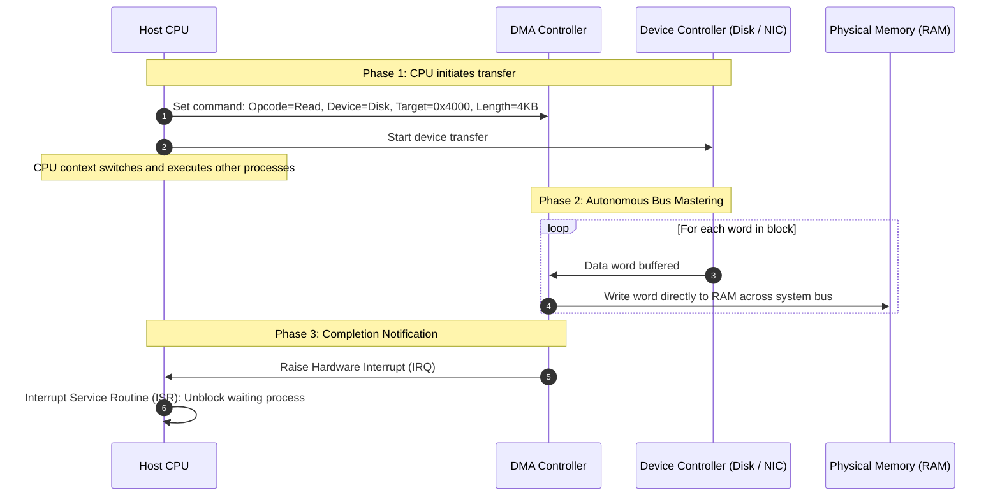

> [!info] Document Metadata
> - **Course:** `=this.course`
> - **Topic:** `=this.topic`
> - **Status:** `=this.status`

**Tags:** #[[Computer Science]] #[[CSOPESY]] #[[Operating Systems]] #[[03 - IO and Display]]

---

# CSOPESY 03: I/O and Display Interfaces

## Overview
Input/Output (I/O) is one of the most complex areas of OS design. An Operating System acts as the critical intermediary between software applications and physical hardware devices (like disks, keyboards, network cards, and displays). 

The guiding principle of the I/O Subsystem is **Abstraction and Encapsulation**. The OS hides the extreme variations in hardware by providing a standardized, unified software interface. **Device Drivers**—specialized kernel modules written specifically for a hardware component—serve as the translation layer between the generic kernel I/O subsystem and the specific device controller hardware.

---

## Key Concepts

### 1. I/O Hardware Integration
Hardware communicates with the system via ports or buses (like PCIe).
* **Device Controller**: The electronic circuitry embedded within the hardware device itself that understands physical signals.
* **Memory-Mapped I/O**: Instead of using special CPU instructions to talk to devices, the device controller's command and data registers are mapped directly to standard physical memory addresses. The CPU controls the device simply by writing to and reading from those specific memory addresses.

### 2. Device Interaction Mechanisms (CPU to Controller)
* **Polling (Programmed I/O)**: The CPU runs an infinite `while` loop (a "busy-wait"), constantly checking a device's status register to see if it's ready. 
  * *Pros*: Zero setup overhead; very fast for immediate devices.
  * *Cons*: Wastes vast amounts of CPU cycles if the device takes a long time.
* **Interrupt-Driven I/O**: The CPU issues a command to the device and goes to sleep or works on another process. When the device finishes, it sends an electrical signal (interrupt) to the CPU.
  * *Pros*: High CPU efficiency; CPU can multitask.
  * *Cons*: The context switch overhead makes it inefficient for massive data streams.
* **Direct Memory Access (DMA)**: A specialized microcontroller (the DMA Controller) is programmed by the CPU to transfer large chunks of data (e.g., entire disk blocks) directly to/from memory. The DMA controller only interrupts the CPU once the *entire block* is transferred.



### 3. Application I/O Interfaces
To manage the chaotic hardware landscape, the OS abstracts devices into a few logical categories:
* **Block Devices**: Read/written in fixed-size blocks randomly (e.g., HDDs, SSDs).
* **Character Devices**: Read/written sequentially as a stream of bytes (e.g., keyboards, mice, serial ports).
* **Network Devices**: Accessed via network sockets (e.g., Ethernet adapters).

### 4. I/O Execution Models
When an application requests I/O, the operation can be categorized by how it affects the application's thread of execution:
* **Blocking I/O**: The application issues a `read()` and is put to sleep (moved to a Wait Queue). It absolutely cannot execute the next line of code until the data is fully loaded. (Simple, but limits concurrency).
* **Non-blocking I/O**: The system call returns *immediately*. If data is ready, it returns the data. If not, it returns an error code (like `EAGAIN` or `EWOULDBLOCK`). The application is responsible for polling the OS repeatedly to check if data has arrived.
* **Asynchronous I/O**: The application issues an I/O request and continues executing its code. The kernel handles the I/O in the background. Once the hardware finishes, the OS notifies the application via a signal, event, or callback function. No application polling is required.

```mermaid
flowchart TD
    subgraph Blocking["Blocking I/O (Synchronous)"]
        B1["Application invokes read()"] --> B2["Kernel suspends process (Wait Queue)"]
        B2 --> B3["Device transfers data to kernel buffer"]
        B3 --> B4["Kernel copies data to user buffer"]
        B4 --> B5["Process moved to Ready Queue -> Resumes"]
    end

    subgraph NonBlocking["Non-Blocking I/O (Synchronous Polling)"]
        NB1["Application invokes read(O_NONBLOCK)"] --> NB2{"Is data ready in buffer?"}
        NB2 -- No --> NB3["Return immediately: -1 (EWOULDBLOCK)"]
        NB3 --> NB4["Process does compute / Polls again"]
        NB2 -- Yes --> NB5["Copy data to user buffer -> Return bytes"]
    end

    subgraph Async["Asynchronous I/O (AIO)"]
        A1["Application invokes aio_read()"] --> A2["Kernel registers request & returns immediately"]
        A2 --> A3["Process executes unrelated computations"]
        A3 -.->|"Signal / Event Completion"| A4["Kernel invokes user callback handler"]
    end
```



### 5. Kernel I/O Subsystem Services
* **Scheduling**: Reordering I/O requests (like disk arm movements) to reduce hardware mechanical delays.
* **Buffering**: Storing data temporarily in memory while it is being transferred, smoothing out speed mismatches between fast networks and slow disks.
* **Caching**: Keeping copies of frequently accessed disk blocks in fast RAM.
* **Spooling**: Managing exclusive devices (like a printer). Multiple applications can print at once; the OS intercepts the print jobs, buffers them to disk, and sends them to the printer sequentially.

---

## Algorithms & Formulas

### DMA Transfer CPU Cycle Savings
Suppose a disk transfers a 4KB block of data (4096 bytes). 
If the system uses Interrupt-Driven I/O (1 byte per interrupt) and context switching takes 50 cycles:
$$ \text{Cycles Wasted} = 4096 \text{ bytes} \times 50 \text{ cycles/interrupt} = 204,800 \text{ cycles} $$
If the system uses DMA, it generates exactly *one* interrupt for the entire 4KB block.
$$ \text{Cycles Wasted} = 1 \text{ block} \times 50 \text{ cycles/interrupt} = 50 \text{ cycles} $$
*Conclusion*: DMA drastically reduces CPU overhead for bulk transfers.

---

## Code Examples

### Blocking vs Non-Blocking vs Asynchronous File Reading in C

```c
#include <unistd.h>
#include <fcntl.h>
#include <stdio.h>
#include <errno.h>

void read_examples() {
    char buffer[1024];

    // 1. BLOCKING I/O (Default)
    int fd1 = open("/path/to/slow/device", O_RDONLY);
    // Program completely halts here until device delivers data
    ssize_t bytes1 = read(fd1, buffer, sizeof(buffer)); 
    printf("Read %zd bytes blocking.\n", bytes1);

    // 2. NON-BLOCKING I/O
    // The O_NONBLOCK flag forces the kernel to return immediately
    int fd2 = open("/path/to/slow/device", O_RDONLY | O_NONBLOCK);
    ssize_t bytes2 = read(fd2, buffer, sizeof(buffer));
    
    if (bytes2 == -1 && (errno == EAGAIN || errno == EWOULDBLOCK)) {
        printf("No data ready right now! I will do other work and check later.\n");
    }

    // 3. ASYNCHRONOUS I/O (Conceptual POSIX AIO)
    // struct aiocb cb;
    // ... setup control block with buffer and file descriptor ...
    // aio_read(&cb); 
    // printf("Request submitted. I am doing other math now!");
    // Kernel will send a signal (e.g., SIGIO) when 'cb' is populated.
}
```

---

## Multiple Choice Questions

1. Which data transfer technique is specifically designed to alleviate the CPU from the burden of copying large blocks of data byte-by-byte from a device controller to main memory?
    - **A)** Memory-Mapped I/O
    - **B)** Polling
    - **C)** Direct Memory Access (DMA)
    - **D)** Interrupt-Driven character streaming

2. An application issues a system call to read data from a network socket. The system call returns immediately with an error code `EWOULDBLOCK` because the packet hasn't arrived over the wire yet. The application proceeds to execute a UI update and checks the socket again later. What type of I/O model is this?
    - **A)** Synchronous Blocking I/O
    - **B)** Synchronous Non-blocking I/O
    - **C)** Asynchronous Event-driven I/O
    - **D)** Direct Memory Access I/O

3. Why is polling (busy-waiting) sometimes preferred over interrupt-driven I/O in extremely specific, high-performance scenarios?
    - **A)** Polling completely eliminates the context switch overhead required by interrupts.
    - **B)** Polling consumes less overall electrical power than interrupts.
    - **C)** Polling allows multiple devices to share the exact same physical wire.
    - **D)** Polling forces the CPU into sleep mode, preserving CPU cycles.

4. A printer can only process one document at a time. If three users try to print simultaneously, the OS intercepts the data streams, saves them to a temporary disk directory, and feeds them to the printer one by one. Which Kernel I/O subsystem service is being utilized?
    - **A)** Caching
    - **B)** Buffering
    - **C)** Spooling
    - **D)** Scheduling

5. The OS categorizes a standard keyboard as which type of device?
    - **A)** Block Device, because keys are sent in 4KB chunks.
    - **B)** Character Device, because keystrokes are processed as a sequential stream of bytes.
    - **C)** Network Device, because it utilizes packet switching.
    - **D)** Memory-Mapped File, because keystrokes alter RAM directly.

### Answer Key & Explanations

1. **C**. Direct Memory Access (DMA) offloads bulk memory transfers to a specialized controller, requiring only one CPU interrupt per block rather than one per byte.
2. **B**. This is Non-blocking I/O. The call returned immediately without sleeping the process, but the application still has to actively poll/check for completion (unlike Asynchronous I/O which uses callbacks).
3. **A**. If a device is incredibly fast (e.g., ready in 2 microseconds), the time taken to save CPU state and jump to an interrupt handler (e.g., 5 microseconds) is slower than just letting the CPU spin in a fast `while` loop for 2 microseconds.
4. **C**. Spooling (Simultaneous Peripheral Operations On-Line) is specifically used for devices that cannot handle interleaved data streams, like printers. Data is queued on disk and handled sequentially.
5. **B**. Keyboards and mice stream individual characters/bytes sequentially and cannot be randomly accessed (you can't ask a keyboard for the 5th byte it typed 10 minutes ago). They are Character Devices.

## References & Navigation

- **Previous Topic:** [[CSOPESY 02 - Operating System Structure]]
- **Next Topic:** [[CSOPESY 04 - Processes]]
- **Related Notes:** 
