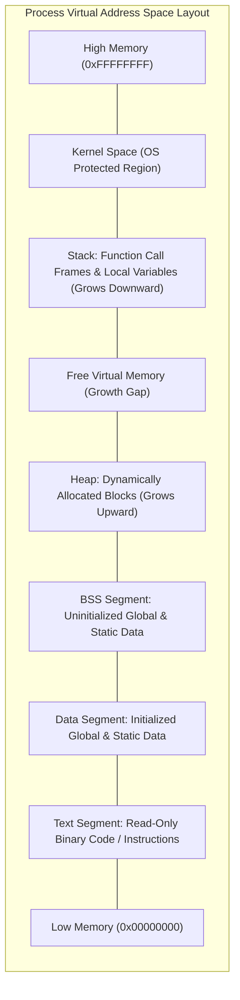
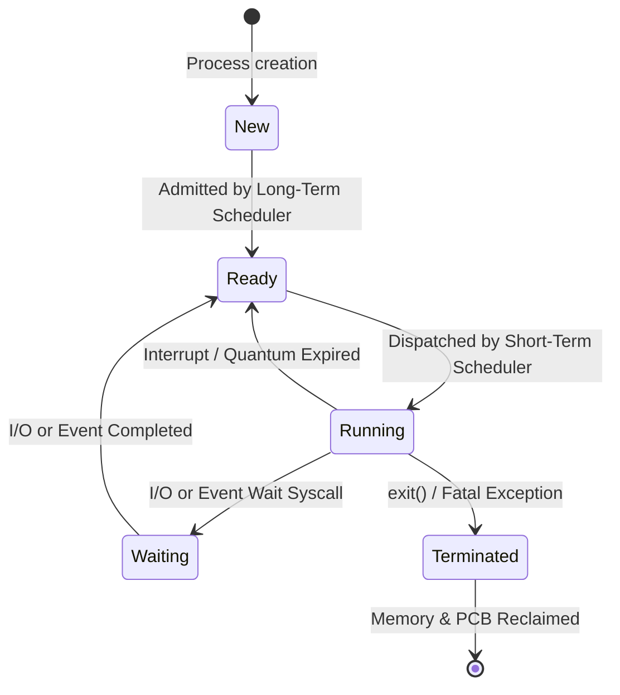
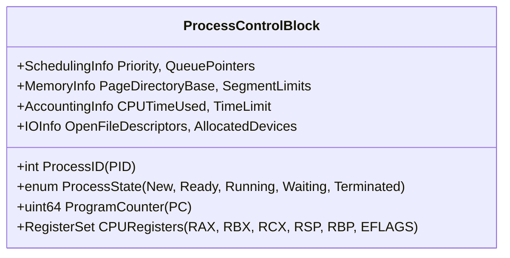
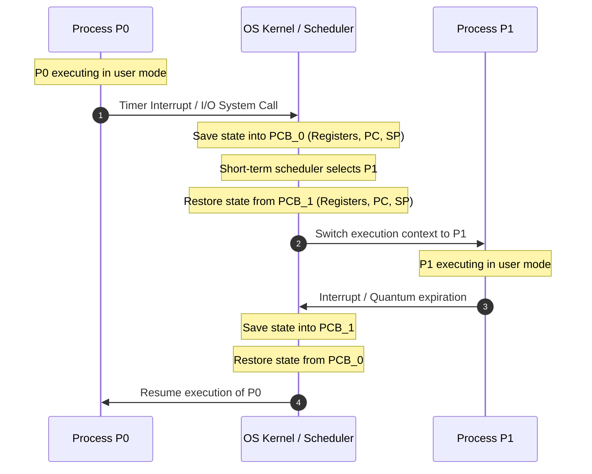

> [!info] Document Metadata
> - **Course:** `=this.course`
> - **Topic:** `=this.topic`
> - **Status:** `=this.status`

**Tags:** #[[Computer Science]] #[[CSOPESY]] #[[Operating Systems]] #[[04 - Processes]]

---

## Overview
A **Process** is more than just a piece of code; it is a program in execution. While a program is a passive entity (such as an executable file residing on a disk), a process is an active, dynamic entity with a state, a program counter, and various resources assigned to it. Modern operating systems rely on processes to manage concurrent execution and isolate tasks. For instance, launching a web browser executes the browser program, but opening multiple tabs may spawn individual processes to manage each tab, guaranteeing that if one tab crashes, the others survive.

## Key Concepts

### Process Components & Memory Layout
A process in memory is structured into several distinct segments to isolate different types of data:
- **Text Section:** Contains the compiled program code (machine instructions). It is generally read-only to prevent accidental modification.
- **Data Section:** Stores global and static variables initialized by the programmer. 
- **Heap:** Used for memory allocated dynamically during run-time (e.g., via `malloc()` in C or `new` in C++). The heap grows upwards in memory address space.
- **Stack:** A temporary data storage area utilized for function calls. It contains local variables, function parameters, and return addresses. The stack grows downwards. 

*Memory layout constraint:* The OS ensures the Stack and Heap do not overlap, leaving a gap between them for dynamic growth. If they collide, a stack overflow or out-of-memory error occurs.



### Process States & Transitions
As a process executes, its state shifts dynamically:
1. **New:** The process is currently being created by the OS.
2. **Ready:** The process is fully loaded in memory and waiting to be assigned to a CPU core.
3. **Running:** Instructions are actively being executed by the CPU.
4. **Waiting (Blocked):** The process cannot continue executing until a specific event occurs (e.g., waiting for user input, disk I/O completion, or a network response).
5. **Terminated:** Execution has concluded, and the OS is reclaiming its resources.



### Process Control Block (PCB)
The **Process Control Block (PCB)** or Task Control Block is a kernel data structure representing the "identity card" of a process. It contains:
- **Process State:** Current state (Ready, Running, etc.).
- **Program Counter (PC):** The memory address of the next instruction to execute.
- **CPU Registers:** Saved registers to restore execution seamlessly after a pause.
- **Scheduling Information:** Priority levels and queue pointers.
- **Memory Management Information:** Page tables or segment limits defining the process's address space.
- **Accounting & I/O Status:** CPU time consumed, allocated I/O devices, and open file descriptors.



### Schedulers and Context Switching
Operating systems use schedulers to manage process queues (Job Queue, Ready Queue, Device Queues):
- **Long-Term Scheduler (Job Scheduler):** Controls the degree of multiprogramming by deciding which processes move from disk into memory. It aims for a balanced mix of I/O-bound and CPU-bound jobs.
- **Short-Term Scheduler (CPU Scheduler):** Highly active; selects processes from the Ready Queue to execute on the CPU.
- **Medium-Term Scheduler:** Swaps processes in and out of memory to disk to manage memory load.

**Context Switching** is the mechanism of saving the state of the current running process (into its PCB) and loading the state of the next process. This is pure overhead—the CPU does no productive application work during a context switch.



### Process Creation and Termination
Processes create other processes (e.g., via `fork()` in UNIX). The creator is the **parent**, and the created is the **child**.
- **Execution Models:** The parent can execute concurrently with the child, or wait (`wait()`) for the child to terminate.
- **Termination:** 
  - **Normal:** Process finishes and calls `exit()`.
  - **Zombie:** A terminated child process whose parent hasn't yet invoked `wait()` to collect its exit status. It occupies an entry in the process table.
  - **Orphan:** A child process whose parent terminated unexpectedly. Typically, the root `init` or `systemd` process adopts orphans to harvest their exit statuses.

### Interprocess Communication (IPC)
Cooperating processes need IPC to share data and synchronize actions:
- **Shared Memory:** A region of memory accessible by multiple processes. Extremely fast, but requires explicit synchronization (like mutexes) to avoid race conditions.
- **Message Passing:** Processes exchange messages via OS-provided systems (e.g., `send()` and `receive()`). Ideal for distributed systems or smaller data transfers.
- **Sockets & RPC:** Used heavily in client-server networks. Sockets bind IP and ports, whereas Remote Procedure Calls (RPC) allow invoking functions on remote machines transparently.

## Code Examples

## Code Examples

### 1. Robust Process Spawning with `fork()`, `execvp()`, and `waitpid()`

```c
#include <stdio.h>
#include <stdlib.h>
#include <unistd.h>
#include <sys/types.h>
#include <sys/wait.h>

int main(void) {
    printf("[Parent PID: %d] Spawning child process...\n", getpid());
    pid_t pid = fork();

    if (pid < 0) {
        // Fork failure (e.g., system process table full)
        perror("fork() failed");
        return EXIT_FAILURE;
    } 
    else if (pid == 0) {
        // --- CHILD PROCESS EXECUTION CONTEXT ---
        printf("  [Child PID: %d, Parent PPID: %d] Executing new binary via execvp...\n", 
               getpid(), getppid());

        // Prepare argument vector (null-terminated array of strings)
        char *args[] = {"ls", "-l", "--color=auto", NULL};

        // execvp replaces the current process address space with the new binary
        if (execvp(args[0], args) == -1) {
            perror("execvp() execution failed");
            exit(EXIT_FAILURE); // Terminate child immediately if exec fails
        }
    } 
    else {
        // --- PARENT PROCESS EXECUTION CONTEXT ---
        printf("[Parent PID: %d] Waiting for Child PID %d to terminate...\n", getpid(), pid);

        int status;
        // waitpid reaps child resources and extracts exit status (prevents zombie state)
        pid_t terminated_pid = waitpid(pid, &status, 0);

        if (terminated_pid == -1) {
            perror("waitpid() error");
            return EXIT_FAILURE;
        }

        // Decode exit status using standard POSIX macros
        if (WIFEXITED(status)) {
            printf("[Parent] Child %d terminated normally with exit code: %d\n", 
                   terminated_pid, WEXITSTATUS(status));
        } else if (WIFSIGNALED(status)) {
            printf("[Parent] Child %d was killed by signal: %d\n", 
                   terminated_pid, WTERMSIG(status));
        }
    }

    return EXIT_SUCCESS;
}
```

### 2. Multi-Process Fan-Out (Forking Multiple Concurrent Workers)

```c
#include <stdio.h>
#include <stdlib.h>
#include <unistd.h>
#include <sys/wait.h>

#define NUM_WORKERS 4

int main(void) {
    printf("[Master PID: %d] Spawning %d parallel workers...\n", getpid(), NUM_WORKERS);

    for (int i = 0; i < NUM_WORKERS; i++) {
        pid_t pid = fork();
        if (pid == 0) {
            // Child Worker Task
            printf("  [Worker %d, PID: %d] Performing computation...\n", i + 1, getpid());
            usleep(100000 * (i + 1)); // Staggered work simulation
            exit(i + 10); // Return unique exit code
        }
    }

    // Master Process Reaps All Children
    int status;
    pid_t wpid;
    while ((wpid = waitpid(-1, &status, 0)) > 0) {
        if (WIFEXITED(status)) {
            printf("[Master] Reaped Child PID %d (Exit Status: %d)\n", wpid, WEXITSTATUS(status));
        }
    }
    printf("[Master] All worker processes successfully reaped. No zombies created.\n");
    return EXIT_SUCCESS;
}
```

## Multiple Choice Questions

1. Which memory segment dynamically grows upwards and is used for manually allocated memory like `malloc()`?
    - **A)** Text Section
    - **B)** Stack
    - **C)** Heap
    - **D)** Data Section

2. A process has completed execution but its parent has not yet invoked `wait()` to read its exit status. What is this process called?
    - **A)** Orphan process
    - **B)** Zombie process
    - **C)** Daemon process
    - **D)** Terminated process

3. In an operating system, the Long-Term Scheduler is primarily responsible for:
    - **A)** Allocating the CPU to a ready process.
    - **B)** Swapping a blocked process out to disk.
    - **C)** Controlling the degree of multiprogramming.
    - **D)** Performing context switches.

4. Which of the following is true regarding a Context Switch?
    - **A)** It executes the next instruction in the application code.
    - **B)** It has zero overhead on modern processors.
    - **C)** It involves saving the old process's PCB and loading the new process's PCB.
    - **D)** It requires user intervention to occur.

5. In UNIX-like systems, what is the standard method for a process to replace its memory space with a completely new program?
    - **A)** `fork()`
    - **B)** `wait()`
    - **C)** `exit()`
    - **D)** `exec()`

6. What is a key advantage of the Message Passing model for IPC over the Shared Memory model?
    - **A)** It requires less OS intervention during communication.
    - **B)** It is significantly faster for transferring large gigabytes of data.
    - **C)** It is better suited for distributed systems across different computers.
    - **D)** It avoids the need for system calls like `send()` and `receive()`.

7. Which of the following components is NOT typically stored in the Process Control Block (PCB)?
    - **A)** Program Counter
    - **B)** CPU Registers
    - **C)** Source code of the program
    - **D)** Process State

8. What happens during cascading termination?
    - **A)** A parent process terminates, and the OS terminates all of its child processes.
    - **B)** A process triggers a segmentation fault, terminating itself.
    - **C)** An orphan process is reassigned to the `init` process.
    - **D)** A process spawns an infinite loop of threads.

### Answer Key & Explanations

1. **C**. The heap is used for dynamic memory allocation and grows upwards, whereas the stack is used for local variables/functions and grows downwards.
2. **B**. A zombie is a terminated process that still retains an entry in the process table because the parent hasn't collected its exit status. Orphans lack a parent completely.
3. **C**. The long-term scheduler dictates how many processes are placed into memory, while the short-term scheduler decides which in-memory process gets the CPU.
4. **C**. Context switching is pure overhead and entirely handled by the kernel using the PCBs.
5. **D**. While `fork()` duplicates a process, `exec()` overwrites the current process's address space with a new executable program.
6. **C**. Message passing handles synchronization intrinsically and can route messages over networks seamlessly, unlike local shared memory.
7. **C**. The PCB holds metadata and state for execution (like the PC and registers), but the raw source code is not needed; the compiled binary is in the Text segment.
8. **A**. Some systems don't allow children to outlive their parents and forcibly shut them down in a cascading manner.

## References & Navigation

- **Previous Topic:** [[CSOPESY 03 - IO and Display]]
- **Next Topic:** [[CSOPESY 05 - Threads]]
- **Related Notes:** 
