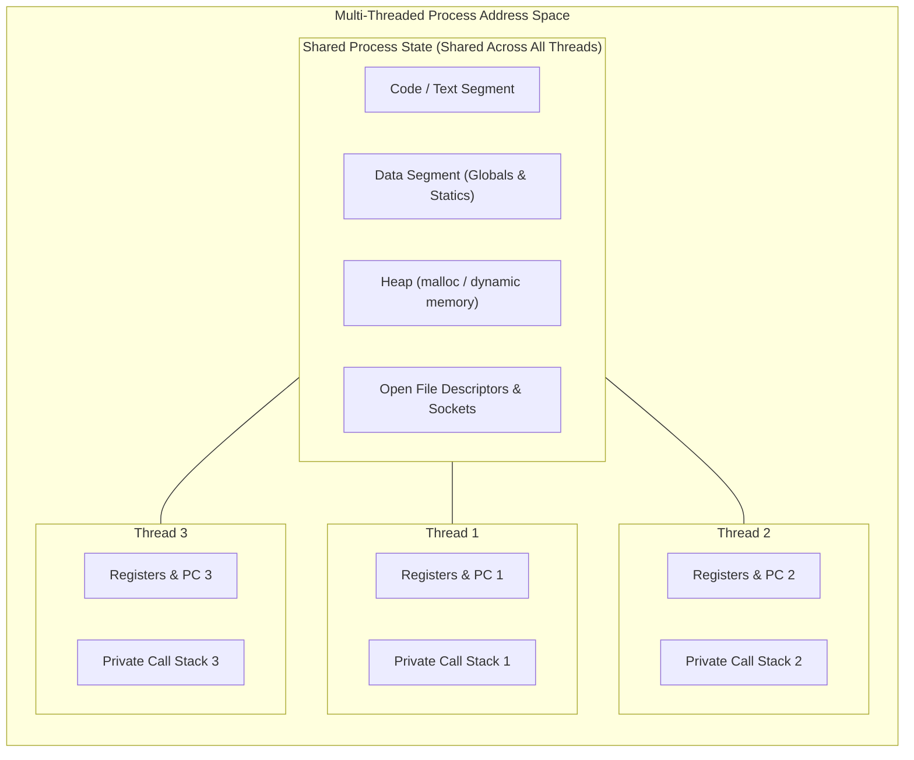
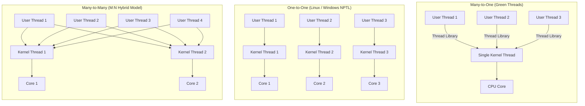

> [!info] Document Metadata
> - **Course:** `=this.course`
> - **Topic:** `=this.topic`
> - **Status:** `=this.status`

**Tags:** #[[Computer Science]] #[[CSOPESY]] #[[Operating Systems]] #[[05 - Threads]]

---

## Overview
While a process is traditionally a heavyweight entity with its own memory space and resources, a **Thread** (or lightweight process) is a fundamental unit of CPU utilization within that process. A thread possesses its own thread ID, program counter, register set, and stack. However, it *shares* its code section (text), data section, and operating system resources (like open files and signals) with other threads belonging to the same parent process. 

Multithreading is ubiquitous in modern software. A web browser, for example, may use one thread to render the UI, another to handle networking, and a third to parse HTML, all within the same browser process.



## Key Concepts

### Benefits of Multithreading
- **Responsiveness:** If one thread is blocked (e.g., waiting for network I/O), other threads can continue executing, keeping the application responsive to the user.
- **Resource Sharing:** Threads share memory naturally without the complex setup of IPC (Interprocess Communication) required for separate processes.
- **Economy:** Allocating memory and resources for process creation is costly. Context switching between threads is significantly faster and less resource-intensive than context switching between separate processes.
- **Scalability:** Multithreading allows processes to run in parallel on multicore architectures, leveraging modern hardware.

### Multicore Programming Challenges
With multicore architectures, software must explicitly manage parallelism to gain performance:
- **Data Parallelism:** Distributing portions of the same data set across multiple cores to perform identical operations (e.g., summing up elements of a massive array).
- **Task Parallelism:** Distributing unique tasks (threads) across multiple cores, where each task performs a distinct operation (e.g., one core handles networking, another handles database queries).
- **Challenges:** Programmers must carefully divide activities, ensure balanced workloads, manage data splitting, and use synchronization (mutexes, semaphores) to prevent race conditions.

### Threading Models
User threads are mapped to kernel threads by the OS in different ways:
- **Many-to-One Model:** Many user-level threads map to a single kernel thread. *Flaw:* If one user thread blocks (e.g., I/O call), the entire process blocks because the kernel thread is tied up. True parallelism is impossible on multi-cores.
- **One-to-One Model:** Each user thread maps directly to a kernel thread (used by Windows, Linux). Allows true parallelism. *Flaw:* Creating too many threads can overload the kernel.
- **Many-to-Many Model:** Many user threads map to a smaller or equal number of kernel threads, offering a balanced approach without kernel bloat.



### Implicit Threading
To shift the burden of thread creation away from developers, modern systems use **Implicit Threading**:
- **Thread Pools:** Pre-creating a pool of threads at startup. When a task arrives, an idle thread takes it. This eliminates thread creation/destruction overhead during runtime.
- **OpenMP:** Compiler directives that automatically parallelize loops in C/C++.
- **Grand Central Dispatch (GCD) & Intel TBB:** Advanced libraries that manage task dispatching natively.

### Thread Issues
- **`fork()` and `exec()`:** If a thread calls `fork()`, does it copy just the calling thread or all threads? POSIX provides different versions for both cases.
- **Thread Cancellation:** 
  - *Asynchronous:* Terminates a thread instantly (dangerous if it's updating shared data).
  - *Deferred:* The thread periodically checks a flag to see if it should safely terminate itself.
- **Thread-Local Storage (TLS):** Variables that are unique to each thread, rather than shared across the process.

## Algorithms & Formulas

### Amdahl's Law
Amdahl's law provides a formula to find the theoretical maximum speedup of a system when using multiple processors. It illustrates that performance gains are strictly limited by the sequential (non-parallelizable) portion of the application.

$$ Speedup \le \frac{1}{S + \frac{1-S}{N}} $$
Where:
- $S$: The proportion of the execution time that must be executed sequentially ($0 \le S \le 1$).
- $N$: The number of processing cores.

*Intuition:* If an application is 25% sequential ($S = 0.25$), no matter how many cores you add ($N \to \infty$), the maximum theoretical speedup is $\frac{1}{0.25} = 4x$.

## Code Examples

### POSIX Pthreads in C
```c
#include <pthread.h>
#include <stdio.h>
#include <stdlib.h>

// The thread runner function
void *print_message(void *msg) {
    char *message = (char *)msg;
    printf("Thread Output: %s\n", message);
    pthread_exit(0);
}

int main() {
    pthread_t thread_id;
    char *message = "Hello from the multithreaded world!";

    // Create a new thread
    if (pthread_create(&thread_id, NULL, print_message, (void *)message)) {
        fprintf(stderr, "Error creating thread\n");
        return 1;
    }

    // Wait for the thread to finish (similar to wait() for processes)
    pthread_join(thread_id, NULL);
    printf("Main thread exiting.\n");
    return 0;
}
```
*Explanation:* The `pthread_create()` function spawns a user thread that immediately executes `print_message`. The main thread calls `pthread_join()` to ensure the process doesn't exit before the child thread finishes its work.

## Multiple Choice Questions

1. Which of the following resources is typically uniquely owned by a thread rather than shared across all threads in a process?
    - **A)** Global Variables (Data Section)
    - **B)** Memory Heap
    - **C)** Open Files
    - **D)** Stack and CPU Registers

2. According to Amdahl’s Law, if an application consists of 50% purely sequential code, what is the maximum theoretical speedup achievable with an infinite number of processors?
    - **A)** 1.5x
    - **B)** 2x
    - **C)** 4x
    - **D)** Infinite

3. Which threading model suffers heavily from the limitation that if one thread makes a blocking system call, all other threads in the process are blocked as well?
    - **A)** One-to-One
    - **B)** Many-to-Many
    - **C)** Many-to-One
    - **D)** System-Contention Scope

4. What is the primary purpose of a Thread Pool?
    - **A)** To map user threads to kernel threads securely.
    - **B)** To reduce the performance overhead of repeatedly creating and destroying threads.
    - **C)** To provide a garbage collection mechanism for orphaned threads.
    - **D)** To assign threads automatically across distributed computer networks.

5. What is the difference between asynchronous and deferred thread cancellation?
    - **A)** Asynchronous waits for the thread to finish; deferred kills it instantly.
    - **B)** Asynchronous kills the thread instantly; deferred allows the thread to periodically check a flag to exit gracefully.
    - **C)** Asynchronous is handled by the user library; deferred is handled by the OS kernel.
    - **D)** There is no difference; they are aliases for the same POSIX command.

6. Distributing portions of the exact same array across 4 cores to sum them up independently is an example of:
    - **A)** Task Parallelism
    - **B)** Asymmetric Multiprocessing
    - **C)** Implicit Threading
    - **D)** Data Parallelism

7. In a multithreaded architecture, what is Thread-Local Storage (TLS) used for?
    - **A)** Storing the process's main executable code.
    - **B)** Storing variables that are globally accessible but read-only.
    - **C)** Storing data specific to an individual thread, separate from the shared data section.
    - **D)** Replacing the CPU cache for kernel threads.

8. True or False: Linux primarily uses a separate, distinct thread implementation rather than standard processes to handle multithreading.
    - **A)** True, Linux uses POSIX standard thread isolation.
    - **B)** False, Linux kernel does not distinguish between threads and processes, referring to both as "tasks" created via `clone()`.
    - **C)** True, Linux maps threads into a Many-to-One model for efficiency.
    - **D)** False, Linux does not support multithreading natively.

### Answer Key & Explanations

1. **D**. Each thread needs its own stack for function calls and its own registers to keep track of its specific execution state, while the heap, data, and code are shared.
2. **B**. With $S = 0.5$, the formula becomes $1 / (0.5 + 0) = 1 / 0.5 = 2$.
3. **C**. Because multiple user threads share a single kernel thread, if the kernel thread gets blocked by one user thread, none of the others can execute.
4. **B**. Thread creation is computationally expensive. Pools initialize them beforehand.
5. **B**. Deferred cancellation is much safer because it prevents data corruption that might occur if a thread is killed midway through a memory write.
6. **D**. Applying the same operation simultaneously to different chunks of data is data parallelism.
7. **C**. While threads share the data section, TLS offers a structured way to maintain thread-specific "global" variables.
8. **B**. Linux fundamentally relies on `clone()` to share address spaces, blurring the line between processes and threads.

## References & Navigation

- **Previous Topic:** [[CSOPESY 04 - Processes]]
- **Next Topic:** [[CSOPESY 06 - CPU Scheduling]]
- **Related Notes:** 
