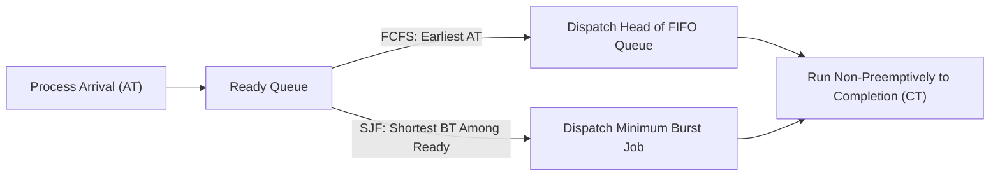

# [EX] Exercise 1 - CPU Scheduling (FCFS and SJF)

> [!info] Document Metadata
> - **Course:** `=this.course`
> - **Topic:** `=this.topic`
> - **Status:** `=this.status`

**Tags:** #[[Computer Science]] #[[CSOPESY]] #[[Operating Systems]] #[[CPU Scheduling]] #[[Exercise]]

---

## Overview

This exercise evaluates two foundational **non-preemptive** CPU scheduling policies—**First-Come, First-Served (FCFS)** and **Non-Preemptive Shortest Job First (SJF)**—against a common five-process workload. For each policy, we derive the execution Gantt chart, per-process start time, Completion Time ($CT$), Turnaround Time ($TAT$), and Waiting Time ($WT$), along with aggregate system averages. Comparing both policies on the identical workload illustrates how FCFS suffers from the convoy effect while non-preemptive SJF minimizes waiting time among ready tasks.

## Common Process Data Set & Scheduling Formulas

All scheduling exercises in this series (Exercises 1–3) operate on the following five processes ($P_1$–$P_5$), measured in milliseconds ($\text{ms}$):

| Process ID | Arrival Time ($AT$) | CPU Burst Time ($BT$) | Priority ($1 = \text{Highest}$) |
| :--- | :---: | :---: | :---: |
| **P1** | $0$ | $10$ | $3$ |
| **P2** | $1$ | $5$ | $1$ |
| **P3** | $3$ | $2$ | $4$ |
| **P4** | $5$ | $8$ | $2$ |
| **P5** | $7$ | $6$ | $5$ |

Total CPU burst demand across all five processes is $\sum BT_i = 10 + 5 + 2 + 8 + 6 = 31\text{ ms}$. Since $P_1$ arrives at $t = 0$ and the CPU never becomes idle between arrivals, every non-preemptive schedule completes at $t = 31\text{ ms}$.

**Core Metric Definitions:**
$$TAT_i = CT_i - AT_i$$
$$WT_i = TAT_i - BT_i$$
$$\text{Avg } TAT = \frac{1}{n} \sum_{i=1}^{n} TAT_i, \qquad \text{Avg } WT = \frac{1}{n} \sum_{i=1}^{n} WT_i$$

Because $\text{Avg } TAT - \text{Avg } WT = \text{Avg } BT$, every valid schedule on this data set satisfies the invariant:
$$\text{Avg } TAT - \text{Avg } WT = \frac{31}{5} = 6.2\text{ ms}$$



---

## Part 1: First-Come, First-Served (FCFS) Scheduling

### Dispatch Trace

Under FCFS, processes execute strictly in order of arrival ($P_1 \to P_2 \to P_3 \to P_4 \to P_5$) without preemption:

1. **$t = 0 \to 10$:** $P_1$ arrives first and runs its entire $10\text{ ms}$ burst ($CT = 10$). Meanwhile, $P_2, P_3, P_4, P_5$ all arrive and queue behind $P_1$.
2. **$t = 10 \to 15$:** $P_2$ runs for $5\text{ ms}$ ($CT = 15$).
3. **$t = 15 \to 17$:** $P_3$ runs for $2\text{ ms}$ ($CT = 17$).
4. **$t = 17 \to 25$:** $P_4$ runs for $8\text{ ms}$ ($CT = 25$).
5. **$t = 25 \to 31$:** $P_5$ runs for $6\text{ ms}$ ($CT = 31$).

**Gantt Chart:**
```text
|     P1     |   P2   | P3 |    P4    |   P5   |
0           10       15   17         25       31
```

### Verified FCFS Metrics Table

| Process ID | AT (ms) | BT (ms) | Start Time (ms) | CT (ms) | TAT (ms) | WT (ms) |
| :--- | :---: | :---: | :---: | :---: | :---: | :---: |
| **P1** | $0$ | $10$ | $0$ | $10$ | $10 - 0 = 10$ | $10 - 10 = 0$ |
| **P2** | $1$ | $5$ | $10$ | $15$ | $15 - 1 = 14$ | $14 - 5 = 9$ |
| **P3** | $3$ | $2$ | $15$ | $17$ | $17 - 3 = 14$ | $14 - 2 = 12$ |
| **P4** | $5$ | $8$ | $17$ | $25$ | $25 - 5 = 20$ | $20 - 8 = 12$ |
| **P5** | $7$ | $6$ | $25$ | $31$ | $31 - 7 = 24$ | $24 - 6 = 18$ |

### FCFS Averages

$$\text{Avg } TAT = \frac{10 + 14 + 14 + 20 + 24}{5} = \frac{82}{5} = \mathbf{16.4\text{ ms}}$$
$$\text{Avg } WT = \frac{0 + 9 + 12 + 12 + 18}{5} = \frac{51}{5} = \mathbf{10.2\text{ ms}}$$

*Invariant check:* $16.4 - 10.2 = 6.2\text{ ms}$ (exact match).

---

## Part 2: Non-Preemptive Shortest Job First (SJF) Scheduling

### Dispatch Trace

At each scheduling decision point (when the CPU becomes free), non-preemptive SJF selects the available process in the ready queue with the smallest CPU burst time:

1. **$t = 0$:** Only $P_1$ ($BT = 10$) has arrived. Because SJF is non-preemptive, $P_1$ executes uninterrupted from $0 \to 10$ ($CT = 10$).
2. **$t = 10$:** Ready queue contains $P_2(5)$, $P_3(2)$, $P_4(8)$, and $P_5(6)$. Shortest burst is **$P_3$ ($2\text{ ms}$)** $\implies P_3$ executes $10 \to 12$.
3. **$t = 12$:** Remaining ready processes are $P_2(5)$, $P_4(8)$, and $P_5(6)$. Shortest burst is **$P_2$ ($5\text{ ms}$)** $\implies P_2$ executes $12 \to 17$.
4. **$t = 17$:** Remaining ready processes are $P_4(8)$ and $P_5(6)$. Shortest burst is **$P_5$ ($6\text{ ms}$)** $\implies P_5$ executes $17 \to 23$.
5. **$t = 23$:** Only **$P_4$ ($8\text{ ms}$)** remains $\implies P_4$ executes $23 \to 31$.

**Gantt Chart:**
```text
|     P1     | P3 |   P2   |   P5   |    P4    |
0           10   12       17       23         31
```

### Verified Non-Preemptive SJF Metrics Table

| Process ID | AT (ms) | BT (ms) | Start Time (ms) | CT (ms) | TAT (ms) | WT (ms) |
| :--- | :---: | :---: | :---: | :---: | :---: | :---: |
| **P1** | $0$ | $10$ | $0$ | $10$ | $10 - 0 = 10$ | $10 - 10 = 0$ |
| **P2** | $1$ | $5$ | $12$ | $17$ | $17 - 1 = 16$ | $16 - 5 = 11$ |
| **P3** | $3$ | $2$ | $10$ | $12$ | $12 - 3 = 9$ | $9 - 2 = 7$ |
| **P4** | $5$ | $8$ | $23$ | $31$ | $31 - 5 = 26$ | $26 - 8 = 18$ |
| **P5** | $7$ | $6$ | $17$ | $23$ | $23 - 7 = 16$ | $16 - 6 = 10$ |

### Non-Preemptive SJF Averages

$$\text{Avg } TAT = \frac{10 + 16 + 9 + 26 + 16}{5} = \frac{77}{5} = \mathbf{15.4\text{ ms}}$$
$$\text{Avg } WT = \frac{0 + 11 + 7 + 18 + 10}{5} = \frac{46}{5} = \mathbf{9.2\text{ ms}}$$

*Invariant check:* $15.4 - 9.2 = 6.2\text{ ms}$ (exact match).

---

## Comparative Analysis: FCFS vs. Non-Preemptive SJF

| Metric | FCFS | Non-Preemptive SJF | Delta (SJF vs. FCFS) |
| :--- | :---: | :---: | :---: |
| **Execution Order** | $P_1 \to P_2 \to P_3 \to P_4 \to P_5$ | $P_1 \to P_3 \to P_2 \to P_5 \to P_4$ | Shorter jobs promoted after $t = 10$ |
| **Average Turnaround Time** | $16.4\text{ ms}$ | $15.4\text{ ms}$ | $-1.0\text{ ms}$ ($-6.1\%$) |
| **Average Waiting Time** | $10.2\text{ ms}$ | $9.2\text{ ms}$ | $-1.0\text{ ms}$ ($-9.8\%$) |
| **Worst Individual Wait Time** | $18\text{ ms}$ ($P_5$) | $18\text{ ms}$ ($P_4$) | Shifted from last arrival to longest ready job |

> [!note] Key Takeaway on the Convoy Effect
> Even under non-preemptive SJF, $P_1$'s initial $10\text{ ms}$ burst forces every subsequent shorter job ($P_3$ with $2\text{ ms}$ and $P_2$ with $5\text{ ms}$) to wait until $t = 10$. Once $P_1$ completes, SJF immediately schedules $P_3$ before $P_2$, shaving $1.0\text{ ms}$ off both average turnaround and average waiting time compared to FCFS. Eliminating the initial $P_1$ delay requires **preemption** (SRTF, analyzed in Exercise 2).

---

## Multiple Choice Questions

1. Why does $P_1$ still run uninterrupted from $t = 0$ to $t = 10$ under Non-Preemptive SJF even though $P_2$ ($BT = 5$) arrives at $t = 1$ and $P_3$ ($BT = 2$) arrives at $t = 3$?
    - **A)** Because $P_1$ has a higher static priority than $P_3$
    - **B)** Because non-preemptive SJF only invokes the dispatcher when the currently running process finishes or blocks
    - **C)** Because $P_2$ and $P_3$ are placed in a separate I/O wait queue upon arrival
    - **D)** Because SJF requires all five processes to arrive before reordering any bursts

2. [INPUT] Using the Exercise 1 process data set, what is the **Average Waiting Time** (in $\text{ms}$) under **FCFS** scheduling?

3. [INPUT] Using the Exercise 1 process data set, what is the **Average Turnaround Time** (in $\text{ms}$) under **Non-Preemptive SJF** scheduling?

4. [BLANK] Complete the **FCFS** metrics for processes $P_3$ and $P_5$ from the Exercise 1 data set (enter numeric values in $\text{ms}$):

| Process | Start Time | Completion Time (CT) | Turnaround Time (TAT) | Waiting Time (WT) |
| :--- | :---: | :---: | :---: | :---: |
| **P3** ($AT=3, BT=2$) | {{1}} | {{2}} | 14 | {{3}} |
| **P5** ($AT=7, BT=6$) | 25 | {{4}} | {{5}} | 18 |

5. [BLANK] Complete the **Non-Preemptive SJF** metrics for processes $P_3$ and $P_4$ from the Exercise 1 data set (enter numeric values in $\text{ms}$):

| Process | Start Time | Completion Time (CT) | Turnaround Time (TAT) | Waiting Time (WT) |
| :--- | :---: | :---: | :---: | :---: |
| **P3** ($AT=3, BT=2$) | {{1}} | {{2}} | {{3}} | 7 |
| **P4** ($AT=5, BT=8$) | {{4}} | 31 | 26 | {{5}} |

6. [MSQ] Which of the following statements hold true for both FCFS and Non-Preemptive SJF on the Exercise 1 process set? (Select all that apply)
    - **A)** The makespan (final completion time of all five processes) is $31\text{ ms}$
    - **B)** The difference $\text{Avg } TAT - \text{Avg } WT$ equals the average burst time of $6.2\text{ ms}$
    - **C)** Process $P_1$ incurs $0\text{ ms}$ of waiting time
    - **D)** Process $P_4$ finishes before Process $P_5$

### Answer Key & Explanations

1. **B)** Non-preemptive SJF never interrupts an actively executing CPU burst when shorter jobs arrive; it evaluates the ready queue only after $P_1$ completes at $t = 10$. Priority values (A) are ignored by SJF, arriving processes enter the ready queue rather than an I/O queue (C), and SJF does not wait for all processes to arrive before starting $P_1$ (D).
2. **[10.2; 10.2 ms; 10.2ms; 51/5]** Under FCFS, waiting times are $P_1 = 0$, $P_2 = 9$, $P_3 = 12$, $P_4 = 12$, and $P_5 = 18$, giving $(0 + 9 + 12 + 12 + 18) / 5 = 51 / 5 = 10.2\text{ ms}$.
3. **[15.4; 15.4 ms; 15.4ms; 77/5]** Under Non-Preemptive SJF, turnaround times are $P_1 = 10$, $P_2 = 16$, $P_3 = 9$, $P_4 = 26$, and $P_5 = 16$, giving $(10 + 16 + 9 + 26 + 16) / 5 = 77 / 5 = 15.4\text{ ms}$.
4. **[1: 15; 2: 17; 3: 12; 4: 31; 5: 24]** In FCFS, $P_3$ starts after $P_1(10)$ and $P_2(5)$ finish at $t = 15$, completes at $15 + 2 = 17$, and waits $14 - 2 = 12\text{ ms}$. $P_5$ runs $25 \to 31$, giving $CT = 31$ and $TAT = 31 - 7 = 24\text{ ms}$.
5. **[1: 10; 2: 12; 3: 9; 4: 23; 5: 18]** After $P_1$ finishes at $t = 10$, $P_3$ has the shortest burst ($2\text{ ms}$), so it runs $10 \to 12$ ($TAT = 12 - 3 = 9$). $P_4$ has the longest ready burst ($8\text{ ms}$), so it runs last from $23 \to 31$, giving $WT = 26 - 8 = 18\text{ ms}$.
6. **A, B, C)** Total burst time is $31\text{ ms}$ with zero idle gaps, so both schedules finish at $31\text{ ms}$ (A). Because $TAT_i - WT_i = BT_i$ for every process, $\text{Avg } TAT - \text{Avg } WT = \text{Avg } BT = 31/5 = 6.2\text{ ms}$ (B). $P_1$ starts immediately at $t = 0$ in both policies (C). D is false because $P_5$ ($BT = 6$) precedes $P_4$ ($BT = 8$) under SJF.

## References & Navigation

- **Related Notes:** [[CSOPESY 06 - CPU Scheduling]], [[[EX] Exercise 2 - CPU Scheduling (Priority and SRTF)]], [[[EX] Exercise 3 - CPU Scheduling (Round Robin)]], [[[QZ] CSOPESY Practice Quiz 2 - CPU Scheduling]]
