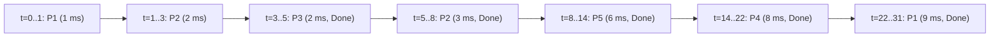

# [EX] Exercise 2 - CPU Scheduling (Priority and SRTF)

> [!info] Document Metadata
> - **Course:** `=this.course`
> - **Topic:** `=this.topic`
> - **Status:** `=this.status`

**Tags:** #[[Computer Science]] #[[CSOPESY]] #[[Operating Systems]] #[[CPU Scheduling]] #[[Exercise]]

---

## Overview

This exercise extends the common five-process scheduling benchmark from Exercise 1 to **Non-Preemptive Priority Scheduling** (where smaller integers represent higher priority) and **Preemptive Shortest Remaining Time First (SRTF)**. Tracing both algorithms highlights the stark trade-off between priority-based ordering—which can inflate average wait times when long high-priority jobs block short low-priority jobs—and preemptive SRTF, which actively interrupts long bursts to achieve the theoretical minimum average waiting time.

## Common Process Data Set

| Process ID | Arrival Time ($AT$) | CPU Burst Time ($BT$) | Priority ($1 = \text{Highest}$) |
| :--- | :---: | :---: | :---: |
| **P1** | $0$ | $10$ | $3$ |
| **P2** | $1$ | $5$ | $1$ |
| **P3** | $3$ | $2$ | $4$ |
| **P4** | $5$ | $8$ | $2$ |
| **P5** | $7$ | $6$ | $5$ |

**Metric Formulas:** $TAT = CT - AT$, $WT = TAT - BT$, with total burst sum $\sum BT_i = 31\text{ ms}$ ($\text{Avg } BT = 6.2\text{ ms}$).

---

## Part 1: Non-Preemptive Priority Scheduling

### Dispatch Trace

Lower numeric values indicate higher scheduling priority ($1 > 2 > 3 > 4 > 5$). Because this policy is non-preemptive, an executing process runs to completion before the ready queue is re-evaluated:

1. **$t = 0$:** Only $P_1$ ($\text{Pri } 3$) has arrived. $P_1$ executes $0 \to 10$ ($CT = 10$).
2. **$t = 10$:** Ready queue contains $P_2(\text{Pri } 1)$, $P_3(\text{Pri } 4)$, $P_4(\text{Pri } 2)$, and $P_5(\text{Pri } 5)$. Highest priority is **$P_2$ ($\text{Pri } 1$)** $\implies P_2$ executes $10 \to 15$.
3. **$t = 15$:** Remaining ready processes are $P_3(\text{Pri } 4)$, $P_4(\text{Pri } 2)$, and $P_5(\text{Pri } 5)$. Highest priority is **$P_4$ ($\text{Pri } 2$)** $\implies P_4$ executes $15 \to 23$.
4. **$t = 23$:** Remaining ready processes are $P_3(\text{Pri } 4)$ and $P_5(\text{Pri } 5)$. Highest priority is **$P_3$ ($\text{Pri } 4$)** $\implies P_3$ executes $23 \to 25$.
5. **$t = 25$:** Only **$P_5$ ($\text{Pri } 5$)** remains $\implies P_5$ executes $25 \to 31$.

**Gantt Chart:**
```text
|     P1     |   P2   |    P4    | P3 |   P5   |
0           10       15         23   25       31
```

### Verified Non-Preemptive Priority Metrics Table

| Process ID | AT (ms) | BT (ms) | Priority | Start Time (ms) | CT (ms) | TAT (ms) | WT (ms) |
| :--- | :---: | :---: | :---: | :---: | :---: | :---: | :---: |
| **P1** | $0$ | $10$ | $3$ | $0$ | $10$ | $10$ | $0$ |
| **P2** | $1$ | $5$ | $1$ | $10$ | $15$ | $14$ | $9$ |
| **P3** | $3$ | $2$ | $4$ | $23$ | $25$ | $22$ | $20$ |
| **P4** | $5$ | $8$ | $2$ | $15$ | $23$ | $18$ | $10$ |
| **P5** | $7$ | $6$ | $5$ | $25$ | $31$ | $24$ | $18$ |

### Non-Preemptive Priority Averages

$$\text{Avg } TAT = \frac{10 + 14 + 22 + 18 + 24}{5} = \frac{88}{5} = \mathbf{17.6\text{ ms}}$$
$$\text{Avg } WT = \frac{0 + 9 + 20 + 10 + 18}{5} = \frac{57}{5} = \mathbf{11.4\text{ ms}}$$

*Invariant check:* $17.6 - 11.4 = 6.2\text{ ms}$. Note how $P_3$—despite needing only $2\text{ ms}$ of CPU—waits $20\text{ ms}$ because its low static priority ($\text{Pri } 4$) forces it behind both $P_2$ and $P_4$.

---

## Part 2: Preemptive Shortest Remaining Time First (SRTF)

### Event-by-Event Preemption Trace

Under SRTF, every arrival event compares the newly arrived process's burst time against the **remaining burst time** of the currently executing process. Preemption occurs strictly when $\text{BT}_{\text{new}} < \text{Rem}_{\text{running}}$:

| Time ($t$) | Event | Ready & Running Pool (Remaining Burst) | Scheduler Action | Active CPU |
| :---: | :--- | :--- | :--- | :---: |
| **$0$** | $P_1$ arrives ($10$) | $P_1(10)$ | Dispatch $P_1$ | **P1** |
| **$1$** | $P_2$ arrives ($5$) | $P_1(9)$, $P_2(5)$ | $5 < 9 \implies$ **Preempt $P_1$**, dispatch $P_2$ | **P2** |
| **$3$** | $P_3$ arrives ($2$) | $P_1(9)$, $P_2(3)$, $P_3(2)$ | $2 < 3 \implies$ **Preempt $P_2$**, dispatch $P_3$ | **P3** |
| **$5$** | $P_3$ finishes ($CT=5$); $P_4$ arrives ($8$) | $P_1(9)$, $P_2(3)$, $P_4(8)$ | Minimum remaining is $P_2(3) \implies$ **Resume $P_2$** | **P2** |
| **$7$** | $P_5$ arrives ($6$) | $P_1(9)$, $P_2(1)$, $P_4(8)$, $P_5(6)$ | $6 > 1 \implies$ No preemption; $P_2$ continues | **P2** |
| **$8$** | $P_2$ finishes ($CT=8$) | $P_1(9)$, $P_4(8)$, $P_5(6)$ | Minimum remaining is $P_5(6) \implies$ Dispatch $P_5$ | **P5** |
| **$14$** | $P_5$ finishes ($CT=14$) | $P_1(9)$, $P_4(8)$ | Minimum remaining is $P_4(8) \implies$ Dispatch $P_4$ | **P4** |
| **$22$** | $P_4$ finishes ($CT=22$) | $P_1(9)$ | Only $P_1(9)$ left $\implies$ **Resume $P_1$** | **P1** |
| **$31$** | $P_1$ finishes ($CT=31$) | Empty | All processes complete | Idle |



**Gantt Chart:**
```text
|P1| P2 | P3 |  P2  |    P5    |     P4     |      P1      |
0  1    3    5      8         14           22             31
```

### Verified SRTF Metrics Table

Because preempted processes enter the CPU multiple times, both initial start and resume timestamps are recorded in the Start Time column:

| Process ID | AT (ms) | BT (ms) | Start / Resume Times (ms) | CT (ms) | TAT (ms) | WT (ms) |
| :--- | :---: | :---: | :---: | :---: | :---: | :---: |
| **P1** | $0$ | $10$ | $0,\ 22$ | $31$ | $31 - 0 = 31$ | $31 - 10 = 21$ |
| **P2** | $1$ | $5$ | $1,\ 5$ | $8$ | $8 - 1 = 7$ | $7 - 5 = 2$ |
| **P3** | $3$ | $2$ | $3$ | $5$ | $5 - 3 = 2$ | $2 - 2 = 0$ |
| **P4** | $5$ | $8$ | $14$ | $22$ | $22 - 5 = 17$ | $17 - 8 = 9$ |
| **P5** | $7$ | $6$ | $8$ | $14$ | $14 - 7 = 7$ | $7 - 6 = 1$ |

### SRTF Averages

$$\text{Avg } TAT = \frac{31 + 7 + 2 + 17 + 7}{5} = \frac{64}{5} = \mathbf{12.8\text{ ms}}$$
$$\text{Avg } WT = \frac{21 + 2 + 0 + 9 + 1}{5} = \frac{33}{5} = \mathbf{6.6\text{ ms}}$$

*Invariant check:* $12.8 - 6.6 = 6.2\text{ ms}$. Preempting $P_1$ at $t = 1$ allows short jobs ($P_3$, $P_2$, $P_5$) to finish rapidly, cutting average waiting time by **$42.1\%$** relative to Non-Preemptive Priority ($6.6\text{ ms}$ vs. $11.4\text{ ms}$), though $P_1$'s individual wait rises from $0\text{ ms}$ to $21\text{ ms}$.

---

## Multiple Choice Questions

1. Under Preemptive SRTF on the Exercise 2 process set, what happens at $t = 7$ when $P_5$ ($BT = 6\text{ ms}$) arrives?
    - **A)** $P_5$ preempts $P_2$ because $P_5$ has a shorter original burst time than $P_1$
    - **B)** $P_2$ continues running because its remaining time ($1\text{ ms}$) is strictly less than $P_5$'s burst ($6\text{ ms}$)
    - **C)** $P_4$ preempts $P_2$ because $P_4$ arrived earlier than $P_5$
    - **D)** $P_1$ resumes immediately because it has been waiting since $t = 1$

2. Under Non-Preemptive Priority Scheduling (1 = Highest), why does $P_3$ suffer the largest waiting time ($20\text{ ms}$) despite having the shortest CPU burst ($2\text{ ms}$)?
    - **A)** Because Priority Scheduling always executes processes in reverse arrival order
    - **B)** Because $P_3$ arrives after $P_1$ has already started and has lower priority ($\text{Pri } 4$) than both $P_2$ ($\text{Pri } 1$) and $P_4$ ($\text{Pri } 2$)
    - **C)** Because $P_3$ is preempted twice by $P_2$ and $P_4$ before finishing
    - **D)** Because Priority Scheduling penalizes jobs whose burst time is below the mean burst time

3. [INPUT] Using the Exercise 2 process data set, what is the **Average Waiting Time** (in $\text{ms}$) under **Non-Preemptive Priority Scheduling** (1 = Highest)?

4. [INPUT] Using the Exercise 2 process data set, what is the **Average Waiting Time** (in $\text{ms}$) under **Preemptive SRTF** scheduling?

5. [BLANK] Complete the **Non-Preemptive Priority** metrics for $P_3$ and $P_4$ (enter numeric values in $\text{ms}$):

| Process | Priority | Start Time | CT (ms) | TAT (ms) | WT (ms) |
| :--- | :---: | :---: | :---: | :---: | :---: |
| **P4** ($AT=5, BT=8$) | 2 | {{1}} | {{2}} | 18 | {{3}} |
| **P3** ($AT=3, BT=2$) | 4 | {{4}} | 25 | {{5}} | 20 |

6. [BLANK] Complete the **Preemptive SRTF** metrics for $P_1$, $P_2$, and $P_5$ (enter numeric values in $\text{ms}$):

| Process | Resume Time (2nd Start) | CT (ms) | TAT (ms) | WT (ms) |
| :--- | :---: | :---: | :---: | :---: |
| **P1** ($AT=0, BT=10$) | {{1}} | 31 | {{2}} | 21 |
| **P2** ($AT=1, BT=5$) | {{3}} | {{4}} | 7 | 2 |
| **P5** ($AT=7, BT=6$) | — | {{5}} | 7 | {{6}} |

### Answer Key & Explanations

1. **B)** At $t = 7$, $P_2$ has executed $2\text{ ms}$ during $1 \to 3$ and $2\text{ ms}$ during $5 \to 7$, leaving only $1\text{ ms}$ remaining. Since $1 < 6$, $P_2$ finishes at $t = 8$ before $P_5$ is dispatched.
2. **B)** $P_1$ holds the CPU non-preemptively until $t = 10$, after which the ready queue dispatches in priority order $P_2(1) \to P_4(2) \to P_3(4) \to P_5(5)$. Thus $P_3$ waits from $t = 3$ until $t = 23$, accumulating $20\text{ ms}$ of waiting time.
3. **[11.4; 11.4 ms; 11.4ms; 57/5]** Waiting times are $P_1 = 0$, $P_2 = 9$, $P_3 = 20$, $P_4 = 10$, and $P_5 = 18$, yielding $(0 + 9 + 20 + 10 + 18) / 5 = 57 / 5 = 11.4\text{ ms}$.
4. **[6.6; 6.6 ms; 6.6ms; 33/5]** Waiting times under SRTF are $P_1 = 21$, $P_2 = 2$, $P_3 = 0$, $P_4 = 9$, and $P_5 = 1$, yielding $(21 + 2 + 0 + 9 + 1) / 5 = 33 / 5 = 6.6\text{ ms}$.
5. **[1: 15; 2: 23; 3: 10; 4: 23; 5: 22]** Under Non-Preemptive Priority, $P_4$ ($\text{Pri } 2$) runs after $P_1$ ($0 \to 10$) and $P_2$ ($10 \to 15$), so $P_4$ runs $15 \to 23$ ($WT = 18 - 8 = 10$). Then $P_3$ ($\text{Pri } 4$) runs $23 \to 25$, giving $TAT = 25 - 3 = 22\text{ ms}$.
6. **[1: 22; 2: 31; 3: 5; 4: 8; 5: 14; 6: 1]** Under SRTF, $P_1$ is preempted at $t = 1$ and resumes last at $t = 22$ ($CT = 31$, $TAT = 31$). $P_2$ is preempted by $P_3$ at $t = 3$, resumes at $t = 5$, and completes at $t = 8$. $P_5$ starts at $t = 8$, completes at $t = 14$, and waits $7 - 6 = 1\text{ ms}$.

## References & Navigation

- **Related Notes:** [[CSOPESY 06 - CPU Scheduling]], [[[EX] Exercise 1 - CPU Scheduling (FCFS and SJF)]], [[[EX] Exercise 3 - CPU Scheduling (Round Robin)]], [[[QZ] CSOPESY Practice Quiz 2 - CPU Scheduling]]
