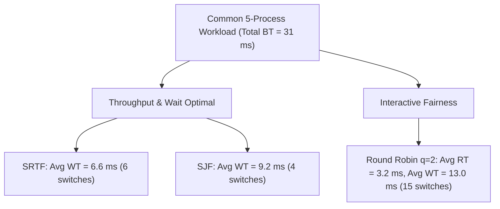

# [EX] Exercise 3 - CPU Scheduling (Round Robin)

> [!info] Document Metadata
> - **Course:** `=this.course`
> - **Topic:** `=this.topic`
> - **Status:** `=this.status`

**Tags:** #[[Computer Science]] #[[CSOPESY]] #[[Operating Systems]] #[[CPU Scheduling]] #[[Exercise]]

---

## Overview

This exercise completes the five-algorithm CPU scheduling study on the common five-process workload by tracing **Round Robin (RR)** scheduling with a time quantum of $q = 2\text{ ms}$. Round Robin enforces strict time-sharing fairness and low initial response times at the cost of frequent context switching and higher average turnaround and waiting times. The final section consolidates all five scheduling algorithms across Exercises 1–3 into a unified comparative benchmark.

## Common Process Data Set & Queue Convention

| Process ID | Arrival Time ($AT$) | CPU Burst Time ($BT$) | Priority ($1 = \text{Highest}$) |
| :--- | :---: | :---: | :---: |
| **P1** | $0$ | $10$ | $3$ |
| **P2** | $1$ | $5$ | $1$ |
| **P3** | $3$ | $2$ | $4$ |
| **P4** | $5$ | $8$ | $2$ |
| **P5** | $7$ | $6$ | $5$ |

**Round Robin Scheduling Parameters:**
- **Time Quantum:** $q = 2\text{ ms}$
- **Queue Insertion Convention:** Any process arriving during a time slice (including at the quantum boundary) enters the tail of the ready queue **before** the preempted process is re-enqueued.
- **Start Time Definition:** Recorded as the **first** dispatch timestamp (response start) for each process.

---

## Slice-by-Slice Ready Queue Trace ($q = 2\text{ ms}$)

| Slice | Time Window | Running | Burst Consumed | Remaining After | Arrivals During Slice | Ready Queue After Slice (Front $\to$ Tail) |
| :---: | :---: | :---: | :---: | :---: | :--- | :--- |
| **1** | $0 \to 2$ | **P1** | $2$ | $8$ | $P_2$ ($t=1$) | `[P2, P1]` |
| **2** | $2 \to 4$ | **P2** | $2$ | $3$ | $P_3$ ($t=3$) | `[P1, P3, P2]` |
| **3** | $4 \to 6$ | **P1** | $2$ | $6$ | $P_4$ ($t=5$) | `[P3, P2, P4, P1]` |
| **4** | $6 \to 8$ | **P3** | $2$ | $0$ (**Done**, $CT=8$) | $P_5$ ($t=7$) | `[P2, P4, P1, P5]` |
| **5** | $8 \to 10$ | **P2** | $2$ | $1$ | — | `[P4, P1, P5, P2]` |
| **6** | $10 \to 12$ | **P4** | $2$ | $6$ | — | `[P1, P5, P2, P4]` |
| **7** | $12 \to 14$ | **P1** | $2$ | $4$ | — | `[P5, P2, P4, P1]` |
| **8** | $14 \to 16$ | **P5** | $2$ | $4$ | — | `[P2, P4, P1, P5]` |
| **9** | $16 \to 17$ | **P2** | $1$ | $0$ (**Done**, $CT=17$) | — | `[P4, P1, P5]` |
| **10** | $17 \to 19$ | **P4** | $2$ | $4$ | — | `[P1, P5, P4]` |
| **11** | $19 \to 21$ | **P1** | $2$ | $2$ | — | `[P5, P4, P1]` |
| **12** | $21 \to 23$ | **P5** | $2$ | $2$ | — | `[P4, P1, P5]` |
| **13** | $23 \to 25$ | **P4** | $2$ | $2$ | — | `[P1, P5, P4]` |
| **14** | $25 \to 27$ | **P1** | $2$ | $0$ (**Done**, $CT=27$) | — | `[P5, P4]` |
| **15** | $27 \to 29$ | **P5** | $2$ | $0$ (**Done**, $CT=29$) | — | `[P4]` |
| **16** | $29 \to 31$ | **P4** | $2$ | $0$ (**Done**, $CT=31$) | — | `[]` |

**Gantt Chart:**
```text
|P1|P2|P1|P3|P2|P4|P1|P5|P2|P4|P1|P5|P4|P1|P5|P4|
0  2  4  6  8 10 12 14 16 17 19 21 23 25 27 29 31
```

Notice that Slice 9 ($16 \to 17$) runs for only $1\text{ ms}$ because $P_2$ has just $1\text{ ms}$ remaining and voluntarily yields upon termination, avoiding a wasted idle millisecond. Across all 16 dispatches, the scheduler performs **15 context switches**.

---

## Verified Round Robin ($q = 2\text{ ms}$) Metrics Table

| Process ID | AT (ms) | BT (ms) | First Start (ms) | Response Time ($RT$) | CT (ms) | TAT (ms) | WT (ms) |
| :--- | :---: | :---: | :---: | :---: | :---: | :---: | :---: |
| **P1** | $0$ | $10$ | $0$ | $0$ | $27$ | $27 - 0 = 27$ | $27 - 10 = 17$ |
| **P2** | $1$ | $5$ | $2$ | $1$ | $17$ | $17 - 1 = 16$ | $16 - 5 = 11$ |
| **P3** | $3$ | $2$ | $6$ | $3$ | $8$ | $8 - 3 = 5$ | $5 - 2 = 3$ |
| **P4** | $5$ | $8$ | $10$ | $5$ | $31$ | $31 - 5 = 26$ | $26 - 8 = 18$ |
| **P5** | $7$ | $6$ | $14$ | $7$ | $29$ | $29 - 7 = 22$ | $22 - 6 = 16$ |

### Round Robin Averages

$$\text{Avg } TAT = \frac{27 + 16 + 5 + 26 + 22}{5} = \frac{96}{5} = \mathbf{19.2\text{ ms}}$$
$$\text{Avg } WT = \frac{17 + 11 + 3 + 18 + 16}{5} = \frac{65}{5} = \mathbf{13.0\text{ ms}}$$
$$\text{Avg } RT = \frac{0 + 1 + 3 + 5 + 7}{5} = \frac{16}{5} = \mathbf{3.2\text{ ms}}$$

*Invariant check:* $19.2 - 13.0 = 6.2\text{ ms}$ (exact match with $\text{Avg } BT$).

---

## Master Comparison Across Exercises 1–3 (All 5 Algorithms)

Evaluating all five algorithms on the identical five-process benchmark ($P_1$–$P_5$) demonstrates their canonical performance ordering:

| Rank (by Avg WT) | Scheduling Algorithm | Preemptive? | Avg TAT (ms) | Avg WT (ms) | Context Switches | Key Behavioral Characteristic |
| :---: | :--- | :---: | :---: | :---: | :---: | :--- |
| **1** | **SRTF** (Ex. 2) | Yes | **$12.8$** | **$6.6$** | $6$ | Provably optimal minimum Avg WT; interrupts long $P_1$ at $t=1$ |
| **2** | **Non-Preemptive SJF** (Ex. 1) | No | $15.4$ | $9.2$ | $4$ | Optimal among non-preemptive policies once $P_1$ finishes |
| **3** | **FCFS** (Ex. 1) | No | $16.4$ | $10.2$ | $4$ | Simple FIFO; suffers convoy effect behind $P_1$ |
| **4** | **Non-Preemptive Priority** (Ex. 2) | No | $17.6$ | $11.4$ | $4$ | Starvation risk; short $P_3$ waits $20\text{ ms}$ behind higher-priority jobs |
| **5** | **Round Robin ($q = 2$)** (Ex. 3) | Yes | $19.2$ | $13.0$ | $15$ | Best fairness and interactive response ($RT_{\text{avg}} = 3.2\text{ ms}$); highest Avg WT |



---

## Multiple Choice Questions

1. Under Round Robin ($q = 2\text{ ms}$) on the Exercise 3 workload, which process finishes **first** and at what completion time?
    - **A)** $P_2$ at $t = 7\text{ ms}$
    - **B)** $P_3$ at $t = 8\text{ ms}$
    - **C)** $P_1$ at $t = 10\text{ ms}$
    - **D)** $P_2$ at $t = 17\text{ ms}$

2. Why does Slice 9 ($P_2$) execute for only $1\text{ ms}$ ($16 \to 17$) instead of consuming a full $2\text{ ms}$ quantum?
    - **A)** Because a higher-priority process arrived at $t = 17$ and preempted $P_2$
    - **B)** Because $P_2$ only had $1\text{ ms}$ of CPU burst remaining and voluntarily released the CPU upon completion
    - **C)** Because the OS dynamically shrinks the time quantum after every 8 slices
    - **D)** Because $P_2$ entered an I/O wait state midway through its quantum

3. [INPUT] Using the Exercise 3 process data set with Round Robin ($q = 2\text{ ms}$), what is the **Average Turnaround Time** (in $\text{ms}$)?

4. [INPUT] Using the Exercise 3 process data set with Round Robin ($q = 2\text{ ms}$), what is the **Average Waiting Time** (in $\text{ms}$)?

5. [BLANK] Complete the **Round Robin ($q = 2\text{ ms}$)** metrics table for processes $P_1$, $P_4$, and $P_5$ (enter numeric values in $\text{ms}$):

| Process | First Start | CT (ms) | TAT (ms) | WT (ms) |
| :--- | :---: | :---: | :---: | :---: |
| **P1** ($AT=0, BT=10$) | 0 | {{1}} | 27 | {{2}} |
| **P4** ($AT=5, BT=8$) | {{3}} | {{4}} | 26 | 18 |
| **P5** ($AT=7, BT=6$) | {{5}} | 29 | {{6}} | 16 |

6. [MSQ] Comparing all five scheduling algorithms evaluated across Exercises 1–3 on the same workload, which conclusions are accurate? (Select all that apply)
    - **A)** SRTF achieves the lowest average waiting time ($6.6\text{ ms}$) and lowest average turnaround time ($12.8\text{ ms}$)
    - **B)** Round Robin ($q = 2$) incurs the highest number of context switches ($15$) and highest average waiting time ($13.0\text{ ms}$)
    - **C)** Round Robin ($q = 2$) gives $P_3$ a significantly lower waiting time ($3\text{ ms}$) than FCFS ($12\text{ ms}$) or Non-Preemptive Priority ($20\text{ ms}$)
    - **D)** Non-Preemptive Priority produces a lower average waiting time than FCFS on this process set

### Answer Key & Explanations

1. **B)** $P_3$ arrives at $t = 3$ with a burst of $2\text{ ms}$, which fits inside a single time quantum. It runs during Slice 4 ($6 \to 8$) and finishes first at $CT = 8\text{ ms}$.
2. **B)** $P_2$ consumed $2\text{ ms}$ in Slice 2 and $2\text{ ms}$ in Slice 5, leaving $5 - 4 = 1\text{ ms}$. When a process finishes before its quantum expires, it immediately terminates and triggers the next dispatch.
3. **[19.2; 19.2 ms; 19.2ms; 96/5]** Turnaround times are $P_1 = 27$, $P_2 = 16$, $P_3 = 5$, $P_4 = 26$, and $P_5 = 22$, giving $(27 + 16 + 5 + 26 + 22) / 5 = 96 / 5 = 19.2\text{ ms}$.
4. **[13; 13.0; 13 ms; 13.0 ms; 13ms]** Waiting times are $P_1 = 17$, $P_2 = 11$, $P_3 = 3$, $P_4 = 18$, and $P_5 = 16$, giving $(17 + 11 + 3 + 18 + 16) / 5 = 65 / 5 = 13.0\text{ ms}$.
5. **[1: 27; 2: 17; 3: 10; 4: 31; 5: 14; 6: 22]** $P_1$ completes in Slice 14 at $t = 27$ ($WT = 27 - 10 = 17$). $P_4$ first runs at $t = 10$ and finishes last at $t = 31$. $P_5$ first runs at $t = 14$ and finishes at $t = 29$ ($TAT = 29 - 7 = 22$).
6. **A, B, C)** SRTF achieves the minimum Avg WT ($6.6\text{ ms}$) and Avg TAT ($12.8\text{ ms}$) (A). Round Robin ($q = 2$) performs 15 context switches and yields Avg WT $= 13.0\text{ ms}$ (B), while dramatically protecting short job $P_3$ ($WT = 3\text{ ms}$) compared to FCFS ($12\text{ ms}$) and Priority ($20\text{ ms}$) (C). D is false because Non-Preemptive Priority ($11.4\text{ ms}$) performs worse than FCFS ($10.2\text{ ms}$).

## References & Navigation

- **Related Notes:** [[CSOPESY 06 - CPU Scheduling]], [[[EX] Exercise 1 - CPU Scheduling (FCFS and SJF)]], [[[EX] Exercise 2 - CPU Scheduling (Priority and SRTF)]], [[[QZ] CSOPESY Practice Quiz 2 - CPU Scheduling]]
