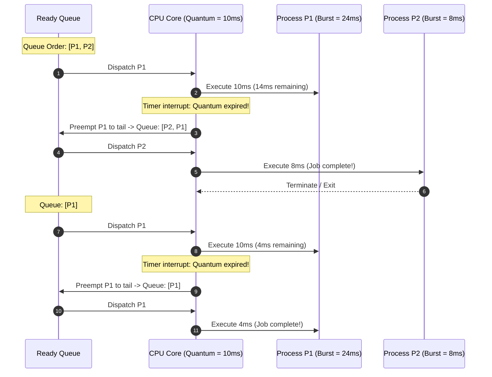
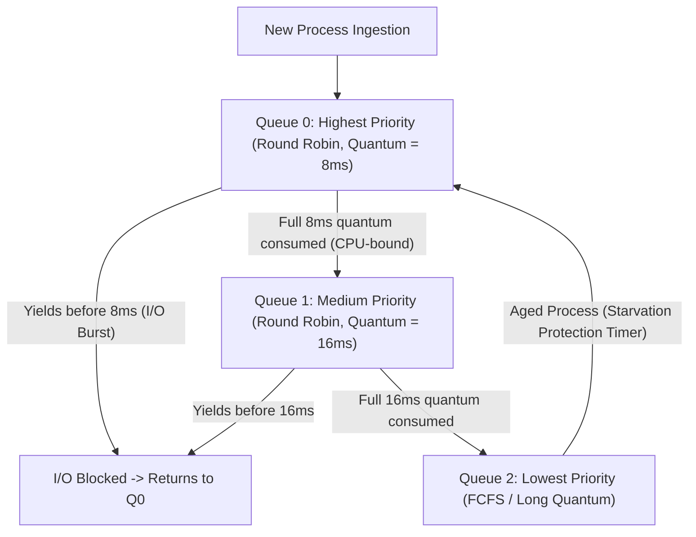

> [!info] Document Metadata
> - **Course:** `=this.course`
> - **Topic:** `=this.topic`
> - **Status:** `=this.status`

**Tags:** #[[Computer Science]] #[[CSOPESY]] #[[Operating Systems]] #[[06 - CPU Scheduling]]

---

## Overview
In a multiprogrammed system, multiple processes reside in memory simultaneously, actively competing for the CPU. The **CPU Scheduler** (Short-Term Scheduler) is the critical operating system component responsible for determining which process in the ready queue gets executed next. Proper scheduling is paramount for maintaining system responsiveness, maximizing CPU utilization, and enforcing fairness among users and processes.

## Key Concepts

### CPU-I/O Burst Cycle
Processes naturally alternate between two states:
- **CPU Burst:** The process is actively executing instructions on the processor.
- **I/O Burst:** The process is paused, waiting for I/O operations (like disk reads, network responses, or user input).
- **CPU-bound jobs** tend to have very long CPU bursts and rare I/O requests (e.g., video rendering).
- **I/O-bound jobs** tend to have frequent but very short CPU bursts (e.g., text editors). Schedulers typically prioritize I/O-bound jobs to maintain interactivity.

### Preemptive vs. Nonpreemptive Scheduling
The CPU scheduler makes decisions during four specific events:
1. Process switches from Running to Waiting (e.g., waits for I/O).
2. Process switches from Running to Ready (e.g., timer interrupt).
3. Process switches from Waiting to Ready (e.g., I/O completes).
4. Process terminates.

- **Nonpreemptive (Cooperative):** The scheduler only takes control when the process voluntarily gives up the CPU (events 1 and 4).
- **Preemptive:** The OS can aggressively interrupt a running process at any time (events 2 and 3) to hand the CPU to a higher-priority process. Modern OSes (Windows, Linux, macOS) are strictly preemptive. Preemption can cause race conditions if kernel data structures are interrupted while being modified, necessitating mutex locks.

### The Dispatcher
While the scheduler *selects* the process, the **Dispatcher** is the module that actively gives control of the CPU to the process. It handles:
- Context switching (saving/loading PCBs).
- Switching CPU mode to user mode.
- Jumping to the correct program counter.
The time taken to perform this is called **Dispatch Latency**, which is pure overhead.

### Scheduling Criteria
To evaluate scheduling algorithms, several metrics are used:
- **CPU Utilization:** Keep the CPU as busy as possible (aim for 100%).
- **Throughput:** Number of processes completed per unit of time.
- **Turnaround Time:** Total time from submission to termination (Waiting + Execution + I/O).
- **Waiting Time:** Total time a process spends waiting *specifically in the ready queue*.
- **Response Time:** Time from submission until the first response is generated (critical for interactive UIs).

## Algorithms & Formulas

### 1. First Come First Serve (FCFS)
- **Concept:** Simplest nonpreemptive algorithm using a FIFO queue.
- **Drawback - The Convoy Effect:** If a massive CPU-bound process arrives first, all quick I/O-bound processes get stuck waiting behind it, causing severe bottlenecks and terrible average waiting times.

### 2. Shortest Job First (SJF) & Shortest Remaining Time First (SRTF)
- **SJF (Nonpreemptive):** Allocates the CPU to the process with the smallest next CPU burst. It is mathematically optimal for minimizing average waiting time.
- **SRTF (Preemptive SJF):** If a new process arrives with a shorter burst than what is *remaining* on the current process, the current process is interrupted.
- **Challenge:** You cannot know the exact length of a process's next burst. It must be predicted using an **Exponential Average** of past bursts:
  $$ \tau_{n+1} = \alpha t_n + (1 - \alpha) \tau_n $$
  *(Where $t_n$ is the actual length of the last burst, $\tau_n$ was the prediction, and $\alpha$ dictates the weight given to recent history, usually 0.5).*

### 3. Priority Scheduling
- **Concept:** CPU is allocated to the highest-priority process.
- **Problem - Starvation:** Low-priority processes might never get CPU time if high-priority processes constantly arrive.
- **Solution - Aging:** Gradually increase the priority of long-waiting processes so they eventually execute.

### 4. Round Robin (RR)
- **Concept:** Preemptive algorithm for time-sharing systems. Each process gets a **time quantum** (e.g., 10-100ms). If it doesn't finish, it gets preempted and pushed to the back of the queue.
- **Trade-off:** Too large quantum $\to$ devolves into FCFS. Too small quantum $\to$ enormous context switching overhead.

### 5. Multilevel Feedback Queue (MLFQ)
- The most complex, general-purpose scheduling algorithm used in modern OSes.
- **Concept:** Maintains multiple priority queues. Processes dynamically move between queues based on their behavior:
  - If a process uses its entire time quantum, it is deemed CPU-bound and demoted to a lower priority queue.
  - If a process waits too long in a lower queue, it is promoted (aging).
  - I/O bound interactive processes stay at the top.

### Multi-Processor Scheduling
- **Symmetric Multiprocessing (SMP):** Each processor acts independently and pulls from a common ready queue (or local queues).
- **Processor Affinity:** Shifting a process to a different CPU core destroys cache performance, as the new core's L1/L2 cache won't have the process's data.
  - *Soft Affinity:* OS tries to keep a process on the same core, but might move it for load balancing.
  - *Hard Affinity:* Process explicitly binds itself to specific cores (e.g., `sched_setaffinity` in Linux).
- **Thread Scheduling:** 
  - *Process-Contention Scope (PCS):* User library schedules user threads on available kernel threads.
  - *System-Contention Scope (SCS):* The OS schedules kernel threads directly onto CPU cores.

## Multiple Choice Questions

1. What specific issue does the First-Come, First-Serve (FCFS) algorithm suffer from that degrades system performance?
    A. Exponential Decay
    B. Cache Invalidation
    C. The Convoy Effect
    D. Starvation

2. Which algorithm is mathematically proven to provide the minimum average waiting time for a given batch of processes?
    A. Shortest Job First (SJF)
    B. Round Robin (RR)
    C. Multilevel Feedback Queue (MLFQ)
    D. Priority Scheduling

3. If a Round Robin scheduler is given a very large time quantum approaching infinity, the algorithm effectively devolves into which other algorithm?
    A. Priority Scheduling
    B. Shortest Remaining Time First
    C. First-Come, First-Serve
    D. Multilevel Queue

4. In Priority Scheduling, what is the standard solution to prevent process starvation?
    A. Context Switching
    B. Aging
    C. Preemption
    D. Multithreading

5. A process that frequently pauses to wait for keyboard input and screen refreshes is classified as:
    A. CPU-bound
    B. Core-bound
    C. I/O-bound
    D. Thread-bound

6. What is the primary purpose of Exponential Average estimation in Shortest Job First scheduling?
    A. To calculate the dispatch latency.
    B. To predict the length of a process's next CPU burst based on past behavior.
    C. To allocate memory chunks for the heap.
    D. To determine the time quantum for Round Robin.

7. Why do Symmetric Multiprocessing (SMP) systems enforce Processor Affinity?
    A. To prevent starvation of background threads.
    B. To guarantee equitable distribution of RAM.
    C. To avoid the massive overhead of invalidating and repopulating cache memory when jumping between physical CPU cores.
    D. To enforce security between isolated containers.

8. In a Multilevel Feedback Queue (MLFQ), what typical action is taken if a process entirely consumes its allotted time quantum without yielding?
    A. It is promoted to a higher priority queue.
    B. It is terminated instantly.
    C. It is demoted to a lower priority queue because it is behaving like a CPU-bound process.
    D. It triggers a hardware interrupt.

9. Which OS component is directly responsible for saving the old PCB and loading the new PCB into the CPU registers?
    A. The Medium-Term Scheduler
    B. The Dispatcher
    C. The Job Scheduler
    D. The Thread Pool

10. A system interrupts a running process to give the CPU to a newly arrived higher-priority process. This behavior represents what kind of scheduling?
    A. Nonpreemptive scheduling
    B. Cooperative scheduling
    C. Deterministic scheduling
    D. Preemptive scheduling

### Answer Key & Explanations
1. **C. The Convoy Effect** - Fast I/O bound processes get stuck behind a single long CPU-bound process, causing hardware components to sit idle.
2. **A. Shortest Job First (SJF)** - SJF optimally shifts short bursts to the front of the queue, minimizing average wait, though it is impossible to implement perfectly without future knowledge.
3. **C. First-Come, First-Serve** - If the quantum is large enough that no process ever hits the limit, processes just execute in the exact order they arrive until completion.
4. **B. Aging** - Aging slowly increases the priority of a process the longer it waits, guaranteeing it will eventually reach the top of the queue.
5. **C. I/O-bound** - It spends the vast majority of its life cycle waiting for external input/output rather than actively calculating on the CPU.
6. **B. To predict the length of a process's next CPU burst based on past behavior.** - Short-term schedulers cannot look into the future, so they use the exponential average of past bursts to guess the next burst length.
7. **C. To avoid the massive overhead of invalidating and repopulating cache memory when jumping between physical CPU cores.** - Moving a thread to a new CPU means it experiences slow L3 cache/RAM access until the new core's L1/L2 caches warm up.
8. **C. It is demoted to a lower priority queue because it is behaving like a CPU-bound process.** - MLFQ penalizes CPU hogs by moving them down, freeing the fast upper queues for responsive I/O processes.
9. **B. The Dispatcher** - Schedulers just choose the next process; the dispatcher physically executes the context switch overhead.
10. **D. Preemptive scheduling** - Preemption allows the OS kernel to forcefully seize control back from a process.

## References & Navigation

- **Previous Topic:** [[CSOPESY 05 - Threads]]
- **Next Topic:** [[CSOPESY 07 - Synchronization Tools]]
- **Related Notes:** 
