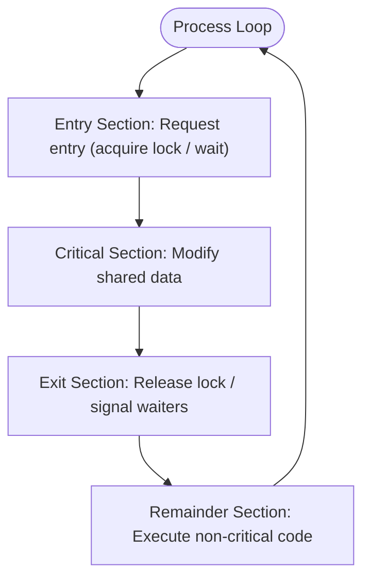
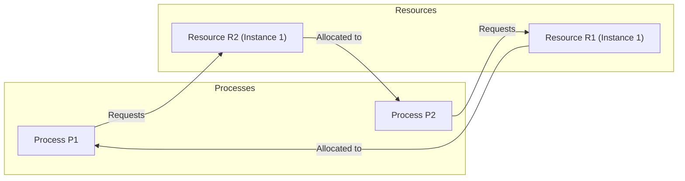
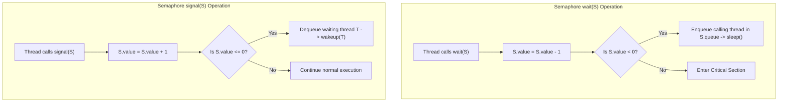
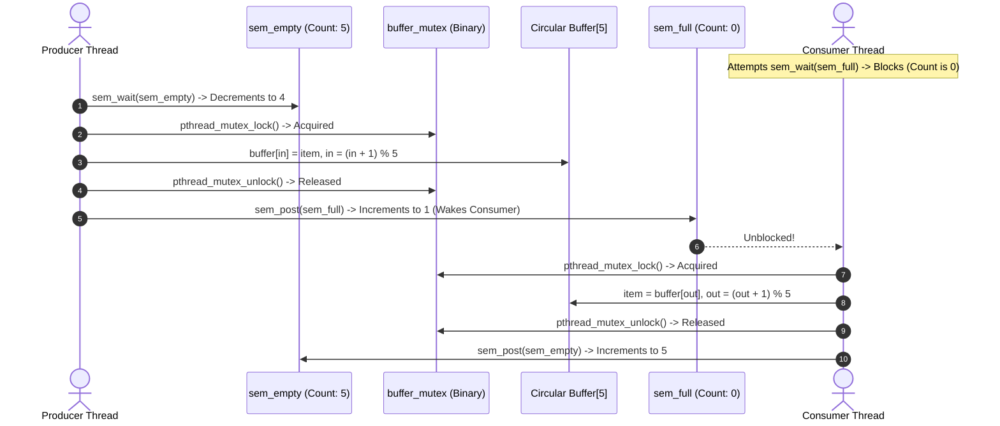

> [!info] Document Metadata
> - **Course:** `=this.course`
> - **Topic:** `=this.topic`
> - **Status:** `=this.status`

**Tags:** #[[Computer Science]] #[[CSOPESY]] #[[Operating Systems]] #[[07 - Synchronization Tools]]

---

# CSOPESY 07 - Synchronization Tools

## Overview
In modern computing, systems are typically designed to handle multiple processes or threads executing concurrently. While concurrency improves performance and responsiveness, it introduces a significant challenge: **data inconsistency**. When multiple processes access and manipulate shared data concurrently, their operations may interleave in unpredictable ways. The primary goal of process synchronization is to provide mechanisms that ensure the orderly execution of cooperating processes, thereby maintaining data consistency. 

This note covers the foundational problem of the critical section, along with both software and hardware-based solutions, and explores advanced synchronization primitives like Mutex Locks, Semaphores, and Monitors.

## Key Concepts

### Race Conditions
A **Race Condition** is a scenario where multiple processes access and manipulate shared data concurrently. The final outcome of the execution depends entirely on the unpredictable order in which the memory access takes place. 
- **Example:** In a banking application, if two transactions (a debit and a credit) are applied to an account balance simultaneously without proper synchronization, interleaved reads and writes may result in an incorrect final balance.

### The Critical-Section Problem
A **Critical Section** is the segment of code within a process or thread where shared data is accessed and modified. The **Critical-Section Problem** is the task of designing a protocol that cooperating processes can use to ensure that when one process is executing in its critical section, no other process is allowed to enter its critical section.



#### Solution Requirements
Any valid solution to the critical-section problem must satisfy three strict requirements:
1. **Mutual Exclusion:** If process $P_i$ is executing in its critical section, then no other processes can be executing in their respective critical sections.
2. **Progress:** If no process is executing in its critical section, and some processes wish to enter their critical sections, only those processes not in their remainder sections can participate in deciding which will enter next. This selection cannot be postponed indefinitely.
3. **Bounded Waiting:** There must be a strict limit (or bound) on the number of times other processes are allowed to enter their critical sections after a process has made a request to enter its critical section, and before that request is granted.

### Deadlocks and Starvation
- **Deadlock:** A catastrophic state where two or more processes are waiting indefinitely for an event that can only be triggered by one of the waiting processes. For instance, Process A holds Resource 1 and waits for Resource 2, while Process B holds Resource 2 and waits for Resource 1.
- **Starvation (Indefinite Blocking):** A process waits indefinitely within a semaphore's waiting queue, even though other processes are repeatedly entering and leaving the critical section. Unlike a deadlock, the system is still making progress overall, just not for the starved process.



---

## Algorithms & Formulas

### Peterson's Solution
A classic software-based solution restricted to two processes ($P_0$ and $P_1$). It relies on two shared variables:
- `turn`: An integer indicating whose turn it is to enter the critical section.
- `flag[2]`: A boolean array where `flag[i] = true` indicates that process $P_i$ is ready to enter its critical section.
While mathematically sound and satisfying all three critical-section requirements, Peterson's solution is not guaranteed to work on modern architectures due to instruction reordering and compiler optimizations.

### Hardware Synchronization
Modern architectures provide atomic (uninterruptible) hardware instructions to simplify synchronization.
- **Atomic Operation:** An operation that is executed completely or not at all, with no possibility of being interrupted mid-execution.
- **TestAndSet():** Atomically tests a boolean variable and sets it to true.
- **CompareAndSwap() (CAS):** Atomically compares a variable with an expected value, and if they match, swaps it with a new value.

### Advanced Synchronization Primitives
1. **Mutex Locks (Mutual Exclusion):** The simplest synchronization tool. A process must `acquire()` the lock before entering a critical section and `release()` it upon exiting. If the lock uses busy waiting (spinning in a loop), it is called a **Spinlock**. Spinlocks are advantageous in multicore systems for short critical sections because they avoid the overhead of a context switch.
2. **Semaphores:** Integer variables accessed via two atomic operations: `wait()` (or P) and `signal()` (or V). 
   - *Counting Semaphores:* Can range over an unrestricted domain, useful for controlling access to a resource pool with multiple instances.
   - *Binary Semaphores:* Restricted to 0 or 1, functionally similar to Mutex Locks.
   Semaphores solve the busy-waiting problem by suspending a waiting process and placing it in a waiting queue.
3. **Monitors:** High-level abstractions that encapsulate shared variables, synchronization operations, and condition variables (e.g., `wait()` and `signal()`). Monitors inherently guarantee mutual exclusion, preventing common programming errors associated with raw semaphores.



---

## Code Examples

### Peterson's Solution Structure (Process i)
```c
do {
    flag[i] = true;         // Indicate process i wants to enter
    turn = j;               // Give priority to process j
    
    // Wait if process j wants to enter and it's their turn
    while (flag[j] && turn == j); 
    
    /* --- CRITICAL SECTION --- */
    
    flag[i] = false;        // Indicate process i has exited
    
    /* --- REMAINDER SECTION --- */
} while (true);
```

### Hardware TestAndSet() Implementation
```c
boolean TestAndSet(boolean *target) {
    boolean rv = *target;
    *target = true; // Set the target to true atomically
    return rv;      // Return original value
}
```

### Hardware CompareAndSwap() Implementation
```c
int CompareAndSwap(int *value, int expected, int new_value) {
    int temp = *value;
    if (*value == expected) {
        *value = new_value; // Only update if it matches expected
    }
    return temp;            // Return original value
}
```

### Production POSIX Producer-Consumer Bounded-Buffer in C

Demonstrates counting semaphores (`empty`, `full`) and mutual exclusion (`mutex`):

```c
#include <stdio.h>
#include <stdlib.h>
#include <pthread.h>
#include <semaphore.h>
#include <unistd.h>

#define BUFFER_SIZE 5
#define TOTAL_ITEMS 10

int buffer[BUFFER_SIZE];
int in = 0;   // Index for producer insertion
int out = 0;  // Index for consumer removal

pthread_mutex_t buffer_mutex;
sem_t sem_empty;  // Tracks available vacant slots (init: BUFFER_SIZE)
sem_t sem_full;   // Tracks filled items available for consumption (init: 0)

void *producer(void *param) {
    for (int item = 1; item <= TOTAL_ITEMS; item++) {
        // 1. Wait for an available empty slot (MUST precede mutex to avoid deadlock)
        sem_wait(&sem_empty);

        // 2. Acquire mutual exclusion on shared buffer
        pthread_mutex_lock(&buffer_mutex);

        // Critical Section: Add item to circular buffer
        buffer[in] = item;
        printf("[Producer] Produced Item %d at buffer[%d]\n", item, in);
        in = (in + 1) % BUFFER_SIZE;

        // 3. Release mutual exclusion
        pthread_mutex_unlock(&buffer_mutex);

        // 4. Signal that a new filled slot is ready
        sem_post(&sem_full);

        usleep(50000); // Simulate production delay (50ms)
    }
    pthread_exit(NULL);
}

void *consumer(void *param) {
    for (int i = 1; i <= TOTAL_ITEMS; i++) {
        // 1. Wait for at least one filled item (MUST precede mutex)
        sem_wait(&sem_full);

        // 2. Acquire mutual exclusion
        pthread_mutex_lock(&buffer_mutex);

        // Critical Section: Remove item from circular buffer
        int item = buffer[out];
        printf("    [Consumer] Consumed Item %d from buffer[%d]\n", item, out);
        out = (out + 1) % BUFFER_SIZE;

        // 3. Release mutual exclusion
        pthread_mutex_unlock(&buffer_mutex);

        // 4. Signal that an empty slot has been reclaimed
        sem_post(&sem_empty);

        usleep(80000); // Simulate consumption processing delay (80ms)
    }
    pthread_exit(NULL);
}

int main(void) {
    pthread_t prod_thread, cons_thread;

    // Initialize synchronization primitives
    pthread_mutex_init(&buffer_mutex, NULL);
    sem_init(&sem_empty, 0, BUFFER_SIZE); // Initial vacant slots = 5
    sem_init(&sem_full, 0, 0);            // Initial ready items = 0

    // Spawn concurrent producer and consumer threads
    pthread_create(&prod_thread, NULL, producer, NULL);
    pthread_create(&cons_thread, NULL, consumer, NULL);

    // Wait for thread termination
    pthread_join(prod_thread, NULL);
    pthread_join(cons_thread, NULL);

    // Clean up resources
    pthread_mutex_destroy(&buffer_mutex);
    sem_destroy(&sem_empty);
    sem_destroy(&sem_full);

    printf("Producer-Consumer Execution Completed Cleanly.\n");
    return 0;
}
```

#### Protocol Sequence: Deadlock-Free Interleaving



---

## Multiple Choice Questions

1. Which of the following conditions ensures that if no process is executing in its critical section, the selection of the next process to enter cannot be postponed indefinitely?
A) Mutual Exclusion
B) Progress
C) Bounded Waiting
D) Spinlocking

2. What is the primary disadvantage of using a spinlock?
A) It requires a context switch, which is expensive.
B) It wastes CPU cycles if the critical section is long.
C) It cannot guarantee mutual exclusion on a single-core system.
D) It can only be implemented using Peterson's solution.

3. In the context of semaphores, what does the `wait()` operation do?
A) It increments the semaphore value and blocks the process if the value is negative.
B) It decrements the semaphore value and blocks the process if the value becomes negative.
C) It checks if the semaphore is zero, and if so, wakes up the next process.
D) It forces the CPU to idle until an interrupt occurs.

4. Which of the following accurately describes the difference between deadlock and starvation?
A) In a deadlock, the system makes progress for some processes, but in starvation, no processes make progress.
B) Deadlocks only occur with semaphores, while starvation only occurs with monitors.
C) In a deadlock, processes wait indefinitely for an event caused by another waiting process, halting progress; in starvation, the system continues to make progress, but a specific process is indefinitely denied resources.
D) There is no difference; they are synonymous terms in operating systems.

5. What happens when a process invokes `signal()` on a condition variable within a Monitor, and no process is currently waiting?
A) The signal is saved, and the next process to call `wait()` will immediately proceed.
B) The operation has no effect.
C) The monitor enters a deadlock state.
D) A hardware trap is generated.

6. Why might Peterson's solution fail on modern computer architectures?
A) It only supports up to three processes.
B) Modern architectures do not have boolean variables.
C) Modern processors optimize and reorder memory accesses, breaking the strict sequence of variable updates required.
D) The `while` loop consumes too much power.

7. Which synchronization tool provides built-in mutual exclusion and encapsulates shared data and condition variables into a single abstract data type?
A) Spinlock
B) Semaphore
C) Monitor
D) Atomic Integer

### Answer Key & Explanations
1. **B) Progress.** The progress requirement specifically guarantees that a decision on which process enters the critical section next is made by the processes not in their remainder sections, and it is made without indefinite delay.
2. **B) It wastes CPU cycles if the critical section is long.** Spinlocks use "busy waiting" by continuously looping while checking a condition, preventing other tasks from utilizing that CPU core.
3. **B) It decrements the semaphore value and blocks the process if the value becomes negative.** If it drops below zero, the process cannot proceed and is placed in a blocked queue.
4. **C)** Deadlock implies a circular wait where no involved process can proceed. Starvation means one or more processes are skipped over indefinitely, but the system overall is still servicing other processes.
5. **B) The operation has no effect.** Unlike semaphores, where a signal (or V) increments a persistent counter, a signal on a condition variable in a monitor is lost if there are no waiting processes.
6. **C)** Out-of-order execution and memory caching in modern CPUs can cause the updates to `turn` and `flag` to appear in a different order to other threads, violating the solution's logic.
7. **C) Monitor.** Monitors encapsulate the shared data, the operations on that data, and the synchronization mechanisms (condition variables) guaranteeing that only one process is active within the monitor at a time.

## References & Navigation

- **Previous Topic:** [[CSOPESY 06 - CPU Scheduling]]
- **Next Topic:** [[CSOPESY 08 - Main Memory]]
- **Related Notes:** 
