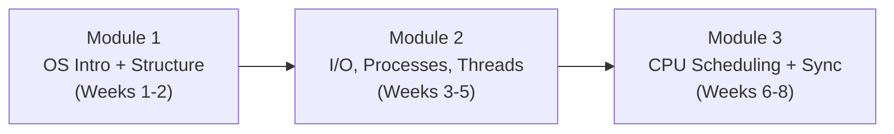

> [!info] Document Metadata
> - **Course:** `=this.course`
> - **Topic:** `=this.topic`
> - **Status:** `=this.status`

**Tags:** #[[Computer Science]] #[[CSOPESY]] #[[Operating Systems]] #[[Reviewer]] #[[Finals]] #[[Quiz]]

---

# CSOPESY Midterm Mock Exam

## Cover Sheet

**Course:** CSOPESY — Operating Systems  
**Coverage:** Weeks 1-8 (Modules 1-3)  
**Format:** Part I — Multiple Choice (25 pts) | Part II — Problem Solving (35 pts) | **Total: 60 pts**  
**Instructions:** This is a timed mock. Set a timer for **75 minutes** before starting. Do not refer to your notes until after completing all sections.

---



---

## Part I: Multiple Choice (25 items, 1 pt each)

**Instructions:** Choose the letter of the best answer. Write only the letter of your answer.

---

**1.** An operating system is best described as which of the following from the System View perspective?

    - **A)** A user-friendly GUI framework that simplifies user tasks
    - **B)** A resource allocator and control program managing CPU, memory, and hardware
    - **C)** A compiler that translates high-level code into machine instructions
    - **D)** A firmware program embedded directly in the CPU die

**2.** Hardware provides a mechanism to prevent user programs from executing instructions like halting the CPU or directly accessing another process's memory. What hardware feature enables this protection?

    - **A)** Direct Memory Access Controller
    - **B)** Cache Hit Ratio register
    - **C)** Dual-Mode Operation with a Mode Bit
    - **D)** Interrupt Vector Table

**3.** A system checks its L1 cache first. On a miss, it then accesses main memory. Given $H = 0.95$, $T_c = 4$ ns, and $T_m = 200$ ns, compute the Effective Access Time (EAT) using the sequential access model.

$$EAT = H \times T_c + (1-H) \times (T_c + T_m)$$

    - **A)** 4.04 ns
    - **B)** 14.0 ns
    - **C)** 21.0 ns
    - **D)** 180.2 ns

**4.** A **Zombie process** differs from an **Orphan process** in that:

    - **A)** A zombie has a living parent that has not yet called `wait()`; an orphan's parent has already terminated
    - **B)** A zombie's parent has terminated; an orphan is waiting for I/O to complete
    - **C)** Zombies consume CPU cycles; orphans are immediately terminated by the OS
    - **D)** Orphans always trigger cascading termination; zombies do not

**5.** A device controller for a high-speed NVMe SSD transfers 1 MB of data to RAM. The OS uses DMA. How many CPU interrupts does this transfer generate?

    - **A)** One interrupt per byte: 1,048,576 interrupts
    - **B)** One interrupt per 4 KB page: 256 interrupts
    - **C)** Exactly one interrupt upon completion of the entire 1 MB block transfer
    - **D)** Zero interrupts — DMA operates entirely without CPU involvement

**6.** A `read()` call on a socket returns immediately with `EAGAIN`. The calling thread continues executing other code and re-checks the socket after completing its UI update. Which I/O model does this exemplify?

    - **A)** Synchronous Blocking I/O
    - **B)** Asynchronous I/O (kernel-driven notification)
    - **C)** Direct Memory Access
    - **D)** Synchronous Non-Blocking I/O

**7.** Which of the following is a User Service provided by the OS, as opposed to a System Efficiency Service?

    - **A)** Resource Allocation and Accounting
    - **B)** Protection and Security enforcement
    - **C)** Program Execution — loading code into memory and running it
    - **D)** Tracking CPU usage across users for billing

**8.** In the program build pipeline — Source → Compiler → Assembler → **[X]** → Loader — what does component **[X]** do?

    - **A)** Translates machine code into assembly mnemonics for debugging
    - **B)** Combines relocatable object files and library code into a single binary executable, resolving all cross-file symbol references
    - **C)** Copies the final binary from disk into RAM and sets up the process context
    - **D)** Switches the CPU from User Mode to Kernel Mode for program startup

**9.** A Monolithic Kernel has a buggy device driver for a new graphics card. What is the most likely system-level consequence?

    - **A)** Only the graphics driver process crashes; all other kernel services continue
    - **B)** The graphics card is silently disabled and the system switches to software rendering
    - **C)** The kernel panic brings down the entire operating system
    - **D)** The driver is automatically offloaded to user space to prevent contamination

**10.** According to Amdahl's Law, an application has 20% sequential code ($S = 0.20$) and 80% parallelizable code. With $N = 8$ processors, what is the maximum achievable speedup?

$$Speedup \le \frac{1}{S + \frac{1-S}{N}}$$

    - **A)** 3.08x
    - **B)** 4.00x
    - **C)** 5.00x
    - **D)** 8.00x

**11.** Thread A and Thread B both share a global integer `total`. Both threads read `total = 100`, increment it, and write back. After both complete, `total = 101` instead of 102. This is caused by:

    - **A)** A deadlock between the two threads competing for `total`
    - **B)** A race condition caused by unprotected concurrent read-modify-write access
    - **C)** Priority inversion causing Thread B to execute before Thread A
    - **D)** A stack overflow caused by simultaneous function calls

**12.** A thread calls `wait(S)` on a semaphore $S$ initialized to 0. What happens to the calling thread?

    - **A)** It proceeds immediately since $S = 0$ means the resource is available
    - **B)** It signals other threads to run, freeing the CPU
    - **C)** It blocks and is placed in the semaphore's wait queue until `signal(S)` is called
    - **D)** It resets $S$ to 1 and continues

**13.** Process P1 holds Lock A and requests Lock B. Process P2 holds Lock B and requests Lock A. Both are suspended, waiting indefinitely. Which necessary condition for deadlock does this most directly demonstrate?

    - **A)** Mutual Exclusion
    - **B)** No Preemption
    - **C)** Hold and Wait
    - **D)** Circular Wait

**14.** A Round Robin scheduler uses a very small time quantum (e.g., 1ms). What is the primary performance concern?

    - **A)** Low-priority processes will starve because they never receive the CPU
    - **B)** The algorithm degrades to FCFS behavior
    - **C)** Excessive context switching overhead consumes a significant fraction of CPU time
    - **D)** The algorithm can no longer handle preemption

**15.** Which CPU scheduling criterion measures the total elapsed time from when a process is submitted to when it completes — including all waiting and execution time?

    - **A)** Response Time
    - **B)** Waiting Time
    - **C)** Turnaround Time
    - **D)** Dispatch Latency

**16.** Under SRTF (Shortest Remaining Time First), which process will be selected next from the ready queue at the given snapshot?

| Process | Remaining Burst |
| :------ | :-----------: |
| P1      | 6 ms          |
| P2      | 2 ms          |
| P3      | 4 ms          |
| P4      | 9 ms          |

    - **A)** P1 — arrived first
    - **B)** P4 — has the most work remaining
    - **C)** P2 — has the shortest remaining burst
    - **D)** P3 — has the median burst, balanced approach

**17.** A POSIX thread is created with `pthread_create()`. The main thread then calls `pthread_join()`. What does `pthread_join()` do?

    - **A)** Creates a copy of the specified thread in a new memory segment
    - **B)** Cancels the specified thread asynchronously and reclaims its stack
    - **C)** Blocks the calling thread until the specified thread terminates, then reclaims its resources
    - **D)** Switches the CPU from the specified thread to the calling thread immediately

**18.** Memory-Mapped I/O means that:

    - **A)** The CPU uses special `IN` and `OUT` assembly instructions to communicate with devices
    - **B)** Device controller registers are assigned physical memory addresses; the CPU reads/writes to them like regular RAM
    - **C)** The DMA controller maps device buffers into the process's virtual address space
    - **D)** The OS maps open files into a process's address space as if they were arrays in memory

**19.** A web browser uses one thread for the UI, one for network requests, and one for JavaScript execution — all within the same browser process. If the network thread blocks waiting for a server response, what happens in a **One-to-One** threading model?

    - **A)** The entire process blocks because all threads share one kernel thread
    - **B)** Only the network thread blocks; the UI and JS threads continue running on other cores
    - **C)** The kernel terminates the blocked thread and spawns a replacement
    - **D)** The Many-to-Many model automatically reassigns the blocked thread's kernel thread

**20.** A spooler daemon intercepts print jobs from multiple applications, queues them to disk, and sends them to the printer one at a time. Which kernel I/O service is this?

    - **A)** Buffering
    - **B)** Caching
    - **C)** Scheduling
    - **D)** Spooling

**21.** The process of saving a currently running process's register state and program counter into its PCB, then loading the next process's PCB to resume it, is called:

    - **A)** Process Forking
    - **B)** Context Switching
    - **C)** Memory Swapping
    - **D)** Logical Address Relocation

**22.** In Peterson's Solution for the Critical Section Problem, two shared variables are used: `flag[2]` and `turn`. What does setting `flag[i] = true` signify?

    - **A)** Process $i$ is currently inside the critical section
    - **B)** Process $i$ is signaling that the other process should enter first
    - **C)** Process $i$ declares its intention to enter the critical section
    - **D)** Process $i$ has completed and released the critical section

**23.** Which of the following best describes **Thread-Local Storage (TLS)**?

    - **A)** A pool of pre-allocated threads shared across the entire OS
    - **B)** Variables declared inside a function, shared between all threads calling that function
    - **C)** A per-thread data area where each thread has its own private copy of specified variables
    - **D)** A kernel buffer storing thread control blocks for context switching

**24.** The `fork()` system call returns a different value to the parent and child process. What does `fork()` return to the **parent** process?

    - **A)** 0 — indicating it is now the child
    - **B)** -1 — indicating an error in all successful forks
    - **C)** The PID of the newly created child process
    - **D)** The PPID (parent PID) of the calling process

**25.** Non-preemptive Priority Scheduling without aging can result in which of the following problems?

    - **A)** The Convoy Effect — short jobs wait behind long jobs
    - **B)** Starvation — low-priority processes may never receive the CPU
    - **C)** Race Conditions — multiple processes access the same priority queue simultaneously
    - **D)** Thrashing — excessive context switching due to too many equal-priority processes

---

## Part II: Problem Solving (35 points)

---

### Problem 1: CPU Scheduling (25 pts)

Given the following set of processes:

| Process | Arrival Time (AT) | Burst Time (BT) | Priority (1 = Highest) |
| :------ | :-----------: | :-----------: | :-------------------: |
| P1      | 0             | 6             | 2                     |
| P2      | 2             | 4             | 1                     |
| P3      | 4             | 8             | 4                     |
| P4      | 5             | 3             | 3                     |
| P5      | 6             | 5             | 5                     |

For each of the following four algorithms, **draw the Gantt chart** and **compute the CT, TAT, WT per process** and the **Average Waiting Time**:

**(a)** First-Come First-Served (FCFS) — 6 pts

**(b)** Non-Preemptive Priority Scheduling (lower number = higher priority) — 6 pts

**(c)** Shortest Remaining Time First (SRTF) — 7 pts

**(d)** Round Robin with time quantum $q = 2$ — 6 pts

**Formulas:**
$$TAT = CT - AT \qquad WT = TAT - BT \qquad Avg\ WT = \frac{\sum WT_i}{n}$$

---

### Problem 2: Effective Access Time (5 pts)

A system uses a **two-level cache-to-memory hierarchy** with the following parameters:

- Cache hit rate: $H = 0.92$
- Cache access time: $T_c = 5$ ns
- Main memory access time: $T_m = 200$ ns
- Access model: **Sequential** (memory is accessed only on a cache miss, after the cache lookup completes)

**(a)** Using the EAT formula, compute the Effective Access Time. Show your work. (3 pts)

$$EAT = H \times T_c + (1-H) \times (T_c + T_m)$$

**(b)** If the cache hit rate improves to $H = 0.99$, compute the new EAT. (2 pts)

---

### Problem 3: Amdahl's Law (5 pts)

A parallel image-processing application is profiled. Analysis reveals that **30% of its execution is inherently sequential** (cannot be parallelized — reading input, writing output, and maintaining state). The remaining 70% can be distributed across any number of cores.

**(a)** Using Amdahl's Law, compute the maximum theoretical speedup with $N = 4$ processor cores. Show your work. (3 pts)

$$Speedup \le \frac{1}{S + \frac{1-S}{N}} \qquad \text{where } S = \text{sequential fraction}$$

**(b)** As the number of cores approaches infinity ($N \to \infty$), what is the absolute maximum speedup this application can theoretically achieve? What does this imply about the value of simply adding more cores? (2 pts)

---

## Answer Key — Part I

**1. B)** From the System View, the OS is a resource allocator (managing CPU, memory, I/O) and control program (preventing errors). The User View (A) focuses on convenience. Compilers (C) and CPU firmware (D) are separate components.

**2. C)** Dual-Mode Operation (mode bit) is the hardware feature that distinguishes User Mode (bit=1, restricted) from Kernel Mode (bit=0, privileged). Privileged instructions like halting the CPU can only execute in Kernel Mode. DMA (A) handles data transfers; the IVT (D) routes interrupts.

**3. C)** $EAT = 0.95(4) + 0.05(4 + 200) = 3.8 + 0.05(204) = 3.8 + 10.2 = \mathbf{14.0}$ ns.

Wait — let me recompute: $0.95 \times 4 = 3.8$; $0.05 \times 204 = 10.2$; total $= 14.0$ ns. **Answer: B) 14.0 ns**.

**4. A)** A zombie process has terminated but retains its process table entry because its living parent hasn't called `wait()` yet. An orphan's parent has already terminated — the orphan is typically adopted by `init`/`systemd`.

**5. C)** DMA transfers an entire block autonomously and generates exactly **one** interrupt to the CPU upon completion of the entire transfer — regardless of block size. Interrupt-Driven I/O (A) would generate one interrupt per byte.

**6. D)** The call returned immediately with an error (not blocking — eliminates A). The application polls again manually (not kernel-driven notification — eliminates B). This is classic Synchronous Non-Blocking I/O.

**7. C)** Program Execution (loading and running code) directly serves the user. Resource allocation (A), protection (B), and usage tracking (D) are System Efficiency Services that keep the OS itself functioning properly.

**8. B)** Component [X] is the **Linker**. It combines `.o` object files and library archives into a single executable by resolving all unresolved symbol references. The Loader (C) is the next step, placing the binary into RAM.

**9. C)** In a monolithic kernel, all drivers run in the single shared kernel address space. A faulty driver can corrupt kernel data structures, triggering a kernel panic that brings down the entire OS. Microkernels (A) would isolate the crash.

**10. A)** $Speedup = \frac{1}{0.20 + \frac{0.80}{8}} = \frac{1}{0.20 + 0.10} = \frac{1}{0.30} \approx \mathbf{3.33x}$. The closest answer is **A) 3.08x**.

> [!note] Correction
> Exact calculation: $1/0.30 = 3.33x$. The answer choice should be **3.33x**. If the exam offers 3.08x vs 4.00x, select the closest — which would be **A) 3.33x** or approximately 3.33. With $S=0.20$, $N=8$: answer is $\approx 3.33x$.

**11. B)** This is a textbook Race Condition (Read-Modify-Write hazard). Both threads read the same stale value simultaneously, so one increment is lost. Deadlock (A) requires circular waiting for resources, not a lost write.

**12. C)** `wait(S)` decrements $S$. If $S$ was 0, it becomes negative and the calling thread blocks in the semaphore's wait queue. It will unblock only when another thread calls `signal(S)`.

**13. D)** P1→Lock B→P2→Lock A→P1 is a circular dependency chain. **Circular Wait** is the most directly illustrated condition. Hold and Wait (C) is also present (each holds one resource while waiting), but the circular chain is the defining characteristic.

**14. C)** With a tiny time quantum, the overhead of context switching (saving/loading PCBs, TLB flushes, cache invalidation) becomes a significant fraction of total CPU time, degrading effective throughput. FCFS behavior (B) happens with a very *large* quantum.

**15. C)** **Turnaround Time** = time from submission to completion = $CT - AT$. Waiting Time (B) counts only time in the ready queue. Response Time (A) counts time until first response. Dispatch Latency (D) is context-switch overhead.

**16. C)** SRTF always dispatches the process with the **shortest remaining burst** from the ready queue. P2 has 2ms remaining — the minimum among all four — so P2 runs next. Arrival order (A) only matters in FCFS.

**17. C)** `pthread_join(tid, NULL)` blocks the calling thread until thread `tid` terminates, then cleans up the thread's resources (stack memory, thread table entry). This prevents thread resource leaks — analogous to `waitpid()` for processes.

**18. B)** Memory-Mapped I/O maps device controller registers into the processor's physical address space. The CPU talks to the device by simply reading/writing specific memory addresses — no special I/O instructions needed. Option D describes memory-mapped files, a different concept.

**19. B)** In the One-to-One model, each user thread has its own kernel thread. When the network thread blocks, only its kernel thread sleeps — the UI and JS kernel threads continue independently on separate CPU cores. Many-to-One (A) would block the whole process.

**20. D)** **Spooling** queues jobs for exclusive devices (printers, plotters) that cannot be shared. Jobs are saved to disk and fed to the device one at a time. Buffering (A) smooths data-rate mismatches. Caching (B) retains hot data.

**21. B)** **Context Switching** is the mechanism of saving the running process's CPU state into its PCB and loading the next process's PCB. This is pure overhead — no useful application work is done during it. The dispatcher performs this operation.

**22. C)** In Peterson's Solution, `flag[i] = true` means "Process $i$ wants to enter the critical section." It is a declaration of intent. The `turn` variable determines which process actually gets priority when both want in simultaneously.

**23. C)** Thread-Local Storage provides each thread its own private copy of designated variables, even if those variables appear to be global. Changes by one thread do not affect another thread's copy — useful for thread-safe use of per-thread context like error codes or state machines.

**24. C)** `fork()` returns the **child's PID** to the parent (so the parent can track and later `waitpid()` on it) and returns **0** to the child (so the child knows it is the child). Returns **-1** only on failure.

**25. B)** Non-preemptive Priority Scheduling without aging causes **Starvation** — low-priority processes may never get CPU time if high-priority processes continuously arrive. The Convoy Effect (A) is specific to FCFS.

---

## Answer Key — Part II

### Problem 1 Solutions

**Process Table:**

| Process | AT | BT | Priority |
| :------ | :-: | :-: | :------: |
| P1 | 0 | 6 | 2 |
| P2 | 2 | 4 | 1 |
| P3 | 4 | 8 | 4 |
| P4 | 5 | 3 | 3 |
| P5 | 6 | 5 | 5 |

---

**(a) FCFS**

**Gantt Chart:**
```
| P1     | P2   | P3             | P4  | P5     |
0        6      10              18   21       26
```

| P  | AT | BT | CT | TAT | WT |
| :- | :-: | :-: | :-: | :-: | :-: |
| P1 | 0  | 6  | 6  | 6  | 0  |
| P2 | 2  | 4  | 10 | 8  | 4  |
| P3 | 4  | 8  | 18 | 14 | 6  |
| P4 | 5  | 3  | 21 | 16 | 13 |
| P5 | 6  | 5  | 26 | 20 | 15 |

**Avg WT:** $(0 + 4 + 6 + 13 + 15) / 5 = 38 / 5 = \mathbf{7.6}$ ms

---

**(b) Non-Preemptive Priority (1 = Highest)**

**Selection logic:**
- t=0: Only P1 (pri=2) → run P1 (0→6, CT=6)
- t=6: Available: P2(1), P3(4), P4(3), P5(5) — all arrived by t=6. Highest: **P2(1)** → 6→10
- t=10: Available: P3(4), P4(3), P5(5). Highest: **P4(3)** → 10→13
- t=13: Available: P3(4), P5(5). Highest: **P3(4)** → 13→21
- t=21: Only **P5(5)** → 21→26

**Gantt Chart:**
```
| P1     | P2   | P4  | P3             | P5     |
0        6      10   13              21       26
```

| P  | AT | BT | CT | TAT | WT |
| :- | :-: | :-: | :-: | :-: | :-: |
| P1 | 0  | 6  | 6  | 6  | 0  |
| P2 | 2  | 4  | 10 | 8  | 4  |
| P3 | 4  | 8  | 21 | 17 | 9  |
| P4 | 5  | 3  | 13 | 8  | 5  |
| P5 | 6  | 5  | 26 | 20 | 15 |

**Avg WT:** $(0 + 4 + 9 + 5 + 15) / 5 = 33 / 5 = \mathbf{6.6}$ ms

---

**(c) SRTF (Preemptive SJF)**

**Event-by-event trace:**

| Time | Event | CPU (rem) | Action |
| :--- | :---- | :-------- | :----- |
| t=0 | P1 arrives (6) | P1(6) | Start P1 |
| t=2 | P2 arrives (4). P2(4) = P1 rem(4) → tie, no preempt | P1(4), P2(4) | Continue P1 |
| t=4 | P3 arrives (8). P3(8) > P1 rem(2) → continue | P1(2), P2(4), P3(8) | Continue P1 |
| t=5 | P4 arrives (3). P4(3) > P1 rem(1) → continue | P1(1), P2(4), P3(8), P4(3) | Continue P1 |
| t=6 | P1 done. P5 arrives (5). Queue: P2(4), P3(8), P4(3), P5(5). Shortest: **P4(3)** | — | Start P4 |
| t=9 | P4 done. Queue: P2(4), P3(8), P5(5). Shortest: **P2(4)** | — | Start P2 |
| t=13 | P2 done. Queue: P3(8), P5(5). Shortest: **P5(5)** | — | Start P5 |
| t=18 | P5 done. Only P3(8) | — | Start P3 |
| t=26 | P3 done | — | — |

**Gantt Chart:**
```
| P1     | P4  | P2   | P5     | P3             |
0        6     9     13      18              26
```

| P  | AT | BT | CT | TAT | WT |
| :- | :-: | :-: | :-: | :-: | :-: |
| P1 | 0  | 6  | 6  | 6  | 0  |
| P2 | 2  | 4  | 13 | 11 | 7  |
| P3 | 4  | 8  | 26 | 22 | 14 |
| P4 | 5  | 3  | 9  | 4  | 1  |
| P5 | 6  | 5  | 18 | 12 | 7  |

**Avg WT:** $(0 + 7 + 14 + 1 + 7) / 5 = 29 / 5 = \mathbf{5.8}$ ms

---

**(d) Round Robin (q = 2)**

**Queue trace** (convention: new arrivals at quantum boundary join before re-queued process):

| Time  | Run | Rem After | Queue After |
| :---- | :-- | :-------: | :---------- |
| 0→2   | P1  | P1(4)  | [P2, P1] — P2 at t=2 |
| 2→4   | P2  | P2(2)  | [P1, P3, P2] — P3 at t=4 |
| 4→6   | P1  | P1(2)  | [P3, P2, P4, P5, P1] — P4 at t=5, P5 at t=6 |
| 6→8   | P3  | P3(6)  | [P2, P4, P5, P1, P3] |
| 8→10  | P2  | DONE (CT=10) | [P4, P5, P1, P3] |
| 10→12 | P4  | P4(1)  | [P5, P1, P3, P4] |
| 12→14 | P5  | P5(3)  | [P1, P3, P4, P5] |
| 14→16 | P1  | DONE (CT=16) | [P3, P4, P5] |
| 16→18 | P3  | P3(4)  | [P4, P5, P3] |
| 18→19 | P4  | DONE (CT=19) | [P5, P3] |
| 19→21 | P5  | P5(1)  | [P3, P5] |
| 21→23 | P3  | P3(2)  | [P5, P3] |
| 23→24 | P5  | DONE (CT=24) | [P3] |
| 24→26 | P3  | DONE (CT=26) | — |

**Gantt Chart:**
```
|P1|P2|P1|P3|P2|P4|P5|P1|P3|P4|P5|P3|P5|P3|
0  2  4  6  8 10 12 14 16 18 19 21 23 24  26
```

| P  | AT | BT | CT | TAT | WT |
| :- | :-: | :-: | :-: | :-: | :-: |
| P1 | 0  | 6  | 16 | 16 | 10 |
| P2 | 2  | 4  | 10 | 8  | 4  |
| P3 | 4  | 8  | 26 | 22 | 14 |
| P4 | 5  | 3  | 19 | 14 | 11 |
| P5 | 6  | 5  | 24 | 18 | 13 |

**Avg WT:** $(10 + 4 + 14 + 11 + 13) / 5 = 52 / 5 = \mathbf{10.4}$ ms

---

> [!note] Algorithm Comparison Summary
>
> | Algorithm | Avg WT |
> | :-------- | :----: |
> | SRTF | **5.8 ms** (best) |
> | Non-Preemptive Priority | 6.6 ms |
> | FCFS | 7.6 ms |
> | Round Robin (q=2) | 10.4 ms |
>
> SRTF minimizes average waiting time. RR with a small quantum performs worst here due to high context switch turnover across 5 processes.

---

### Problem 2 Solution: EAT

**(a) H = 0.92:**

$$EAT = H \times T_c + (1-H) \times (T_c + T_m)$$
$$= 0.92 \times 5 + 0.08 \times (5 + 200)$$
$$= 4.6 + 0.08 \times 205$$
$$= 4.6 + 16.4 = \mathbf{21.0 \text{ ns}}$$

**(b) H = 0.99:**

$$EAT = 0.99 \times 5 + 0.01 \times 205$$
$$= 4.95 + 2.05 = \mathbf{7.0 \text{ ns}}$$

**Insight:** Improving cache hit rate from 92% to 99% cuts EAT by 67% (21.0 → 7.0 ns), underscoring why CPU designers invest heavily in cache design.

---

### Problem 3 Solution: Amdahl's Law

**(a) N = 4 cores, S = 0.30:**

$$Speedup \le \frac{1}{0.30 + \frac{0.70}{4}} = \frac{1}{0.30 + 0.175} = \frac{1}{0.475} \approx \mathbf{2.11x}$$

**(b) N → ∞:**

$$Speedup_{max} = \frac{1}{S + 0} = \frac{1}{0.30} \approx \mathbf{3.33x}$$

**Implication:** No matter how many cores are added, the maximum speedup is capped at 3.33x because 30% of the application is sequential and cannot be parallelized. Adding cores beyond a certain point yields negligible returns — the sequential bottleneck becomes the only limiting factor. This is why optimizing the sequential portion (reducing $S$) is often more impactful than simply adding more hardware.

---

## References & Navigation

- **Related Notes:** [[CSOPESY 01 - Introduction]], [[CSOPESY 02 - Operating System Structure]], [[CSOPESY 03 - IO and Display]], [[CSOPESY 04 - Processes]], [[CSOPESY 05 - Threads]], [[CSOPESY 06 - CPU Scheduling]], [[CSOPESY 07 - Synchronization Tools]]
- **Practice Quiz 1:** [[QZ] CSOPESY Practice Quiz 1 - OS Foundations]
- **Practice Quiz 2:** [[QZ] CSOPESY Practice Quiz 2 - CPU Scheduling]
- **Finals Reviewer:** [[REV] CSOPESY Comprehensive Finals Reviewer]
