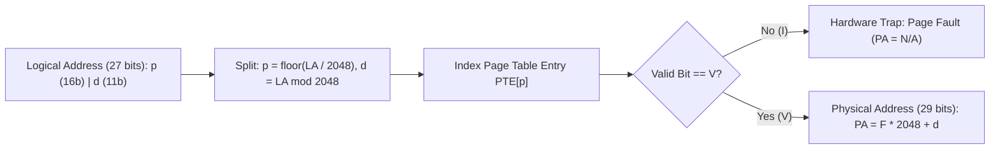

# [EX] Exercise 5 - Paging and Address Translation

> [!info] Document Metadata
> - **Course:** `=this.course`
> - **Topic:** `=this.topic`
> - **Status:** `=this.status`

**Tags:** #[[Computer Science]] #[[CSOPESY]] #[[Operating Systems]] #[[Memory Management]] #[[Paging]] #[[Exercise]]

---

## Overview

Paging eliminates external fragmentation by partitioning a process's logical address space into fixed-size **pages** and physical RAM into identically sized **frames**. This exercise derives the exact bit-field widths and table dimensions for a $128\text{ MB}$ logical / $512\text{ MB}$ physical byte-addressable paging system with $2\text{ KB}$ pages, then performs complete logical-to-physical address translation—including Valid/Invalid bit checking and page-fault trap detection—using a per-process page table.

## System Specifications & Page Table

### Hardware & Addressing Parameters
- **Logical Address Space Size:** $128\text{ MB} = 2^{27}\text{ bytes}$
- **Physical Memory Size:** $512\text{ MB} = 2^{29}\text{ bytes}$
- **Page Size (and Frame Size):** $2\text{ KB} = 2^{11}\text{ bytes} = 2{,}048\text{ bytes}$

### Active Process Page Table

| Page Number ($P$) | Frame Number ($F$) | Valid / Invalid Bit ($V$) | Status |
| :---: | :---: | :---: | :--- |
| $0$ | $8$ | `V` | Resident in RAM |
| $1$ | $20$ | `V` | Resident in RAM |
| $2$ | $12$ | `V` | Resident in RAM |
| $3$ | $11$ | `V` | Resident in RAM |
| $4$ | $15$ | `V` | Resident in RAM |
| $5$ | $9$ | `I` | Not resident (**Page Fault / Trap**) |
| $6$ | $4$ | `V` | Resident in RAM |
| $7$ | $1$ | `V` | Resident in RAM |

---

## Part 1: Memory Parameter Calculations

For a byte-addressable paging architecture with Logical Space $L = 2^m$, Physical Memory $M = 2^k$, and Page/Frame Size $S = 2^n$:

- **Page Offset Bits:** $d_{\text{bits}} = \log_2(S) = n$
- **Total Logical Pages:** $N_{\text{pages}} = L / S = 2^{m - n}$
- **Page Number Bits:** $p_{\text{bits}} = \log_2(N_{\text{pages}}) = m - n$
- **Total Physical Frames:** $N_{\text{frames}} = M / S = 2^{k - n}$
- **Frame Number Bits:** $f_{\text{bits}} = \log_2(N_{\text{frames}}) = k - n$

### Complete Parameter Derivations (Questions 1–5)

| Question | Parameter | Derivation | Verified Answer |
| :---: | :--- | :--- | :---: |
| **Q1** | Bits for **Page Offset ($d$)** | $\log_2(2\text{ KB}) = \log_2(2^{11}) = 11$ | **$11\text{ bits}$** |
| **Q2** | Total **pages** in Logical Address Space | $\dfrac{2^{27}}{2^{11}} = 2^{16} = 65{,}536$ | **$65{,}536\text{ pages}$** |
| **Q3** | Bits for **Page Number ($p$)** | $27 - 11 = \log_2(65{,}536) = 16$ | **$16\text{ bits}$** |
| **Q4** | Total **frames** in Physical Memory | $\dfrac{2^{29}}{2^{11}} = 2^{18} = 262{,}144$ | **$262{,}144\text{ frames}$** |
| **Q5** | Bits for **Frame Number ($f$)** | $29 - 11 = \log_2(262{,}144) = 18$ | **$18\text{ bits}$** |

Notice that a logical address has $16 + 11 = 27\text{ bits}$ (matching $2^{27} = 128\text{ MB}$), while a translated physical address has $18 + 11 = 29\text{ bits}$ (matching $2^{29} = 512\text{ MB}$). Only the upper page bits are translated; the lower $11$ offset bits pass through the MMU unchanged.

---

## Part 2: Logical-to-Physical Address Translation

### Translation Formulas

With page size $S = 2{,}048\text{ bytes}$:
$$P = \left\lfloor \frac{LA}{2{,}048} \right\rfloor, \qquad d = LA \bmod 2{,}048$$
$$\text{If } \text{PTE}[P].\text{valid} = \texttt{V}: \quad PA = (F \times 2{,}048) + d \quad (\text{Hit})$$
$$\text{If } \text{PTE}[P].\text{valid} = \texttt{I}: \quad F = \texttt{I}, \quad PA = \texttt{N/A} \quad (\text{Trap / Page Fault})$$

### Complete Translation Table (Question 6)

| Logical Address ($LA$) | Page Number ($P$) | Offset ($d$) | Frame Number ($F$) | Physical Address ($PA$) | Result (`Hit`/`Trap`) |
| :---: | :---: | :---: | :---: | :---: | :---: |
| **`4,100`** | $2$ | $4$ | $12$ | **$24{,}580$** | **Hit** |
| **`10,245`** | $5$ | $5$ | **`I`** | **`N/A`** | **Trap** |
| **`2,048`** | $1$ | $0$ | $20$ | **$40{,}960$** | **Hit** |
| **`14,340`** | $7$ | $4$ | $1$ | **$2{,}052$** | **Hit** |

### Row-by-Row Arithmetic Verification

1. **$LA = 4{,}100$:**
   - $P = \lfloor 4{,}100 / 2{,}048 \rfloor = 2$ (since $2 \times 2{,}048 = 4{,}096$)
   - $d = 4{,}100 - 4{,}096 = 4$
   - Lookup $\text{PTE}[2]$: $F = 12$, Valid bit $= \texttt{V}$ (**Hit**)
   - $PA = (12 \times 2{,}048) + 4 = 24{,}576 + 4 = \mathbf{24{,}580}$

2. **$LA = 10{,}245$:**
   - $P = \lfloor 10{,}245 / 2{,}048 \rfloor = 5$ (since $5 \times 2{,}048 = 10{,}240$)
   - $d = 10{,}245 - 10{,}240 = 5$
   - Lookup $\text{PTE}[5]$: Valid bit $= \texttt{I}$ (**Invalid** — although the raw frame column contains stale value $9$, the MMU never uses an invalid entry and immediately raises a **Page Fault Trap**).
   - Output: Frame $= \texttt{I}$, $PA = \texttt{N/A}$, Result $= \texttt{Trap}$.

3. **$LA = 2{,}048$:**
   - $P = \lfloor 2{,}048 / 2{,}048 \rfloor = 1$ (exact page boundary — first byte of Page 1)
   - $d = 2{,}048 \bmod 2{,}048 = 0$
   - Lookup $\text{PTE}[1]$: $F = 20$, Valid bit $= \texttt{V}$ (**Hit**)
   - $PA = (20 \times 2{,}048) + 0 = \mathbf{40{,}960}$

4. **$LA = 14{,}340$:**
   - $P = \lfloor 14{,}340 / 2{,}048 \rfloor = 7$ (since $7 \times 2{,}048 = 14{,}336$)
   - $d = 14{,}340 - 14{,}336 = 4$
   - Lookup $\text{PTE}[7]$: $F = 1$, Valid bit $= \texttt{V}$ (**Hit**)
   - $PA = (1 \times 2{,}048) + 4 = 2{,}048 + 4 = \mathbf{2{,}052}$

> [!warning] Common Paging Pitfall: Ignoring the Valid/Invalid Bit
> For $LA = 10{,}245$ ($P = 5$), the page table lists Frame `9` alongside `I` (Invalid). Always check the Valid/Invalid bit **before** computing $F \times S + d$. Computing $9 \times 2048 + 5 = 18{,}437$ is incorrect because hardware traps on an invalid bit before accessing RAM.

---

## Multiple Choice Questions

1. In a paging system where the logical address space is $128\text{ MB}$ ($2^{27}\text{ B}$), physical memory is $512\text{ MB}$ ($2^{29}\text{ B}$), and page size is $2\text{ KB}$ ($2^{11}\text{ B}$), which address bit field remains identical between the logical address and the translated physical address?
    - **A)** The 16-bit Page Number ($p$)
    - **B)** The 18-bit Frame Number ($f$)
    - **C)** The 11-bit Page Offset ($d$)
    - **D)** The Valid/Invalid protection bit

2. Why does translating $LA = 10{,}245$ produce a `Trap` instead of physical address $18{,}437$ even though Page Table Entry 5 lists `9` in its frame column?
    - **A)** Because offset $d = 5$ exceeds the $2\text{ KB}$ frame boundary
    - **B)** Because the Valid/Invalid bit for Page 5 is set to `I` (Invalid), causing the MMU to trigger a page fault trap without accessing frame 9
    - **C)** Because Frame 9 exceeds the total number of physical frames in $512\text{ MB}$ RAM
    - **D)** Because odd-numbered pages are reserved for kernel read-only code

3. [INPUT] How many total **frames** exist in a $512\text{ MB}$ ($2^{29}\text{ B}$) physical memory when the frame size is $2\text{ KB}$ ($2^{11}\text{ B}$)?

4. [INPUT] Using the Exercise 5 page table ($2\text{ KB}$ pages, where Page 1 maps to Valid Frame 20), what is the decimal **Physical Address** for Logical Address $LA = 2{,}048$?

5. [INPUT] Using the Exercise 5 page table ($2\text{ KB}$ pages, where Page 7 maps to Valid Frame 1), what is the decimal **Physical Address** for Logical Address $LA = 14{,}340$?

6. [BLANK] Complete the logical-to-physical translation rows for $LA = 4{,}100$ and $LA = 10{,}245$ using the Exercise 5 page table ($2\text{ KB}$ pages):

| Logical Address ($LA$) | Page Number ($P$) | Offset ($d$) | Frame Number ($F$) | Physical Address ($PA$) | Result |
| :---: | :---: | :---: | :---: | :---: | :---: |
| 4,100 | 2 | 4 | {{1}} | {{2}} | {{3}} |
| 10,245 | 5 | 5 | {{4}} | {{5}} | {{6}} |

### Answer Key & Explanations

1. **C)** Paging maps pages to same-sized frames ($2\text{ KB} = 2^{11}\text{ B}$), so the MMU replaces only the 16-bit page number $p$ with the 18-bit frame number $f$ while concatenating the 11-bit byte offset $d$ unchanged.
2. **B)** When a Page Table Entry's valid bit is `I`, the page is not legally resident in physical RAM (either on backing store or unallocated). The MMU immediately raises a hardware trap (page fault) and ignores any stale integer in the frame column.
3. **[262144; 262,144; 2^18]** Dividing physical memory size by frame size gives $2^{29} / 2^{11} = 2^{18} = 262{,}144$ frames.
4. **[40960; 40,960]** $LA = 2{,}048$ gives $P = 2048 / 2048 = 1$ and $d = 0$. Since Page 1 maps to valid Frame 20, $PA = 20 \times 2{,}048 + 0 = 40{,}960$.
5. **[2052; 2,052]** $LA = 14{,}340$ gives $P = \lfloor 14340 / 2048 \rfloor = 7$ and $d = 14340 - 14336 = 4$. Since Page 7 maps to valid Frame 1, $PA = 1 \times 2{,}048 + 4 = 2{,}052$.
6. **[1: 12; 2: 24580/24,580; 3: Hit/hit; 4: I/i; 5: N/A/n/a; 6: Trap/trap]** For $LA = 4{,}100$, Page 2 is Valid in Frame 12, giving $PA = 12 \times 2048 + 4 = 24{,}580$ (`Hit`). For $LA = 10{,}245$, Page 5 is Invalid (`I`), so no physical address is formed (`N/A`) and a `Trap` occurs.

## References & Navigation

- **Related Notes:** [[CSOPESY 08 - Main Memory]], [[CSOPESY 09 - Virtual Memory]], [[[EX] Exercise 6 - Frame Allocation and Memory Swapping]], [[[REV] CSOPESY Comprehensive Finals Reviewer]]
