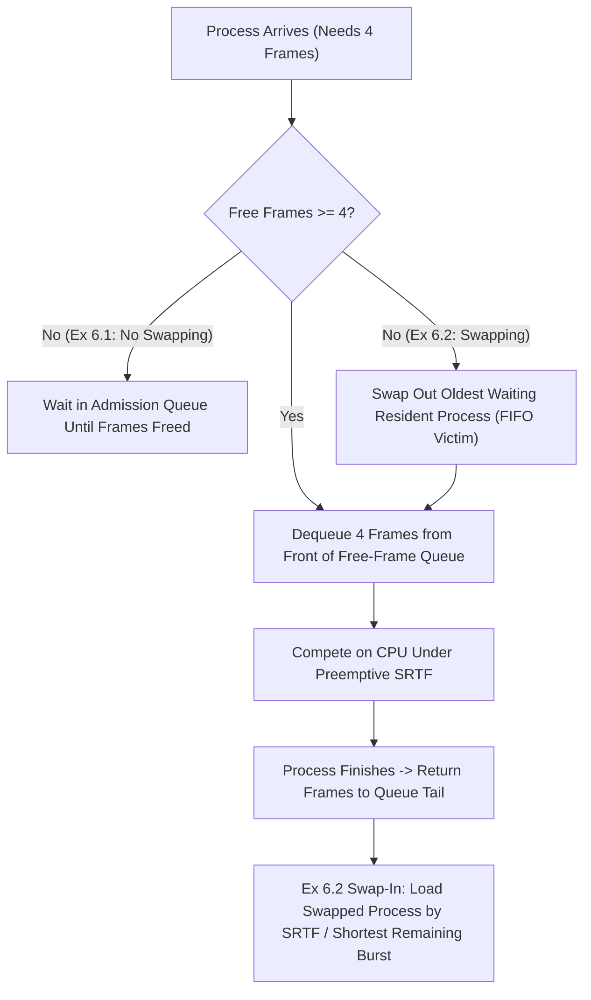

# [EX] Exercise 6 - Frame Allocation and Memory Swapping

> [!info] Document Metadata
> - **Course:** `=this.course`
> - **Topic:** `=this.topic`
> - **Status:** `=this.status`

**Tags:** #[[Computer Science]] #[[CSOPESY]] #[[Operating Systems]] #[[Memory Management]] #[[Paging]] #[[Swapping]] #[[CPU Scheduling]] #[[Exercise]]

---

## Overview

In multiprogrammed operating systems, CPU scheduling and physical memory allocation interact tightly: a process cannot compete for the CPU unless its required frames are resident in physical RAM. This two-part exercise traces combined **Preemptive Shortest Remaining Time First (SRTF)** CPU scheduling and **free-frame queue management** under two distinct memory regimes: (1) **Exercise 6.1**, where processes wait in an admission queue when insufficient free frames exist (no swapping), and (2) **Exercise 6.2**, where physical memory saturation triggers **process swapping** to a backing store, highlighting the critical course convention governing swap-out victim selection versus swap-in scheduling priority.

---

## Part 1 (Exercise 6.1): Free-Frame Queue Allocation with SRTF (No Swapping)

### System Parameters & Workload
- **Total Physical Frames:** $14$ frames (indexed $0$–$13$)
- **Requirement per Process:** $4$ frames $\implies$ at most $\lfloor 14 / 4 \rfloor = \mathbf{3}$ processes can reside in physical memory simultaneously (leaving $2$ frames free)
- **CPU Scheduling Policy:** Preemptive Shortest Remaining Time First (**SRTF**) among resident processes only
- **Memory Policy:** No swapping; arriving processes finding fewer than $4$ free frames wait in the admission queue until a resident process finishes and releases its frames
- **Deallocation Order:** Freed frames are appended to the **tail** of the free-frame queue in page-table (allocation) order
- **Initial Free-Frame Queue (Front $\to$ Back):** `[7, 8, 9, 2, 3, 4, 5, 10, 11, 0, 1, 6, 12, 13]`

| Process | Arrival Time ($AT$) | CPU Burst ($BT$) | Frames Required |
| :---: | :---: | :---: | :---: |
| **P1** | $0$ | $11$ | $4$ |
| **P2** | $1$ | $6$ | $4$ |
| **P3** | $2$ | $7$ | $4$ |
| **P4** | $3$ | $2$ | $4$ |
| **P5** | $4$ | $4$ | $4$ |

### Event-by-Event Execution & Frame Allocation Trace

| Time ($t$) | Event | Allocated Frames | Running Process (SRTF) | Free-Frame Queue (Front $\to$ Back) |
| :---: | :--- | :--- | :--- | :--- |
| **$0$** | **P1** arrives ($BT=11$) and loads into RAM | P1: `[7, 8, 9, 2]` | **P1** (rem: $11 \to 10$) | `[3, 4, 5, 10, 11, 0, 1, 6, 12, 13]` |
| **$1$** | **P2** arrives ($BT=6$), loads, and preempts P1 ($6 < 10$) | P2: `[3, 4, 5, 10]` | **P2** (rem: $6 \to 5$) | `[11, 0, 1, 6, 12, 13]` |
| **$2$** | **P3** arrives ($BT=7$) and loads into RAM ($7 > 5$) | P3: `[11, 0, 1, 6]` | **P2** (rem: $5 \to 4$) | `[12, 13]` |
| **$3$** | **P4** arrives ($BT=2$); **waits** (only 2 frames free) | — | **P2** (rem: $4 \to 3$) | `[12, 13]` |
| **$4$** | **P5** arrives ($BT=4$); **waits** (only 2 frames free) | — | **P2** (rem: $3 \to 0$ at $t=7$) | `[12, 13]` |
| **$7$** | **P2 finishes** (frees `[3, 4, 5, 10]`); **P4** admits and runs | P4: `[12, 13, 3, 4]` | **P4** (rem: $2 \to 1$ at $t=8$) | `[5, 10]` |
| **$8$** | **P4** continues executing (snapshot checkpoint) | — | **P4** (rem: $1 \to 0$ at $t=9$) | `[5, 10]` |
| **$9$** | **P4 finishes** (frees `[12, 13, 3, 4]`); **P5** admits and runs | P5: `[5, 10, 12, 13]` | **P5** (rem: $4 \to 0$ at $t=13$) | `[3, 4]` |
| **$13$** | **P5 finishes** (frees `[5, 10, 12, 13]`); **P3** runs ($7 < 10$) | — | **P3** (rem: $7 \to 0$ at $t=20$) | `[3, 4, 5, 10, 12, 13]` |
| **$20$** | **P3 finishes** (frees `[11, 0, 1, 6]`); **P1** resumes | — | **P1** (rem: $10 \to 0$ at $t=30$) | `[3, 4, 5, 10, 12, 13, 11, 0, 1, 6]` |
| **$30$** | **P1 finishes** (frees `[7, 8, 9, 2]`) | — | Done | `[3, 4, 5, 10, 12, 13, 11, 0, 1, 6, 7, 8, 9, 2]` |

### Exercise 6.1 Verified Answers

#### Question 1: Physical Memory Map at Time Slice $t = 8$
At $t = 8$, $P_2$ has terminated, $P_4$ is executing (1 unit remaining), $P_1$ and $P_3$ remain resident in RAM, and frames $5$ and $10$ are free:

| Frame | Owner | Frame | Owner |
| :---: | :---: | :---: | :---: |
| **0** | `P3` | **7** | `P1` |
| **1** | `P3` | **8** | `P1` |
| **2** | `P1` | **9** | `P1` |
| **3** | `P4` | **10** | `Free` |
| **4** | `P4` | **11** | `P3` |
| **5** | `Free` | **12** | `P4` |
| **6** | `P3` | **13** | `P4` |

#### Question 2: Last Value of the Free-Frame List After Completion
- **Verified Answer:** **`2`**
- **Explanation:** $P_1$ is the last process to finish (at $t = 30$) and appends its allocated page-table frames `[7, 8, 9, 2]` to the tail of the queue, leaving `[3, 4, 5, 10, 12, 13, 11, 0, 1, 6, 7, 8, 9, 2]`. *(Edge-case note: only if a system released frames by scanning physical RAM in ascending frame-index order `[2, 7, 8, 9]` instead of page-table order would the tail become `9`.)*

#### Question 3: Frames Allocated to Process 1 ($P_1$)
- **Verified Answer:** **`[7, 8, 9, 2]`**
- **Explanation:** $P_1$ arrives first at $t = 0$ and dequeues the first four frames from the front of the initial free-frame list.

---

## Part 2 (Exercise 6.2): Memory Swapping with SRTF Scheduling

### System Parameters & Workload
- **Total Physical Frames:** $8$ frames (indexed $0$–$7$)
- **Requirement per Process:** $4$ frames $\implies$ at most $\lfloor 8 / 4 \rfloor = \mathbf{2}$ processes can reside in physical memory simultaneously
- **Initial Free-Frame Queue (Front $\to$ Back):** `[2, 3, 7, 6, 0, 1, 4, 5]` (splits cleanly into two 4-frame blocks: Block A $= \texttt{[2, 3, 7, 6]}$ and Block B $= \texttt{[0, 1, 4, 5]}$)
- **CPU Scheduling Policy:** Preemptive **SRTF**

| Process | Arrival Time ($AT$) | CPU Burst ($BT$) | Frames Required |
| :---: | :---: | :---: | :---: |
| **P1** | $0$ | $8$ | $4$ |
| **P2** | $3$ | $4$ | $4$ |
| **P3** | $7$ | $11$ | $4$ |
| **P4** | $9$ | $8$ | $4$ |
| **P5** | $11$ | $3$ | $4$ |

### Verified Course Swapping Conventions

> [!important] Authoritative Swapping Rules (Verified Against Quiz Key)
> When tracing OS paging-and-swapping exams, distinguish carefully between the **swap-out rule** and the **swap-in rule**:
> 1. **Swap-Out (Victim Selection):** Follow the prompt's explicit replacement policy—here, evict the **oldest waiting (non-running) resident process** in physical memory to the backing store.
> 2. **Swap-In (Loading From Backing Store):** Follow the **CPU scheduling policy**—under **SRTF / SJF**, when frames become free, swap in the backing-store process with the **shortest remaining burst time** (not FIFO arrival-to-backing-store order).
> 3. **Reported Frames:** A process's final frame list is the set of physical frames it holds when it **actually executes to completion**.

### Verified Execution & Swapping Trace (SRTF Swap-In Convention)

| Time ($t$) | Event | Memory Allocation | Running (SRTF) | Free Queue | Backing Store (Swapped Out) |
| :---: | :--- | :--- | :--- | :--- | :--- |
| **$0$** | **P1** arrives ($8$) and loads | P1: `[2, 3, 7, 6]` | **P1** (rem: $8 \to 5$) | `[0, 1, 4, 5]` | `[]` |
| **$3$** | **P2** arrives ($4$), loads, and preempts P1 ($4 < 5$) | P1: `[2, 3, 7, 6]`, P2: `[0, 1, 4, 5]` | **P2** (rem: $4 \to 0$) | `[]` | `[]` |
| **$7$** | **P2 finishes** (frees `[0, 1, 4, 5]`); **P3** arrives ($11$) and loads; P1 resumes ($5 < 11$) | P1: `[2, 3, 7, 6]`, P3: `[0, 1, 4, 5]` | **P1** (rem: $5 \to 3$) | `[]` | `[]` |
| **$9$** | **P4** arrives ($8$); RAM full $\implies$ **swap out P3** (oldest waiting) | P1: `[2, 3, 7, 6]`, P4: `[0, 1, 4, 5]` | **P1** (rem: $3 \to 1$) | `[]` | `[P3 (11)]` |
| **$11$** | **P5** arrives ($3$); RAM full $\implies$ **swap out P4** (oldest waiting) | P1: `[2, 3, 7, 6]`, P5: `[0, 1, 4, 5]` | **P1** (rem: $1 \to 0$) | `[]` | `[P3 (11), P4 (8)]` |
| **$12$** | **P1 finishes** (frees `[2, 3, 7, 6]`). Between P3 ($11$) and P4 ($8$), **SRTF swaps in P4** ($8 < 11$) | P5: `[0, 1, 4, 5]`, **P4: `[2, 3, 7, 6]`** | **P5** (rem: $3 \to 0$) | `[]` | `[P3 (11)]` |
| **$15$** | **P5 finishes** (frees `[0, 1, 4, 5]`); **P3 swaps back in** into freed frames | P4: `[2, 3, 7, 6]`, **P3: `[0, 1, 4, 5]`** | **P4** (rem: $8 \to 0$) | `[]` | `[]` |
| **$23$** | **P4 finishes** (frees `[2, 3, 7, 6]`) | P3: `[0, 1, 4, 5]` | **P3** (rem: $11 \to 0$) | `[2, 3, 7, 6]` | `[]` |
| **$34$** | **P3 finishes** (frees `[0, 1, 4, 5]`) | — | Done | `[2, 3, 7, 6, 0, 1, 4, 5]` | `[]` |

### Exercise 6.2 Verified Answers

| Question | Prompt | Verified Answer |
| :---: | :--- | :---: |
| **Q1** | Process that finishes last | **`P3`** (completes at $t = 34$) |
| **Q2** | Allocated frames for **P1** | **`[2, 3, 7, 6]`** |
| **Q3** | Allocated frames for **P2** | **`[0, 1, 4, 5]`** |
| **Q4** | Allocated frames for **P3** (upon final execution) | **`[0, 1, 4, 5]`** |
| **Q5** | Allocated frames for **P4** (upon final execution) | **`[2, 3, 7, 6]`** |
| **Q6** | Allocated frames for **P5** | **`[0, 1, 4, 5]`** |

> [!warning] Divergence Check at $t = 12$: SRTF Swap-In vs. FIFO Swap-In
> Up through $t = 11$, both conventions produce identical states (`P1: [2, 3, 7, 6]`, `P2: [0, 1, 4, 5]`, `P5: [0, 1, 4, 5]`). At $t = 12$, when $P_1$ frees `[2, 3, 7, 6]`, the backing store holds `P3 (burst 11)` and `P4 (burst 8)`:
> - **SRTF Swap-In (Course Key):** Loads **$P_4$** first into `[2, 3, 7, 6]`, then loads **$P_3$** at $t = 15$ into `[0, 1, 4, 5]`.
> - **FIFO Swap-In (Alternative):** Would load **$P_3$** first into `[2, 3, 7, 6]` and **$P_4$** at $t = 15$ into `[0, 1, 4, 5]`—swapping $P_3$ and $P_4$'s frame sets while leaving completion order (`P3` last at $t = 34$) unchanged.

---

## Multiple Choice Questions

1. In Exercise 6.1 (14 frames total, 4 frames per process, no swapping), why does $P_4$ ($AT = 3, BT = 2$) fail to preempt $P_2$ ($rem = 3$) immediately at $t = 3$ despite having a shorter CPU burst?
    - **A)** Because SRTF disables preemption whenever three processes are active
    - **B)** Because only 2 physical frames (`[12, 13]`) are free at $t = 3$, so $P_4$ cannot load into RAM and must wait in the admission queue until $P_2$ terminates at $t = 7$
    - **C)** Because $P_4$ has a lower static priority than $P_2$
    - **D)** Because $P_4$ is immediately swapped out to the backing store at $t = 3$

2. In Exercise 6.2, what causes $P_3$ and $P_4$'s final allocated frame sets to diverge at $t = 12$ between FIFO swap-in and SRTF swap-in?
    - **A)** At $t = 12$, $P_1$ frees `[2, 3, 7, 6]` while both $P_3$ (rem 11) and $P_4$ (rem 8) are in the backing store; SRTF swap-in selects shorter $P_4$ first whereas FIFO swap-in selects earlier-evicted $P_3$ first
    - **B)** At $t = 12$, $P_5$ is evicted to disk to make room for $P_4$
    - **C)** At $t = 12$, $P_2$ returns from I/O and reclaims `[0, 1, 4, 5]`
    - **D)** At $t = 12$, physical memory expands from 8 frames to 14 frames

3. [INPUT] In Exercise 6.1, after all five processes finish at $t = 30$ (returning freed frames to the queue tail in page-table order), what is the **last frame number** at the tail of the free-frame queue?

4. [INPUT] In Exercise 6.2, at what exact timestamp $t$ does the last process ($P_3$) finish executing?

5. [BLANK] Complete the Exercise 6.1 physical memory ownership snapshot at time slice $t = 8$ for the listed frames (enter `P1`, `P3`, `P4`, or `Free`):

| Physical Frame | Frame 2 | Frame 3 | Frame 5 | Frame 10 | Frame 11 | Frame 12 |
| :--- | :---: | :---: | :---: | :---: | :---: | :---: |
| **Owner at $t = 8$** | {{1}} | {{2}} | {{3}} | {{4}} | {{5}} | {{6}} |

6. [BLANK] Complete the verified Exercise 6.2 final frame allocations (using the course SRTF swap-in convention; enter comma-separated frame numbers such as `2, 3, 7, 6`):

| Process | Final Allocated Frame Set | Completion Time ($CT$) |
| :---: | :---: | :---: |
| **P3** | {{1}} | {{2}} |
| **P4** | {{3}} | {{4}} |

### Answer Key & Explanations

1. **B)** Only processes loaded into physical memory can compete for the CPU. At $t = 3$, $P_1$, $P_2$, and $P_3$ occupy 12 of the 14 frames, leaving only 2 free frames (`12, 13`). Since $P_4$ requires 4 frames and swapping is disabled in Ex. 6.1, $P_4$ waits until $P_2$ frees 4 frames at $t = 7$.
2. **A)** Under the verified course convention, swap-out evicts the oldest waiting resident process, while swap-in follows the CPU scheduler (SRTF/SJF). Thus $P_4$ ($BT = 8$) swaps into $P_1$'s freed `[2, 3, 7, 6]` at $t = 12$, and $P_3$ ($BT = 11$) swaps into $P_5$'s freed `[0, 1, 4, 5]` at $t = 15$.
3. **[2]** $P_1$ is the final process to terminate at $t = 30$, returning its page-table frames `[7, 8, 9, 2]` to the tail of the queue; hence `2` is the final element.
4. **[34; t=34; t = 34]** Total CPU burst sum is $8 + 4 + 11 + 8 + 3 = 34$ with zero idle time, and $P_3$ executes last from $t = 23$ to $t = 34$.
5. **[1: P1/p1; 2: P4/p4; 3: Free/free; 4: Free/free; 5: P3/p3; 6: P4/p4]** At $t = 8$, resident allocations are $P_1 = [7, 8, 9, 2]$, $P_3 = [11, 0, 1, 6]$, and $P_4 = [12, 13, 3, 4]$, leaving frames `5` and `10` free.
6. **[1: 0, 1, 4, 5/0,1,4,5; 2: 34; 3: 2, 3, 7, 6/2,3,7,6; 4: 23]** Under SRTF swap-in, $P_4$ swaps into `[2, 3, 7, 6]` at $t = 12$ and finishes at $t = 23$, while $P_3$ swaps into `[0, 1, 4, 5]` at $t = 15$ and finishes last at $t = 34$.

## References & Navigation

- **Related Notes:** [[CSOPESY 06 - CPU Scheduling]], [[CSOPESY 08 - Main Memory]], [[CSOPESY 09 - Virtual Memory]], [[[EX] Exercise 5 - Paging and Address Translation]]
