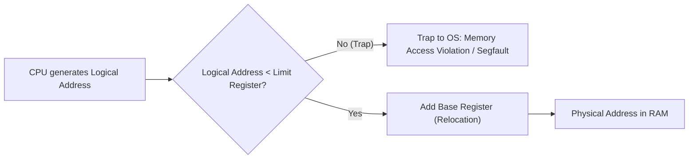
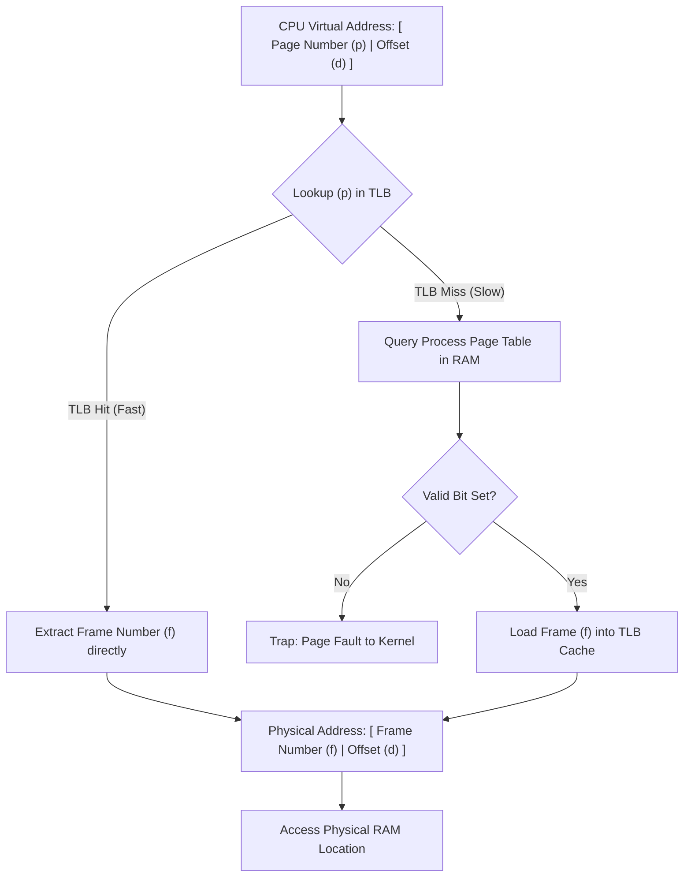
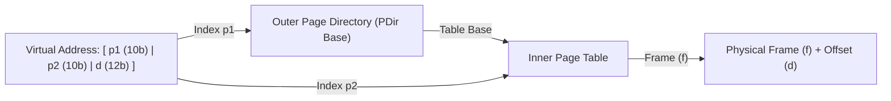

> [!info] Document Metadata
> - **Course:** `=this.course`
> - **Topic:** `=this.topic`
> - **Status:** `=this.status`

**Tags:** #[[Computer Science]] #[[CSOPESY]] #[[Operating Systems]] #[[08 - Main Memory]]

---

# CSOPESY 08 - Main Memory

## Overview
The CPU can only execute instructions and access data that is loaded into main memory (RAM). Because memory is a limited and shared resource, the Operating System faces the complex challenge of managing it securely and efficiently across multiple active processes. The core goals of memory management include **Relocation** (allowing processes to load into any memory region), **Protection** (preventing illegal memory accesses), **Sharing** (allowing controlled access to shared memory, like libraries), and providing a logical abstraction for programmers.

This note covers the evolution of memory management from simple contiguous allocation to sophisticated noncontiguous techniques like paging, addressing external and internal fragmentation, and the hardware that makes rapid memory virtualization possible.

## Key Concepts

### Basic Hardware & Protection
- **Base and Limit Registers:** To enforce memory protection, hardware relies on these two registers. The *Base Register* holds the smallest valid physical address, while the *Limit Register* specifies the size of the memory range. The CPU hardware checks every generated logical address to ensure it falls within these bounds.
- **Kernel Mode Privilege:** Changing the base and limit registers requires privileged instructions executable only in Kernel Mode. Any unauthorized access out of bounds triggers a fatal hardware trap to the OS.



### Address Binding & Logical vs. Physical Memory
- **Address Binding:** The process of mapping logical program addresses to physical memory addresses. It can occur at *Compile Time* (absolute code), *Load Time* (relocatable code), or *Execution Time* (addresses mapped dynamically on the fly).
- **Logical (Virtual) Address:** The address generated by the CPU. This is all the user program ever sees.
- **Physical Address:** The actual hardware memory location.
- **Memory-Management Unit (MMU):** The hardware device responsible for translating logical addresses to physical addresses at run-time. In contiguous allocation, it simply adds the Base Register to the logical address.

### Contiguous Memory Allocation
Early OS designs assigned each process to a single, continuous block of memory. When a process requested memory, the OS searched for an available "hole".
- **First-Fit:** Allocates the first hole that is big enough. Fast and often efficient.
- **Best-Fit:** Allocates the smallest hole that is big enough. Requires searching the whole list and produces tiny leftover holes.
- **Worst-Fit:** Allocates the largest hole, leaving a potentially useful large remainder. Usually the poorest performer.

### Fragmentation
- **External Fragmentation:** Over time, contiguous allocation scatters small, unusable holes throughout memory. Even if the total free memory is sufficient for a new process, no single hole is large enough. (Rule of thumb: 50% rule).
- **Internal Fragmentation:** When memory is allocated in fixed-size blocks (like pages), the space inside the block that the process doesn't use is wasted. 
- *Solution to External Fragmentation:* **Compaction** (shuffling memory to merge free space) is slow. The modern hardware solution is **Paging**.

### Paging
Paging breaks physical memory into fixed-sized blocks called **Frames**, and logical memory into blocks of the same size called **Pages**. 
- **Logical Address Translation:** Every address consists of a *Page Number* ($p$) and a *Page Offset* ($d$). The page number acts as an index into the **Page Table**, which contains the base physical frame number ($f$). The MMU combines $f$ and $d$ to form the physical address.
- Paging completely eliminates external fragmentation but introduces internal fragmentation on the last page of a process.



### Optimizing Paging: TLB and Hierarchical Page Tables
- **Translation Look-aside Buffer (TLB):** Because keeping the page table in RAM doubles memory access time (one access for the table, one for the data), a high-speed, associative hardware cache called the TLB is used. If a page number is in the TLB (TLB Hit), translation is nearly instantaneous.
- **Multi-Level Page Tables:** For large 32-bit and 64-bit address spaces, a single continuous page table is too large. The page table itself is paged (e.g., a Page Directory pointing to smaller Page Tables).
- **Hashed & Inverted Page Tables:** Hashed tables hash the virtual page number. Inverted page tables track physical frames rather than virtual pages, dramatically saving memory at the cost of lookup speed.



### Swapping
To increase the degree of multiprogramming, inactive processes (or their pages) can be temporarily swapped out to a backing store (SSD/HDD) to free up RAM. Modern OSes use **Page Swapping** (paging out individual pages rather than whole processes). Note that mobile OSes (iOS/Android) often avoid swapping to disk due to flash memory write limits, instead relying on aggressive background app termination or voluntary memory release.

---

## Algorithms & Formulas

### Logical to Physical Translation (Paging)
Given a logical address format with a page size of $2^n$ bytes:
- The lowest $n$ bits constitute the **Page Offset ($d$)**.
- The remaining upper bits constitute the **Page Number ($p$)**.
- **Physical Address:** `(Frame_Number_from_Table[p] * Page_Size) + d`

### Contiguous Allocation Calculation
- **Valid Address Check:** `0 <= Logical Address < Limit Register`
- **Physical Address:** `Logical Address + Base Register`

---

## Code Examples

### Simulating MMU Translation (Paging)
```python
PAGE_SIZE = 4096 # 2^12 bytes, meaning 12 bits for offset
page_table = {
    0: 5,  # Virtual Page 0 is in Physical Frame 5
    1: 12, # Virtual Page 1 is in Physical Frame 12
    2: 7   # Virtual Page 2 is in Physical Frame 7
}

def translate_address(logical_address):
    # Extract page number and offset
    page_number = logical_address // PAGE_SIZE
    page_offset = logical_address % PAGE_SIZE
    
    if page_number not in page_table:
        raise Exception("Page Fault! Page not in memory.")
        
    frame_number = page_table[page_number]
    
    # Calculate physical address
    physical_address = (frame_number * PAGE_SIZE) + page_offset
    return physical_address

# Example: logical address 8200
# 8200 // 4096 = 1 (Page 1)
# 8200 % 4096 = 8 (Offset 8)
# Frame for Page 1 is 12. Physical = (12 * 4096) + 8 = 49160
print(f"Physical address: {translate_address(8200)}")
```

---

## Multiple Choice Questions

1. Which of the following best describes external fragmentation?
    - **A)** The wasted space inside an allocated fixed-size block.
    - **B)** The situation where total free memory is sufficient, but no single contiguous block is large enough to satisfy a request.
    - **C)** The delay caused by fetching a page from the backing store.
    - **D)** The overhead of maintaining a TLB.

2. In a system using contiguous memory allocation, what happens if a user program attempts to access an address beyond its Limit Register?
    - **A)** The program accesses the operating system's memory.
    - **B)** The OS expands the program's memory allocation automatically.
    - **C)** The hardware generates a trap (fatal error) to the Operating System.
    - **D)** The Memory Management Unit wraps the address around to zero.

3. What is the primary purpose of the Translation Look-aside Buffer (TLB)?
    - **A)** To store frequently accessed user data blocks.
    - **B)** To convert 32-bit addresses into 64-bit addresses.
    - **C)** To cache recently used page-to-frame translations to avoid the performance penalty of accessing the page table in RAM.
    - **D)** To handle dynamic loading of dynamically linked libraries (DLLs).

4. Which allocation algorithm produces the smallest leftover hole, but requires searching the entire free list?
    - **A)** First-fit
    - **B)** Best-fit
    - **C)** Worst-fit
    - **D)** Round-Robin

5. How does paging solve the external fragmentation problem?
    - **A)** By allowing a process's physical address space to be noncontiguous, slotting pages into any available physical frames.
    - **B)** By continuously running a compaction algorithm in the background.
    - **C)** By allocating a single, massive block of memory for all user processes.
    - **D)** By replacing the hard drive with a faster SSD.

6. An Inverted Page Table is structured such that:
    - **A)** There is one entry for every logical page across all processes.
    - **B)** The table is swapped out to disk.
    - **C)** There is one entry for each physical frame in the system, significantly reducing memory overhead.
    - **D)** It uses a TLB miss to generate the logical address.

7. Why do mobile operating systems like iOS and Android generally avoid traditional swapping to a backing store?
    - **A)** Mobile processors lack a Memory Management Unit (MMU).
    - **B)** Flash memory used in phones has limited write cycles and slower throughput, making continuous swapping detrimental to device lifespan and performance.
    - **C)** Mobile apps do not use virtual memory.
    - **D)** Paging algorithms like LRU are computationally impossible on ARM processors.

8. If a page size is 4KB ($2^{12}$ bytes), what are the page number and page offset for the logical address $4105$ (in decimal)?
    - **A)** Page Number: 0, Offset: 4105
    - **B)** Page Number: 1, Offset: 9
    - **C)** Page Number: 4, Offset: 105
    - **D)** Page Number: 1, Offset: 4096

### Answer Key & Explanations

1. **B**. External fragmentation occurs when free memory is broken into many small pieces, preventing a large block from being allocated contiguously.
2. **C**. CPU hardware checks every address against the Limit Register. A violation triggers a hardware trap, resulting in the OS terminating the program with a segmentation fault.
3. **C**. Without the TLB, every memory access requires two physical memory trips (one for the page table, one for the data). The TLB is a specialized cache that mitigates this overhead.
4. **B**. Best-fit searches for the hole that is closest in size to the requested amount, leaving a tiny, usually unusable fragment.
5. **A**. Paging maps fixed-size logical pages to fixed-size physical frames, completely eliminating the need for contiguous physical memory blocks.
6. **C**. Standard page tables scale with the virtual address space. Inverted page tables scale with the physical RAM, which is much smaller, thereby saving memory.
7. **B**. Flash storage wears out after a certain number of write cycles, and its latency makes standard page-swapping heavily noticeable to the user.
8. **B**. $4105 / 4096 = 1$ (Page Number). $4105 \pmod{4096} = 9$ (Offset).

## References & Navigation

- **Previous Topic:** [[CSOPESY 07 - Synchronization Tools]]
- **Next Topic:** [[CSOPESY 09 - Virtual Memory]]
- **Related Notes:** 
