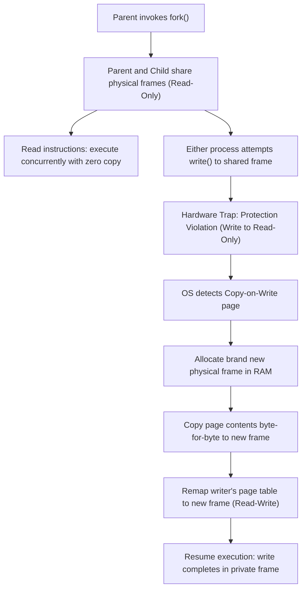

> [!info] Document Metadata
> - **Course:** `=this.course`
> - **Topic:** `=this.topic`
> - **Status:** `=this.status`

**Tags:** #[[Computer Science]] #[[CSOPESY]] #[[Operating Systems]] #[[09 - Virtual Memory]]

---

# CSOPESY 09 - Virtual Memory

## Overview
Virtual Memory is a revolutionary technique that entirely separates the logical memory (as seen by a process) from the physical memory (the actual RAM hardware). By doing so, a program can possess a virtual address space that is substantially larger than the available physical memory. Only the active portions of the program are loaded into RAM. 

This note covers the mechanisms that make virtual memory possible—specifically **Demand Paging**—and delves into page fault handling, the powerful **Copy-on-Write** optimization, various **Page Replacement Algorithms**, and the catastrophic performance collapse known as **Thrashing**.

## Key Concepts

### Demand Paging & Page Faults
- **Demand Paging:** A "lazy loading" strategy where pages are brought into memory only when an instruction explicitly accesses them. 
- **Valid-Invalid Bit:** The page table includes a bit indicating if the page is currently in physical memory (`Valid`) or not (`Invalid` / on disk).
- **Page Fault:** If a process accesses an `Invalid` page, the hardware triggers a trap to the OS. The OS pauses the process, finds a free frame, schedules a disk I/O to load the required page into the frame, updates the page table to `Valid`, and restarts the interrupted instruction.

```mermaid
sequenceDiagram
    autonumber
    participant CPU as CPU / MMU
    participant OS as OS Kernel Page Fault Handler
    participant Disk as Backing Store (Swap Space / Disk)
    participant RAM as Physical RAM Frames

    CPU->>CPU: Instruction references virtual page P (Valid bit = 0)
    CPU->>OS: Hardware Trap: Page Fault Exception
    OS->>OS: Verify legal memory reference via internal PCB tables
    OS->>RAM: Locate free frame F (or run page replacement to evict)
    OS->>Disk: Issue asynchronous disk read: Load page P into frame F
    Note over OS: Process placed in Wait Queue; context switch to other task
    Disk-->>OS: Disk controller generates I/O completion interrupt
    OS->>RAM: Page P successfully resident in frame F
    OS->>OS: Update Process Page Table: Map P -> F, set Valid = 1
    OS->>CPU: Move process to Ready Queue & restart faulting instruction
    CPU->>RAM: Memory access resolves with zero delay!
```

### Copy-on-Write (COW)
An optimization used primarily during process creation (e.g., the `fork()` system call in UNIX). Instead of immediately copying all of the parent's memory pages to the child, both processes share the same physical pages marked as "read-only." If either process attempts to modify a shared page, a trap occurs, and the OS creates a duplicate of only that specific page for the modifying process. This saves massive amounts of time and memory.



### Page Replacement
When a page fault occurs and physical memory is completely full (no free frames), the OS must evict an existing page to make room. 
- **The Dirty Bit (Modify Bit):** To optimize I/O, the hardware sets a bit whenever a page is written to. If the evicted page is "dirty", it must be written back to the disk. If it is "clean", it can simply be overwritten without a costly disk write.
- **Global vs. Local Replacement:**
  - *Local:* A process can only replace pages from its own allocated frames.
  - *Global:* A process can "steal" a frame from another process. More common as it maximizes overall system throughput, though it makes execution times unpredictable.

### Page Replacement Algorithms
1. **FIFO (First-In, First-Out):** Replaces the oldest page in memory. Extremely simple, but prone to **Belady's Anomaly**, a paradoxical situation where adding *more* physical memory frames actually *increases* the number of page faults.
2. **LRU (Least Recently Used):** Replaces the page that has not been accessed for the longest time. Assumes the past predicts the future (Locality of Reference). Highly effective and avoids Belady's Anomaly, but hardware implementation (via counters or stacks) is expensive.
3. **Optimal (OPT):** Replaces the page that will not be used for the longest period in the *future*. It guarantees the lowest possible page fault rate but is practically impossible to implement since it requires predicting the future. Used strictly as a theoretical benchmark.

### Thrashing
- **Thrashing** occurs when a process is engaged in high-frequency page faulting. The process spends more time paging (waiting for disk I/O) than executing actual instructions.
- If CPU utilization drops due to thrashing, the OS might incorrectly increase the degree of multiprogramming by admitting new processes, which steal more frames, causing a systemic collapse in throughput.
- **Working-Set Model:** A strategy to prevent thrashing. The OS tracks the *Working Set* (the set of unique pages heavily accessed in a recent time window $\Delta$). If the total demand for frames by all working sets exceeds the available physical RAM, the OS suspends a process to free up memory and stabilize the system.

---

## Algorithms & Formulas

### Effective Access Time (EAT) in Demand Paging
Because disk I/O is astronomically slower than RAM, the page fault rate ($p$) dictates performance.
- $ma$: memory access time
- $p$: probability of a page fault ($0 \le p \le 1$)
- **EAT = $(1 - p) \times ma + p \times (\text{page fault service time})$**
*Takeaway:* $p$ must remain extremely close to $0$ to maintain acceptable performance.

### Working-Set State
- $WSS_i$: Working set size of process $i$.
- $D = \sum WSS_i$ (Total demand for frames).
- $m$: Total available physical frames.
- **Condition for Thrashing:** If $D > m$, thrashing is imminent.

---

## Code Examples

### Simulating FIFO Page Replacement
```python
def fifo_page_replacement(reference_string, num_frames):
    frames = []
    page_faults = 0
    
    for page in reference_string:
        if page not in frames:
            page_faults += 1
            if len(frames) < num_frames:
                frames.append(page)
            else:
                frames.pop(0) # Evict the oldest (First In)
                frames.append(page)
        # print(f"Access {page}: Frames -> {frames}")
        
    return page_faults

ref_string = [7, 0, 1, 2, 0, 3, 0, 4, 2, 3, 0, 3, 2, 1, 2, 0, 1, 7, 0, 1]
print(f"FIFO Faults (3 frames): {fifo_page_replacement(ref_string, 3)}")
# Output: 15
```

---

## Multiple Choice Questions

1. Which of the following is the defining characteristic of Demand Paging?
A) Entire processes are loaded into memory before execution begins.
B) Pages are loaded into memory only when an instruction explicitly requires them.
C) The OS pre-fetches all pages associated with a program's imports.
D) Pages are swapped to the disk sequentially.

2. What is the primary purpose of the Copy-on-Write (COW) mechanism during a `fork()` system call?
A) To instantly duplicate all physical memory for the child process.
B) To allow the child to overwrite the parent's memory safely.
C) To delay and potentially eliminate the copying of memory pages by sharing them until one of the processes attempts a write operation.
D) To prevent Belady's Anomaly.

3. Belady’s Anomaly describes a situation where:
A) LRU replacement causes more page faults than FIFO.
B) Increasing the number of physical frames allocated to a process results in an increased number of page faults.
C) A process spends more time paging than executing.
D) The working set size exceeds available physical memory.

4. Why is the Optimal (OPT) page replacement algorithm rarely used in production operating systems?
A) It suffers heavily from Belady's Anomaly.
B) It causes severe internal fragmentation.
C) It requires knowing the future sequence of memory references, which is impossible.
D) It takes up too much memory to store the time-of-use counters.

5. What optimization allows the Operating System to avoid writing an evicted page back to the disk if its contents haven't changed?
A) The Valid-Invalid Bit
B) The Dirty (Modify) Bit
C) The Working-Set Window
D) The Translation Look-aside Buffer

6. Thrashing fundamentally occurs when:
A) The disk drive spins at its maximum speed.
B) A process does not have enough frames to hold its actively used locality of reference, leading to continuous page faulting.
C) The CPU overheats due to infinite loops in user code.
D) Global page replacement is disabled.

7. In the Working-Set Model, if the total demand for frames ($D$) exceeds the total physical frames ($m$), what action must the OS take to prevent thrashing?
A) Increase the CPU clock speed.
B) Decrease the Working-Set Window ($\Delta$).
C) Suspend (swap out) one or more processes to free up frames.
D) Allocate more frames to the process with the highest priority.

8. If a system has a memory access time of $200\text{ns}$ and a page fault service time of $8,000,000\text{ns}$ ($8\text{ms}$), what happens to the Effective Access Time (EAT) if the page fault rate ($p$) is $10\%$ ($0.1$)?
A) It increases slightly to $250\text{ns}$.
B) It remains $200\text{ns}$ due to caching.
C) It rockets to roughly $800,000\text{ns}$, causing a massive performance bottleneck.
D) The system crashes.

### Answer Key & Explanations
1. **B)** Demand paging acts as a lazy swapper, loading only the necessary pages when they are referenced (demanded) by the CPU.
2. **C)** COW avoids the expensive copying of a process's entire memory footprint. Read-only pages can be shared indefinitely; copies are only made when a write occurs.
3. **B)** Belady's Anomaly is a counter-intuitive phenomenon found in algorithms like FIFO where giving a process more memory actually makes its performance worse for specific reference strings.
4. **C)** The OPT algorithm requires perfect foreknowledge of the reference string to evict the page that won't be needed for the longest time in the future.
5. **B)** The Dirty Bit tracks whether a page has been written to. If it is 0 (clean), the page in memory matches the disk, so a write-back is unnecessary.
6. **B)** When the allocated frames cannot contain a program's active working set, it enters a thrashing cycle of evicting and immediately reloading pages.
7. **C)** If $D > m$, the system is over-committed. The only way to resolve the frame deficit and restore the required localities is to completely suspend a process.
8. **C)** $EAT = (0.9 \times 200) + (0.1 \times 8000000) = 180 + 800000 = 800,180\text{ns}$. Even a 10% fault rate absolutely ruins performance because disk I/O is orders of magnitude slower than RAM.

## References & Navigation

- **Previous Topic:** [[CSOPESY 08 - Main Memory]]
- **Next Topic:** None
- **Related Notes:** 
