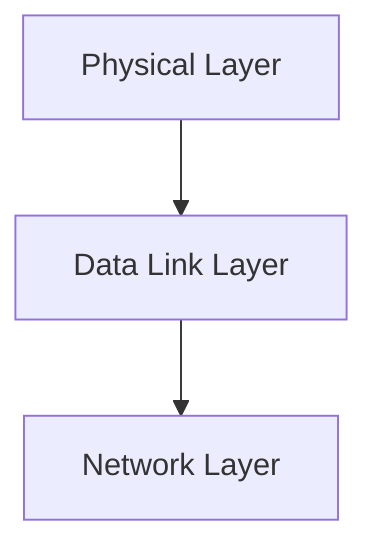

> [!info] Document Metadata
> - **Course:** `=this.course`
> - **Topic:** `=this.topic`
> - **Status:** `=this.status`

**🏷️ Tags:** #[[Computer Science]] #[[NSCOM03]] #[[Conceptual]] #[[Finals Review]]

---

## Overview
This module explores the foundational concepts of Finals Reviewer as they relate to data communications and networking. It highlights the primary mechanisms used for robust transmission, formatting, and analysis in computer networks.

## Key Definitions
- **Data Communications:** The exchange of digital data between two or more nodes.
- **Physical Layer:** The lowest layer responsible for the physical connection between devices.
- **Data Link Layer:** Ensures error-free transmission of data frames between nodes.

## Theoretical Framework / Core Concepts
The transmission of data requires precise synchronization and structuring. Theoretical models such as the OSI Reference Model standardize these processes. 
- The Physical layer deals with analog/digital signals, bandwidth, attenuation, and noise.
- The Data Link layer deals with framing, flow control, and error detection/correction.

## Worked Examples / Protocol Walkthroughs / Calculations
**Example Calculation:**
Given a channel with bandwidth $B = 3000$ Hz and $SNR = 3162$, calculate the Shannon capacity:
$$ C = B \log_2(1 + SNR) $$
$$ C = 3000 \log_2(1 + 3162) \approx 3000 \times 11.62 \approx 34860 \text{ bps} $$

## Summary & Key Takeaways
- The Physical and Data Link layers form the backbone of local and wide area networks.
- Precise encoding and error detection are vital for maintaining data integrity.
- Protocols manage access and transmission over diverse physical media.

## References & Navigation

- **Related Notes:** [[Network Communications 3]]
