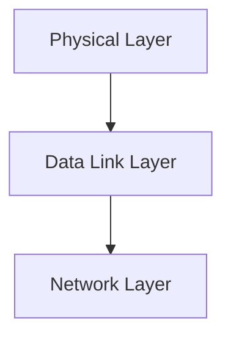

> [!info] Document Metadata
> - **Course:** `=this.course`
> - **Topic:** `=this.topic`
> - **Status:** `=this.status`

**Tags:** #[[Computer Science]] #[[NSCOM03]] #[[Conceptual]] #[[Review of Physical and Data Link Layer]]

---

## Overview
This module explores the foundational concepts of Module 1- Review of Physical and Data Link Layer as they relate to data communications and networking. It highlights the primary mechanisms used for robust transmission, formatting, and analysis in computer networks.

## Key Definitions **Data Communications:** The exchange of digital data between two or more nodes. **Physical Layer:** The lowest layer responsible for the physical connection between devices. **Data Link Layer:** Ensures error-free transmission of data frames between nodes.

## Theoretical Framework / Core Concepts
The transmission of data requires precise synchronization and structuring. Theoretical models such as the OSI Reference Model standardize these processes.  The Physical layer deals with analog/digital signals, bandwidth, attenuation, and noise. The Data Link layer deals with framing, flow control, and error detection/correction.

## Worked Examples / Protocol Walkthroughs / Calculations
**Example Calculation:**
Given a channel with bandwidth $B = 3000$ Hz and $SNR = 3162$, calculate the Shannon capacity:
$$ C = B \log_2(1 + SNR) $$
$$ C = 3000 \log_2(1 + 3162) \approx 3000 \times 11.62 \approx 34860 \text{ bps} $$

## Summary & Key Takeaways The Physical and Data Link layers form the backbone of local and wide area networks. Precise encoding and error detection are vital for maintaining data integrity. Protocols manage access and transmission over diverse physical media.

## Multiple Choice Questions

1. What is the definition of Data Communications according to the text?
    - **A)** The exchange of digital data between two or more nodes
    - **B)** The physical connection between multiple devices
    - **C)** The processing of analog signals over wide area networks
    - **D)** The synchronization of network layers

2. Which layer ensures error-free transmission of data frames between nodes?
    - **A)** Physical Layer
    - **B)** Data Link Layer
    - **C)** Network Layer
    - **D)** Transport Layer

3. According to the Shannon capacity formula $C = B \log_2(1 + SNR)$, what is the approximate capacity if $B = 3000$ Hz and $SNR = 3162$?
    - **A)** 3000 bps
    - **B)** 11620 bps
    - **C)** 34860 bps
    - **D)** 31620 bps

4. Which of the following is specifically handled by the Physical layer?
    - **A)** Framing and flow control
    - **B)** Attenuation and noise
    - **C)** Error detection and correction
    - **D)** Logical addressing

### Answer Key & Explanations

1. **A**. The text explicitly defines Data Communications as "The exchange of digital data between two or more nodes."
2. **B**. The Data Link Layer is defined as the layer that "Ensures error-free transmission of data frames between nodes."
3. **C**. The example calculation shows that with $B = 3000$ and $SNR = 3162$, $C \approx 3000 \times 11.62 \approx 34860$ bps.
4. **B**. The Physical layer deals with "analog/digital signals, bandwidth, attenuation, and noise."

## References & Navigation

- **Next Topic:** [[Physical Communication Layer]]
- **Related Notes:** [[Physical Communication Layer]], [[Network Layer]]

