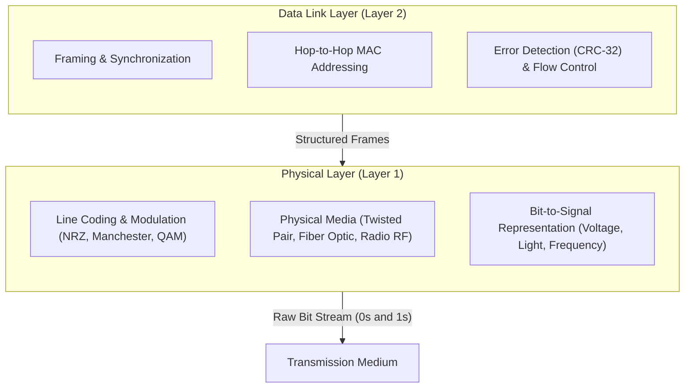

> [!info] Document Metadata
> - **Course:** `=this.course`
> - **Topic:** `=this.topic`
> - **Status:** `=this.status`

**Tags:** #[[Computer Science]] #[[NSCOM03]] #[[Conceptual]] #[[Review of Physical and Data Link Layer]]

---

## Overview

This module provides an architectural review of the lowest two layers of the OSI reference model: the Physical Layer (Layer 1) and the Data Link Layer (Layer 2). It synthesizes signal transmission fundamentals, theoretical channel capacity limits (Nyquist and Shannon formulations), framing mechanisms, node-to-node addressing, and error detection across communication media.

---

## Key Definitions

- **Physical Layer (Layer 1):** The lowest architectural layer, responsible for the mechanical, electrical, and functional transmission of unstructured raw bit streams over physical media.
- **Data Link Layer (Layer 2):** The layer responsible for providing reliable node-to-node (hop-by-hop) communication, organizing raw bit streams into structured frames, managing medium access, and performing error and flow control.
- **Nyquist Bit Rate:** The theoretical maximum transmission rate over an ideal, noiseless channel of bandwidth $B$ with $L$ discrete signal levels: $C = 2B \log_2 L$.
- **Shannon Capacity Theorem:** The theoretical upper bound for data rate across a noisy channel with Gaussian thermal noise: $C = B \log_2(1 + SNR)$.
- **Framing:** The process of encapsulating network layer packets into discrete Data Link units marked with start and end delimiters.

---

## Theoretical Framework

---

## Worked Examples: Theoretical Channel Capacity

### Problem 1: Noisy Voice-Grade Channel (Shannon Capacity)
A typical voice-grade telephone channel has a bandwidth $B = 3000\text{ Hz}$ and an average Signal-to-Noise Ratio $SNR = 3162$ (which corresponds to $SNR_{dB} = 10 \log_{10}(3162) \approx 35\text{ dB}$). Calculate the theoretical maximum channel capacity:

$$C = B \log_2(1 + SNR)$$
$$C = 3000 \cdot \log_2(1 + 3162) = 3000 \cdot \log_2(3163)$$
Since $2^{11} = 2048$ and $2^{12} = 4096$, $\log_2(3163) \approx 11.627$:
$$C \approx 3000 \times 11.627 \approx 34881\text{ bps} \approx 34.88\text{ kbps}$$

### Problem 2: Noiseless Channel (Nyquist Rate Comparison)
If the same $3000\text{ Hz}$ channel were completely noiseless and transmitted using binary signaling ($L = 2$ signal levels):
$$C_{Nyquist} = 2B \log_2 L = 2(3000) \log_2(2) = 6000\text{ bps}$$
To achieve a rate approaching the Shannon capacity limit on this band-limited channel, the physical layer modulation must use multi-level signaling (e.g. $L \ge 16$ or $64$ levels via QAM).

---

## Multiple Choice Questions

1. Which responsibility belongs strictly to the Data Link Layer (Layer 2) rather than the Physical Layer (Layer 1)?
    - **A)** Encoding bits into electromagnetic pulses or optical waveforms
    - **B)** Grouping raw bit streams into structured frames with header flags and checksums
    - **C)** Defining connector pinouts and mechanical specifications
    - **D)** Measuring cable signal attenuation in decibels

2. According to the Shannon Capacity Theorem $C = B \log_2(1 + SNR)$, what physical constraint fundamentally caps the maximum error-free data rate over an analog channel?
    - **A)** The packet header size in the transport protocol
    - **B)** The channel bandwidth $B$ and thermal noise ratio $SNR$
    - **C)** The processing speed of the host CPU
    - **D)** The maximum transmission unit (MTU) of the operating system

3. A channel with bandwidth $B = 4\text{ kHz}$ has an $SNR = 63$. What is its theoretical maximum information carrying capacity?
    - **A)** $12\text{ kbps}$
    - **B)** $24\text{ kbps}$
    - **C)** $48\text{ kbps}$
    - **D)** $64\text{ kbps}$

4. What is the fundamental difference between node-to-node (hop-by-hop) delivery and end-to-end delivery in the network hierarchy?
    - **A)** Node-to-node delivery transmits frames between two directly connected adjacent nodes at Layer 2, while end-to-end delivery tracks packets between the original source and final destination across intermediate routers.
    - **B)** Node-to-node delivery uses IP addresses, whereas end-to-end delivery uses MAC addresses.
    - **C)** Node-to-node delivery operates only over wireless media, while end-to-end delivery is restricted to fiber optics.
    - **D)** Node-to-node delivery handles application ports, while end-to-end delivery manages physical pinouts.

5. If an engineer wants to increase the transmission data rate over a noiseless channel without changing its physical bandwidth $B$, what parameter must be increased according to Nyquist's formula?
    - **A)** The signal attenuation coefficient
    - **B)** The number of discrete signal voltage levels $L$
    - **C)** The thermal noise floor
    - **D)** The cable propagation delay

---

### Answer Key & Explanations

1. **B**. The Data Link Layer organizes raw bits into frames, calculates checksums (FCS/CRC), and controls medium access. The Physical layer only transmits raw, uninterpreted bits as electrical, optical, or radio signals.
2. **B**. Shannon's formula proves that capacity is strictly bounded by channel bandwidth $B$ and the signal-to-noise ratio $SNR$. Regardless of how many signal levels are used, thermal Gaussian noise causes decoding errors if the rate exceeds $C$.
3. **B**. Using $C = B \log_2(1 + SNR)$: $1 + 63 = 64$. Since $64 = 2^6$, $\log_2(64) = 6$. Therefore, $C = 4000 \times 6 = 24000\text{ bps} = 24\text{ kbps}$.
4. **A**. Data Link Layer protocols (Ethernet, Wi-Fi, PPP) handle hop-by-hop frame transport between two adjacent network interfaces. Higher layers (Network Layer with IP, Transport Layer with TCP/UDP) manage end-to-end communication across the multi-hop path.
5. **B**. By Nyquist's theorem $C = 2B \log_2 L$, for a fixed bandwidth $B$, increasing the number of discrete signal levels $L$ allows each baud symbol to carry more bits ($r = \log_2 L$ bits per symbol), raising total throughput.

---

## References & Navigation

- **Next Topic:** [[Physical Communication Layer]]
- **Related Notes:** [[Physical Communication Layer]], [[Network Layer]]
