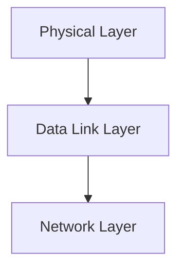

> [!info] Document Metadata
> - **Course:** `=this.course`
> - **Topic:** `=this.topic`
> - **Status:** `=this.status`

**🏷️ Tags:** #[[Computer Science]] #[[NSCOM03]] #[[Conceptual]] #[[Physical Communication Layer]]

---

## Overview
This module explores the foundational concepts of Module 2- Physical Communication Layer as they relate to data communications and networking. It highlights the primary mechanisms used for robust transmission, formatting, and analysis in computer networks.

## Key Definitions **Data Communications:** The exchange of digital data between two or more nodes. **Physical Layer:** The lowest layer responsible for the physical connection between devices. **Data Link Layer:** Ensures error-free transmission of data frames between nodes.

## Theoretical Framework / Core Concepts
The transmission of data requires precise synchronization and structuring. Theoretical models such as the OSI Reference Model standardize these processes.  The Physical layer deals with analog/digital signals, bandwidth, attenuation, and noise. The Data Link layer deals with framing, flow control, and error detection/correction.

## Worked Examples / Protocol Walkthroughs / Calculations
**Example Calculation:**
Given a channel with bandwidth $B = 3000$ Hz and $SNR = 3162$, calculate the Shannon capacity:
$$ C = B \log_2(1 + SNR) $$
$$ C = 3000 \log_2(1 + 3162) \approx 3000 \times 11.62 \approx 34860 \text{ bps} $$

## Summary & Key Takeaways The Physical and Data Link layers form the backbone of local and wide area networks. Precise encoding and error detection are vital for maintaining data integrity. Protocols manage access and transmission over diverse physical media.

## Multiple Choice Questions

1. Which is the lowest layer responsible for the physical connection between devices?
- **A)** Network Layer
- **B)** Physical Layer
- **C)** Data Link Layer
- **D)** Application Layer

2. What does the Data Link layer primarily manage alongside error detection?
- **A)** Analog and digital signal conversion
- **B)** Framing and flow control
- **C)** Bandwidth and attenuation
- **D)** Network routing

3. In the provided formula $C = B \log_2(1 + SNR)$, what does '$B$' stand for?
- **A)** Bitrate
- **B)** Bandwidth
- **C)** Base frequency
- **D)** Baud rate

4. What role does the OSI Reference Model play according to the text?
- **A)** It strictly defines how analog signals are converted to digital
- **B)** It physically connects diverse media
- **C)** It standardizes the processes of precise synchronization and structuring
- **D)** It calculates the Shannon capacity of a channel

### Answer Key & Explanations
1. **B)** The text defines the Physical Layer as "The lowest layer responsible for the physical connection between devices."
2. **B)** The Data Link layer deals with "framing, flow control, and error detection/correction."
3. **B)** The formula calculates Shannon capacity for a given channel where $B$ refers to the bandwidth (e.g., $B = 3000$ Hz).
4. **C)** The text notes that "Theoretical models such as the OSI Reference Model standardize these processes" of precise synchronization and structuring.

## References & Navigation

- **Previous Topic:** [[Review of Physical and Data Link Layer]]
- **Next Topic:** [[Digital Transmission]]
- **Related Notes:** [[Digital Transmission]], [[Review of Physical and Data Link Layer]]
