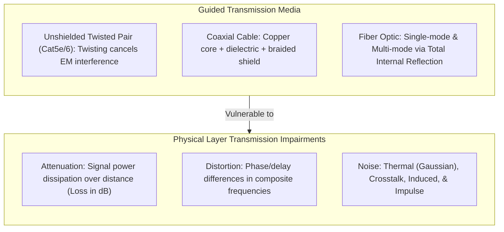

> [!info] Document Metadata
> - **Course:** `=this.course`
> - **Topic:** `=this.topic`
> - **Status:** `=this.status`

**Tags:** #[[Computer Science]] #[[NSCOM03]] #[[Conceptual]] #[[Physical Communication Layer]]

---

## Overview

This module covers physical communication layer concepts including transmission media, physical transmission impairments, and signal attenuation metrics. It explores guided media (twisted pair, coaxial, optical fiber), unguided wireless media, and quantitative modeling of decibel loss, amplification, and Signal-to-Noise Ratio (SNR).

---

## Key Definitions

- **Attenuation:** The progressive reduction in signal amplitude and power as electromagnetic energy propagates through a physical transmission medium.
- **Decibel (dB):** A logarithmic unit measuring relative signal power loss or gain: $\text{dB} = 10 \log_{10}\left(\frac{P_2}{P_1}\right)$.
- **Distortion:** Alteration of a composite signal's waveform caused by differing propagation velocities and phase shifts across its constituent harmonic frequencies.
- **Total Internal Reflection:** The optical phenomenon occurring when a light ray traveling in a higher-refractive-index core ($n_1$) strikes a lower-index cladding ($n_2$) at an angle of incidence greater than the critical angle $\theta_c = \arcsin(n_2 / n_1)$, reflecting all optical power back into the core.
- **Signal-to-Noise Ratio (SNR):** The ratio of signal power to background noise power, expressed linearly as $SNR = \frac{P_{signal}}{P_{noise}}$ or logarithmically as $SNR_{dB} = 10 \log_{10}(SNR)$.

---

## Theoretical Framework

---

## Worked Examples: Attenuation, Gain, and SNR in Decibels

### Problem 1: Transmission Cable Attenuation and Amplification
A $100\text{ mW}$ signal ($P_1 = 100\text{ mW}$) is transmitted through a $20\text{ km}$ transmission cable that exhibits an attenuation coefficient of $-0.3\text{ dB/km}$.

1. Calculate the total decibel loss over the $20\text{ km}$ link:
   $$\text{Total Loss} = (-0.3\text{ dB/km}) \times 20\text{ km} = -6\text{ dB}$$

2. Calculate the signal power $P_2$ arriving at the destination:
   $$-6 = 10 \log_{10}\left(\frac{P_2}{100\text{ mW}}\right)$$
   $$-0.6 = \log_{10}\left(\frac{P_2}{100}\right) \implies \frac{P_2}{100} = 10^{-0.6} \approx 0.2512$$
   $$P_2 = 100 \times 0.2512 \approx 25.12\text{ mW}$$
   *(A loss of $-6\text{ dB}$ reduces signal power to approximately one-quarter of its initial value).*

3. If an in-line amplifier with a gain of $+10\text{ dB}$ is inserted at the destination, what is the final output power $P_3$?
   $$\text{Net dB} = -6\text{ dB} + 10\text{ dB} = +4\text{ dB}$$
   $$P_3 = 100\text{ mW} \times 10^{4/10} = 100 \times 10^{0.4} \approx 100 \times 2.512 \approx 251.2\text{ mW}$$

### Problem 2: Signal-to-Noise Ratio Conversion
If a receiver measures signal power $P_s = 20\text{ mW}$ and background thermal noise power $P_n = 2\text{ }\mu\text{W} = 0.002\text{ mW}$:
$$SNR = \frac{20\text{ mW}}{0.002\text{ mW}} = 10000$$
$$SNR_{dB} = 10 \log_{10}(10000) = 10 \times 4 = 40\text{ dB}$$

---

## Multiple Choice Questions

1. If a signal's power drops from $1000\text{ mW}$ to $1\text{ mW}$ while propagating through a long transmission line, what is the attenuation in decibels?
    - **A)** $-30\text{ dB}$
    - **B)** $-10\text{ dB}$
    - **C)** $-3\text{ dB}$
    - **D)** $-60\text{ dB}$

2. What optical principle allows light pulses to travel hundreds of kilometers through single-mode fiber-optic cores without leaking through the cladding?
    - **A)** Diffuse scattering
    - **B)** Total Internal Reflection, where angle of incidence exceeds critical angle $\theta_c$
    - **C)** Destructive phase interference
    - **D)** Frequency division multiplexing

3. Why are wire pairs in Category 5e and Category 6 Ethernet cables twisted symmetrically around one another?
    - **A)** To increase the physical tensile strength of the cable
    - **B)** To cancel electromagnetic interference (EMI) and crosstalk from neighboring pairs
    - **C)** To increase electrical resistance and slow down high frequencies
    - **D)** To reduce thermal heating of copper conductors

4. A communication channel has a measured Signal-to-Noise Ratio of $SNR_{dB} = 30\text{ dB}$. What is its linear power ratio $P_{signal} / P_{noise}$?
    - **A)** 30
    - **B)** 300
    - **C)** 1000
    - **D)** 3000

5. Which type of transmission impairment occurs specifically in composite analog signals because individual harmonic frequency components propagate at slightly different phase velocities along a medium?
    - **A)** Thermal noise
    - **B)** Distortion
    - **C)** Attenuation
    - **D)** Crosstalk

---

### Answer Key & Explanations

1. **A**. Using $\text{dB} = 10 \log_{10}(P_2 / P_1) = 10 \log_{10}(1 / 1000) = 10 \times (-3) = -30\text{ dB}$.
2. **B**. Fiber-optic cores have a higher refractive index ($n_1$) than the surrounding cladding ($n_2$). When the angle of incidence exceeds the critical angle $\theta_c = \arcsin(n_2 / n_1)$, total internal reflection occurs, trapping 100% of light energy within the core.
3. **B**. Twisting wire pairs ensures both wires receive nearly equal electromagnetic interference from external sources and adjacent pairs. Because receivers measure differential voltage between the two wires, common-mode noise is cancelled out.
4. **C**. Since $SNR_{dB} = 10 \log_{10}(SNR)$, $30 = 10 \log_{10}(SNR) \implies \log_{10}(SNR) = 3 \implies SNR = 10^3 = 1000$.
5. **B**. Distortion occurs because composite signals comprise multiple frequencies, each experiencing slightly different phase velocity and delay, warping the original envelope shape by the time it reaches the receiver.

---

## References & Navigation

- **Previous Topic:** [[Review of Physical and Data Link Layer]]
- **Next Topic:** [[Digital Transmission]]
- **Related Notes:** [[Digital Transmission]], [[Review of Physical and Data Link Layer]]
