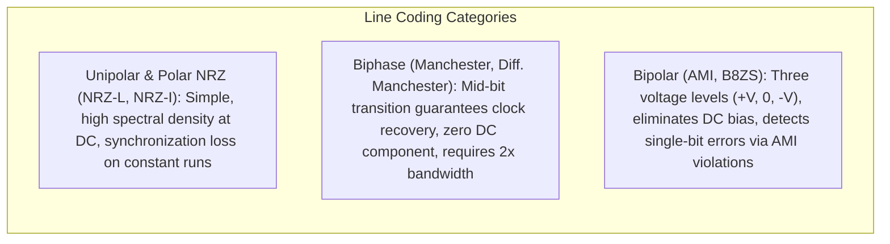

> [!info] Document Metadata
> - **Course:** `=this.course`
> - **Topic:** `=this.topic`
> - **Status:** `=this.status`

**Tags:** #[[Computer Science]] #[[NSCOM03]] #[[Conceptual]] #[[Digital Transmission]]

---

## Overview

This module explores digital transmission techniques, focusing on digital-to-digital line coding mechanisms (NRZ, RZ, Manchester, Bipolar AMI) and analog-to-digital pulse code modulation (PCM). It covers clock synchronization, DC component elimination, Nyquist sampling rates, and quantization noise metrics.

---

## Key Definitions

- **Line Coding:** The process of converting binary data (sequences of 0s and 1s) into a digital signal (a discrete voltage waveform) suitable for transmission over a physical channel.
- **Baud Rate (Modulation Rate):** The number of signal state transitions or signal units transmitted per second, measured in baud or symbols/s ($S = N / r$).
- **Bit Rate (Data Rate):** The number of binary bits transmitted per second, measured in bits per second (bps) ($N = S \cdot r$, where $r = \log_2 L$).
- **Manchester Encoding:** A self-synchronizing biphase line coding scheme where a transition occurs at the center of every bit interval (low-to-high represents binary 1, high-to-low represents binary 0 in IEEE 802.3).
- **Pulse Code Modulation (PCM):** The standard method used to digitally represent analog signals through three sequential stages: Sampling, Quantization, and Binary Encoding.
- **Nyquist Sampling Theorem:** An analog signal with maximum frequency $f_{max}$ can be perfectly reconstructed if it is sampled at a frequency $f_s \ge 2 f_{max}$.

---

## Theoretical Framework: Line Coding Comparison

| Line Code | Voltage Levels | Clock Recovery | DC Component | Bandwidth Required |
| :--- | :--- | :--- | :--- | :--- |
| **NRZ-L** | 2 (+V, -V) | Poor on consecutive identical bits | High (DC baseline wander) | $B_0 = N / 2$ |
| **NRZ-I** | 2 (+V, -V) | Good for runs of 1s, fails on runs of 0s | High | $B_0 = N / 2$ |
| **Manchester** | 2 (+V, -V) | Excellent (transition at every bit center) | Zero (DC balanced) | $B = N$ (Double NRZ) |
| **Bipolar AMI**| 3 (+V, 0, -V)| Poor on consecutive 0s | Zero (alternating polarity) | $B_0 = N / 2$ |

---

## Worked Examples: PCM Digitization and Bit Rate

### Problem 1: Standard Voice Digitization (DS0 Channel)
An analog human voice signal is band-limited by a low-pass filter to a maximum frequency $f_{max} = 4000\text{ Hz}$ ($4\text{ kHz}$). The analog signal is digitized using Pulse Code Modulation (PCM) with $L = 256$ discrete quantization levels.

1. **Calculate the minimum Nyquist sampling rate $f_s$:**
   $$f_s = 2 \times f_{max} = 2 \times 4000\text{ Hz} = 8000\text{ samples/second}$$

2. **Calculate the required number of bits per sample $n_b$:**
   $$n_b = \log_2(L) = \log_2(256) = 8\text{ bits/sample}$$

3. **Calculate the resulting digital bit rate $R$:**
   $$R = f_s \times n_b = 8000\text{ samples/s} \times 8\text{ bits/sample} = 64000\text{ bps} = 64\text{ kbps}$$
   *(This $64\text{ kbps}$ digital stream forms the baseline DS0 channel in digital telecommunication hierarchies).*

4. **Calculate theoretical Signal-to-Quantization-Noise Ratio ($SQNR$):**
   $$SQNR_{dB} \approx 6.02 n_b + 1.76 = 6.02(8) + 1.76 = 48.16 + 1.76 = 49.92\text{ dB}$$

---

## Multiple Choice Questions

1. In 10BASE-T Ethernet, why is Manchester encoding used instead of simple NRZ-L?
    - **A)** Manchester encoding cuts the required transmission bandwidth in half
    - **B)** The transition at the center of each bit interval guarantees continuous clock recovery and eliminates DC bias
    - **C)** Manchester allows 4 bits to be encoded into each baud interval
    - **D)** It prevents high-frequency electromagnetic emissions

2. If an analog audio signal with frequencies up to $20\text{ kHz}$ is to be digitized for CD-quality audio, what is the absolute minimum Nyquist sampling rate required?
    - **A)** $10\text{ kHz}$
    - **B)** $20\text{ kHz}$
    - **C)** $40\text{ kHz}$
    - **D)** $44.1\text{ kHz}$

3. What problem occurs when transmitting long sequences of continuous binary zeros (`00000...`) over a channel using Non-Return-to-Zero Inverted (NRZ-I) encoding?
    - **A)** The signal voltage constantly alternates, causing excessive high-frequency noise
    - **B)** The voltage level remains flat with no transitions, causing the receiver clock to drift out of synchronization
    - **C)** The signal exceeds the maximum power rating of the transmission line
    - **D)** It creates an alternating mark inversion error

4. A digitized sensor signal samples an analog temperature sensor at $1000\text{ samples/s}$ using a 12-bit Analog-to-Digital Converter (ADC). What is the resulting output bit rate?
    - **A)** $1.2\text{ kbps}$
    - **B)** $12\text{ kbps}$
    - **C)** $120\text{ kbps}$
    - **D)** $83.3\text{ bps}$

5. In Bipolar Alternate Mark Inversion (AMI) line coding, how is binary 1 represented?
    - **A)** A constant positive voltage for all 1s
    - **B)** By alternating between positive and negative voltages ($+V$ and $-V$) for each successive 1
    - **C)** Zero voltage
    - **D)** A transition at the beginning of the bit cell

---

### Answer Key & Explanations

1. **B**. Manchester encoding features a voltage transition at the exact center of every bit interval (low-to-high for 1, high-to-low for 0 in IEEE 802.3). This continuous transition allows the receiver phase-locked loop (PLL) to extract clock timing regardless of the data pattern, and prevents DC voltage accumulation.
2. **C**. By Nyquist's sampling theorem, $f_s \ge 2 f_{max} = 2 \times 20\text{ kHz} = 40\text{ kHz}$. (Compact Discs historically chose $44.1\text{ kHz}$ to allow anti-aliasing filter roll-off).
3. **B**. In NRZ-I, a transition occurs only upon encountering a binary 1. A long run of zeros produces zero voltage transitions, causing the receiver to lose bit synchronization.
4. **B**. Bit rate $R = f_s \times n_b = 1000\text{ samples/s} \times 12\text{ bits/sample} = 12000\text{ bps} = 12\text{ kbps}$.
5. **B**. Bipolar AMI encodes binary 0 as zero volts ($0\text{ V}$) and encodes binary 1s by alternating between $+V$ and $-V$. This guarantees that the average DC voltage of the waveform is zero.

---

## References & Navigation

- **Previous Topic:** [[Physical Communication Layer]]
- **Next Topic:** [[Digital to Analog Transmission]]
- **Related Notes:** [[Physical Communication Layer]], [[Digital to Analog Transmission]]
