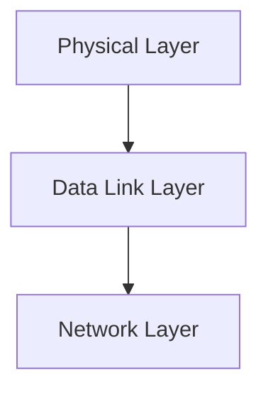

> [!info] Document Metadata
> - **Course:** `=this.course`
> - **Topic:** `=this.topic`
> - **Status:** `=this.status`

**Tags:** #[[Computer Science]] #[[NSCOM03]] #[[Conceptual]] #[[Digital Transmission]]

---

## Overview
This module explores the foundational concepts of Module 3- Digital Transmission as they relate to data communications and networking. It highlights the primary mechanisms used for robust transmission, formatting, and analysis in computer networks.

## Key Definitions **Data Communications:** The exchange of digital data between two or more nodes. **Physical Layer:** The lowest layer responsible for the physical connection between devices. **Data Link Layer:** Ensures error-free transmission of data frames between nodes.

## Theoretical Framework / Core Concepts
The transmission of data requires precise synchronization and structuring. Theoretical models such as the OSI Reference Model standardize these processes.  The Physical layer deals with analog/digital signals, bandwidth, attenuation, and noise. The Data Link layer deals with framing, flow control, and error detection/correction.

## Worked Examples / Protocol Walkthroughs / Calculations
**Example Calculation:**
Given a channel with bandwidth $B = 3000$ Hz and $SNR = 3162$, calculate the Shannon capacity:
$$ C = B \log_2(1 + SNR) $$
$$ C = 3000 \log_2(1 + 3162) \approx 3000 \times 11.62 \approx 34860 \text{ bps} $$

## Summary & Key Takeaways The Physical and Data Link layers form the backbone of local and wide area networks. Precise encoding and error detection are vital for maintaining data integrity. Protocols manage access and transmission over diverse physical media.

## Multiple Choice Questions

1. What ensures error-free transmission of data frames between nodes?
    - **A)** The Physical Layer
    - **B)** The OSI Reference Model
    - **C)** The Network Layer
    - **D)** The Data Link Layer

2. According to the provided diagram, which layer comes immediately after the Data Link Layer?
    - **A)** Transport Layer
    - **B)** Application Layer
    - **C)** Network Layer
    - **D)** Physical Layer

3. Which of the following does the Physical layer NOT deal with?
    - **A)** Bandwidth
    - **B)** Flow control
    - **C)** Attenuation
    - **D)** Noise

4. What is the primary purpose of precise encoding and error detection?
    - **A)** Standardizing the OSI model
    - **B)** Maintaining data integrity
    - **C)** Maximizing channel bandwidth
    - **D)** Removing attenuation

### Answer Key & Explanations

1. **D**. The Data Link Layer is defined by its role to ensure "error-free transmission of data frames between nodes."
2. **C**. The flowchart diagram shows "Data Link Layer --> Network Layer".
3. **B**. Flow control is a responsibility of the Data Link layer, whereas bandwidth, attenuation, and noise are handled by the Physical layer.
4. **B**. The summary states that "Precise encoding and error detection are vital for maintaining data integrity."

## References & Navigation

- **Previous Topic:** [[Physical Communication Layer]]
- **Next Topic:** [[Digital to Analog Transmission]]
- **Related Notes:** [[Physical Communication Layer]], [[Digital to Analog Transmission]]
