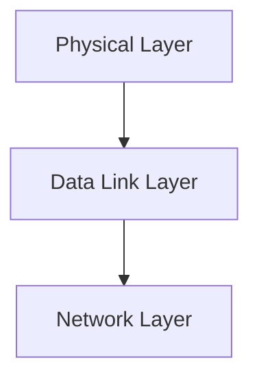

> [!info] Document Metadata
> - **Course:** `=this.course`
> - **Topic:** `=this.topic`
> - **Status:** `=this.status`

**Tags:** #[[Computer Science]] #[[NSCOM03]] #[[Conceptual]] #[[Digital to Analog Transmission]]

---

## Overview
This module explores the foundational concepts of Module 4- Digital to Analog Transmission as they relate to data communications and networking. It highlights the primary mechanisms used for robust transmission, formatting, and analysis in computer networks.

## Key Definitions **Data Communications:** The exchange of digital data between two or more nodes. **Physical Layer:** The lowest layer responsible for the physical connection between devices. **Data Link Layer:** Ensures error-free transmission of data frames between nodes.

## Theoretical Framework / Core Concepts
The transmission of data requires precise synchronization and structuring. Theoretical models such as the OSI Reference Model standardize these processes.  The Physical layer deals with analog/digital signals, bandwidth, attenuation, and noise. The Data Link layer deals with framing, flow control, and error detection/correction.

## Worked Examples / Protocol Walkthroughs / Calculations
**Example Calculation:**
Given a channel with bandwidth $B = 3000$ Hz and $SNR = 3162$, calculate the Shannon capacity:
$$ C = B \log_2(1 + SNR) $$
$$ C = 3000 \log_2(1 + 3162) \approx 3000 \times 11.62 \approx 34860 \text{ bps} $$

## Summary & Key Takeaways The Physical and Data Link layers form the backbone of local and wide area networks. Precise encoding and error detection are vital for maintaining data integrity. Protocols manage access and transmission over diverse physical media.

## Multiple Choice Questions

1. Which factors does the Physical layer directly deal with?
    - **A)** Framing and error correction
    - **B)** Analog/digital signals, bandwidth, attenuation, and noise
    - **C)** Flow control and logical routing
    - **D)** Precise encoding and data integrity

2. What do protocols manage over diverse physical media?
    - **A)** Access and transmission
    - **B)** Analog conversions only
    - **C)** Frequency calculations
    - **D)** Theoretical standardization

3. Which mathematical model is explicitly used to calculate the capacity of a channel in the text?
    - **A)** Nyquist bit rate
    - **B)** OSI Reference Model
    - **C)** Shannon capacity
    - **D)** Signal-to-Noise Ratio formula

4. Which two layers form the backbone of local and wide area networks according to the summary?
    - **A)** Application and Network layers
    - **B)** Network and Transport layers
    - **C)** Physical and Data Link layers
    - **D)** Physical and Network layers

### Answer Key & Explanations

1. **B**. The text explicitly lists that the Physical layer deals with "analog/digital signals, bandwidth, attenuation, and noise."
2. **A**. The summary notes that "Protocols manage access and transmission over diverse physical media."
3. **C**. The text provides a worked example calculating the "Shannon capacity" ($C = B \log_2(1 + SNR)$).
4. **C**. The summary states "The Physical and Data Link layers form the backbone of local and wide area networks."

## References & Navigation

- **Previous Topic:** [[Digital Transmission]]
- **Next Topic:** [[Multiplexing]]
- **Related Notes:** [[Digital Transmission]], [[Multiplexing]]
