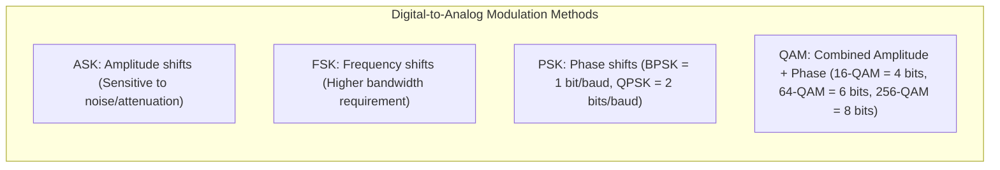

> [!info] Document Metadata
> - **Course:** `=this.course`
> - **Topic:** `=this.topic`
> - **Status:** `=this.status`

**Tags:** #[[Computer Science]] #[[NSCOM03]] #[[Conceptual]] #[[Digital to Analog Transmission]]

---

## Overview

This module covers digital-to-analog modulation techniques, which translate binary data into analog waveforms suitable for band-pass channels (e.g. telephone local loops, radio channels, cable TV coaxial networks). Topics include Amplitude Shift Keying (ASK), Frequency Shift Keying (FSK), Phase Shift Keying (PSK, BPSK, QPSK), Quadrature Amplitude Modulation (QAM), and constellation diagram analysis.

---

## Key Definitions

- **Modulation:** The process of varying one or more characteristics of a high-frequency analog carrier wave ($s(t) = A \sin(2\pi f t + \phi)$) in accordance with a digital bitstream.
- **Amplitude Shift Keying (ASK):** Varies the carrier signal's amplitude between discrete levels while maintaining constant frequency and phase; highly vulnerable to line noise and attenuation.
- **Frequency Shift Keying (FSK):** Varies the carrier frequency between discrete frequencies ($f_1$ for binary 1, $f_2$ for binary 0) while maintaining constant amplitude and phase.
- **Phase Shift Keying (PSK):** Modulates the phase of the carrier wave to represent discrete binary symbols while keeping amplitude and frequency constant.
- **Quadrature Amplitude Modulation (QAM):** A hybrid modulation technique that modulates both amplitude and phase simultaneously, mapping symbols to a two-dimensional constellation diagram.
- **Constellation Diagram:** A Cartesian diagram where the horizontal $x$-axis represents the in-phase ($I$) carrier component and the vertical $y$-axis represents the quadrature ($Q$) carrier component.

---

## Theoretical Framework: Modulation Techniques

| Modulation | Carrier Parameter Varied | Bits/Symbol ($r$) | Typical Applications |
| :--- | :--- | :--- | :--- |
| **BPSK** | Phase ($0^\circ, 180^\circ$) | 1 | Deep space communications, RFID |
| **QPSK** | Phase ($45^\circ, 135^\circ, 225^\circ, 315^\circ$) | 2 | Satellite television, LTE control channels |
| **16-QAM** | Amplitude and Phase (16 points) | 4 | Cable broadband (DOCSIS), Wi-Fi (802.11a/g) |
| **64-QAM** | Amplitude and Phase (64 points) | 6 | Wi-Fi 4 (802.11n), Digital terrestrial TV |
| **256-QAM**| Amplitude and Phase (256 points) | 8 | Wi-Fi 5/6 (802.11ac/ax), High-speed cable |

---

## Worked Examples: QAM Symbol Rate and Bit Rate Calculations

### Problem 1: 16-QAM Data Rate Calculation
A band-pass communication channel operates at a symbol modulation rate (baud rate) $S = 24000\text{ baud}$ using 16-QAM modulation ($L = 16$ discrete constellation points).

1. **Calculate bits per baud symbol $r$:**
   $$r = \log_2(L) = \log_2(16) = 4\text{ bits/symbol}$$

2. **Calculate the resulting bit rate $N$:**
   $$N = S \times r = 24000\text{ baud} \times 4\text{ bits/symbol} = 96000\text{ bps} = 96\text{ kbps}$$

### Problem 2: Upgrading to 64-QAM
To increase transmission throughput over the exact same channel without increasing the baud rate ($S = 24000\text{ baud}$), the modulation scheme is upgraded to 64-QAM ($L = 64$):

1. **Calculate the new bits per symbol $r'$:**
   $$r' = \log_2(64) = 6\text{ bits/symbol}$$

2. **Calculate the upgraded data rate $N'$:**
   $$N' = S \times r' = 24000\text{ baud} \times 6\text{ bits/symbol} = 144000\text{ bps} = 144\text{ kbps}$$
   *(Upgrading from 16-QAM to 64-QAM yields a $50\%$ throughput increase at identical baud rate, but requires higher SNR to distinguish the closer constellation points).*

---

## Multiple Choice Questions

1. How many bits are encoded into each transmitted symbol in a 16-QAM constellation diagram?
    - **A)** 2 bits
    - **B)** 4 bits
    - **C)** 8 bits
    - **D)** 16 bits

2. What is the primary operational advantage of Quadrature Phase Shift Keying (QPSK) over Binary Phase Shift Keying (BPSK)?
    - **A)** QPSK eliminates all need for carrier synchronization
    - **B)** QPSK transmits 2 bits per baud symbol, doubling the data rate for a given baud rate
    - **C)** QPSK requires only half the receiver signal-to-noise ratio
    - **D)** QPSK is immune to multipath fading

3. Why is Amplitude Shift Keying (ASK) rarely used for high-speed long-distance communication over copper or wireless media?
    - **A)** It requires excessive computational power to decode
    - **B)** Amplitude is highly susceptible to noise, attenuation, and atmospheric fading
    - **C)** It cannot be combined with carrier frequencies above $1\text{ kHz}$
    - **D)** It is incompatible with digital-to-analog converters

4. If a Wi-Fi router transmits at a baud rate of $20\text{ Mbaud}$ using 256-QAM, what is the raw data rate of this transmission stream?
    - **A)** $40\text{ Mbps}$
    - **B)** $80\text{ Mbps}$
    - **C)** $160\text{ Mbps}$
    - **D)** $256\text{ Mbps}$

5. On a QAM constellation diagram, what do the radial distance from the origin and the angular displacement represent, respectively?
    - **A)** Signal frequency and channel bandwidth
    - **B)** Signal amplitude and phase angle
    - **C)** Signal baud rate and bit rate
    - **D)** Signal attenuation and thermal noise

---

### Answer Key & Explanations

1. **B**. In 16-QAM, there are $L = 16$ distinct constellation points. The number of bits represented by each symbol is $r = \log_2(16) = 4$ bits.
2. **B**. BPSK encodes 1 bit per symbol ($0^\circ, 180^\circ$). QPSK uses 4 phases ($45^\circ, 135^\circ, 225^\circ, 315^\circ$), encoding $r = \log_2(4) = 2$ bits per symbol, allowing double the data rate at the same symbol transmission rate.
3. **B**. Thermal noise, electromagnetic interference, and medium resistance directly affect signal amplitude. In ASK, amplitude variations directly corrupt the data bits.
4. **C**. For 256-QAM, $r = \log_2(256) = 8$ bits/symbol. Raw bit rate $N = S \times r = 20\text{ Mbaud} \times 8\text{ bits/symbol} = 160\text{ Mbps}$.
5. **B**. In polar coordinates on a constellation diagram, the distance $r = \sqrt{I^2 + Q^2}$ from the origin represents peak signal amplitude, while the angle $\theta = \arctan(Q / I)$ represents carrier phase shift.

---

## References & Navigation

- **Previous Topic:** [[Digital Transmission]]
- **Next Topic:** [[Multiplexing]]
- **Related Notes:** [[Digital Transmission]], [[Multiplexing]]
