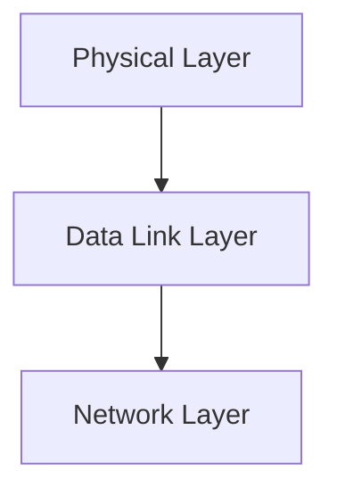

> [!info] Document Metadata
> - **Course:** `=this.course`
> - **Topic:** `=this.topic`
> - **Status:** `=this.status`

**Tags:** #[[Computer Science]] #[[NSCOM03]] #[[Conceptual]] #[[Multiplexing]]

---

## Overview
This module explores the foundational concepts of Module 5- Multiplexing as they relate to data communications and networking. It highlights the primary mechanisms used for robust transmission, formatting, and analysis in computer networks.

## Key Definitions **Data Communications:** The exchange of digital data between two or more nodes. **Physical Layer:** The lowest layer responsible for the physical connection between devices. **Data Link Layer:** Ensures error-free transmission of data frames between nodes.

## Theoretical Framework / Core Concepts
The transmission of data requires precise synchronization and structuring. Theoretical models such as the OSI Reference Model standardize these processes.  The Physical layer deals with analog/digital signals, bandwidth, attenuation, and noise. The Data Link layer deals with framing, flow control, and error detection/correction.

## Worked Examples / Protocol Walkthroughs / Calculations
**Example Calculation:**
Given a channel with bandwidth $B = 3000$ Hz and $SNR = 3162$, calculate the Shannon capacity:
$$ C = B \log_2(1 + SNR) $$
$$ C = 3000 \log_2(1 + 3162) \approx 3000 \times 11.62 \approx 34860 \text{ bps} $$

## Summary & Key Takeaways The Physical and Data Link layers form the backbone of local and wide area networks. Precise encoding and error detection are vital for maintaining data integrity. Protocols manage access and transmission over diverse physical media.

## Multiple Choice Questions

1. What layer is responsible for framing and flow control?
    - **A)** Physical Layer
    - **B)** Data Link Layer
    - **C)** Network Layer
    - **D)** Application Layer

2. In the Shannon capacity example provided, what is the exact value of SNR used?
    - **A)** 3000
    - **B)** 3162
    - **C)** 11.62
    - **D)** 34860

3. What is exchanged during Data Communications?
    - **A)** Analog frequencies
    - **B)** OSI reference models
    - **C)** Digital data
    - **D)** Channel bandwidth

4. What manages access and transmission over diverse physical media?
    - **A)** The Shannon formula
    - **B)** Protocols
    - **C)** The Physical Layer alone
    - **D)** Bandwidth allocations

### Answer Key & Explanations

1. **B**. The text states that "The Data Link layer deals with framing, flow control, and error detection/correction."
2. **B**. The example calculation uses an SNR value of 3162.
3. **C**. Data Communications is defined as "The exchange of digital data between two or more nodes."
4. **B**. The summary states, "Protocols manage access and transmission over diverse physical media."

## References & Navigation

- **Previous Topic:** [[Digital to Analog Transmission]]
- **Next Topic:** [[Error Detection]]
- **Related Notes:** [[Digital to Analog Transmission]], [[Physical Communication Layer]]
