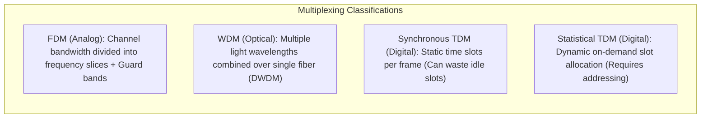

> [!info] Document Metadata
> - **Course:** `=this.course`
> - **Topic:** `=this.topic`
> - **Status:** `=this.status`

**Tags:** #[[Computer Science]] #[[NSCOM03]] #[[Conceptual]] #[[Multiplexing]]

---

## Overview

This module covers multiplexing principles in data communications: combining multiple low-speed data streams into a single high-speed physical link. It examines Frequency Division Multiplexing (FDM), Wavelength Division Multiplexing (WDM), and digital Time Division Multiplexing (Synchronous and Statistical TDM), including frame rate, time slot, and aggregate data rate calculations.

---

## Key Definitions

- **Multiplexing:** The technique of transmitting multiple simultaneous signals across a shared transmission medium using a Multiplexer (MUX) at the transmitter and a Demultiplexer (DEMUX) at the receiver.
- **Frequency Division Multiplexing (FDM):** An analog multiplexing technique where the total channel bandwidth is divided into non-overlapping frequency bands separated by guard bands.
- **Wavelength Division Multiplexing (WDM):** An optical variant of FDM where multiple optical carriers of differing wavelengths ($\lambda$) travel concurrently through a single optical fiber.
- **Synchronous TDM:** A digital multiplexing technique where time on the shared medium is divided into frames, with each incoming channel statically allocated a dedicated time slot in every frame regardless of activity.
- **Statistical (Asynchronous) TDM:** Dynamically allocates time slots on demand only to active input lines, incorporating source address overhead to eliminate wasted idle slots.
- **Guard Bands:** Narrow unused frequency intervals positioned between adjacent channels in FDM to prevent spectral overlap and inter-channel crosstalk.

---

## Theoretical Framework: Multiplexing Paradigms

| Multiplexing Type | Medium Domain | Allocation Mechanism | Inefficiency / Vulnerability |
| :--- | :--- | :--- | :--- |
| **FDM** | Analog / RF | Frequency sub-bands | Guard band bandwidth overhead, crosstalk |
| **WDM / DWDM** | Optical fiber | Discrete light wavelengths | Requires precise laser transceivers |
| **Synchronous TDM**| Digital baseband | Pre-allocated periodic time slots | Wasted time slots when lines are idle |
| **Statistical TDM** | Digital baseband | Dynamic slots with address tags | Variable queueing delay and header overhead |

---

## Worked Examples: Synchronous TDM Frame and Rate Calculations

### Problem 1: Four-Channel Byte-Interleaved Synchronous TDM
Four separate digital channels, each transmitting at $R_{in} = 250\text{ kbps}$ ($250000\text{ bps}$), are multiplexed onto a single shared link using Synchronous Time Division Multiplexing. Multiplexing is byte-interleaved (each input channel contributes 1 byte = 8 bits per time slot). One additional synchronization (framing) bit is appended to each transmitted frame.

1. **Calculate the total frame size in bits:**
   $$\text{Data bits per frame} = 4\text{ channels} \times 8\text{ bits/slot} = 32\text{ bits}$$
   $$\text{Total Frame Size} = 32\text{ data bits} + 1\text{ framing bit} = 33\text{ bits/frame}$$

2. **Calculate the frame generation rate:**
   Since each input channel delivers $250000\text{ bps}$ and contributes 8 bits per frame:
   $$\text{Frame Rate} = \frac{250000\text{ bits/s}}{8\text{ bits/frame}} = 31250\text{ frames/second}$$
   $$\text{Frame Duration } T_f = \frac{1}{31250\text{ s}^{-1}} = 3.2 \times 10^{-5}\text{ s} = 32\text{ }\mu\text{s}$$

3. **Calculate the aggregate multiplexed output data rate $R_{out}$:**
   $$R_{out} = 31250\text{ frames/s} \times 33\text{ bits/frame} = 1031250\text{ bps} \approx 1.031\text{ Mbps}$$

### Problem 2: Classical T-1 Carrier System
The standard North American T-1 carrier multiplexes 24 digitized voice channels (each at $64\text{ kbps}$, sampling at $8000\text{ samples/s}$ with 8 bits/sample) with 1 synchronization bit per frame:
$$\text{Bits per frame} = (24 \times 8) + 1 = 192 + 1 = 193\text{ bits}$$
$$\text{T-1 Line Rate} = 8000\text{ frames/s} \times 193\text{ bits/frame} = 1544000\text{ bps} = 1.544\text{ Mbps}$$

---

## Multiple Choice Questions

1. In Synchronous Time Division Multiplexing (TDM), what happens when one of the connected input channels has no data to transmit?
    - **A)** The multiplexer automatically reallocates that slot to adjacent channels
    - **B)** The slot allocated for that channel is transmitted empty, resulting in wasted link capacity
    - **C)** The frame size collapses dynamically to exclude the inactive channel
    - **D)** The multiplexer suspends transmission until all channels become active

2. What is the fundamental operational difference between Synchronous TDM and Statistical (Asynchronous) TDM?
    - **A)** Synchronous TDM is analog while Statistical TDM is optical
    - **B)** Statistical TDM dynamically allocates slots only to active channels, requiring address headers for each slot, whereas Synchronous TDM uses fixed, pre-assigned slots
    - **C)** Synchronous TDM requires guard bands while Statistical TDM does not
    - **D)** Statistical TDM cannot support digital baseband signals

3. In Frequency Division Multiplexing (FDM), what is the function of guard bands between adjacent sub-channels?
    - **A)** To amplify weak signals at high frequencies
    - **B)** To prevent spectral overlap and reduce inter-channel crosstalk
    - **C)** To provide a dedicated channel for clock synchronization
    - **D)** To convert digital bits into analog carriers

4. A standard T-1 digital carrier line multiplexes 24 voice channels. If each voice channel uses 8 bits per frame and 1 framing bit is appended per frame, what is the total bit rate transmitted over the T-1 line?
    - **A)** $64\text{ kbps}$
    - **B)** $1.544\text{ Mbps}$
    - **C)** $2.048\text{ Mbps}$
    - **D)** $10\text{ Mbps}$

5. Which multiplexing technology allows multiple optical light wavelengths of different colors to propagate simultaneously over a single optical fiber core?
    - **A)** Wavelength Division Multiplexing (WDM)
    - **B)** Synchronous TDM
    - **C)** Time Division Multiple Access (TDMA)
    - **D)** Orthogonal Frequency Shift Keying

---

### Answer Key & Explanations

1. **B**. In Synchronous TDM, time slots are statically mapped to input channels. If an input channel has no data to send, its assigned slot is transmitted empty, wasting capacity.
2. **B**. Statistical TDM avoids the idle-slot waste of Synchronous TDM by dynamically creating slots only when an input line has active data. To allow the demultiplexer to route the data correctly, each slot carries an address identifier.
3. **B**. Guard bands are narrow unallocated frequency gaps that separate adjacent modulated signals in FDM to prevent filtering imperfections from causing crosstalk.
4. **B**. Each T-1 frame carries $(24 \times 8) + 1 = 193$ bits. Multiplying by the standard telephony sampling rate of $8000\text{ frames/s}$ yields $193 \times 8000 = 1544000\text{ bps} = 1.544\text{ Mbps}$.
5. **A**. Wavelength Division Multiplexing (WDM/DWDM) combines multiple optical carrier signals onto a single strand of fiber by using different wavelengths (colors) of laser light.

---

## References & Navigation

- **Previous Topic:** [[Digital to Analog Transmission]]
- **Next Topic:** [[Error Detection]]
- **Related Notes:** [[Digital to Analog Transmission]], [[Physical Communication Layer]]
