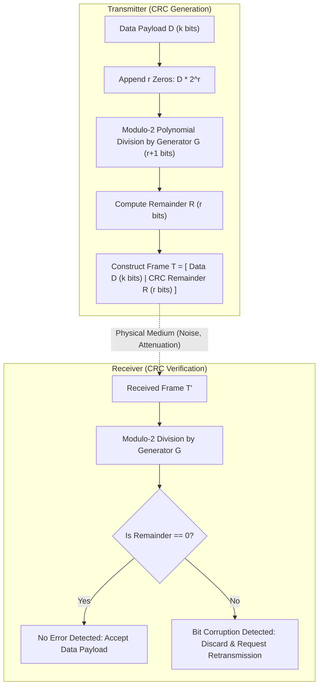

> [!info] Document Metadata
> - **Course:** `=this.course`
> - **Topic:** `=this.topic`
> - **Status:** `=this.status`

**Tags:** #[[Computer Science]] #[[NSCOM03]] #[[Conceptual]] #[[Error Detection]]

---

## Overview
This module explores the foundational concepts of Module 6- Error Detection as they relate to data communications and networking. It highlights the primary mechanisms used for robust transmission, formatting, and analysis in computer networks.

## Key Definitions
- **Error Detection:** Mathematical encoding mechanisms that allow a receiving station to detect bit flips caused by channel noise.
- **Parity Check:** Appending a single parity bit to make the total number of 1s even (Even Parity) or odd (Odd Parity).
- **Checksum:** 16-bit one's complement sum of message words used in IP, TCP, and UDP headers.
- **Cyclic Redundancy Check (CRC):** An algebraic polynomial division code that provides robust detection of single-bit, double-bit, and burst errors.
- **Generator Polynomial ($G$):** A predefined binary divisor of length $r+1$ bits agreed upon by sender and receiver.

## Theoretical Framework / Core Concepts

Error detection operates by appending $r$ redundant check bits to a $k$-bit data word. The receiving node executes an identical verification algorithm:

## Worked Examples / Protocol Walkthroughs / Calculations
**Example Calculation:**
Given a channel with bandwidth $B = 3000$ Hz and $SNR = 3162$, calculate the Shannon capacity:
$$ C = B \log_2(1 + SNR) $$
$$ C = 3000 \log_2(1 + 3162) \approx 3000 \times 11.62 \approx 34860 \text{ bps} $$

## Summary & Key Takeaways The Physical and Data Link layers form the backbone of local and wide area networks. Precise encoding and error detection are vital for maintaining data integrity. Protocols manage access and transmission over diverse physical media.

## Multiple Choice Questions

1. Which of the following is responsible for the physical connection between devices?
    - **A)** Network Layer
    - **B)** Data Link Layer
    - **C)** Physical Layer
    - **D)** Access Control Layer

2. The transmission of data requires which of the following?
    - **A)** Continuous analog signaling
    - **B)** Unrestricted bandwidth
    - **C)** Precise synchronization and structuring
    - **D)** Elimination of all noise

3. In the provided Shannon capacity calculation, what is $\log_2(1 + 3162)$ approximately equal to?
    - **A)** 3000
    - **B)** 11.62
    - **C)** 34860
    - **D)** 3162

4. Which layer ensures error-free transmission of data frames?
    - **A)** Physical Layer
    - **B)** Data Link Layer
    - **C)** Network Layer
    - **D)** Transport Layer

### Answer Key & Explanations

1. **C**. The Physical Layer is defined as "The lowest layer responsible for the physical connection between devices."
2. **C**. The core concepts section mentions "The transmission of data requires precise synchronization and structuring."
3. **B**. The calculation step shows $\log_2(1 + 3162) \approx 11.62$.
4. **B**. The Data Link Layer "Ensures error-free transmission of data frames between nodes."

## References & Navigation

- **Previous Topic:** [[Multiplexing]]
- **Next Topic:** [[Media Access Control]]
- **Related Notes:** [[Media Access Control]], [[Data Link Protocols (LAN)]]
