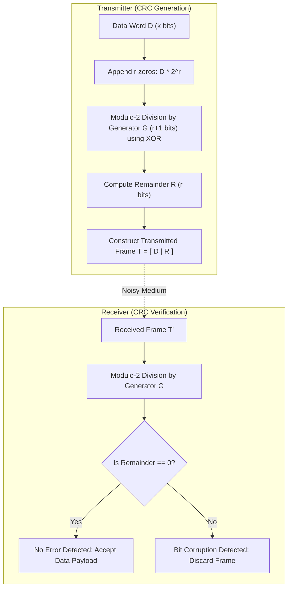

> [!info] Document Metadata
> - **Course:** `=this.course`
> - **Topic:** `=this.topic`
> - **Status:** `=this.status`

**Tags:** #[[Computer Science]] #[[NSCOM03]] #[[Conceptual]] #[[Error Detection]]

---

## Overview

This module examines error detection mechanisms operating at the Data Link Layer. Topics include single-bit parity, two-dimensional parity, the Internet Checksum algorithm (one's complement summation), and the algebraic Cyclic Redundancy Check (CRC) based on polynomial modulo-2 arithmetic.

---

## Key Definitions

- **Redundancy:** Appending extra non-information bits to a data payload so that a receiver can mathematically verify bit integrity.
- **Hamming Distance ($d_{min}$):** The minimum number of bit positions in which any two valid codewords in a code differ; to detect $s$ bit errors, the code must satisfy $d_{min} \ge s + 1$.
- **Parity Check:** Appending a single check bit such that the total count of 1s in the frame is always even (Even Parity) or odd (Odd Parity); detects all single-bit errors but fails on even-numbered bit flips.
- **Internet Checksum:** A 16-bit error detection code computed by summing 16-bit words using one's complement arithmetic and taking the one's complement of the result (used in IPv4, TCP, UDP).
- **Cyclic Redundancy Check (CRC):** A powerful polynomial-based error-detecting code where binary strings are treated as polynomials with coefficients in GF(2); bit strings are divided using modulo-2 arithmetic.
- **Generator Polynomial ($G(x)$):** A predetermined divisor polynomial of degree $r$ ($r + 1$ bits) agreed upon by transmitter and receiver.

---

## Theoretical Framework: CRC Generation and Verification



---

## Worked Examples: CRC Modulo-2 Division

### Problem 1: CRC Computation
A transmitter wants to send a 6-bit data word $D = 101001$ using a Cyclic Redundancy Check with generator polynomial $G(x) = x^3 + x + 1$.

1. **Convert the generator polynomial to binary:**
   $$G(x) = 1 \cdot x^3 + 0 \cdot x^2 + 1 \cdot x^1 + 1 \cdot x^0 \implies G = 1011$$
   The degree of $G(x)$ is $r = 3$, meaning the divisor is $r + 1 = 4$ bits long and will produce an $r = 3$-bit remainder.

2. **Append $r = 3$ zeros to the data word:**
   $$\text{Dividend} = D \times 2^3 = 101001000$$

3. **Perform Modulo-2 division (XOR subtraction, no carries or borrows):**
   ```text
              100100  (Quotient)
        -------------
   1011 ) 101001000
          1011
          ----
          000101000  (XOR: 1010 ^ 1011 = 0001; bring down 0, 1, 0)
             1011
             ----
             000100  (XOR: 1010 ^ 1011 = 0001; bring down 0, 0)
   ```
   - Step 1: $1010 \oplus 1011 = 0001$.
   - Bring down $0 \to 0010$ (cannot divide, quotient bit 0).
   - Bring down $1 \to 0101$ (cannot divide, quotient bit 0).
   - Bring down $0 \to 1010$.
   - Step 2: $1010 \oplus 1011 = 0001$.
   - Bring down $0 \to 0010$ (cannot divide, quotient bit 0).
   - Bring down $0 \to 0100$.
   The remainder after processing all dividend bits is $R = 100$ ($3$ bits).

4. **Construct the transmitted frame $T$:**
   $$T = [D \mid R] = 101001100$$

5. **Receiver Verification:**
   The receiver divides the received frame $101001100$ by $1011$.
   $$101001100 \div 1011 \implies \text{Remainder} = 000$$
   Because the remainder is zero, the frame is accepted as uncorrupted.

---

## Multiple Choice Questions

1. In modulo-2 polynomial arithmetic used in CRC calculations, which logical operation replaces both addition and subtraction?
    - **A)** Logical AND
    - **B)** Exclusive OR (XOR)
    - **C)** Logical OR
    - **D)** Two's complement negation

2. A transmitter uses a generator polynomial of degree $r = 4$ (such as $G(x) = x^4 + x + 1$). How many check bits (FCS) are appended to the data word?
    - **A)** 3 bits
    - **B)** 4 bits
    - **C)** 5 bits
    - **D)** 8 bits

3. What condition must a CRC generator polynomial $G(x)$ satisfy to guarantee the detection of all odd numbers of bit errors in a frame?
    - **A)** $G(x)$ must contain $(x + 1)$ as a factor
    - **B)** $G(x)$ must be a primitive polynomial of degree 16
    - **C)** $G(x)$ must have an even number of terms
    - **D)** The coefficient of $x^0$ must be zero

4. If a communication code has a minimum Hamming distance $d_{min} = 5$, what is the maximum number of bit errors $s$ it can reliably detect in any frame?
    - **A)** 2 errors
    - **B)** 4 errors
    - **C)** 5 errors
    - **D)** 6 errors

5. Why does a standard single-bit parity check fail to detect corruption when two bits within the same transmitted character flip simultaneously?
    - **A)** Two bit flips preserve the total odd/even parity count of 1s in the frame
    - **B)** Parity bits can only protect the first 4 bits of a character
    - **C)** The receiver automatically inverts even bit positions
    - **D)** Single-bit parity applies exclusively to analog signals

---

### Answer Key & Explanations

1. **B**. Modulo-2 arithmetic operates over GF(2), where addition and subtraction are identical and equivalent to bitwise XOR: $0 \oplus 0 = 0, 0 \oplus 1 = 1, 1 \oplus 0 = 1, 1 \oplus 1 = 0$, with no carries or borrows.
2. **B**. The number of appended check bits (the length of remainder $R$) is always equal to the degree $r$ of the generator polynomial $G(x)$. A degree-4 polynomial has $r = 4$ and requires a 5-bit divisor, leaving a 4-bit remainder.
3. **A**. It is a fundamental algebraic property of CRC codes that any generator polynomial $G(x)$ containing $(x + 1)$ as a factor will detect all error polynomials $E(x)$ with an odd number of terms (all odd-numbered bit errors).
4. **B**. To detect $s$ errors, the code must satisfy $d_{min} \ge s + 1$. For $d_{min} = 5$, $s = d_{min} - 1 = 5 - 1 = 4$ errors.
5. **A**. Even or odd parity only detects changes in the parity of the count of 1s. Flipping two bits (e.g. $1 \to 0$ and $0 \to 1$, or two $1 \to 0$) changes the count by an even number, leaving the parity bit unchanged and rendering the error invisible.

---

## References & Navigation

- **Previous Topic:** [[Multiplexing]]
- **Next Topic:** [[Media Access Control]]
- **Related Notes:** [[Media Access Control]], [[Data Link Protocols (LAN)]]
