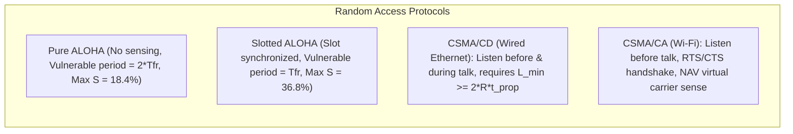

> [!info] Document Metadata
> - **Course:** `=this.course`
> - **Topic:** `=this.topic`
> - **Status:** `=this.status`

**Tags:** #[[Computer Science]] #[[NSCOM03]] #[[Conceptual]] #[[Media Access Control]]

---

## Overview

This module covers Media Access Control (MAC) sublayer protocols that regulate shared transmission channels. It evaluates random access protocols (Pure ALOHA, Slotted ALOHA, CSMA, CSMA/CD, CSMA/CA), collision window dynamics, minimum frame size constraints in wired Ethernet, and collision avoidance with RTS/CTS in wireless networks.

---

## Key Definitions

- **Media Access Control (MAC):** The lower sublayer of the Data Link Layer (IEEE 802) responsible for allocating multi-access broadcast channels among competing stations.
- **Pure ALOHA:** An unslotted random access protocol where stations transmit whenever they have a frame ready; exhibits a vulnerable collision window of $2 T_{fr}$ and maximum channel throughput of $18.4\%$.
- **Slotted ALOHA:** Synchronizes transmission to discrete time slots of duration $T_{fr}$; halving the vulnerable collision period to $T_{fr}$ and doubling maximum throughput to $36.8\%$.
- **CSMA/CD (Collision Detection):** Carrier Sense Multiple Access with Collision Detection, used in half-duplex wired Ethernet (IEEE 802.3); stations listen during transmission and immediately abort upon sensing a collision.
- **CSMA/CA (Collision Avoidance):** Used in wireless LANs (IEEE 802.11) where collision detection is infeasible due to transmitter power drowning out incoming signals; uses Interframe Spaces (DIFS, SIFS), backoff timers, and RTS/CTS exchanges.
- **Hidden Terminal Problem:** A wireless network condition where two stations out of radio range of each other transmit simultaneously to a mutual intermediate station, causing a collision at the receiver.

---

## Theoretical Framework: Random Access Comparison

---

## Worked Examples: CSMA/CD Minimum Frame Length Calculation

### Problem 1: Minimum Frame Size Constraint in CSMA/CD
To ensure a transmitting station detects collisions before it finishes sending its frame, the transmission time $T_{tx}$ must be at least twice the propagation time between the two furthest stations ($T_{tx} \ge 2 t_{prop}$):
$$\frac{L_{min}}{R} \ge 2 \times \frac{d}{v} \implies L_{min} \ge 2 \cdot t_{prop} \cdot R$$

Consider a network running at data rate $R = 100\text{ Mbps}$ ($10^8\text{ bps}$) over a maximum cable distance $d = 1000\text{ meters}$ with signal propagation speed $v = 2 \times 10^8\text{ m/s}$.

1. **Calculate the one-way propagation delay $t_{prop}$:**
   $$t_{prop} = \frac{d}{v} = \frac{1000\text{ m}}{2 \times 10^8\text{ m/s}} = 5 \times 10^{-6}\text{ seconds} = 5\text{ }\mu\text{s}$$

2. **Calculate the round-trip slot time ($2 t_{prop}$):**
   $$\text{Slot Time} = 2 \times t_{prop} = 2 \times 5\text{ }\mu\text{s} = 10\text{ }\mu\text{s}$$

3. **Calculate the minimum frame length $L_{min}$ in bits and bytes:**
   $$L_{min} = 2 \times t_{prop} \times R = (10 \times 10^{-6}\text{ s}) \times (10^8\text{ bps}) = 1000\text{ bits}$$
   $$L_{min} = \frac{1000\text{ bits}}{8\text{ bits/byte}} = 125\text{ bytes}$$
   *(Any frame shorter than 125 bytes could finish transmitting before a collision signal from the far end arrives, failing the collision detection guarantee).*

---

## Multiple Choice Questions

1. Why must standard IEEE 802.3 Ethernet enforce a minimum frame size (such as 64 bytes in 10BASE-T)?
    - **A)** To ensure the frame header does not exceed the data payload
    - **B)** To guarantee that a transmitting station is still sending bits when a collision reflection from the furthest station arrives back
    - **C)** To prevent switch buffers from overflowing
    - **D)** To maintain an exact integer ratio with IP packet headers

2. What is the theoretical maximum channel throughput ($S_{max}$) achievable by the Pure ALOHA protocol under Poisson traffic assumptions?
    - **A)** $100\%$ ($S = 1.0$)
    - **B)** $50\%$ ($S = 0.5$)
    - **C)** $36.8\%$ ($S = 1/e$)
    - **D)** $18.4\%$ ($S = 1/(2e)$)

3. Why is Collision Detection (CSMA/CD) not used in wireless local area networks (IEEE 802.11 Wi-Fi)?
    - **A)** Wireless stations transmit with much higher power than they receive, making it impossible for a station's receiver to detect a distant collision while transmitting
    - **B)** Wireless frames are too short to have collisions
    - **C)** Wi-Fi channels are completely full-duplex
    - **D)** Electromagnetic waves cannot experience packet collisions

4. In CSMA/CD, what mechanism do stations use after experiencing a collision to prevent repeatedly colliding on the next transmission attempt?
    - **A)** Priority Queuing
    - **B)** Truncated Binary Exponential Backoff
    - **C)** Frequency Division Multiplexing
    - **D)** Token Passing

5. In IEEE 802.11 wireless networks, how does the RTS/CTS (Request to Send / Clear to Send) exchange solve the Hidden Terminal Problem?
    - **A)** It forces all stations to transmit at maximum radio power
    - **B)** The Access Point's CTS broadcast alerts all surrounding stations to set their Network Allocation Vector (NAV) and defer transmission
    - **C)** It converts the wireless broadcast medium into an optical point-to-point link
    - **D)** It doubles the frequency bandwidth of the channel

---

### Answer Key & Explanations

1. **B**. In CSMA/CD, if a frame is too short, the sender could complete transmission and release the channel before a collision signal from the most distant node arrives back. The sender would mistakenly assume successful transmission. Thus, transmission time must satisfy $T_{tx} \ge 2 t_{prop}$.
2. **D**. For Pure ALOHA, the throughput formula is $S = G e^{-2G}$. Differentiating with respect to $G$ yields the maximum at $G = 0.5$: $S_{max} = 0.5 \cdot e^{-1} \approx 0.184$ or $18.4\%$.
3. **A**. In wireless environments, a station's own transmitter outputs significant radio power, swamping its local antenna receiver and preventing it from detecting the much weaker incoming signal of another colliding station. Hence, Wi-Fi must use collision avoidance (CSMA/CA).
4. **B**. After collision $n$, a station randomly picks a backoff integer $k$ from $[0, 2^n - 1]$ (up to $n = 10$) and waits $k \times \text{slot time}$. This exponential expansion of the random window rapidly disperses contending stations.
5. **B**. When station A sends an RTS to the Access Point, the AP broadcasts a CTS. Even if hidden station C cannot hear station A, C hears the AP's CTS, reads the NAV duration field, and silences its transmitter.

---

## References & Navigation

- **Previous Topic:** [[Error Detection]]
- **Next Topic:** [[Data Link Protocols (LAN)]]
- **Related Notes:** [[Data Link Protocols (LAN)]], [[Error Detection]]
