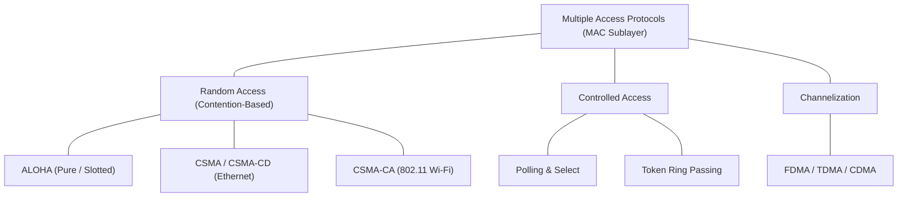
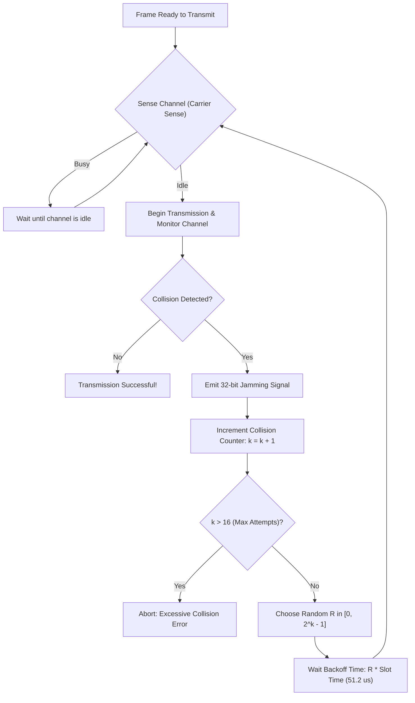

> [!info] Document Metadata
> - **Course:** `=this.course`
> - **Topic:** `=this.topic`
> - **Status:** `=this.status`

**Tags:** #[[Computer Science]] #[[NSCOM03]] #[[Conceptual]] #[[Media Access Control]]

---

## Overview
This module explores the foundational concepts of Module 7- Media Access Control as they relate to data communications and networking. It highlights the primary mechanisms used for robust transmission, formatting, and analysis in computer networks.

## Key Definitions
- **Media Access Control (MAC):** The lower sublayer of the Data Link Layer (IEEE 802) responsible for coordinating access to a shared physical transmission medium.
- **Carrier Sense Multiple Access (CSMA):** A protocol where a station listens to the channel before transmitting ("listen before talk").
- **CSMA/CD (Collision Detection):** Aborts transmission immediately upon detecting a signal collision and emits a jam signal (used in half-duplex Ethernet, IEEE 802.3).
- **CSMA/CA (Collision Avoidance):** Uses Interframe Spaces (IFS) and RTS/CTS handshake to avoid collisions on wireless links (used in Wi-Fi, IEEE 802.11).
- **Binary Exponential Backoff:** An algorithm used after a collision to dynamically increase backoff time based on attempt number $k$.

## Theoretical Framework / Core Concepts

### CSMA/CD Protocol Flow

## Worked Examples / Protocol Walkthroughs / Calculations
**Example Calculation:**
Given a channel with bandwidth $B = 3000$ Hz and $SNR = 3162$, calculate the Shannon capacity:
$$ C = B \log_2(1 + SNR) $$
$$ C = 3000 \log_2(1 + 3162) \approx 3000 \times 11.62 \approx 34860 \text{ bps} $$

## Summary & Key Takeaways The Physical and Data Link layers form the backbone of local and wide area networks. Precise encoding and error detection are vital for maintaining data integrity. Protocols manage access and transmission over diverse physical media.

## Multiple Choice Questions

1. Which of the following issues does the Physical layer address?
- **A)** Framing and error correction
- **B)** Bandwidth and noise
- **C)** Flow control and logical addressing
- **D)** Data encapsulation

2. What forms the backbone of local and wide area networks according to the text?
- **A)** Precise encoding and decoding algorithms
- **B)** The Shannon capacity formula
- **C)** The Physical and Data Link layers
- **D)** Network Layer routing protocols

3. How is Data Communications defined in the module?
- **A)** The physical interconnection of devices
- **B)** The exchange of digital data between two or more nodes
- **C)** The conversion of analog signals to digital data
- **D)** The structuring of OSI reference models

4. What does the calculation $C = B \log_2(1 + SNR)$ determine?
- **A)** Attenuation loss
- **B)** Flow control rate
- **C)** Shannon capacity
- **D)** Error detection probability

### Answer Key & Explanations
1. **B)** The text states that "The Physical layer deals with analog/digital signals, bandwidth, attenuation, and noise."
2. **C)** The summary section concludes that "The Physical and Data Link layers form the backbone of local and wide area networks."
3. **B)** The Key Definitions section specifies "Data Communications: The exchange of digital data between two or more nodes."
4. **C)** The example clearly identifies $C = B \log_2(1 + SNR)$ as the calculation for "Shannon capacity".

## References & Navigation

- **Previous Topic:** [[Error Detection]]
- **Next Topic:** [[Data Link Protocols (LAN)]]
- **Related Notes:** [[Error Detection]], [[Data Link Protocols (LAN)]]
