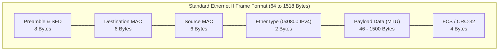
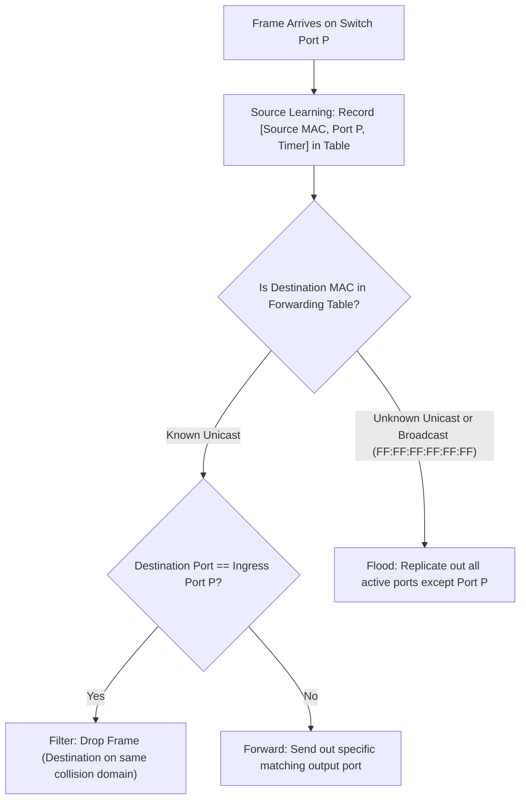

> [!info] Document Metadata
> - **Course:** `=this.course`
> - **Topic:** `=this.topic`
> - **Status:** `=this.status`

**Tags:** #[[Computer Science]] #[[NSCOM03]] #[[Conceptual]] #[[Data Link Protocols (LAN)]]

---

## Overview
This module explores the foundational concepts of Module 8- Data Link Protocols (LAN) as they relate to data communications and networking. It highlights the primary mechanisms used for robust transmission, formatting, and analysis in computer networks.

## Key Definitions
- **Ethernet (IEEE 802.3):** The dominant wired LAN technology operating at the physical and data link layers.
- **LLC (Logical Link Control - 802.2):** Manages link multiplexing, flow control, and error notifications to the network layer.
- **MAC (Media Access Control):** Manages framing, physical device addressing (48-bit MAC addresses), and line access.
- **EtherType:** A 2-byte field in an Ethernet II frame designating the encapsulated protocol (e.g., `0x0800` for IPv4, `0x0806` for ARP).
- **Transparent Bridge / Switch:** A Layer 2 forwarding device that builds a MAC address forwarding table dynamically via source address learning.

## Theoretical Framework / Core Concepts

### Transparent Switch Learning & Forwarding Logic

## Worked Examples / Protocol Walkthroughs / Calculations
**Example Calculation:**
Given a channel with bandwidth $B = 3000$ Hz and $SNR = 3162$, calculate the Shannon capacity:
$$ C = B \log_2(1 + SNR) $$
$$ C = 3000 \log_2(1 + 3162) \approx 3000 \times 11.62 \approx 34860 \text{ bps} $$

## Summary & Key Takeaways The Physical and Data Link layers form the backbone of local and wide area networks. Precise encoding and error detection are vital for maintaining data integrity. Protocols manage access and transmission over diverse physical media.

## Multiple Choice Questions

1. What is the lowest network layer mentioned in the text?
    - **A)** Data Link Layer
    - **B)** Physical Layer
    - **C)** Network Layer
    - **D)** Session Layer

2. Which of the following is explicitly handled by the Data Link layer?
    - **A)** Analog/digital signals
    - **B)** Attenuation
    - **C)** Error detection/correction
    - **D)** Signal bandwidth

3. If $B = 3000$ Hz and $SNR = 3162$, the calculated Shannon capacity is 34860 in what unit?
    - **A)** Hertz (Hz)
    - **B)** Bits per second (bps)
    - **C)** Bytes per minute
    - **D)** Decibels (dB)

4. Which theoretical model is explicitly named as standardizing the precise synchronization and structuring of data?
    - **A)** TCP/IP Model
    - **B)** OSI Reference Model
    - **C)** Shannon-Weaver Model
    - **D)** Data Communications Model

### Answer Key & Explanations

1. **B**. The Physical Layer is defined as "The lowest layer responsible for the physical connection between devices."
2. **C**. The text states that "The Data Link layer deals with framing, flow control, and error detection/correction."
3. **B**. The final result of the calculation is given as "34860 bps".
4. **B**. The text states "Theoretical models such as the OSI Reference Model standardize these processes."

## References & Navigation

- **Previous Topic:** [[Media Access Control]]
- **Next Topic:** [[Data Link Protocols (WANs)]]
- **Related Notes:** [[Media Access Control]], [[Data Link Protocols (WANs)]]
