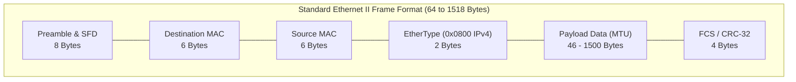
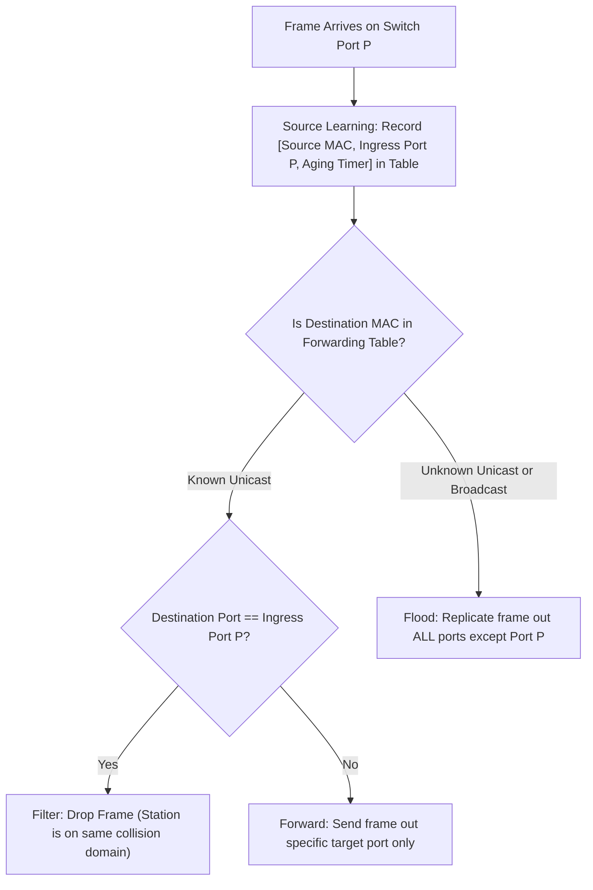

> [!info] Document Metadata
> - **Course:** `=this.course`
> - **Topic:** `=this.topic`
> - **Status:** `=this.status`

**Tags:** #[[Computer Science]] #[[NSCOM03]] #[[Conceptual]] #[[Data Link Protocols (LAN)]]

---

## Overview

This module covers local area network (LAN) protocols operating at Layer 2. It details the IEEE 802 LAN architecture, the standard Ethernet II frame format, 48-bit MAC addressing, Address Resolution Protocol (ARP), and the transparent bridging logic used by Layer 2 Ethernet switches (address learning, filtering, and forwarding).

---

## Key Definitions

- **Ethernet II Frame:** The dominant wired LAN frame encapsulation format, comprising a 14-byte header (6-byte destination MAC, 6-byte source MAC, 2-byte EtherType), a 46-to-1500 byte payload, and a 4-byte CRC-32 Frame Check Sequence (FCS).
- **MAC Address (EUI-48):** A globally unique 48-bit (6-byte) physical hardware address burned into a network interface card (NIC), split into a 24-bit Organizationally Unique Identifier (OUI) and a 24-bit vendor-assigned device ID.
- **EtherType Field:** A 2-byte identifier in an Ethernet II frame designating the encapsulated higher-layer protocol (e.g. `0x0800` for IPv4, `0x0806` for ARP, `0x86DD` for IPv6).
- **Transparent Switch:** A Layer 2 bridging device that learns station locations by inspecting frame source MAC addresses and builds a forwarding table to direct traffic to appropriate egress ports.
- **Flooding:** The process of replicating and transmitting an incoming frame out of all active switch ports except the ingress port, triggered when the destination MAC address is unknown or broadcast (`FF:FF:FF:FF:FF:FF`).

---

## Theoretical Framework: Ethernet II Framing and Switch Forwarding

---

## Worked Examples: Transparent Switch Forwarding Table Trace

### Problem 1: Step-by-Step Switch Learning and Flooding
Consider a 4-port Layer 2 Ethernet switch with an initially empty MAC address table. The following hosts are connected:
- Port 1: Host A (`00:AA:00:00:00:01`)
- Port 2: Host B (`00:BB:00:00:00:02`)
- Port 3: Host C (`00:CC:00:00:00:03`)
- Port 4: Host D (`00:DD:00:00:00:04`)

1. **Event 1: Host A sends a frame to Host B**
   - **Ingress Port:** Port 1.
   - **Learning Action:** The switch inspects the Source MAC (`00:AA:00:00:00:01`) and records in its table: `00:AA:00:00:00:01 -> Port 1`.
   - **Lookup Action:** Destination MAC `00:BB:00:00:00:02` is searched in the table $\to$ **Not Found (Unknown Unicast)**.
   - **Forwarding Action:** The switch **floods** the frame out Ports 2, 3, and 4. Hosts C and D discard the frame; Host B processes it.

2. **Event 2: Host B sends a reply frame to Host A**
   - **Ingress Port:** Port 2.
   - **Learning Action:** The switch inspects Source MAC `00:BB:00:00:00:02` and records: `00:BB:00:00:00:02 -> Port 2`.
   - **Lookup Action:** Destination MAC `00:AA:00:00:00:01` is searched in the table $\to$ **Found on Port 1**.
   - **Forwarding Action:** The switch selectively **forwards** the frame out Port 1 only. Ports 3 and 4 observe zero traffic.

3. **Event 3: Host C transmits a broadcast ARP Request (`FF:FF:FF:FF:FF:FF`)**
   - **Ingress Port:** Port 3.
   - **Learning Action:** Table records: `00:CC:00:00:00:03 -> Port 3`.
   - **Lookup Action:** Destination is broadcast.
   - **Forwarding Action:** The switch floods the frame out all active ports except Port 3 (Ports 1, 2, and 4).

---

## Multiple Choice Questions

1. What is the minimum and maximum allowable frame size for a standard IEEE 802.3 / Ethernet II frame (excluding preamble and SFD)?
    - **A)** 32 bytes minimum, 1024 bytes maximum
    - **B)** 64 bytes minimum, 1518 bytes maximum
    - **C)** 46 bytes minimum, 1500 bytes maximum
    - **D)** 128 bytes minimum, 9000 bytes maximum

2. If an IP packet carrying only 20 bytes of payload is encapsulated in an Ethernet II frame, how many bytes of padding must the network interface card add to reach the minimum frame size?
    - **A)** 0 bytes
    - **B)** 18 bytes
    - **C)** 26 bytes
    - **D)** 44 bytes

3. How does a transparent Layer 2 Ethernet switch learn which host MAC addresses are located on which physical switch ports?
    - **A)** By querying the router via RIP or OSPF
    - **B)** By inspecting the Source MAC address of every incoming frame and recording the ingress port
    - **C)** By broadcasting periodic ping probes across all ports
    - **D)** By parsing IP headers within the TCP/IP payload

4. What is the EtherType value in an Ethernet II frame header that indicates the encapsulated payload is an IPv4 packet?
    - **A)** `0x0800`
    - **B)** `0x0806`
    - **C)** `0x86DD`
    - **D)** `0x8100`

5. What action does a Layer 2 switch take when a unicast frame arrives with a destination MAC address that does NOT currently exist in its MAC address forwarding table?
    - **A)** It drops the frame immediately and returns an ICMP Destination Unreachable message
    - **B)** It floods the frame out all active ports except the port on which it was received
    - **C)** It sends the frame exclusively to the default gateway router
    - **D)** It holds the frame in a buffer until the host broadcasts an ARP reply

---

### Answer Key & Explanations

1. **B**. Standard Ethernet specifies a minimum frame size of 64 bytes ($14\text{ header} + 46\text{ min payload} + 4\text{ FCS}$) and a maximum frame size of 1518 bytes ($14\text{ header} + 1500\text{ max MTU payload} + 4\text{ FCS}$).
2. **C**. The minimum payload required for an Ethernet frame is 46 bytes. If the payload is only 20 bytes, the NIC must append $46 - 20 = 26$ bytes of zero padding to satisfy the 64-byte minimum frame size.
3. **B**. A transparent switch dynamically populates its CAM forwarding table through source address learning: whenever a frame enters port $P$, the switch associates the frame's Source MAC with port $P$ and resets an aging timer.
4. **A**. The standard EtherType hex value for IPv4 is `0x0800`. For comparison, `0x0806` designates ARP, and `0x86DD` designates IPv6.
5. **B**. When a destination MAC address is unknown, the switch cannot determine which port leads to that host. It executes "unknown unicast flooding," replicating the frame out all ports except the arrival port.

---

## References & Navigation

- **Previous Topic:** [[Media Access Control]]
- **Next Topic:** [[Data Link Protocols (WANs)]]
- **Related Notes:** [[Media Access Control]], [[Data Link Protocols (WANs)]]
