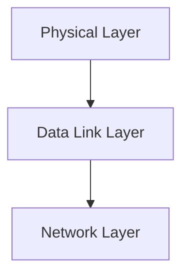

> [!info] Document Metadata
> - **Course:** `=this.course`
> - **Topic:** `=this.topic`
> - **Status:** `=this.status`

**🏷️ Tags:** #[[Computer Science]] #[[NSCOM03]] #[[Conceptual]] #[[Data Link Protocols (WANs)]]

---

## Overview
This module explores the foundational concepts of Module 9- Data Link Protocols (WANs) as they relate to data communications and networking. It highlights the primary mechanisms used for robust transmission, formatting, and analysis in computer networks.

## Key Definitions **Data Communications:** The exchange of digital data between two or more nodes. **Physical Layer:** The lowest layer responsible for the physical connection between devices. **Data Link Layer:** Ensures error-free transmission of data frames between nodes.

## Theoretical Framework / Core Concepts
The transmission of data requires precise synchronization and structuring. Theoretical models such as the OSI Reference Model standardize these processes.  The Physical layer deals with analog/digital signals, bandwidth, attenuation, and noise. The Data Link layer deals with framing, flow control, and error detection/correction.

## Worked Examples / Protocol Walkthroughs / Calculations
**Example Calculation:**
Given a channel with bandwidth $B = 3000$ Hz and $SNR = 3162$, calculate the Shannon capacity:
$$ C = B \log_2(1 + SNR) $$
$$ C = 3000 \log_2(1 + 3162) \approx 3000 \times 11.62 \approx 34860 \text{ bps} $$

## Summary & Key Takeaways The Physical and Data Link layers form the backbone of local and wide area networks. Precise encoding and error detection are vital for maintaining data integrity. Protocols manage access and transmission over diverse physical media.

## Multiple Choice Questions

1. What is described as vital for maintaining data integrity?
- **A)** High bandwidth and low noise
- **B)** Precise encoding and error detection
- **C)** The OSI Reference Model
- **D)** Analog signal processing

2. Which layer ensures error-free transmission of data frames between nodes?
- **A)** Network Layer
- **B)** Data Link Layer
- **C)** Physical Layer
- **D)** Application Layer

3. According to the diagram, what does the Data Link Layer connect to next?
- **A)** Physical Layer
- **B)** Transport Layer
- **C)** Application Layer
- **D)** Network Layer

4. In the example calculation for Shannon capacity, what does the value 3000 represent?
- **A)** Signal-to-Noise Ratio (SNR)
- **B)** Bandwidth in Hz
- **C)** Capacity in bps
- **D)** The logarithmic base

### Answer Key & Explanations
1. **B)** The summary states that "Precise encoding and error detection are vital for maintaining data integrity."
2. **B)** The Key Definitions list "Data Link Layer: Ensures error-free transmission of data frames between nodes."
3. **D)** The flowchart shows an arrow from Data Link Layer to Network Layer.
4. **B)** The example calculation is introduced with "Given a channel with bandwidth $B = 3000$ Hz".

## References & Navigation

- **Previous Topic:** [[Data Link Protocols (LAN)]]
- **Related Notes:** [[Data Link Protocols (LAN)]], [[BGP and Interdomain Routing]]
