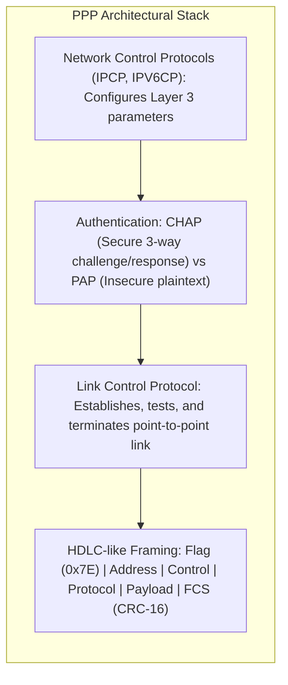

> [!info] Document Metadata
> - **Course:** `=this.course`
> - **Topic:** `=this.topic`
> - **Status:** `=this.status`

**Tags:** #[[Computer Science]] #[[NSCOM03]] #[[Conceptual]] #[[Data Link Protocols (WANs)]]

---

## Overview

This module covers Wide Area Network (WAN) point-to-point Layer 2 protocols. It focuses on High-Level Data Link Control (HDLC) framing, bit stuffing and byte stuffing mechanisms for data transparency, Point-to-Point Protocol (PPP) architecture (LCP and NCP), and authentication mechanisms (PAP vs CHAP).

---

## Key Definitions

- **High-Level Data Link Control (HDLC):** A bit-oriented synchronous Data Link protocol developed by ISO, utilizing flag bytes (`01111110` / `0x7E`) and bit stuffing to delineate frames.
- **Bit Stuffing:** A technique used in bit-oriented protocols where a transmitter inserts a binary `0` after any sequence of five consecutive `1`s in the payload to prevent data from being misinterpreted as a flag delimiter (`01111110`).
- **Byte Stuffing (Character Stuffing):** A technique used in byte-oriented protocols where an escape character (`ESC`, `0x7D` in PPP) is inserted before any payload byte that matches a control flag or escape byte.
- **Point-to-Point Protocol (PPP):** The standard protocol for establishing direct point-to-point serial communication, consisting of HDLC-like framing, Link Control Protocol (LCP), and Network Control Protocols (NCP).
- **Challenge Handshake Authentication Protocol (CHAP):** A secure three-way authentication protocol where the authenticator sends a random challenge string, and the client returns a one-way MD5 hash computed over the challenge and its shared secret.
- **Password Authentication Protocol (PAP):** A legacy, insecure two-way authentication protocol that transmits credentials in unencrypted plaintext across the link.

---

## Theoretical Framework: WAN Data Link Architecture

---

## Worked Examples: HDLC Bit Stuffing and Unstuffing

### Problem 1: Bit Stuffing at the Transmitter
An HDLC transmitter must send the following 20-bit data payload:
$$\text{Data Word} = 01111110111110101111$$

1. **Transmitter Bit Stuffing Rule:**
   Whenever the transmitter encounters five consecutive `1`s (`11111`), it unconditionally injects a `0` immediately after the fifth `1`.

2. **Step-by-Step Scan:**
   - Bits 1 to 6: `0 1 1 1 1 1` $\to$ Five consecutive 1s! **Stuff a `0`**:
     $$011111\mathbf{0}10\dots$$
   - Next bits: `1 1 1 1 1` $\to$ Five consecutive 1s! **Stuff a `0`**:
     $$\dots 1011111\mathbf{0}0101111$$
   - Remaining bits: `0 1 0 1 1 1 1` (four 1s, no stuffing needed).

3. **Resulting Transmitted Stuffed Bitstream:**
   $$\text{Stuffed Payload} = 011111\mathbf{0}1011111\mathbf{0}0101111$$
   *(The 20-bit payload has expanded to 22 bits, ensuring that the flag byte `01111110` can never appear inside the payload field).*

4. **Receiver Bit Unstuffing Rule:**
   The receiver scans the incoming payload: whenever it detects five consecutive `1`s:
   - If the sixth bit is `0`, the receiver **discards (unstuffs)** the `0` and retains the original bitstream.
   - If the sixth bit is `1` and seventh is `0` (`01111110`), it recognizes an end-of-frame **flag**.
   - If the sixth and seventh bits are both `1` (`01111111`), it detects an **abort signal**.

---

## Multiple Choice Questions

1. In HDLC framing, what specific bit sequence serves as the opening and closing frame delimiter flag?
    - **A)** `10101010`
    - **B)** `01111110`
    - **C)** `11111111`
    - **D)** `00000000`

2. A transmitter using HDLC bit stuffing processes the payload `111111`. What sequence of bits is transmitted across the channel?
    - **A)** `1111101`
    - **B)** `1111110`
    - **C)** `0111111`
    - **D)** `1111011`

3. What is the fundamental security advantage of CHAP over PAP when authenticating a dial-up or serial PPP connection?
    - **A)** CHAP encrypts the entire user payload with AES-256
    - **B)** CHAP never transmits the user's secret password over the wire, using a one-way hashed challenge-response exchange instead
    - **C)** CHAP requires multi-factor smart cards
    - **D)** PAP is restricted to fiber-optic links

4. Which subprotocol of the Point-to-Point Protocol (PPP) is responsible for negotiating link options, verifying line quality, and configuring maximum receive units (MRU)?
    - **A)** Internet Protocol Control Protocol (IPCP)
    - **B)** Link Control Protocol (LCP)
    - **C)** Challenge Handshake Authentication Protocol (CHAP)
    - **D)** Address Resolution Protocol (ARP)

5. In character-oriented (byte-stuffed) PPP framing, what action does the transmitter take if the flag byte `0x7E` appears naturally inside the payload data?
    - **A)** It immediately drops the packet and reports an MTU error
    - **B)** It inserts the escape byte `0x7D` and inverts bit 5 of the flag byte (transmitting `0x7D 0x5E`)
    - **C)** It converts the connection to an asynchronous TDM channel
    - **D)** It appends 5 zero bits after the flag

---

### Answer Key & Explanations

1. **B**. The HDLC delimiter flag is the unique 8-bit pattern `01111110` (`0x7E`).
2. **A**. The rule states that a `0` is inserted immediately after five consecutive `1`s. Therefore, for `111111`, after the fifth `1`, a `0` is stuffed, yielding `111110` followed by the remaining `1`, resulting in `1111101`.
3. **B**. PAP sends the username and password in cleartext. CHAP sends an unpredictable random challenge string; the client computes an MD5 hash of (ID + Secret + Challenge) and returns the hash. The shared secret is never transmitted across the network.
4. **B**. LCP handles link establishment, configuration testing, and link termination. NCPs (like IPCP) operate after LCP to configure network-layer protocol options.
5. **B**. In byte stuffing, if `0x7E` occurs in the data, it is escaped by transmitting the two-byte sequence `0x7D 0x5E` (`0x7E ^ 0x20 = 0x5E`).

---

## References & Navigation

- **Previous Topic:** [[Data Link Protocols (LAN)]]
- **Related Notes:** [[Data Link Protocols (LAN)]], [[BGP and Interdomain Routing]]
