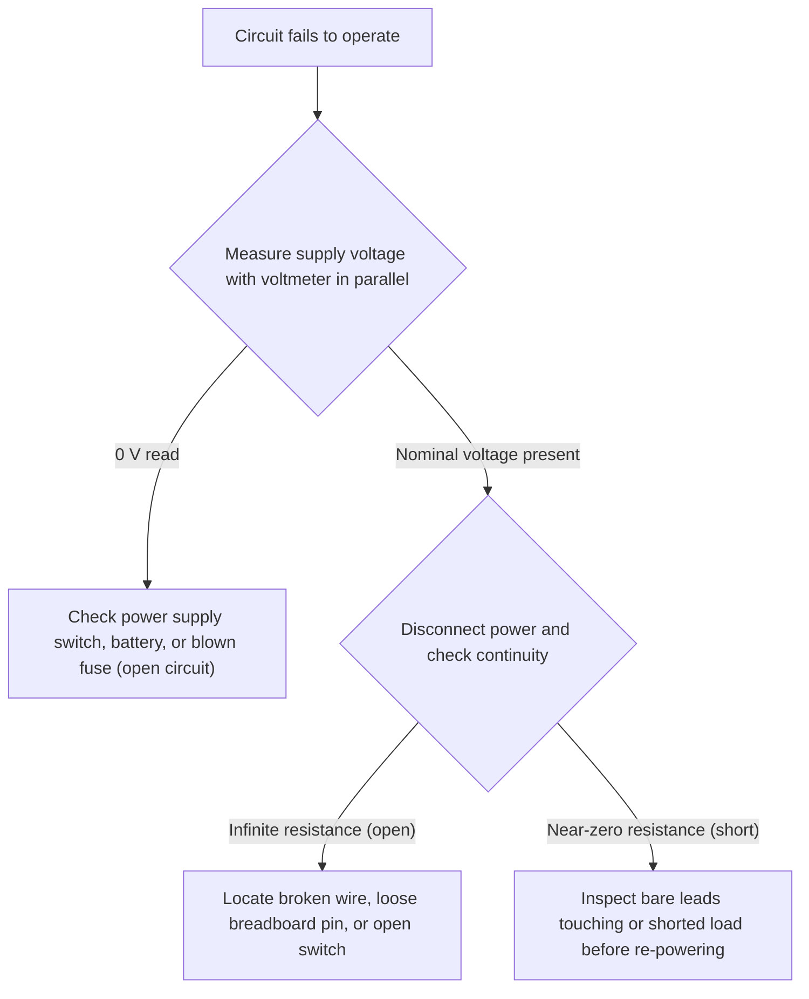

# Basic Electrical Theory

> [!info] Document Metadata
> **Course:** `=this.course` | **Topic:** `=this.topic` | **Status:** `=this.status`

**Tags:** #[[Computer Science]] #[[NSETRON]] #[[Electronics]] #[[Basic Electrical Theory]]

---

## Exam-Oriented Concept Summary

- **Atomic Structure and Charge Carriers:** All matter is composed of atoms containing a central nucleus (positively charged protons and neutral neutrons) surrounded by negatively charged electrons orbiting in discrete energy shells. Elements with fewer than four valence electrons in their outer shell (such as copper with 29 electrons and 1 outer valence electron, silver, gold, and aluminum) easily release free electrons and act as **conductors**. Materials with tightly bound outer electrons (glass, air, plastic, porcelain) act as **insulators**.
- **Current Flow Conventions:**
  - **Electron Theory:** Real physical drift of electrons from the negative (`-`) terminal toward the positive (`+`) terminal.
  - **Conventional Theory:** Standard engineering convention used in circuit schematics and diodes/transistors, tracing current from positive (`+`) to negative (`-`).
- **Core Electrical Quantities:**
  - **Voltage ($V$ or $E$, Volts $\text{V}$):** Electromotive force (EMF) or potential difference pushing charge through a circuit (analogous to water pump pressure).
  - **Current ($I$, Amperes $\text{A}$):** Rate of charge flow past a point per second: $1\text{ A} = 1\text{ C/s} = 6.28 \times 10^{18}\text{ electrons/s}$.
  - **Resistance ($R$, Ohms $\Omega$):** Opposition to current flow determined by material resistivity, cross-sectional area, length, and connection integrity (e.g., corrosion). Conductance is the reciprocal: $G = 1/R$ in Siemens ($\text{S}$).
- **DC vs. AC:** Direct Current (**DC**) flows in a single direction (batteries, DC power supplies); Alternating Current (**AC**) periodically reverses polarity and direction (utility mains, audio/RF signals).
- **Circuit States and Protection:**
  - **Closed Circuit:** Complete continuous loop allowing current flow.
  - **Open Circuit:** Broken path (e.g., open switch or blown fuse) with $I = 0\text{ A}$ and full source voltage across the open break.
  - **Short Circuit:** Unintended near-zero-resistance path (such as bare wires touching) causing dangerously excessive current ($I = V/R \to \infty$); protected by a **fuse** connected in series that melts open above its current rating (e.g., $1\text{ A}$, $15\text{ A}$).
- **Measuring Instruments (Exam Classic):**
  - **Voltmeter:** Connected **in parallel** across the component/source; has very high internal resistance so it draws negligible current.
  - **Ammeter:** Connected **in series** in the current path (break the loop and insert the meter); has very low internal resistance (uses parallel internal shunts for higher current ranges).
  - **Ohmmeter:** Connected **in parallel** across a component **only after disconnecting power** and isolating at least one leg so external voltage or parallel paths do not corrupt the reading or damage the meter.

---

## Key Formulas

| Formula Name | Expression | Units | When to Use |
| :--- | :--- | :--- | :--- |
| Ohm's Law | $V = I R$, $I = \frac{V}{R}$, $R = \frac{V}{I}$ | $V$ ($\text{V}$), $I$ ($\text{A}$), $R$ ($\Omega$) | Solving unknown voltage, current, or resistance in any resistive branch |
| Conductance | $G = \frac{1}{R}$ | $G$ ($\text{S}$), $R$ ($\Omega$) | Converting resistance to conductance (or solving parallel circuits via $G_T = \sum G_i$) |
| Electrical Power | $P = V I = I^2 R = \frac{V^2}{R}$ | $P$ ($\text{W}$) | Computing power dissipation, load current ($I = P/V$), or wattage rating margin |
| Electrical Energy | $W = P \cdot t$ | $W$ ($\text{J}$ or $\text{Wh}$), $t$ ($\text{s}$ or $\text{h}$) | Calculating energy burned over time ($1\text{ Wh} = 3600\text{ J}$, $1\text{ kWh} = 3.6 \times 10^6\text{ J}$) |
| Series Equivalent Resistance | $R_T = R_1 + R_2 + \dots + R_n$ | $\Omega$ | Resistors connected head-to-tail along one single current path ($I$ is equal in all) |
| Parallel Equivalent Resistance | $\frac{1}{R_T} = \frac{1}{R_1} + \frac{1}{R_2} + \dots + \frac{1}{R_n}$ | $\Omega$ | Resistors sharing the same two nodes ($V$ is equal across all); for $N$ equal resistors, $R_T = \frac{R}{N}$ |
| Two-Resistor Parallel Shortcut | $R_T = \frac{R_1 R_2}{R_1 + R_2}$ | $\Omega$ | Fast pen-and-paper parallel reduction for exactly two branches |
| Period and Frequency | $f = \frac{1}{T}$, $T = \frac{1}{f}$ | $f$ ($\text{Hz}$), $T$ ($\text{s}$) | Converting between cycle period and frequency (audio range: $20\text{ Hz}$ to $20\text{ kHz}$; voice: $300$ to $3000\text{ Hz}$) |
| Free-Space Wavelength | $\lambda = \frac{c}{f} = \frac{300}{f_{\text{MHz}}}$ | $\lambda$ ($\text{m}$), $f_{\text{MHz}}$ ($\text{MHz}$) | Relating radio wave frequency to physical wavelength in meters ($c \approx 3 \times 10^8\text{ m/s}$) |
| Power Gain in Decibels | $\text{Gain}_{\text{dB}} = 10 \log_{10}\left(\frac{P_{\text{out}}}{P_{\text{in}}}\right)$ | $\text{dB}$ | Expressing cascaded amplifier gains and transmission losses ($+3\text{ dB} \approx 2\times P$, $+6\text{ dB} \approx 4\times P$, $+10\text{ dB} = 10\times P$) |

---

## Worked Numerical Examples

### Example 1: Series and Parallel Resistance & Power Comparison
A $10\text{ V}$ DC battery powers three resistors: $R_1 = 8\ \Omega$, $R_2 = 8\ \Omega$, and $R_3 = 4\ \Omega$. Compare total resistance, total current, branch values, and total power when connected (a) in series and (b) in parallel.

**Solution (a) Series:**
1. Sum the series resistances along the single current path:
   $$R_T = R_1 + R_2 + R_3 = 8\ \Omega + 8\ \Omega + 4\ \Omega = 20\ \Omega$$
2. Calculate total circuit current (identical through every resistor):
   $$I = \frac{V}{R_T} = \frac{10\text{ V}}{20\ \Omega} = 0.5\text{ A}$$
3. Compute individual voltage drops and total power:
   $$V_1 = 0.5\text{ A} \times 8\ \Omega = 4\text{ V}, \quad V_2 = 4\text{ V}, \quad V_3 = 0.5\text{ A} \times 4\ \Omega = 2\text{ V}$$
   $$P_T = V \cdot I = 10\text{ V} \times 0.5\text{ A} = 5\text{ W}$$

**Solution (b) Parallel:**
1. Sum the reciprocals of each branch:
   $$\frac{1}{R_T} = \frac{1}{8} + \frac{1}{8} + \frac{1}{4} = 0.125 + 0.125 + 0.25 = 0.5\text{ S} \implies R_T = \frac{1}{0.5\text{ S}} = 2\ \Omega$$
   Sanity check: $R_T$ must be less than the smallest branch ($4\ \Omega$) and at least $R_{\min}/N = 4/3 \approx 1.33\ \Omega$. Here $2\ \Omega$ lies in $[1.33\ \Omega, 4\ \Omega]$.
2. Each resistor receives the full $10\text{ V}$ supply, so branch currents are:
   $$I_1 = \frac{10\text{ V}}{8\ \Omega} = 1.25\text{ A}, \quad I_2 = \frac{10\text{ V}}{8\ \Omega} = 1.25\text{ A}, \quad I_3 = \frac{10\text{ V}}{4\ \Omega} = 2.5\text{ A}$$
3. Total current and total power:
   $$I_T = I_1 + I_2 + I_3 = 1.25 + 1.25 + 2.5 = 5\text{ A}, \quad P_T = 10\text{ V} \times 5\text{ A} = 50\text{ W}$$

### Example 2: DC Power, Current Draw, Decibels, and Metric Conversions
(a) A transceiver runs on $13.8\text{ V}$ DC and draws $10\text{ A}$ while transmitting; a separate appliance runs on $120\text{ V}$ DC and consumes $1200\text{ W}$. Find the transceiver power and appliance current.
(b) A linear amplifier increases transmitter output from $5\text{ W}$ to $50\text{ W}$. Express the power gain in decibels.
(c) Convert $7125\text{ kHz}$ to $\text{MHz}$ and $500,000\ \mu\text{F}$ to $\text{F}$.

**Solution:**
1. Transceiver power:
   $$P = V \cdot I = 13.8\text{ V} \times 10\text{ A} = 138\text{ W}$$
2. Appliance current:
   $$I = \frac{P}{V} = \frac{1200\text{ W}}{120\text{ V}} = 10\text{ A}$$
3. Power gain in dB:
   $$\text{Gain}_{\text{dB}} = 10 \log_{10}\left(\frac{50\text{ W}}{5\text{ W}}\right) = 10 \log_{10}(10) = 10\text{ dB}$$
   (Conversely, reducing transmitter power from $1500\text{ W}$ to $150\text{ W}$ is a $-10\text{ dB}$ change, turning a `"20 dB over S9"` signal into `"S9 plus 10 dB"`.)
4. Metric prefix conversions:
   $$7125\text{ kHz} = \frac{7125}{1000}\text{ MHz} = 7.125\text{ MHz}, \quad 500,000\ \mu\text{F} = \frac{500,000}{10^6}\text{ F} = 0.5\text{ F}$$

---

## Practical Instrument Rules

- **Breadboard Lab Prerequisites:** Apply these instrument conventions before wiring circuit experiments starting in [[Basic Electricity and Electronic Components]] (`Laboratory Activity #01`):
  - Always verify supply voltage with a **voltmeter in parallel** before connecting LEDs or polarized components.
  - Break the circuit path to place an **ammeter in series**; placing an ammeter in parallel across a voltage source creates a near-short circuit that blows the meter's internal fuse.
  - Disconnect power before measuring resistance with an **ohmmeter in parallel** to prevent skewed readings and meter damage.

---

## Circuit & Procedure Diagrams

### Instrument Connection Rules (Voltmeter, Ammeter, Ohmmeter)

```circuit:instrument-connections
1. VOLTMETER (Parallel)
   +---[ R_load ]---+
   |                |
  (+)              (-)
  [V_src]          ( V )
  (-)              (+)
   |                |
   +----------------+

2. AMMETER (Series)
   +----( A )----+
   |             |
  (+)        [ R_load ]
  [V_src]        |
  (-)------------+

3. OHMMETER (Power OFF, Component Isolated)
   [V_src DISCONNECTED]     [ R_test ]---( Omega )---[ R_test other end ]
```

### Troubleshooting a Non-Working DC Circuit



---

## Exam Traps & Quick-Recall Checklist

- **Forgetting to invert $1/R_T$ in parallel circuits:** Writing $1/R_T = 0.03$ as $R_T = 0.03\ \Omega$ instead of $1/0.03 = 33.33\ \Omega$ is the most frequent pen-and-paper error. Always check the bounding rule: $R_{\min}/N \le R_T < R_{\min}$.
- **Ammeter vs. Voltmeter placement:** Ammeter goes **in series** (low $R$); voltmeter goes **in parallel** (high $R$). Reversing them causes either an open-like dead circuit (voltmeter in series) or a short circuit blowing the fuse (ammeter in parallel).
- **Measuring resistance live:** Never apply an ohmmeter to an energized circuit or an in-circuit resistor still shunted by parallel branches.
- **Prefix powers of 10:** $\text{G} = 10^9$, $\text{M} = 10^6$, $\text{k} = 10^3$, $\text{m} = 10^{-3}$, $\mu = 10^{-6}$, $\text{n} = 10^{-9}$, $\text{p} = 10^{-12}$. Note $1\ \mu\text{F} = 10^6\text{ pF}$.
- **Decibel rules:** $+3\text{ dB} \approx 2\times$ power, $+6\text{ dB} \approx 4\times$ power, $+10\text{ dB} = 10\times$ power. Decibels add and subtract directly across cascaded stages.

---

## Multiple Choice Questions

1. How must a voltmeter and an ammeter be connected when measuring the voltage across and current through a single load resistor in an energized DC circuit?
    - **A)** Both the voltmeter and the ammeter are connected in parallel with the load resistor
    - **B)** The voltmeter is connected in parallel across the load resistor, and the ammeter is connected in series with the load resistor
    - **C)** The voltmeter is connected in series with the load resistor, and the ammeter is connected in parallel across the load resistor
    - **D)** Both the voltmeter and the ammeter are connected in series after disconnecting the power source

2. [MSQ] Which of the following statements accurately describe conductors, insulators, and current flow conventions? (Select all that apply)
    - **A)** Good metallic conductors such as copper, silver, gold, and aluminum typically have fewer than four valence electrons in their outer shell
    - **B)** Conventional current traces flow from the negative terminal to the positive terminal of a DC source
    - **C)** Electron flow theory traces physical electron movement from the negative terminal to the positive terminal
    - **D)** A fuse is connected in parallel across the load so that high current bypasses the power supply

3. [INPUT] Three resistors of $100\ \Omega$, $100\ \Omega$, and $100\ \Omega$ are connected in parallel across a $12\text{ V}$ DC source. What is the equivalent total resistance $R_T$ in ohms (rounded to two decimal places)?

4. [INPUT] A DC heater draws $2.5\text{ A}$ from a $120\text{ V}$ supply. How much electrical power does it consume in watts?

5. [INPUT] A radio frequency signal has a frequency of $145\text{ MHz}$. Using $\lambda = 300 / f_{\text{MHz}}$, what is its approximate free-space wavelength in meters (rounded to two decimal places)?

6. Two transmitters operate at $1\text{ W}$ and $4\text{ W}$ respectively. By how many decibels does the $4\text{ W}$ transmitter exceed the $1\text{ W}$ transmitter?
    - **A)** $2\text{ dB}$
    - **B)** $3\text{ dB}$
    - **C)** $6\text{ dB}$
    - **D)** $40\text{ dB}$

7. Why does a short circuit pose an immediate fire and component-destruction hazard when two bare power leads touch?
    - **A)** Voltage increases exponentially while current drops to zero
    - **B)** Resistance collapses near zero along the fault path, driving current far above safe conductor limits ($I = V/R$)
    - **C)** Conductance drops to zero Siemens, trapping thermal energy in the battery
    - **D)** The source automatically converts DC into high-frequency AC

8. Three resistors of $6\ \Omega$, $9\ \Omega$, and $18\ \Omega$ are connected in parallel. Without even finishing exact arithmetic, what tight numerical range must the equivalent resistance $R_T$ fall inside?
    - **A)** Between $2\ \Omega$ and $6\ \Omega$
    - **B)** Between $6\ \Omega$ and $9\ \Omega$
    - **C)** Between $18\ \Omega$ and $33\ \Omega$
    - **D)** Below $1\ \Omega$

9. [BLANK] Complete the metric prefix conversion table below using exact standard values:

| Quantity | Converted Value | Target Unit |
| :--- | :--- | :--- |
| $3,500\text{ mV}$ | {{1}} | $\text{V}$ |
| $1.265\text{ GHz}$ | {{2}} | $\text{MHz}$ |
| $0.5\text{ F}$ | {{3}} | $\mu\text{F}$ |

10. What happens to the total current and voltage across individual components when a switch opens in a single-loop series DC circuit?
    - **A)** Current drops to zero everywhere in the loop, and the full supply voltage appears across the open switch contacts
    - **B)** Current continues flowing through the resistor until the capacitor inside the battery drains
    - **C)** Voltage across the resistor doubles while current stays constant
    - **D)** Only the components downstream of the switch lose current while upstream resistors still dissipate power

### Answer Key & Explanations

1. **B)** A voltmeter has high internal resistance and measures potential difference across two nodes in parallel, whereas an ammeter has very low internal resistance and must be placed inline (in series) so all loop current flows through it.
2. **A, C)** Conductors have fewer than four outer-shell electrons (copper has 1 valence electron), and physical electrons move from negative to positive (Electron Theory). Conventional current runs positive-to-negative, and a fuse must be wired in series so melting it opens the circuit.
3. **[33.33; 33.3; 33.33 ohm; 33.33 ohms]** Using the equal-resistor shortcut, $R_T = R/N = 100/3 = 33.33\ \Omega$ (or $1/R_T = 0.01 + 0.01 + 0.01 = 0.03$, $R_T = 1/0.03 = 33.33\ \Omega$).
4. **[300; 300.0; 300 W; 300W]** Using $P = V \cdot I = 120\text{ V} \times 2.5\text{ A} = 300\text{ W}$.
5. **[2.07; 2.07 m; 2.07m]** Using $\lambda = 300 / f_{\text{MHz}} = 300 / 145 \approx 2.069\text{ m} \approx 2.07\text{ m}$.
6. **C)** A fourfold power increase corresponds to $\text{Gain}_{\text{dB}} = 10 \log_{10}(4/1) \approx 6\text{ dB}$ ($2\times$ power is $+3\text{ dB}$, so $4\times = 2 \times 2$ adds $3 + 3 = 6\text{ dB}$).
7. **B)** By Ohm's law $I = V/R$, when insulation fails and conductors short together, $R \to 0\ \Omega$, causing excessive current and rapid $I^2 R$ heating until a fuse opens the path.
8. **A)** For $N = 3$ parallel resistors where the smallest resistor is $R_{\min} = 6\ \Omega$, $R_T$ is bounded by $R_{\min}/N = 6/3 = 2\ \Omega$ and $R_{\min} = 6\ \Omega$. (Exact calculation: $1/6 + 1/9 + 1/18 = 6/18 = 1/3 \implies R_T = 3\ \Omega$.)
9. **[1: 3.5; 2: 1265; 3: 500000/500,000]** $3,500\text{ mV} = 3.5\text{ V}$ ($\div 1000$); $1.265\text{ GHz} = 1265\text{ MHz}$ ($\times 1000$); $0.5\text{ F} = 500,000\ \mu\text{F}$ ($\times 10^6$).
10. **A)** Breaking a series loop forces $I = 0\text{ A}$ everywhere; with zero current through loads ($V_R = I R = 0\text{ V}$), KVL dictates that the entire supply voltage sits across the open switch terminals.

## References & Navigation

- **Next Topic:** [[Basic Electricity and Electronic Components]]
- **Related Notes:** [[Resistors]], [[Ampacity and Wiring]], [[Written Exam Coverage and Formula Sheet]]
