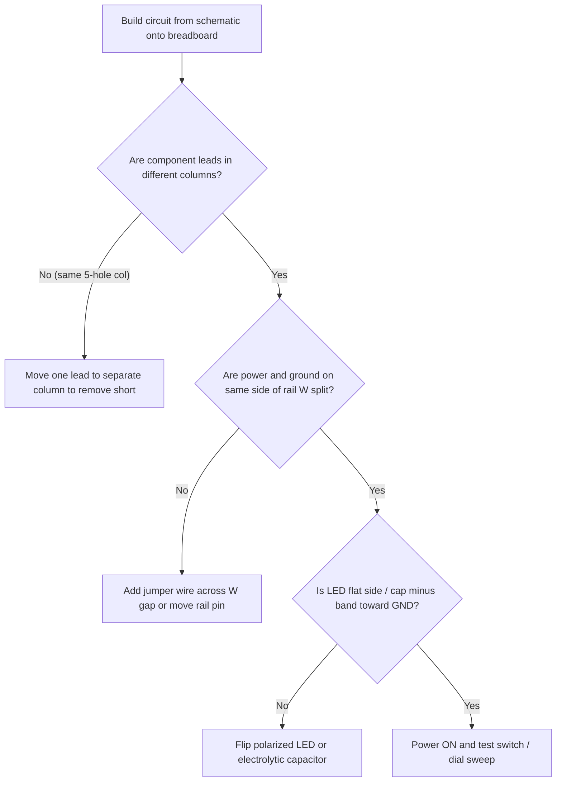

# Basic Electricity and Electronic Components

> [!info] Document Metadata
> **Course:** `=this.course` | **Topic:** `=this.topic` | **Status:** `=this.status`

**Tags:** #[[Computer Science]] #[[NSETRON]] #[[Electronics]] #[[Basic Electricity and Electronic Components]]

---

## Exam-Oriented Concept Summary

- **830-Hole Solderless Breadboard Topology:**
  - **Terminal Strips (Main Matrix):** Two mirrored halves separated by a central IC gap/trench. Each column contains **5 vertically connected holes** (`a-e` on one side of the gap, `f-j` on the other; `126` 5-hole columns total). Columns are **not** connected horizontally to adjacent columns, nor across the center gap.
  - **Power / Ground Bus Rails:** Top and bottom horizontal rows marked red (`+`) and blue (`-`). Standard layouts depict `6` rows of `100` holes (or `2` rails top and `2` rails bottom), where holes along the same `+` or `-` row share an internal bus strip, while `+` and `-` rows remain isolated from one another.
  - **DLSU-CT Lab Breadboard Critical Trap (`"W"` Split):** On DLSU-CT laboratory `830`-hole breadboards used in NSETRON, a printed **`W`** symbol sits near the middle of the horizontal power/ground rails (between columns 30 and 35). That split breaks electrical continuity between the left half and right half of the horizontal rail. Putting the power supply ground on the left side of the `"W"` and a circuit ground jumper on the right side leaves an **open circuit** unless bridged by a jumper wire.
  - **Hole Notation:** Expressed as `<row><col>` (e.g., `b26`, `h9`, `e15`) or `<rail><col>` (e.g., `(+)3`, `(-)21`).
- **Component Polarity & Pin Placement:**
  - **LED (Light-Emitting Diode):** Polarized semiconductor diode (typically GaAs/visible LEDs with forward threshold $\approx 1.5\text{ V}$ to $3\text{ V}$ depending on color/material). The **cathode (`-`)** is marked by the **flat side** on the plastic rim and the **shorter lead**; the **anode (`+`)** has the longer lead. Placing both leads in the same 5-hole column shorts the LED; reversing polarity blocks current and leaves it dark.
  - **Tactile Push-Button Switch:** Never bridge two terminals that are internally connected or place both switched legs inside the same 5-hole column (e.g., `f4` and `g4`), which permanently shorts the switch so the LED stays ON continuously.
  - **Potentiometer (Variable Resistor, 3-Pin):** Outer pins have a fixed total resistance (e.g., $50\text{ k}\Omega$); the center wiper pin varies resistance relative to either outer pin as the dial rotates. Always place a fixed safety current-limiting resistor (e.g., $1\text{ k}\Omega$) in series so turning the potentiometer to $0\ \Omega$ does not burn out the LED.
  - **Electrolytic Capacitor Polarity:** Negative lead is marked by a vertical **stripe with `-` signs/arrowheads** and shorter pin. Reversing polarity risks overheating, electrolyte leakage, or explosion.
- **Inductors and Capacitors in DC vs. AC (Introductory Behavior):**
  - **Inductor ($L$, Henry $\text{H}$, $\text{mH}$, $\mu\text{H}$):** Coil of wire storing energy in a **magnetic field**. Inductance depends on coil turns, diameter, turn spacing, wire type, and core permeability (air, iron, toroid). In **steady-state DC**, an inductor passes DC easily (acts nearly as a short), though at switch-on the rising magnetic field opposes current rise, and at switch-off the collapsing magnetic field induces a high-voltage **flyback / back-EMF** surge in the opposite direction. In **AC**, continually reversing magnetic flux increases opposition (**inductive reactance**, $X_L = 2\pi f L$). Closely coupled coils form a **transformer**.
  - **Capacitor ($C$, Farad $\text{F}$, $\mu\text{F}$, $\text{pF}$):** Two conductive plates separated by a dielectric insulator storing energy in an **electric field**. Capacitance increases with plate area and dielectric permittivity, and decreases with plate spacing. In **DC**, it charges up to source voltage and then **blocks steady DC current**. In **AC**, it continually charges and discharges on alternating half-cycles, acting as if AC passes through it (**capacitive reactance**, $X_C = \frac{1}{2\pi f C}$).

---

## Key Formulas

| Formula Name | Expression | Units | When to Use |
| :--- | :--- | :--- | :--- |
| LED Series Circuit Current | $I = \frac{V_S - V_{\text{LED}}}{R_{\text{total}}}$ | $I$ ($\text{A}$), $V$ ($\text{V}$), $R$ ($\Omega$) | Computing LED current in Lab 1 (use typical visible LED drop $V_{\text{LED}} \approx 1.5\text{ V}$ when unspecified, or ideal $V_S/R$ estimate) |
| Potentiometer Wiper Sum | $R_{AC} = R_{AB} + R_{BC}$ | $\Omega$ | Verifying outer-pin resistance ($50\text{ k}\Omega$ constant) vs. center-wiper resistance |
| Inductive Reactance | $X_L = 2\pi f L$ | $X_L$ ($\Omega$), $f$ ($\text{Hz}$), $L$ ($\text{H}$) | Calculating AC opposition of a coil (increases linearly with frequency $f$) |
| Capacitive Reactance | $X_C = \frac{1}{2\pi f C}$ | $X_C$ ($\Omega$), $f$ ($\text{Hz}$), $C$ ($\text{F}$) | Calculating AC opposition of a capacitor (decreases as $f$ or $C$ rises) |
| Series Inductance (No Mutual Coupling) | $L_T = L_1 + L_2 + \dots + L_n$ | $\text{H}$ | Combining isolated series inductors |
| Parallel Inductance (No Mutual Coupling) | $\frac{1}{L_T} = \frac{1}{L_1} + \frac{1}{L_2} + \dots + \frac{1}{L_n}$ | $\text{H}$ | Combining isolated parallel inductors |

---

## Worked Numerical Examples

### Example 1: Lab 1 Part 1 — Fixed-Resistor LED Current Calculation
In Laboratory Experiment 1 Part 1, a $9\text{ V}$ supply drives a switch, a fixed resistor, and an LED (assume forward voltage drop $V_{\text{LED}} = 1.5\text{ V}$ as specified for GaAs LEDs in Lab 4). Calculate the circuit current for the three tested resistors: $1\text{ k}\Omega$, $10\text{ k}\Omega$, and $100\text{ k}\Omega$.

**Solution:**
1. Find the voltage dropped across the series resistor:
   $$V_R = V_S - V_{\text{LED}} = 9\text{ V} - 1.5\text{ V} = 7.5\text{ V}$$
2. Apply Ohm's Law $I = V_R / R$ for each resistor:
   - For $R = 1\text{ k}\Omega = 1000\ \Omega$:
     $$I_{1\text{k}} = \frac{7.5\text{ V}}{1000\ \Omega} = 0.0075\text{ A} = 7.5\text{ mA} \quad (\text{brightest LED})$$
   - For $R = 10\text{ k}\Omega = 10,000\ \Omega$:
     $$I_{10\text{k}} = \frac{7.5\text{ V}}{10,000\ \Omega} = 0.00075\text{ A} = 0.75\text{ mA} \quad (\text{moderate brightness})$$
   - For $R = 100\text{ k}\Omega = 100,000\ \Omega$:
     $$I_{100\text{k}} = \frac{7.5\text{ V}}{100,000\ \Omega} = 0.000075\text{ A} = 0.075\text{ mA} = 75\ \mu\text{A} \quad (\text{very dim LED})$$

### Example 2: Lab 1 Part 2 — Potentiometer + Safety Resistor Current Range & Reactance Check
(a) In Lab 1 Part 2, a $1\text{ k}\Omega$ safety resistor is in series with a $50\text{ k}\Omega$ potentiometer across $V_S = 9\text{ V}$ with an LED ($V_{\text{LED}} = 1.5\text{ V}$). Find the minimum and maximum LED current as the dial sweeps from $0\ \Omega$ to $50\text{ k}\Omega$, and explain what happens if the $1\text{ k}\Omega$ resistor were omitted at $0\ \Omega$.
(b) A $10\text{ mH}$ inductor operates at $1\text{ kHz}$. Find its inductive reactance $X_L$.

**Solution (a):**
1. Minimum resistance (dial fully turned so $R_{\text{pot}} = 0\ \Omega$):
   $$R_{\min} = 1\text{ k}\Omega + 0\ \Omega = 1\text{ k}\Omega \implies I_{\max} = \frac{9\text{ V} - 1.5\text{ V}}{1000\ \Omega} = 7.5\text{ mA}$$
   Without the $1\text{ k}\Omega$ safety resistor, $R_{\text{total}} \to 0\ \Omega$, causing an uncontrolled current surge that can destroy the LED.
2. Maximum resistance (dial fully turned to $R_{\text{pot}} = 50\text{ k}\Omega$):
   $$R_{\max} = 1\text{ k}\Omega + 50\text{ k}\Omega = 51\text{ k}\Omega \implies I_{\min} = \frac{7.5\text{ V}}{51,000\ \Omega} \approx 0.147\text{ mA}$$

**Solution (b):**
1. Apply $X_L = 2\pi f L$ with $f = 1000\text{ Hz}$ and $L = 10 \times 10^{-3}\text{ H}$:
   $$X_L = 2 \pi (1000\text{ Hz})(0.01\text{ H}) = 20\pi \approx 62.83\ \Omega$$

---

## Laboratory Recap

### Laboratory Activity #01: The Light Bulb
- **Objective:** Understand breadboard hole continuity, schematic-to-breadboard translation, LED polarity, and how fixed and variable resistors control current and LED brightness.
- **Materials & Instruments:** $9\text{ V}$ battery or DC power supply, 830-hole breadboard, tactile pushbutton switch, fixed resistors ($1\text{ k}\Omega$, $10\text{ k}\Omega$, $100\text{ k}\Omega$), $50\text{ k}\Omega$ variable resistor (potentiometer), LED, jumper wires.
- **Numbered Procedure:**
  1. Connect $+9\text{ V}$ to hole `j4` and ground (`0 V`) to hole `(-)3`.
  2. Place switch across `f4` and `f5`, then insert the $10\text{ k}\Omega$ resistor across `j5` and `j9`.
  3. Insert the LED across `g20` (anode) and `g21` (cathode, flat side / shorter lead), jumper `h9` to `j20`, and jumper `f21` to `(-)21`.
  4. Press the switch to observe moderate LED glow; swap the $10\text{ k}\Omega$ resistor for $1\text{ k}\Omega$, then $100\text{ k}\Omega$, observing brightness each time.
  5. For Part 2, wire $1\text{ k}\Omega$ from `j5` to `j15`, insert the $50\text{ k}\Omega$ potentiometer into `e14`, `g15` (wiper), and `e16`, and jumper `c14` to `j20`. Sweep the dial while holding the switch closed.
  6. Test swapping jumper `c14` to `c16` (direction reverses) and connecting the resistor end directly to `c14` while leaving `j15` unused (fixed $50\text{ k}\Omega$, dial has no effect).
- **What Is Observed / Measured:** Visual LED light intensity acting as a qualitative current indicator ("water meter").
- **Expected Readings or Behavior:**
  - $1\text{ k}\Omega \to$ brightest; $10\text{ k}\Omega \to$ medium; $100\text{ k}\Omega \to$ very dim (must shield ambient light to see).
  - Part 2 dial sweep smoothly dims/brightens the LED; moving from `c14` to `c16` reverses turning direction; connecting across outer pins `e14`–`e16` locks resistance at $50\text{ k}\Omega$.
- **Typical Sources of Error:**
  - Inserting both legs of the switch or LED into the **same 5-hole column** (e.g., `f4` and `g4`), shorting the component.
  - Bridging across the **`"W"` rail break** on the DLSU-CT breadboard without a jumper wire.
  - Reversing LED anode/cathode leads or loose/bent component legs causing intermittent potentiometer/breadboard contact.
  - Note: Always double-check resistor color bands (`brown-black-red-gold` is $1\text{ k}\Omega$; `brown-black-yellow-gold` is $100\text{ k}\Omega$) with an ohmmeter before wiring.
- **Conclusion Statements:** Current and resistance exhibit a clear inverse relationship ($I = V/R$). Fixed resistors limit current to safe LED thresholds, and a potentiometer acts as a continuous current controller when wired between an outer terminal and the center wiper, protected by a series $1\text{ k}\Omega$ resistor.

---

## Circuit & Procedure Diagrams

### Breadboard Layout & Lab 1 Part 1 / Part 2 Schematics

```text
Breadboard Internal Bus Map (830-Hole with DLSU-CT "W" Split):
  (-) [o o o o o ... o o]  W  [o o o o o ... o o]  <-- Split at "W" (needs jumper!)
  (+) [o o o o o ... o o]  W  [o o o o o ... o o]
       1 2 3 4 5 ...  30      35 ...          60
  j-f | | | | |   |   |        |               |   <-- Each vertical 5-hole col connected
  === CENTER IC TRENCH (NO VERTICAL CONNECTION ACROSS) ===
  e-a | | | | |   |   |        |               |   <-- Each vertical 5-hole col connected

Lab 1 Part 1 Schematic:
  +9V ---[ Switch ]---[ R (10k / 1k / 100k) ]---(>|) LED (flat=cathode)--- GND

Lab 1 Part 2 Schematic (with 1k Safety Limiter & 50k Potentiometer):
  +9V ---[ Switch ]---[ 1k safety ]---/\/\/\ (50k Pot, pin 14 to wiper 15)---(>|) LED--- GND
                                         ^-- pin 16 unconnected (moving wire 14->16 reverses dial)
```

### Breadboard Circuit Verification & Debugging Flow



---

## Exam Traps & Quick-Recall Checklist

- **Same-column short trap:** Holes `f4` and `g4` are **connected together** vertically. Putting a switch across `f4`–`g4` keeps the LED ON permanently regardless of button presses! Correct placement crosses columns (e.g., `f4`–`f5`) or crosses the center trench (e.g., `e4`–`f4`).
- **DLSU-CT breadboard `"W"` trap:** Horizontal power rails are broken at the `"W"` mark; verify both power supply and circuit jumpers sit on the same side or bridge the `"W"` gap.
- **Role of $1\text{ k}\Omega$ series resistor with a $50\text{ k}\Omega$ pot:** Protects the LED from destructive overcurrent when the potentiometer dial is turned all the way down to $0\ \Omega$.
- **Potentiometer wiring trap:** Connecting the two outer pins (`e14` and `e16`) ignores the wiper (`g15`) and locks resistance at $50\text{ k}\Omega$.
- **Inductor vs. Capacitor in DC/AC:** Capacitors **block steady DC** and pass AC ($X_C \propto 1/f$); inductors **pass steady DC** (short) and oppose changing/AC current ($X_L \propto f$).
- **Color-band typo awareness:** $1\text{ k}\Omega$ = brown-black-red-gold; $10\text{ k}\Omega$ = brown-black-orange-gold; $100\text{ k}\Omega$ = brown-black-yellow-gold.

---

## Multiple Choice Questions

1. A student places both terminals of a tactile push-button switch into holes `f4` and `g4` on a standard breadboard. After applying $9\text{ V}$, the LED stays brightly lit even without pressing the switch. What caused this fault?
    - **A)** The $10\text{ k}\Omega$ resistor was inserted backward
    - **B)** Holes `f4` and `g4` lie in the same 5-hole vertical column and are internally shorted together
    - **C)** The breadboard center trench shorted row `f` to the negative bus rail
    - **D)** The LED was placed with its flat cathode facing the positive supply

2. In Laboratory Experiment 1 Part 2, a $1\text{ k}\Omega$ fixed resistor is placed in series with a $50\text{ k}\Omega$ variable resistor and an LED across a $9\text{ V}$ supply. Why is the $1\text{ k}\Omega$ fixed resistor necessary?
    - **A)** To keep the LED completely OFF when the potentiometer is turned halfway
    - **B)** To double the battery voltage across the potentiometer
    - **C)** To act as a minimum current-limiting safety resistor when the potentiometer is turned to $0\ \Omega$
    - **D)** To convert the series circuit into a parallel voltage divider

3. On a DLSU-CT laboratory breadboard, a ground jumper is plugged into the top `-` horizontal rail to the right of the `"W"` mark while the power supply ground clip is plugged into the same top `-` row to the left of the `"W"` mark. What will occur?
    - **A)** The circuit will work normally because the entire top row is one continuous conductor
    - **B)** The circuit will not work because the `"W"` symbol separates the left rail segment from the right rail segment
    - **C)** The LED will glow twice as brightly because current bypasses the ground rail
    - **D)** The power supply will automatically switch from DC to AC

4. [MSQ] Which of the following statements accurately compare capacitors and inductors in DC and AC circuits? (Select all that apply)
    - **A)** A capacitor stores energy in an electric field and blocks steady-state DC once charged
    - **B)** An inductor stores energy in a magnetic field and produces a high-voltage spike when DC current is abruptly switched off
    - **C)** Capacitive reactance $X_C$ increases as signal frequency increases
    - **D)** Inductive reactance $X_L$ increases as signal frequency increases

5. [MSQ] Which of the following wiring or polarity precautions prevent damage or failure on a breadboard? (Select all that apply)
    - **A)** Orienting an electrolytic capacitor so its negative stripe faces lower potential/ground to avoid overheating or bursting
    - **B)** Inserting an LED's flat side (shorter cathode lead) toward the negative/ground return path
    - **C)** Wiring a potentiometer across its two outer terminals (`e14` and `e16`) when variable brightness adjustment is desired
    - **D)** Keeping bare component leads straight and separated so adjacent leads never touch

6. In Lab 1 Part 2, the jumper originally at potentiometer outer pin `c14` (with wiper at `g15`) is moved to the opposite outer pin `c16`. What happens when you turn the dial from left to right?
    - **A)** The LED remains permanently dark regardless of dial position
    - **B)** The brightness behavior reverses, going from very dim to very bright as the dial turns left to right
    - **C)** The resistance locks permanently at $50\text{ k}\Omega$
    - **D)** The potentiometer burns out due to reverse bias

7. [INPUT] In Lab 1 Part 1, a $9\text{ V}$ battery supplies a series circuit with a $10\text{ k}\Omega$ resistor and a forward-biased LED ($V_{\text{LED}} = 1.5\text{ V}$). Calculate the circuit current in milliamperes ($\text{mA}$).

8. [INPUT] Calculate the inductive reactance $X_L$ (in ohms, rounded to two decimal places) of a $25\text{ mH}$ inductor connected to a $2\text{ kHz}$ AC signal.

9. [BLANK] Complete the Lab 1 Part 1 component table based on standard 4-band resistor color codes (`5%` gold tolerance):

| Nominal Resistance | Band 1 | Band 2 | Band 3 (Multiplier) |
| :--- | :--- | :--- | :--- |
| $1\text{ k}\Omega$ | Brown | Black | {{1}} |
| $10\text{ k}\Omega$ | Brown | Black | {{2}} |
| $100\text{ k}\Omega$ | Brown | Black | {{3}} |

10. What happens in Lab 1 Part 2 if the $1\text{ k}\Omega$ resistor lead is moved from wiper column `15` (`j15`) to outer-pin column `14` (`c14`), leaving the wiper unconnected?
    - **A)** Turning the dial causes the LED brightness to oscillate between bright and off
    - **B)** The LED stays dim and turning the dial has no effect because resistance between the two outer pins is fixed at $50\text{ k}\Omega$
    - **C)** The LED burns out immediately because resistance drops to $0\ \Omega$
    - **D)** Current flows backward through the potentiometer

### Answer Key & Explanations

1. **B)** On a solderless breadboard, each 5-hole vertical column (`a-e` or `f-j`) shares one metal clip underneath. Putting switch leads into `f4` and `g4` (same column 4) permanently bypasses the switch.
2. **C)** If the potentiometer wiper is rotated to $0\ \Omega$, Ohm's Law ($I = V/R$) would send excessive destructive current through the LED without the $1\text{ k}\Omega$ safety resistor in series.
3. **B)** On DLSU-CT laboratory `830`-hole breadboards, the `"W"` divider marks a physical break between left and right halves of the horizontal power/ground rails.
4. **A, B, D)** Capacitors store electric-field energy and block steady DC; inductors store magnetic-field energy, generate collapsing-field flyback spikes when opened, and have $X_L = 2\pi f L$ (directly proportional to $f$). Capacitive reactance $X_C = 1/(2\pi f C)$ *decreases* as frequency increases.
5. **A, B, D)** Electrolytic polarity reversal can overheat/rupture the part, LEDs conduct when the flat/short cathode faces ground, and straight leads prevent accidental shorts. Wiring across the two outer pins of a potentiometer locks it at its full fixed resistance rather than making it variable.
6. **B)** Using the opposite outer pin swaps which side of the resistive track approaches $0\ \Omega$ vs. $50\text{ k}\Omega$ relative to the wiper, reversing the clockwise/counterclockwise brightness direction.
7. **[0.75; 0.75 mA; 0.75mA]** $I = (V_S - V_{\text{LED}}) / R = (9 - 1.5) / 10,000 = 7.5 / 10,000 = 0.00075\text{ A} = 0.75\text{ mA}$.
8. **[314.16; 314.16 ohm; 314.16 ohms; 314.0]** $X_L = 2\pi f L = 2\pi (2000\text{ Hz})(0.025\text{ H}) = 100\pi \approx 314.16\ \Omega$. (Using $6.28$ approximation gives $314.0\ \Omega$; both accepted.)
9. **[1: Red; 2: Orange; 3: Yellow]** Significant digits `1` (Brown) and `0` (Black) give `10`; multiplying by Red ($\times 10^2 = 100$) yields $1\text{ k}\Omega$, Orange ($\times 10^3 = 1\text{ k}$) yields $10\text{ k}\Omega$, and Yellow ($\times 10^4 = 10\text{ k}$) yields $100\text{ k}\Omega$.
10. **B)** Resistance between the two outer terminals of a potentiometer is always its full rated value ($50\text{ k}\Omega$), independent of wiper rotation.

## References & Navigation

- **Previous Topic:** [[Basic Electrical Theory]]
- **Next Topic:** [[Resistors]]
- **Related Notes:** [[Capacitors]], [[Diodes]], [[Written Exam Coverage and Formula Sheet]]
