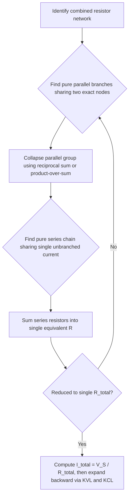

# Resistors

> [!info] Document Metadata
> **Course:** `=this.course` | **Topic:** `=this.topic` | **Status:** `=this.status`

**Tags:** #[[Computer Science]] #[[NSETRON]] #[[Electronics]] #[[Resistors]]

---

## Exam-Oriented Concept Summary

- **Series Resistors (Current Same, Voltages Add — KVL):**
  - Placing resistors end-to-end forces all current along one path: $I_{\text{total}} = I_1 = I_2 = \dots = I_n$.
  - Total resistance is the sum of all resistances ($R_T = \sum R_i$), so the **largest resistor dominates** total resistance and bottlenecks total current.
  - Supply voltage divides across series elements in proportion to each resistance (**Kirchhoff's Voltage Law, KVL**: $V_S = \sum V_i$).
- **Parallel Resistors (Voltage Same, Currents Add — KCL):**
  - Connecting components across the same two nodes guarantees equal voltage across every branch ($V_{\text{branch}} = V_S$).
  - Adding parallel branches opens extra pathways for charge flow, making $R_{\text{parallel}}$ **strictly smaller than the smallest individual branch resistor**.
  - Total supply current equals the sum of branch currents (**Kirchhoff's Current Law, KCL**: $I_T = \sum I_i$). Parallel branches connected across an ideal constant voltage source operate **independently**: changing one branch's resistance alters only that branch's current (and LED brightness), leaving other parallel branches unchanged.
- **Combined Series-Parallel Circuits:**
  - Solved systematically by collapsing clearly parallel or clearly series pairs into single equivalents until $R_T$ is found, then working backward using Ohm's Law, KVL, and KCL to find branch currents and voltages.
- **Resistor Types, Specifications & Color Code:**
  - **Standard E12 ($\pm 10\%$) & E24 ($\pm 5\%$) Values:** Manufactured in decade multiples of `1.0, 1.2, 1.5, 1.8, 2.2, 2.7, 3.3, 3.9, 4.7, 5.6, 6.8, 8.2` ($\pm 10\%$) plus `1.1, 1.3, 1.6, 2.0, 2.4, 3.0, 3.6, 4.3, 5.1, 6.2, 7.5, 9.1` ($\pm 5\%$).
  - **Tolerance Range:** Computed from **rated nominal value**, not measured value: $R_{\text{range}} = R_{\text{nom}} \pm (\text{tolerance} \times R_{\text{nom}})$.
  - **Power Dissipation Rating:** Typical axial ratings are $1/8\text{ W}$, $1/4\text{ W}$, $1/2\text{ W}$, $1\text{ W}$, $2\text{ W}$. Always verify $P = I^2 R = V^2 / R$ with a safety margin (good design keeps actual dissipation $\le 90\%$ of rated power, e.g., $\le 0.225\text{ W}$ for a $1/4\text{ W}$ resistor). Identical $n \times n$ series-parallel resistor arrays multiply power capacity by $n^2$ while keeping net resistance equal to one unit!
  - **Potentiometer vs. Rheostat & Tapers:** **Linear-taper** pots vary resistance uniformly with angle (meters/instruments); **audio/log-taper** pots match human logarithmic hearing (volume controls); **rheostats** are high-power 2-terminal variable resistors.

### 4-Band Resistor Color Code Table

| Color | Digit (Bands 1 & 2) | Multiplier (Band 3) | Tolerance (Band 4) |
| :--- | :---: | :--- | :--- |
| Black | 0 | $\times 1$ | --- |
| Brown | 1 | $\times 10$ | $\pm 1\%$ (or 5th-band reliability/1000 h) |
| Red | 2 | $\times 100$ | $\pm 2\%$ (5th-band $\pm 0.1\%$) |
| Orange | 3 | $\times 1000\ (1\text{ k})$ | 5th-band $\pm 0.01\%$ |
| Yellow | 4 | $\times 10^4\ (10\text{ k})$ | 5th-band $\pm 0.001\%$ |
| Green | 5 | $\times 10^5\ (100\text{ k})$ | --- |
| Blue | 6 | $\times 10^6\ (1\text{ M})$ | --- |
| Violet | 7 | $\times 10^7\ (10\text{ M})$ | --- |
| Gray | 8 | $\times 10^8\ (100\text{ M})$ | --- |
| White | 9 | $\times 10^9\ (1\text{ G})$ | --- |
| Gold | --- | $\times 0.1$ | $\pm 5\%$ |
| Silver | --- | $\times 0.01$ | $\pm 10\%$ |
| No 4th band | --- | --- | $\pm 20\%$ |

---

## Key Formulas

| Formula Name | Expression | Units | When to Use |
| :--- | :--- | :--- | :--- |
| Series Resistance | $R_T = R_1 + R_2 + \dots + R_n$ | $\Omega$ | Resistors on a single unbranched path |
| Parallel Resistance (General) | $R_T = \left(\sum_{i=1}^n \frac{1}{R_i}\right)^{-1}$ | $\Omega$ | Two or more resistors sharing identical endpoint nodes |
| Parallel Resistance (2 Resistors) | $R_P = \frac{R_1 R_2}{R_1 + R_2}$ | $\Omega$ | Fast two-branch calculation (e.g., Lab 2 Part 2) |
| Tolerance Bounds | $R_{\min} = R_{\text{nom}}(1 - t),\quad R_{\max} = R_{\text{nom}}(1 + t)$ | $\Omega$ | Identifying out-of-spec rejects from ohmmeter checks ($t = 0.05$ for gold, $0.10$ for silver) |
| Percentage Error | $\% \text{Error} = \frac{\lvert R_{\text{meas}} - R_{\text{nom}}\rvert}{R_{\text{nom}}} \times 100\%$ | $\%$ | Checking measured resistance against rated nominal value |
| Power Handling & Safety Check | $P_{\text{actual}} = I^2 R = \frac{V_R^2}{R} \le P_{\text{rated}}$ | $\text{W}$ | Ensuring resistor wattage rating is not exceeded ($I_{\max} = \sqrt{P_{\text{rated}}/R}$) |

---

## Worked Numerical Examples

### Example 1: Lab 2 Part 1 & Part 2 — Series vs. Parallel Equivalent Resistance
In Laboratory Experiment 2, a $3.3\text{ k}\Omega$ resistor (`orange-orange-red-gold`) is paired with $100\text{ k}\Omega$, $10\text{ k}\Omega$, and $1\text{ k}\Omega$ resistors across a $9\text{ V}$ supply feeding an LED ($V_{\text{LED}} \approx 1.5\text{ V}$). Compute the equivalent resistor network values for (a) Part 1 (series) and (b) Part 2 (parallel), plus the resulting circuit current for the $3.3\text{ k}\Omega$ and $100\text{ k}\Omega$ pair.

**Solution (a) Series (`Lab 2 Part 1`):**
1. $3.3\text{ k}\Omega + 100\text{ k}\Omega = 103.3\text{ k}\Omega$ (the $100\text{ k}\Omega$ resistor dominates; LED is very dim: $I = \frac{9 - 1.5}{103,300} \approx 0.073\text{ mA}$).
2. $3.3\text{ k}\Omega + 10\text{ k}\Omega = 13.3\text{ k}\Omega$ (LED becomes easily visible: $I = \frac{7.5}{13,300} \approx 0.564\text{ mA}$).
3. $3.3\text{ k}\Omega + 1\text{ k}\Omega = 4.3\text{ k}\Omega$ (now the $3.3\text{ k}\Omega$ dominates, making LED bright, though dimmer than the standalone $1\text{ k}\Omega$ in Lab 1: $I = \frac{7.5}{4300} \approx 1.74\text{ mA}$).

**Solution (b) Parallel (`Lab 2 Part 2`):**
1. $3.3\text{ k}\Omega \parallel 100\text{ k}\Omega$:
   $$R_P = \frac{3.3 \times 100}{3.3 + 100} = \frac{330}{103.3} \approx 3.195\text{ k}\Omega \approx 3.2\text{ k}\Omega$$
   (Current is $I = \frac{7.5}{3195} \approx 2.35\text{ mA}$, making the LED bright despite the $100\text{ k}\Omega$ branch.)
2. $3.3\text{ k}\Omega \parallel 10\text{ k}\Omega$:
   $$R_P = \frac{3.3 \times 10}{3.3 + 10} = \frac{33}{13.3} \approx 2.481\text{ k}\Omega \approx 2.5\text{ k}\Omega$$
3. $3.3\text{ k}\Omega \parallel 1\text{ k}\Omega$:
   $$R_P = \frac{3.3 \times 1}{3.3 + 1} = \frac{3.3}{4.3} \approx 0.767\text{ k}\Omega = 767\ \Omega \approx 770\ \Omega$$
   (Current jumps to $I = \frac{7.5}{767} \approx 9.78\text{ mA}$, making the LED much brighter.)

### Example 2: Color Code Decoding, Tolerance Reject Check, and Power Rating
(a) A resistor has color bands `orange-orange-red-gold`. Determine its nominal value and acceptable ohmmeter range.
(b) Suppose a $56\ \Omega \pm 10\%$ resistor package yields ohmmeter measurements of $50.0\ \Omega$, $53.0\ \Omega$, and $61.1\ \Omega$. Which reading is a reject?
(c) Find the maximum continuous current a $680\ \Omega$, $1/4\text{ W}$ resistor can handle safely (assuming a $10\%$ engineering safety derating to $0.225\text{ W}$).

**Solution:**
1. Band 1 = Orange ($3$), Band 2 = Orange ($3$), Band 3 = Red ($\times 100$), Band 4 = Gold ($\pm 5\%$).
   $$R_{\text{nom}} = 33 \times 100\ \Omega = 3300\ \Omega = 3.3\text{ k}\Omega \pm 5\%$$
   $$5\% \times 3300 = 165\ \Omega \implies R_{\text{range}} = [3135\ \Omega,\ 3465\ \Omega]$$
2. For $56\ \Omega \pm 10\%$, tolerance is $0.10 \times 56 = 5.6\ \Omega$, so valid bounds are $[50.4\ \Omega,\ 61.6\ \Omega]$. Therefore **$50.0\ \Omega$ is a reject** (below $50.4\ \Omega$).
3. Maximum current with $P_{\text{safe}} = 0.225\text{ W}$:
   $$I_{\max} = \sqrt{\frac{P_{\text{safe}}}{R}} = \sqrt{\frac{0.225\text{ W}}{680\ \Omega}} \approx \sqrt{0.0003309} \approx 0.0182\text{ A} = 18.2\text{ mA}$$
   (At full $0.25\text{ W}$ rating, $I = \sqrt{0.25/680} \approx 19.2\text{ mA}$.)

---

## Laboratory Recap

### Laboratory Activity #02: Resistors
- **Objective:** Verify series resistance addition (KVL), parallel resistance reduction (KCL), independent operation of parallel branches, and current splitting in combined series-parallel circuits using fixed and variable resistors.
- **Materials & Instruments:** $9\text{ V}$ power supply, breadboard, pushbutton switch, fixed resistors ($1\text{ k}\Omega$ brown-black-red-gold, $3.3\text{ k}\Omega$ orange-orange-red-gold, $10\text{ k}\Omega$ brown-black-orange-gold, $100\text{ k}\Omega$ brown-black-yellow-gold), $50\text{ k}\Omega$ variable resistor, 2 LEDs, jumper wires.
- **Numbered Procedure:**
  1. **Part 1 (Series):** Connect $+9\text{ V}$ (`j4`), `-` (`(-)3`), switch (`f4`–`f5`), $3.3\text{ k}\Omega$ (`i5`–`i12`), $100\text{ k}\Omega$ (`j12`–`j20`), LED (`g20`–`g21`, flat on `g21`), `f21`–`(-)21`. Test with $100\text{ k}\Omega$, then swap to $10\text{ k}\Omega$, then $1\text{ k}\Omega$.
  2. **Part 2 (Parallel):** Place $3.3\text{ k}\Omega$ (`i5`–`i12`) and $100\text{ k}\Omega$ (`j5`–`j12`) in parallel, jumper `h12`–`j20` to LED. Test with $100\text{ k}\Omega$, then swap to $10\text{ k}\Omega$, then $1\text{ k}\Omega$.
  3. **Part 3A (Independent Parallel LED Branches):** Wire Branch 1 (`100k` at `j5`–`j12`, jumper `h12`–`j20`, LED 1 at `g20`–`g21`) and Branch 2 (`3.3k` at `i5`–`j10`, jumper `g10`–`j23`, LED 2 at `g23`–`g24`, `f24`–`(-)24`). Swap the $100\text{ k}\Omega$ resistor for $10\text{ k}\Omega$ and $1\text{ k}\Omega$ and observe both LEDs.
  4. **Part 3B (Combined Series-Parallel):** Place $3.3\text{ k}\Omega$ (`i5`–`i15`) in series before a parallel split: Left path uses $50\text{ k}\Omega$ VR (`e14, g15, e16`, jumper `c14`–`j20`) + LED 1 (`g20`–`g21`); Right path uses $10\text{ k}\Omega$ (`j15`–`j23`) + LED 2 (`g23`–`g24`). Sweep VR dial from left ($0\ \Omega$) to right ($50\text{ k}\Omega$).
- **What Is Observed / Measured:** Relative LED brightness across branches and calculated vs. nominal resistance behavior.
- **Expected Readings or Behavior:**
  - **Part 1:** $100\text{ k}\Omega$ very dim $\to 10\text{ k}\Omega$ clearly visible $\to 1\text{ k}\Omega$ bright ($R_T = 103.3 \to 13.3 \to 4.3\text{ k}\Omega$).
  - **Part 2:** Bright even with $100\text{ k}\Omega$ ($3.2\text{ k}\Omega$ equiv.), nearly same brightness at $10\text{ k}\Omega$ ($2.5\text{ k}\Omega$), noticeably brighter at $1\text{ k}\Omega$ ($770\ \Omega$).
  - **Part 3A:** Right LED ($3.3\text{ k}\Omega$ branch) keeps constant brightness while changing Left branch resistor affects only Left LED.
  - **Part 3B:** At VR $= 0\ \Omega$ (leftmost), almost all current from the $3.3\text{ k}\Omega$ resistor flows through Left LED (bright) and Right LED is very dim. At $1/5$ turn ($\text{VR} = 10\text{ k}\Omega$), both branches have $10\text{ k}\Omega$ and glow equally. At VR $= 50\text{ k}\Omega$ (rightmost), Left LED dims and Right LED brightens.
- **Typical Sources of Error:** $\pm 5\%$ gold-band manufacturing tolerance, natural resistance of breadboard strips and jumper wires, loose component leads in breadboard sockets, and shorting adjacent tightly packed resistors/wires.
- **Conclusion Statements:** Series circuits obey KVL and additive resistance (largest resistor dominates); parallel circuits obey KCL and reduce equivalent resistance below any single branch while keeping branch voltages independent; combined circuits allow controlled current steering across parallel branches via a series-fed variable resistor.

---

## Circuit & Procedure Diagrams

### Lab 2 Schematics (Series, Parallel, Parallel Branches, Combined)

```text
Part 1 (Series):
  +9V ---[ SW ]---[ 3.3k ]---[ 100k/10k/1k ]---(>| LED)--- GND

Part 2 (Parallel Resistors):
                  +---[ 3.3k ]---+
  +9V ---[ SW ]---+              +---(>| LED)--- GND
                  +---[ 100k ]---+

Part 3A (Parallel LED Branches):          Part 3B (Combined Series-Parallel):
           +---[ 100k ]---(>| LED_L)--+                  +---[ 50k VR ]---(>| LED_L)--+
  +9V--SW--+                          +-GND  +9V--SW--[3.3k]+                          +-GND
           +---[ 3.3k ]---(>| LED_R)--+                  +---[ 10k ]----(>| LED_R)--+
```

### Series-Parallel Circuit Reduction Flow



---

## Exam Traps & Quick-Recall Checklist

- **Independent parallel branches:** In a parallel circuit across a fixed voltage supply, altering one branch's resistor changes **only that branch's current** and total battery current—the other branch's current and LED brightness stay **unchanged**!
- **Combined circuit opposite-brightness trap (Lab 2 Part 3B):** Because a $3.3\text{ k}\Omega$ resistor sits in series *upstream* of the parallel split, lowering VR steals current away from the $10\text{ k}\Omega$ branch (Left brightens, Right dims); raising VR pushes current into the $10\text{ k}\Omega$ branch (Left dims, Right brightens). Equal brightness occurs when VR $= 10\text{ k}\Omega$ ($1/5$ of $50\text{ k}\Omega$ rotation).
- **Tolerance is on rated nominal value:** Never compute $\pm 5\%$ or $\pm 10\%$ around the *measured* value; always compute around the labeled/color-coded nominal value.
- **Minimum parallel resistance check:** If your parallel $R_P$ ever comes out larger than ANY resistor in the parallel group, you forgot to take the final reciprocal $1 / (1/R_P)$.
- **Residential wiring analogy:** Household outlets/lamps are wired in **parallel** (independent switching, full mains voltage), while fuses and wall switches are placed in **series** with individual loads/circuits for control and safety.

---

## Multiple Choice Questions

1. In Laboratory Experiment 2 Part 1, a $3.3\text{ k}\Omega$ resistor and a $100\text{ k}\Omega$ resistor are connected in series with an LED across $9\text{ V}$, causing the LED to glow very dimly. Swapping the $100\text{ k}\Omega$ resistor for a $10\text{ k}\Omega$ resistor makes the LED clearly brighter. Which principle does this demonstrate?
    - **A)** Series current splits equally across each resistor regardless of resistance value
    - **B)** Total series resistance is additive and bottlenecked by the largest resistor ($103.3\text{ k}\Omega \to 13.3\text{ k}\Omega$)
    - **C)** Swapping a resistor automatically boosts the power supply voltage above $9\text{ V}$
    - **D)** In series circuits, the smallest resistor always blocks the largest voltage drop

2. In Laboratory Experiment 2 Part 3A, Branch A has a $3.3\text{ k}\Omega$ resistor with LED A, and Branch B has a $0\text{--}50\text{ k}\Omega$ variable resistor with LED B, connected in parallel across a constant $9\text{ V}$ supply. Adjusting the variable resistor changes LED B's brightness while LED A stays constant. Why?
    - **A)** Parallel branches across a constant voltage source operate independently at the same branch voltage
    - **B)** Variable resistors only affect AC signals and cannot alter DC current
    - **C)** LED A absorbs all available current first before Branch B turns on
    - **D)** Kirchhoff's Current Law requires both branches to maintain identical current

3. A carbon-film resistor has color bands **yellow, violet, red, gold**. What are its nominal resistance and acceptable tolerance range?
    - **A)** $4.7\text{ k}\Omega \pm 5\%$ ($4465\ \Omega$ to $4935\ \Omega$)
    - **B)** $470\ \Omega \pm 5\%$ ($446.5\ \Omega$ to $493.5\ \Omega$)
    - **C)** $47\text{ k}\Omega \pm 10\%$ ($42.3\text{ k}\Omega$ to $51.7\text{ k}\Omega$)
    - **D)** $4.7\text{ k}\Omega \pm 10\%$ ($4230\ \Omega$ to $5170\ \Omega$)

4. [MSQ] Which of the following statements are true regarding the combined circuit in Lab 2 Part 3B ($3.3\text{ k}\Omega$ series feeding parallel branches `VR + LED_left` and `10k + LED_right`)? (Select all that apply)
    - **A)** When the $50\text{ k}\Omega$ VR is set to $0\ \Omega$, nearly all current takes the `VR + LED_left` path, leaving `LED_right` very dim
    - **B)** When the VR is adjusted to $10\text{ k}\Omega$ ($1/5$ turn), both parallel LED paths carry equal resistance and share current equally
    - **C)** When the VR is turned to $50\text{ k}\Omega$, `LED_left` dims while `LED_right` becomes brighter
    - **D)** Both LEDs always stay at identical brightness regardless of dial position because they are in parallel

5. [INPUT] Using Lab 2 Part 2 component values, calculate the exact parallel equivalent resistance (in ohms, rounded to two decimal places) of a $3.3\text{ k}\Omega$ resistor in parallel with a $10\text{ k}\Omega$ resistor.

6. [INPUT] Using Lab 2 Part 2 component values, calculate the exact parallel equivalent resistance (in ohms, rounded to two decimal places) of a $3.3\text{ k}\Omega$ resistor in parallel with a $1\text{ k}\Omega$ resistor.

7. [INPUT] A $470\ \Omega \pm 10\%$ resistor is tested with an ohmmeter. What is the **minimum** acceptable resistance in ohms before the part is classified as a reject?

8. You need a resistor capable of dissipating $1.05\text{ W}$ at roughly $1\text{ k}\Omega$ ($\pm 20\%$ tolerance allowed), using only $1\text{ W}$ resistors from stock. Which configuration solves this reliably and cheaply?
    - **A)** A single $1\text{ k}\Omega$, $1\text{ W}$ resistor because manufacturers allow $10\%$ safety overload
    - **B)** Two $2.2\text{ k}\Omega$, $1\text{ W}$ resistors connected in parallel ($1.1\text{ k}\Omega$ total, $2\text{ W}$ combined capacity)
    - **C)** Two $2.2\text{ k}\Omega$, $1\text{ W}$ resistors connected in series
    - **D)** One $1\text{ k}\Omega$, $1\text{ W}$ resistor in series with a $100\ \Omega$, $1/4\text{ W}$ resistor

9. [BLANK] Complete the Lab 2 series-vs-parallel equivalent resistance summary table below (enter values in $\text{k}\Omega$ rounded to two decimal places, or exact integers where exact):

| Resistor Pair | Series Total ($\text{k}\Omega$) | Parallel Equivalent ($\text{k}\Omega$) |
| :--- | :--- | :--- |
| $3.3\text{ k}\Omega$ and $100\text{ k}\Omega$ | {{1}} | {{2}} |
| $10\text{ k}\Omega$ and $10\text{ k}\Omega$ | {{3}} | {{4}} |

10. [BLANK] Complete the 4-band color code mapping for the resistors used in Lab 2:

| Resistance | Band 1 | Band 2 | Band 3 | Band 4 |
| :--- | :--- | :--- | :--- | :--- |
| $3.3\text{ k}\Omega \pm 5\%$ | {{1}} | Orange | Red | {{2}} |
| $100\text{ k}\Omega \pm 5\%$ | Brown | Black | {{3}} | Gold |

### Answer Key & Explanations

1. **B)** In series, resistances sum ($3.3 + 100 = 103.3\text{ k}\Omega$, then $3.3 + 10 = 13.3\text{ k}\Omega$), so the largest resistor sets the current bottleneck.
2. **A)** Parallel branches across a constant voltage source receive the full supply voltage independently; changing Branch B's resistance alters only Branch B's current (plus total source current), leaving Branch A unchanged.
3. **A)** Yellow ($4$), Violet ($7$), Red ($\times 10^2 = 100$) $= 4700\ \Omega = 4.7\text{ k}\Omega$. Gold $= \pm 5\%$ ($0.05 \times 4700 = 235\ \Omega$), giving $[4465\ \Omega,\ 4935\ \Omega]$.
4. **A, B, C)** Sweeping the VR from $0\ \Omega \to 10\text{ k}\Omega \to 50\text{ k}\Omega$ shifts current from the left LED branch to equal sharing and then into the right $10\text{ k}\Omega$ LED branch.
5. **[2481.20; 2481.2; 2481; 2481.20 ohm; 2481.20 ohms]** $R_P = (3300 \times 10000) / (3300 + 10000) = 33,000,000 / 13,300 \approx 2481.20\ \Omega$ (approx. $2.48\text{ k}\Omega$, commonly rounded to $2.5\text{ k}\Omega$).
6. **[767.44; 767.4; 767; 767.44 ohm; 767.44 ohms]** $R_P = (3300 \times 1000) / (3300 + 1000) = 3,300,000 / 4300 \approx 767.44\ \Omega$ (commonly rounded to $770\ \Omega$).
7. **[423; 423.0; 423 ohm; 423 ohms]** $R_{\min} = 470 - 0.10(470) = 470 - 47 = 423\ \Omega$.
8. **B)** Two $2.2\text{ k}\Omega$, $1\text{ W}$ resistors in parallel yield $R_P = 2.2/2 = 1.1\text{ k}\Omega$ (within $+10\%$ of $1\text{ k}\Omega$, well inside $20\%$) and split the $1.05\text{ W}$ load equally ($0.525\text{ W}$ each), giving $2\text{ W}$ combined dissipation capability.
9. **[1: 103.3; 2: 3.19/3.2/3.20; 3: 20; 4: 5]** Series: $3.3 + 100 = 103.3\text{ k}\Omega$, $10 + 10 = 20\text{ k}\Omega$. Parallel: $(3.3 \times 100)/103.3 \approx 3.195\text{ k}\Omega$ ($3.19$ or $3.20$ or $3.2$), $10/2 = 5\text{ k}\Omega$.
10. **[1: Orange; 2: Gold; 3: Yellow]** $3.3\text{ k}\Omega$ = Orange (`3`), Orange (`3`), Red ($\times 100$), Gold ($\pm 5\%$); $100\text{ k}\Omega$ = Brown (`1`), Black (`0`), Yellow ($\times 10^4$), Gold ($\pm 5\%$).

## References & Navigation

- **Previous Topic:** [[Basic Electricity and Electronic Components]]
- **Next Topic:** [[Capacitors]]
- **Related Notes:** [[Basic Electrical Theory]], [[Sensor Controls, Comparator and Voltage Divider]], [[Written Exam Coverage and Formula Sheet]]
