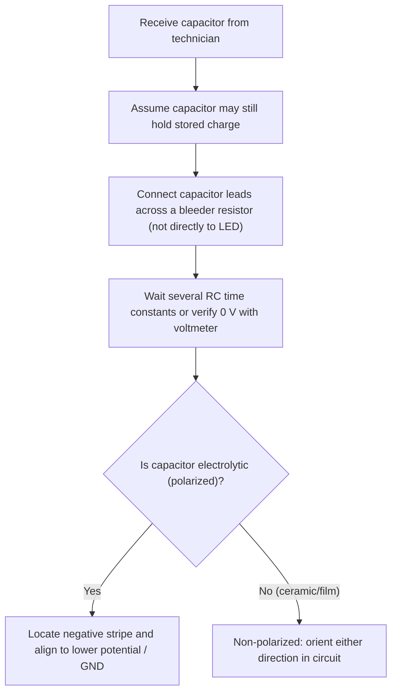

# Capacitors

> [!info] Document Metadata
> **Course:** `=this.course` | **Topic:** `=this.topic` | **Status:** `=this.status`

**Tags:** #[[Computer Science]] #[[NSETRON]] #[[Electronics]] #[[Capacitors]]

---

## Exam-Oriented Concept Summary

- **Physical Construction & Energy Storage:** A capacitor consists of two conductive metal plates separated by an insulating **dielectric** material (air, ceramic, mica, paper, plastic film, tantalum, or electrolytic oxide). It stores energy **electrostatically in an electric field** between the plates.
- **Physical Factors Governing Capacitance ($C$, Farads $\text{F}$):**
  - Directly proportional to plate overlap **surface area** ($A$).
  - Inversely proportional to **plate spacing** ($d$).
  - Directly proportional to the dielectric constant ($\varepsilon_r$) of the insulating material.
- **Series vs. Parallel Capacitors (Opposite of Resistors!):**
  - **Parallel Capacitors ($C_T = C_1 + C_2 + \dots$):** Connecting capacitors in parallel effectively adds their plate surface areas together, **increasing** total capacitance (like resistors in series). Voltage across each is identical.
  - **Series Capacitors ($1/C_T = 1/C_1 + 1/C_2 + \dots$):** Connecting capacitors in series effectively increases total dielectric spacing (in the hydraulic analogy, placing two rubber diaphragms in series stiffens opposition), **reducing** total capacitance below the smallest unit (like resistors in parallel). The **smallest capacitor dominates** total capacitance and reaches full voltage fastest.
- **RC Charging, Discharging, and Time Constant ($\tau = R C$):**
  - Charge and discharge duration are **directly proportional** to both the capacitance $C$ and the resistance $R$ in the active charge or discharge loop ($\tau = R C$).
  - A capacitor charges exponentially toward the supply voltage (reaching $63.2\%$ in $1\tau$ and $>99\%$ in $5\tau$) and discharges exponentially through whatever resistance closes its return path.
  - Because charging and discharging paths can use different resistors (as in Lab 3 Part 1), changing only the charging resistor changes only the charge time, while changing $C$ changes *both* charge and discharge times.
- **Capacitor vs. Battery & Safe Lab Handling:**
  - **Capacitors vs. Chemical Batteries:** Capacitors store charge electrostatically between physical plates, yielding **much lower energy density** and **rapid exponential discharge** compared to electrochemical batteries (e.g., a $100\ \mu\text{F}$ capacitor powers an LED for only moments, whereas a $9\text{ V}$ battery runs an entire lab session).
  - **Safety & Pre-Lab Discharge:** Capacitors can retain stored charge long after removal from a circuit (and high-voltage filter capacitors retain lethal charge after unplugging). Always **discharge a capacitor safely across a resistor** before handling or testing—never discharge directly into an LED (risk of overcurrent burnout) or blindly twist/short leads (especially for large capacities).
  - **Electrolytic Polarity & Voltage Rating:** Polarized electrolytic capacitors have a `-` stripe on the cathode; reverse connection or exceeding maximum working voltage causes heating, leakage, or explosion. Small disc/variable capacitors (pF range) charge/discharge so fast they behave like open circuits in low-speed DC LED timing tests.

---

## Key Formulas

| Formula Name | Expression | Units | When to Use |
| :--- | :--- | :--- | :--- |
| Charge-Voltage Relation | $Q = C V$ | $Q$ ($\text{C}$), $C$ ($\text{F}$), $V$ ($\text{V}$) | Finding stored electrostatic charge on capacitor plates |
| Stored Electrostatic Energy | $E = \frac{1}{2} C V^2$ | $E$ ($\text{J}$) | Computing energy stored at voltage $V$ |
| Parallel Capacitance | $C_T = C_1 + C_2 + \dots + C_n$ | $\text{F}$ (or $\mu\text{F}$, $\text{pF}$) | Capacitors connected across the same two nodes |
| Series Capacitance (General) | $\frac{1}{C_T} = \frac{1}{C_1} + \frac{1}{C_2} + \dots + \frac{1}{C_n}$ | $\text{F}$ (or $\mu\text{F}$, $\text{pF}$) | Capacitors connected head-to-tail in one chain ($C_T < C_{\min}$) |
| Two-Capacitor Series Shortcut | $C_T = \frac{C_1 C_2}{C_1 + C_2}$ | $\text{F}$ (or $\mu\text{F}$, $\text{pF}$) | Fast pen-and-paper series calculation for two capacitors |
| Equal Series Capacitors | $C_T = \frac{C}{N}$ | $\text{F}$ | $N$ identical capacitors of value $C$ wired in series |
| RC Time Constant | $\tau = R C$ | $\tau$ ($\text{s}$), $R$ ($\Omega$), $C$ ($\text{F}$) | Comparing charge/discharge speed ($1\ \text{k}\Omega \times 1\ \mu\text{F} = 1\text{ ms}$; full transient $\approx 5\tau$) |
| Capacitive Reactance | $X_C = \frac{1}{2\pi f C}$ | $X_C$ ($\Omega$), $f$ ($\text{Hz}$), $C$ ($\text{F}$) | Steady-state AC opposition (blocks DC at $f = 0\text{ Hz}$) |

---

## Worked Numerical Examples

### Example 1: Lab 3 Parts 2 & 3 — Series vs. Parallel Capacitance
In Laboratory Experiment 3, students test $C_1 = 10\ \mu\text{F}$ and $C_2 = 100\ \mu\text{F}$. Calculate the total equivalent capacitance when connected (a) in series (Part 2) and (b) in parallel (Part 3).

**Solution (a) Series (`Lab 3 Part 2`):**
1. Apply the two-capacitor series formula:
   $$C_{\text{series}} = \frac{C_1 C_2}{C_1 + C_2} = \frac{(10\ \mu\text{F})(100\ \mu\text{F})}{10\ \mu\text{F} + 100\ \mu\text{F}} = \frac{1000}{110}\ \mu\text{F} \approx 9.09\ \mu\text{F} \approx 9.1\ \mu\text{F}$$
   This matches the Lab 3 manual value ($9.1\ \mu\text{F}$). Because $9.09\ \mu\text{F} < 10\ \mu\text{F}$, the smaller $10\ \mu\text{F}$ capacitor dominates the circuit response.

**Solution (b) Parallel (`Lab 3 Part 3`):**
1. Sum the parallel capacitances directly:
   $$C_{\text{parallel}} = C_1 + C_2 = 10\ \mu\text{F} + 100\ \mu\text{F} = 110\ \mu\text{F}$$
   Because $C_{\text{parallel}}$ is larger than either individual capacitor, charging and discharging take longer.

### Example 2: Lab 3 Part 1 — Separate Charge vs. Discharge RC Time Constants
In Lab 3 Part 1, a $100\ \mu\text{F}$ capacitor charges from the $9\text{ V}$ supply through a $1\text{ k}\Omega$ resistor when the switch is closed, and discharges through a $10\text{ k}\Omega$ resistor and LED when the switch is opened. Compare the charging RC time constant $\tau_{\text{chg}}$ (through $1\text{ k}\Omega$) with the discharging RC time constant $\tau_{\text{dis}}$ (through $10\text{ k}\Omega$ neglecting LED dynamic resistance), and find the stored energy at $9\text{ V}$.

**Solution:**
1. Convert $100\ \mu\text{F} = 100 \times 10^{-6}\text{ F} = 10^{-4}\text{ F}$.
2. Charging time constant (with $1\text{ k}\Omega = 1000\ \Omega$):
   $$\tau_{\text{chg}} = R_{\text{chg}} C = (1000\ \Omega)(10^{-4}\text{ F}) = 0.10\text{ s} \quad (5\tau_{\text{chg}} = 0.50\text{ s})$$
   (With the initial $3.3\text{ k}\Omega$ resistor, $\tau_{\text{chg}} = 3300 \times 10^{-4} = 0.33\text{ s}$.)
3. Discharging time constant (with $10\text{ k}\Omega = 10,000\ \Omega$):
   $$\tau_{\text{dis}} = R_{\text{dis}} C = (10,000\ \Omega)(10^{-4}\text{ F}) = 1.00\text{ s} \quad (5\tau_{\text{dis}} = 5.0\text{ s})$$
   Because $\tau_{\text{dis}}$ is $10\times$ larger than $\tau_{\text{chg}}$, the LED takes noticeably longer to fade out than to brighten.
4. Stored electrostatic energy at $V = 9\text{ V}$:
   $$E = \frac{1}{2} C V^2 = 0.5 (10^{-4}\text{ F})(9\text{ V})^2 = 0.5 \times 10^{-4} \times 81 = 4.05 \times 10^{-3}\text{ J} = 4.05\text{ mJ}$$

---

## Laboratory Recap

### Laboratory Activity #03: Capacitors (Manual Only — No Group 8 Report in Staging)
- **Objective:** Inspect schematics directly without parts lists to observe RC charge/discharge timing, series vs. parallel capacitor behavior, and electrostatic energy storage.
- **Materials & Instruments:** $9\text{ V}$ supply, breadboard, switch, resistors ($1\text{ k}\Omega$, $3.3\text{ k}\Omega$, $10\text{ k}\Omega$), electrolytic capacitors ($100\ \mu\text{F}$, $10\ \mu\text{F}$; also ceramic disc & variable capacitors noted as too small for this DC test), LED, jumper wires.
- **Numbered Procedure:**
  1. **Part 1 (RC Timing):** Wire $9\text{ V}$ $\to$ switch $\to 3.3\text{ k}\Omega$ $\to$ node connected to $100\ \mu\text{F}$ (to GND) and $10\text{ k}\Omega$ $\to$ LED $\to$ GND. Press and release the switch several times. Swap $3.3\text{ k}\Omega \to 1\text{ k}\Omega$, then swap $100\ \mu\text{F} \to 10\ \mu\text{F}$.
  2. **Part 2 (Series Capacitors):** Connect $100\ \mu\text{F}$ and $10\ \mu\text{F}$ in series (respecting `+` and `-` polarity!) at the capacitor branch. Press/release switch and compare LED turn-on/fade speed.
  3. **Part 3 (Parallel Capacitors):** Connect $10\ \mu\text{F}$ and $100\ \mu\text{F}$ in parallel across the capacitor node to GND. Press/release switch and observe slower fade.
  4. **Part 4 (Loose-Wire Storage):** Leave one side of the $9\text{ V}$ supply and one side of the $3.3\text{ k}\Omega$-LED path open; attach a loose wire to `+` of the $100\ \mu\text{F}$ capacitor (`-` to GND). Touch the loose wire briefly to $+9\text{ V}$, isolate it in air, then touch it to the $3.3\text{ k}\Omega$ resistor lead to discharge through the LED (either continuously or in short bursts).
- **What Is Observed:** LED turn-on ramp rate and fade-out duration after releasing the switch or touching the loose wire.
- **Expected Readings or Behavior:**
  - **Part 1:** Replacing $3.3\text{ k}\Omega \to 1\text{ k}\Omega$ speeds up charging while leaving discharge through $10\text{ k}\Omega$ unchanged; replacing $100\ \mu\text{F} \to 10\ \mu\text{F}$ speeds up *both* charging and discharging.
  - **Part 2:** $100\ \mu\text{F}$ and $10\ \mu\text{F}$ in series behave like $9.1\ \mu\text{F}$ (faster than $10\ \mu\text{F}$ alone; order does not matter).
  - **Part 3:** $10\ \mu\text{F} + 100\ \mu\text{F}$ in parallel behave like $110\ \mu\text{F}$ (longest hold/fade time). Disc capacitors are too tiny (pF range) and act like open switches here.
  - **Part 4:** Loose wire charges $100\ \mu\text{F}$ nearly instantly (no series resistor except tiny wire/internal battery resistance), holds charge while floating, and lights the LED briefly on discharge; lower discharge $R$ makes a brighter/shorter flash, higher $R$ makes a dimmer/longer glow. If the loose wire fails to light the LED, charge longer or increase $C$ so stored energy exceeds the LED turn-on threshold.
- **Typical Sources of Error:** Reversed electrolytic capacitor polarity, residual prior charge before testing, loose wire touching metal rails prematurely, insufficient charging contact time in Part 4, or electrolytic tolerance (often $\pm 20\%$).
- **Conclusion Statements:** Charge/discharge times are proportional to $R$ and $C$ in the active path; series capacitors combine reciprocally (smallest dominates), parallel capacitors add directly, and capacitors store electrostatic energy transiently with far lower capacity than chemical batteries.

---

## Circuit & Procedure Diagrams

### Lab 3 Schematics (Parts 1-4)

```text
Part 1 (RC Timing):                      Part 2 (Series):       Part 3 (Parallel):
  +9V--SW--[3.3k/1k]--+--[10k]--(>| LED)--GND   +--+100uF-       +--+10uF-   +--+100uF-
                      |                            |+10uF-          |          |
                    + | 100uF (or 10uF)            v                v          v
                    - |                           GND              GND        GND
                     GND

Part 4 (Loose-Wire Energy Storage):
  +9V o (touch to charge)     (touch to discharge) o---[ 3.3k ]---(>| LED)--- GND
             ^------- [ LOOSE WIRE ] -------^
                            |
                         +  =  100uF
                         -  |
                           GND
```

### Safe Pre-Lab Capacitor Discharge & Handling Flow



---

## Exam Traps & Quick-Recall Checklist

- **Series vs. parallel inversion:** Resistors add in series and combine reciprocally in parallel; **capacitors do the exact opposite** (add in parallel, combine reciprocally in series).
- **Separate charge vs. discharge resistors (Lab 3 Part 1):** Changing the resistor between battery and capacitor changes **only charge time**; discharge time depends only on $C$ and the discharge-path resistor ($10\text{ k}\Omega$). To keep an LED lit longer after power loss, increase $C$ (e.g., $100\ \mu\text{F} \to 220\ \mu\text{F}$) or increase the discharge-path resistor.
- **Why disc capacitors "do nothing" in Lab 3:** Picofarad disc capacitors have microsecond/nanosecond $\tau$ with $\text{k}\Omega$ resistors—far too little stored energy ($E = \frac{1}{2}CV^2$) to visibly sustain an LED.
- **Pre-lab discharge method:** Discharge across a **resistor**, never directly into an LED (can overcurrent the LED) and not by twisting legs together when charged.
- **Loose-wire failure fix:** If the Part 4 loose-wire capacitor fails to light the LED, charge it longer (if a series resistor is present) or use a larger capacitor so sufficient energy is stored.

---

## Multiple Choice Questions

1. In Laboratory Experiment 3 Part 1, a $100\ \mu\text{F}$ capacitor charges through a $3.3\text{ k}\Omega$ resistor when a switch closes and discharges through a $10\text{ k}\Omega$ resistor into an LED when the switch opens. If you replace the $3.3\text{ k}\Omega$ resistor with a $1\text{ k}\Omega$ resistor, what changes?
    - **A)** Both the charging time and the discharging time become faster
    - **B)** The charging time becomes faster, while the discharging time remains unchanged
    - **C)** The discharging time becomes faster, while the charging time remains unchanged
    - **D)** Neither time changes because only capacitance determines timing

2. Which modification will make an LED remain lit for a **longer** duration after the power switch is opened in an RC discharge circuit?
    - **A)** Replace the $100\ \mu\text{F}$ capacitor with a $10\ \mu\text{F}$ capacitor
    - **B)** Lower the discharge-path resistance from $10\text{ k}\Omega$ to $1\text{ k}\Omega$
    - **C)** Replace the $100\ \mu\text{F}$ capacitor with a $220\ \mu\text{F}$ capacitor or increase the discharge-path resistance
    - **D)** Swap the electrolytic capacitor to reverse polarity

3. [MSQ] Which of the following statements accurately explain why a capacitor is not a direct substitute for a chemical battery, and how it should be handled safely before lab use? (Select all that apply)
    - **A)** Capacitors store energy electrostatically between physical plates, yielding lower energy density and rapid discharge compared to chemical batteries
    - **B)** Before use, a lab capacitor should be discharged across a resistor in case it retained stored charge from prior experiments
    - **C)** Discharging an electrolytic capacitor by connecting it directly across an LED without a resistor is recommended because LEDs limit surge current to zero
    - **D)** Reversing an electrolytic capacitor's polarity can cause it to overheat, leak, or explode

4. [INPUT] In Lab 3 Part 2, a $100\ \mu\text{F}$ capacitor and a $10\ \mu\text{F}$ capacitor are connected in **series**. What is the total equivalent capacitance in $\mu\text{F}$ (rounded to two decimal places)?

5. [INPUT] In Lab 3 Part 3, the same $10\ \mu\text{F}$ and $100\ \mu\text{F}$ capacitors are reconnected in **parallel**. What is the total equivalent capacitance in $\mu\text{F}$?

6. [INPUT] Using $\tau = R C$, compute the charging time constant $\tau$ in **seconds** when a $220\ \mu\text{F}$ capacitor charges through a $4.7\text{ k}\Omega$ resistor (round to three decimal places).

7. Why does inserting a $10\ \text{pF}$ ceramic disc capacitor in place of the $100\ \mu\text{F}$ electrolytic capacitor in Lab 3 produce no visible slow fade on the LED?
    - **A)** Ceramic disc capacitors block AC but conduct steady DC permanently
    - **B)** Its capacitance is millions of times smaller, storing negligible energy and making $\tau$ too brief for the human eye to perceive
    - **C)** Ceramic capacitors require at least $220\text{ V}$ to conduct charge
    - **D)** Ceramic capacitors are polarized and block forward current

8. In Lab 3 Part 4 (loose-wire capacitor activity), why does a student who charges the capacitor briefly still fail to light the LED if the capacitance is too small?
    - **A)** The stored energy ($E = \frac{1}{2}CV^2$) or voltage duration is insufficient to visibly turn on the LED before collapsing
    - **B)** Loose wires introduce infinite inductance that blocks DC voltage
    - **C)** The $3.3\text{ k}\Omega$ resistor converts electrical energy into magnetic flux before reaching the LED
    - **D)** The capacitor needs at least 50 charge/discharge cycles before it starts storing electrons

9. [BLANK] Complete the capacitor network comparison table below using $C_1 = 47\ \mu\text{F}$ and $C_2 = 47\ \mu\text{F}$:

| Connection Type | Net Capacitance ($\mu\text{F}$) | Governing Principle |
| :--- | :--- | :--- |
| Series | {{1}} | Effective dielectric spacing {{2}} (increases/decreases) |
| Parallel | {{3}} | Effective plate surface area {{4}} (increases/decreases) |

10. A student doubles the voltage across a $100\ \mu\text{F}$ capacitor from $5\text{ V}$ to $10\text{ V}$. By what factor does the stored electrostatic energy ($E = \frac{1}{2}CV^2$) increase?
    - **A)** $2\times$
    - **B)** $4\times$
    - **C)** $8\times$
    - **D)** Remains unchanged

### Answer Key & Explanations

1. **B)** Only the $3.3\text{ k}\Omega \to 1\text{ k}\Omega$ charging resistor changed; when the switch opens, the capacitor still discharges solely through the unchanged $10\text{ k}\Omega$ resistor and LED.
2. **C)** Discharge duration scales with $\tau_{\text{dis}} = R_{\text{dis}} C$; raising either capacitance ($100\ \mu\text{F} \to 220\ \mu\text{F}$) or discharge resistance lengthens LED illumination.
3. **A, B, D)** Capacitors hold electrostatic charge (lower energy density, rapid decay), must be safely bled through a resistor prior to use, and risk overheating/rupture if an electrolytic unit is reverse-biased. Direct connection to an LED without a limiting resistor risks excessive surge current.
4. **[9.09; 9.1; 9.09 uF; 9.1 uF]** $C_{\text{series}} = (100 \times 10)/(100 + 10) = 1000/110 \approx 9.09\ \mu\text{F}$ (quoted as $9.1\ \mu\text{F}$ in Lab 3).
5. **[110; 110.0; 110 uF]** $C_{\text{parallel}} = 10 + 100 = 110\ \mu\text{F}$.
6. **[1.034; 1.034 s; 1.03]** $\tau = R C = (4700\ \Omega)(220 \times 10^{-6}\text{ F}) = 1.034\text{ s}$.
7. **B)** At $C = 10\text{ pF} = 10^{-11}\text{ F}$ and $R = 10\text{ k}\Omega$, $\tau = 0.1\ \mu\text{s}$ and $E \approx 4.05 \times 10^{-10}\text{ J}$—too tiny and brief to register visually, acting effectively like an open switch in this DC timing circuit.
8. **A)** Insufficient stored energy means the LED either does not receive enough charge above its turn-on threshold or discharges faster than visible perception; increasing charging duration (if limited) or increasing capacitance resolves it.
9. **[1: 23.5; 2: increases; 3: 94; 4: increases]** Two equal $47\ \mu\text{F}$ capacitors in series yield $47/2 = 23.5\ \mu\text{F}$ (effective plate separation increases); in parallel they yield $47 + 47 = 94\ \mu\text{F}$ (effective plate area increases).
10. **B)** Energy is proportional to $V^2$: doubling voltage ($2V$) quadruples energy ($2^2 = 4\times$).

## References & Navigation

- **Previous Topic:** [[Resistors]]
- **Next Topic:** [[Diodes]]
- **Related Notes:** [[Basic Electricity and Electronic Components]], [[AC Circuits]], [[Written Exam Coverage and Formula Sheet]]
