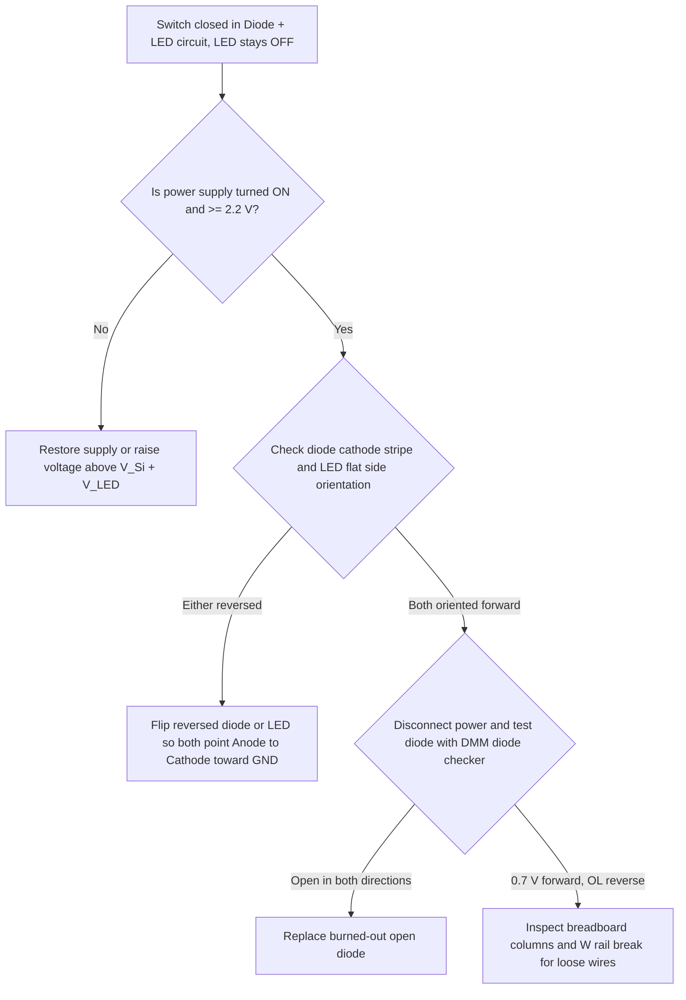

# Diodes

> [!info] Document Metadata
> **Course:** `=this.course` | **Topic:** `=this.topic` | **Status:** `=this.status`

**Tags:** #[[Computer Science]] #[[NSETRON]] #[[Electronics]] #[[Diodes]]

---

## Exam-Oriented Concept Summary

- **Semiconductor Physics & Doping:**
  - **Silicon ($\text{Si}$)** has 4 valence electrons forming covalent crystal bonds, sitting between conductors (1 valence electron, e.g., copper) and insulators. Thermal energy creates electron-hole pairs (conduction-band electrons and valence-band holes).
  - **$n$-type Doping:** Adding pentavalent impurities (e.g., **Antimony $\text{Sb}$**) supplies free conduction electrons. **Electrons** are majority carriers; holes are minority carriers.
  - **$p$-type Doping:** Adding trivalent impurities (e.g., **Boron $\text{B}$**) creates valence vacancies (holes). **Holes** are majority carriers; electrons are minority carriers.
- **P-N Junction & Barrier Potential:** Joining $p$-type and $n$-type semiconductor forms a **P-N junction**. Electrons diffuse across to fill holes near the boundary, creating negative ions on the $p$ side, positive ions on the $n$ side, and a charge-free **depletion region** whose built-in electric field establishes a **barrier potential** ($V_{\text{barrier}}$):
  - **Silicon ($\text{Si}$):** $\approx 0.7\text{ V}$
  - **Germanium ($\text{Ge}$):** $\approx 0.3\text{ V}$
  - **Gallium Arsenide ($\text{GaAs}$):** $\approx 1.2\text{ V}$ intrinsic barrier value ($\approx 1.5\text{ V}$ forward turn-on threshold for standard GaAs LEDs, rising to $2\text{ V}\text{--}3\text{ V}$ for typical visible indicator LEDs).
- **Three Bias States & Zener Region:**
  - **No Bias ($V_D = 0\text{ V}$):** Zero current ($I_D = 0\text{ A}$), modest equilibrium depletion width.
  - **Forward Bias ($+$ to Anode `A` / $p$-side, $-$ to Cathode `K` / $n$-side):** Depletion region **narrows**; once $V_S > V_{\text{barrier}}$, the diode conducts heavy forward current. Physically, the cathode is marked by a **stripe/band** on rectifier diodes (`1N400x`) or the **flat rim / shorter lead** on an LED.
  - **Reverse Bias ($-$ to Anode, $+$ to Cathode):** Depletion region **widens**; blocks current like an open switch (only tiny leakage $I_R$ flows) until reverse voltage reaches **Peak Inverse Voltage (PIV / PRV)** and enters **Zener / avalanche breakdown** ($V_Z$), where reverse current rises sharply.
  - **Hydraulic Analogy:** A diode behaves like a **one-way check valve** with a light threshold spring ($0.7\text{ V}$) allowing fluid flow in one direction only.
- **Three Diode Approximation Models:**
  1. **Ideal Model:** Forward = closed switch ($V_F = 0\text{ V}$, $R_F = 0\ \Omega$); Reverse = open switch ($I_R = 0\text{ A}$, $R_R = \infty$).
  2. **Practical Model:** Forward = closed switch + barrier voltage source ($V_F = 0.7\text{ V}$ for Si); Reverse = open switch.
  3. **Complete Model:** Forward = $V_F = 0.7\text{ V}$ + small internal bulk resistance $r_B$ ($0.1\text{--}2\ \Omega$ typical); Reverse = large finite reverse resistance $R_R$ accounting for tiny leakage current.
- **Temperature, AC Resistance, Recovery & Testing:**
  - **Temperature rise** adds thermal energy: lowers required $V_F$, increases reverse saturation current $I_R$, and raises maximum avalanche voltage. $\text{Ge}$ is more temperature-sensitive than $\text{Si}$ or $\text{GaAs}$.
  - **Dynamic AC Resistance:** $r_d = \frac{26\text{ mV}}{I_D}$ at $25^\circ\text{C}$ (plus bulk $r_B$).
  - **Diode Capacitance & Switching:** Reverse bias creates transition/depletion capacitance $C_T$; forward bias creates diffusion/storage capacitance $C_D$; **reverse recovery time ($t_{rr}$)** is the delay required to stop conducting when switched from forward to reverse bias.
  - **Testing Out-of-Circuit:** Use a DMM **diode checker** (reads $\sim 0.7\text{ V}$ Si forward, open/`OL` reverse), an **ohmmeter** on low-ohms scale (low $R$ forward, very high $R$ reverse), or a **curve tracer**.
  - **Rectification & Specialized Diodes:** Converting AC to DC via diodes is **rectification**. **Zener diodes** operate safely in reverse breakdown ($1.8\text{ V}$–$200\text{ V}$) for voltage regulation; **LEDs** emit infrared or visible photons in forward bias.

---

## Key Formulas

| Formula Name | Expression | Units | When to Use |
| :--- | :--- | :--- | :--- |
| Practical Silicon Diode Current | $I_D = \frac{V_S - V_F}{R}$ | $I_D$ ($\text{A}$), $V$ ($\text{V}$), $R$ ($\Omega$) | Series circuit with $V_F = 0.7\text{ V}$ (Si), $0.3\text{ V}$ (Ge), or $1.5\text{ V}$ (GaAs LED) |
| Ideal Diode Current | $I_D = \frac{V_S}{R}$ | $\text{A}$ | First-pass estimate ignoring $V_F$ ($V_S \gg V_F$) |
| Complete Diode Forward Current | $I_D = \frac{V_S - V_F}{R + r_B}$ | $\text{A}$ | High-precision forward check including bulk resistance $r_B$ |
| DC (Static) Resistance | $R_{DC} = \frac{V_D}{I_D}$ | $\Omega$ | Static operating point resistance on the I-V curve |
| AC (Dynamic) Resistance | $r_d \approx \frac{26\text{ mV}}{I_D} + r_B$ | $\Omega$ | Small-signal dynamic resistance in forward bias at $25^\circ\text{C}$ |
| Lab 4 Series Si Diode + LED Current | $I = \frac{V_S - V_{\text{Si}} - V_{\text{LED}}}{R}$ | $\text{A}$ | Computing forward loop current when a Si diode and LED are both in series |

---

## Worked Numerical Examples

### Example 1: Ideal vs. Practical vs. Complete Diode Model Comparison
A $9\text{ V}$ DC source supplies a series circuit containing a silicon diode ($V_F = 0.7\text{ V}$, bulk resistance $r_B = 2\ \Omega$) and a $3.3\text{ k}\Omega$ resistor (without an LED). Compute the forward current $I_D$ using (a) the ideal model, (b) the practical model, and (c) the complete model.

**Solution:**
1. **Ideal model ($V_F = 0\text{ V}$):**
   $$I_D = \frac{9\text{ V}}{3300\ \Omega} = 0.002727\text{ A} \approx 2.73\text{ mA}$$
2. **Practical model ($V_F = 0.7\text{ V}$):**
   $$I_D = \frac{9\text{ V} - 0.7\text{ V}}{3300\ \Omega} = \frac{8.3\text{ V}}{3300\ \Omega} \approx 0.002515\text{ A} \approx 2.52\text{ mA}$$
3. **Complete model ($V_F = 0.7\text{ V}$, $r_B = 2\ \Omega$):**
   $$I_D = \frac{9\text{ V} - 0.7\text{ V}}{3300\ \Omega + 2\ \Omega} = \frac{8.3\text{ V}}{3302\ \Omega} \approx 0.002514\text{ A} \approx 2.51\text{ mA}$$
   Notice that when $R \gg r_B$, the practical model matches the complete model closely and is the standard pen-and-paper exam choice.

### Example 2: Lab 4 Part 1 & Part 2 — Series Si Diode + GaAs LED & Supply Threshold Check
(a) In Laboratory Experiment 4 Part 1, a $9\text{ V}$ battery feeds a switch, a $3.3\text{ k}\Omega$ resistor, a forward-biased silicon diode ($V_F = 0.7\text{ V}$), and a forward-biased GaAs LED ($V_{\text{LED}} = 1.5\text{ V}$). Calculate the loop current and the voltage across the resistor.
(b) What happens if that same GaAs LED ($1.5\text{ V}$ turn-on) is connected forward-biased to a $1.0\text{ V}$ DC source instead of $9\text{ V}$?

**Solution:**
1. **Voltage dropped across the $3.3\text{ k}\Omega$ resistor (KVL):**
   $$V_R = V_S - V_{\text{Si}} - V_{\text{LED}} = 9\text{ V} - 0.7\text{ V} - 1.5\text{ V} = 6.8\text{ V}$$
2. **Loop current:**
   $$I = \frac{V_R}{R} = \frac{6.8\text{ V}}{3300\ \Omega} \approx 0.002061\text{ A} \approx 2.06\text{ mA}$$
   Because $9\text{ V}$ far exceeds $0.7 + 1.5 = 2.2\text{ V}$, adding the Si diode reduces the voltage across $R$ only slightly (from $7.5\text{ V}$ to $6.8\text{ V}$), so the LED still lights clearly.
3. **With a $1.0\text{ V}$ source across the $1.5\text{ V}$ GaAs LED:**
   Because $1.0\text{ V} < 1.5\text{ V}$, the external bias cannot overcome the GaAs P-N barrier potential. The LED remains **OFF** ($I \approx 0\text{ A}$).

---

## Laboratory Recap

### Laboratory Activity #04: Diodes
- **Objective:** Verify unidirectional conduction of a standard silicon rectifier diode and demonstrate directional charge/discharge indication using anti-parallel GaAs LEDs with a capacitor.
- **Materials & Instruments:** $9\text{ V}$ supply, breadboard, switch, $3.3\text{ k}\Omega$ resistor, silicon rectifier diode (with cathode band/stripe), $100\ \mu\text{F}$ electrolytic capacitor, 2 LEDs, jumper wires.
- **Numbered Procedure:**
  1. **Part 1 (Single Diode Direction Test):** Connect $+9\text{ V} \to$ switch $\to 3.3\text{ k}\Omega \to$ silicon diode (cathode stripe facing LED) $\to$ LED (flat side to GND). Close switch and observe LED.
  2. Reverse the silicon diode leads so the cathode stripe faces the $3.3\text{ k}\Omega$ resistor; close switch and observe.
  3. Restore the diode to forward bias (or remove it), then reverse the LED leads and press the switch to confirm the LED itself is a diode.
  4. **Part 2 (Anti-Parallel Dual LED Charge/Discharge Indicator):** Connect the $100\ \mu\text{F}$ capacitor (`+` lead to a loose jumper wire, `-` lead through $3.3\text{ k}\Omega$ to the parallel opposite-polarity LED pair `LED LEFT` and `LED RIGHT`, whose outer ends tie to GND).
  5. Touch the loose wire to $+9\text{ V}$ (charging) and watch which LED flashes; then touch the loose wire to GND (`0 V`, discharging) and watch which LED flashes.
- **What Is Observed:** LED ON/OFF conduction state in Part 1; bright-to-dim flash sequence alternating between Left and Right LEDs in Part 2.
- **Expected Readings or Behavior:**
  - **Part 1:** Forward-biased Si diode ($0.7\text{ V}$ drop) + forward LED lights up; reversing either the diode or the LED puts the device in reverse bias, blocking current completely (LED stays dark).
  - **Part 2:** Touching loose wire to $+9\text{ V}$ pushes charging current into `LEFT` LED (forward-biased: lights brightly then dims as $V_C \to 9\text{ V}$), while `RIGHT` LED is reverse-biased (dark). Touching loose wire to GND discharges the $100\ \mu\text{F}$ capacitor in the reverse direction through `RIGHT` LED (forward-biased: lights brightly then dims as $V_C \to 0\text{ V}$), while `LEFT` LED is reverse-biased (dark).
- **Typical Sources of Error:** Misreading the cathode stripe on the diode or flat rim on either LED, failing to connect both anti-parallel LEDs in opposite polarities, or testing with an already-charged $100\ \mu\text{F}$ capacitor.
- **Conclusion Statements:** Diodes conduct current only when forward-biased above their barrier threshold ($\approx 0.7\text{ V}$ for Si, $\approx 1.5\text{ V}$ for GaAs LEDs per Lab 4) and act as open circuits when reverse-biased, enabling directional current steering and AC-to-DC rectification.

---

## Circuit & Procedure Diagrams

### Lab 4 Part 1 & Part 2 Schematics and P-N Biasing

```circuit:lab4-diode-circuits
Bias Conditions:
  Forward:  (+)---[ p | n ]---(-)
            Depletion NARROW, conducts above V_barrier (0.7 V Si)
  Reverse:  (-)---[ p | n ]---(+)
            Depletion WIDE, blocks current (open switch)

Lab 4 Part 1 (Diode + LED Series):
  +9V ---[ SW ]---[ 3.3k ]---[ |>| Si Diode (stripe right) ]---(>| LED)--- GND

Lab 4 Part 2 (Anti-Parallel Dual LED Charge/Discharge):
  +9V o (touch to charge -> LEFT lights)
  GND o (touch to discharge -> RIGHT lights)
          ^
     [LOOSE WIRE]
          |
  + 100uF - ---[3.3k]---+---|>--- (LED LEFT: lights on CHARGE) ----+
                        |                                          +--- GND
                        +---|<--- (LED RIGHT: lights on DISCHARGE)-+
```

```simulator:rc-timing
RC timing (tau = R C):
  charge:    v_C = Vs (1 - e^(-t/RC))     63.2% at 1 tau, >99% at 5 tau
  discharge: v_C = V0 e^(-t/RC)
```

### Troubleshooting a Dark Diode + LED Series Circuit



---

## Exam Traps & Quick-Recall Checklist

- **Testing a dark series Diode + LED circuit:** If connections are tight and the switch is closed but the LED stays dark, the #1 logical troubleshooting check is whether **either the diode or the LED is inserted in reverse bias**.
- **Sub-threshold forward bias trap:** Forward-biasing a $1.5\text{ V}$ GaAs LED with only $1.0\text{ V}$ still keeps it **OFF**—forward polarity alone is insufficient without exceeding $V_{\text{barrier}}$.
- **Cathode markings:** Rectifier diode cathode (`K`) = **silver/black stripe** on package end; LED cathode = **flat edge** on rim / **shorter leg**.
- **Out-of-circuit testing:** Always remove at least one diode lead from the circuit before testing with a DMM diode checker or ohmmeter so parallel circuit paths do not spoof the reading.
- **Zener polarity trap:** Standard rectifier diodes operate forward-biased; Zener voltage regulators are intentionally connected **reverse-biased** to clamp voltage at $V_Z$.
- **Rectification terminology:** Converting AC to pulsating DC using diodes is **rectification** (NOT filtering, regulation, or transformation).

---

## Multiple Choice Questions

1. When a silicon diode ($V_F \approx 0.7\text{ V}$) is **reverse-biased** below its PIV breakdown rating in a DC circuit, how does it behave?
    - **A)** It acts as a low-resistance short circuit carrying infinite current
    - **B)** It blocks current flow and acts like an open switch
    - **C)** It amplifies current by a factor of $\beta$
    - **D)** It converts DC directly into a $60\text{ Hz}$ sine wave

2. A Gallium Arsenide (GaAs) LED requires a turn-on threshold of approximately $1.5\text{ V}$. If connected in forward bias to a $1.0\text{ V}$ battery, what will happen?
    - **A)** It will glow dimly at two-thirds brightness
    - **B)** It will remain OFF because $1.0\text{ V}$ is below the $1.5\text{ V}$ forward turn-on voltage
    - **C)** It will enter Zener breakdown and glow in reverse
    - **D)** It will short-circuit the $1.0\text{ V}$ battery

3. A student builds Lab 4 Part 1 (battery, switch, resistor, silicon diode, and LED in series), verifies all breadboard holes are tight, and closes the switch, yet the LED stays dark. What is the first logical troubleshooting step?
    - **A)** Replace the $9\text{ V}$ battery with a $1.0\text{ V}$ cell
    - **B)** Short-circuit the $3.3\text{ k}\Omega$ resistor with a jumper wire
    - **C)** Check whether either the silicon diode or the LED is inserted in reverse bias
    - **D)** Add a second switch in series to increase current

4. [MSQ] Which of the following statements accurately describe semiconductor doping and P-N junctions? (Select all that apply)
    - **A)** Doping silicon with pentavalent Antimony ($\text{Sb}$) forms an $n$-type semiconductor where electrons are majority carriers
    - **B)** Doping silicon with trivalent Boron ($\text{B}$) forms a $p$-type semiconductor where holes are majority carriers
    - **C)** Reverse bias narrows the depletion region so electrons easily cross the junction
    - **D)** In the hydraulic analogy, a diode corresponds to a one-way check valve

5. [MSQ] Which statements correctly distinguish the three diode approximation models and temperature effects? (Select all that apply)
    - **A)** The ideal model treats a forward-biased diode as $0\text{ V}$ and $0\ \Omega$
    - **B)** The practical silicon model inserts a $0.7\text{ V}$ barrier drop in forward bias
    - **C)** The complete model adds forward bulk resistance $r_B$ and a large reverse resistance for tiny reverse leakage current
    - **D)** Increasing temperature raises the forward barrier voltage required for silicon conduction

6. In Lab 4 Part 2 (loose wire connected to $100\ \mu\text{F}$ capacitor, $3.3\text{ k}\Omega$ resistor, and anti-parallel `LEFT` and `RIGHT` LEDs), what happens while touching the loose wire to **ground (`0 V`)** after previously charging the capacitor to $+9\text{ V}$?
    - **A)** `LEFT` LED lights briefly and `RIGHT` LED stays dark
    - **B)** `RIGHT` LED lights brightly at first and dims as the capacitor discharges to $0\text{ V}$, while `LEFT` LED is reverse-biased and stays dark
    - **C)** Both LEDs stay lit continuously at equal brightness
    - **D)** Neither LED lights because a capacitor cannot discharge through a resistor

7. [INPUT] Using the **practical** silicon diode model ($V_F = 0.7\text{ V}$) and Lab 4 Part 1's GaAs LED ($V_{\text{LED}} = 1.5\text{ V}$) in series with a $3.3\text{ k}\Omega$ resistor across a $9\text{ V}$ source, calculate the circuit current in **milliamperes** (rounded to two decimal places).

8. [INPUT] Using the **ideal** diode model ($V_F = 0\text{ V}$), calculate the current in **milliamperes** when a $12\text{ V}$ supply drives a forward-biased silicon diode in series with a $4.0\text{ k}\Omega$ resistor.

9. [BLANK] Complete the semiconductor diode comparison table below:

| Semiconductor Material | Approximate Forward Knee Voltage ($V_F$) | Primary Majority Carrier in $n$-type |
| :--- | :--- | :--- |
| Silicon ($\text{Si}$) | {{1}} | {{2}} |
| Germanium ($\text{Ge}$) | {{3}} | Electrons |

10. What is the correct term for converting AC voltage into pulsating DC using diodes?
    - **A)** Amplification
    - **B)** Rectification
    - **C)** Modulation
    - **D)** Filtering

### Answer Key & Explanations

1. **B)** Reverse bias pulls electrons and holes away from the P-N junction, widening the depletion region and blocking conduction (acting like an open switch below PIV).
2. **B)** Because the applied $1.0\text{ V}$ forward voltage is less than the $1.5\text{ V}$ barrier threshold, charge carriers lack sufficient energy to cross the junction and the LED remains dark.
3. **C)** Two polarized parts (the diode and the LED) sit in series; reversing either one blocks loop current completely even when all mechanical connections are solid.
4. **A, B, D)** Pentavalent $\text{Sb}$ adds free electrons ($n$-type), trivalent $\text{B}$ creates holes ($p$-type), and a diode acts like a one-way check valve. Reverse bias *widens* (not narrows) the depletion layer.
5. **A, B, C)** Ideal ($0\text{ V}$), practical ($0.7\text{ V}$), and complete ($0.7\text{ V} + r_B$ and finite $R_R$) match standard diode equivalent models; higher temperature *lowers* (reduces) the required forward bias voltage.
6. **B)** Grounding the charged capacitor reverses current direction relative to charging: `RIGHT` LED becomes forward-biased and fades out as capacitor voltage drops to zero, while `LEFT` LED becomes reverse-biased.
7. **[2.06; 2.06 mA; 2.06mA]** $I = (9 - 0.7 - 1.5) / 3300 = 6.8 / 3300 \approx 2.0606\text{ mA} \approx 2.06\text{ mA}$.
8. **[3; 3.0; 3 mA; 3.0 mA]** Under the ideal model ($V_F = 0\text{ V}$), $I = 12\text{ V} / 4000\ \Omega = 3\text{ mA}$.
9. **[1: 0.7 V/0.7V/0.7; 2: Electrons/electrons; 3: 0.3 V/0.3V/0.3]** Silicon knee voltage is $\approx 0.7\text{ V}$, Germanium is $\approx 0.3\text{ V}$, and electrons are always the majority carriers in $n$-type doped material.
10. **B)** Rectification uses diodes to pass one polarity (half-wave) or invert the negative half (full-wave) to convert AC to pulsating DC; filtering smooths ripple afterward.

## References & Navigation

- **Previous Topic:** [[Capacitors]]
- **Next Topic:** [[AC Circuits]]
- **Related Notes:** [[Basic Electricity and Electronic Components]], [[Transistors]], [[Written Exam Coverage and Formula Sheet]]
