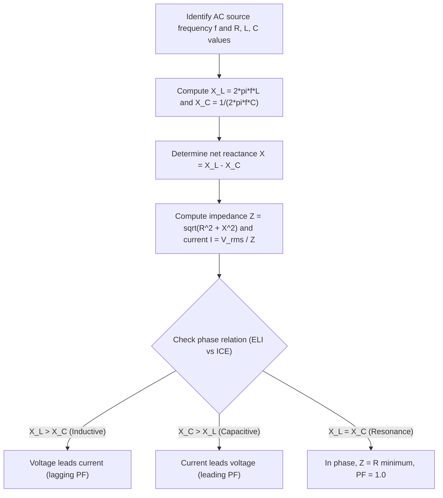

# AC Circuits

> [!info] Document Metadata
> **Course:** `=this.course` | **Topic:** `=this.topic` | **Status:** `=this.status`

**Tags:** #[[Computer Science]] #[[NSETRON]] #[[Electronics]] #[[AC Circuits]]

---

## Exam-Oriented Concept Summary

- **Why Power Grids Use AC:**
  - The decisive advantage of **AC over DC** is that **AC can be transformed** efficiently via magnetic induction in a transformer, whereas steady DC cannot.
  - Because $P = V \cdot I$, stepping AC up to high transmission voltages ($11\text{--}25\text{ kV}$ generation $\to$ transmission $\to 22\text{--}49\text{ kV}$ sub-transmission $\to 4.16\text{--}34\text{ kV}$ distribution $\to 120/240\text{ V}$ residential via pole-mounted center-tapped transformers) dramatically **lowers line current**, allowing **smaller conductors/wires**, lighter poles/towers, and lower $I^2 R$ line losses, at the tradeoff of higher insulation/safety requirements.
- **AC Sine Wave Quantities:**
  - One complete sine-wave cycle spans $360^\circ$ ($2\pi\text{ rad}$), generated by rotating loops cutting magnetic flux (fastest rate of flux cutting at $90^\circ$ and $270^\circ$ peaks; zero at $0^\circ, 180^\circ, 360^\circ$).
  - Instantaneous voltage: $e_{\text{inst}} = E_{\max} \sin\theta$.
  - Effective (**RMS**) voltage equals the DC voltage producing identical heating power: $V_{\text{rms}} = 0.707\, V_{\text{peak}}$, and $V_{\text{peak}} = 1.414\, V_{\text{rms}}$, with $V_{pp} = 2\, V_{\text{peak}}$.
- **Reactance & Phase:**
  - **Pure Resistive Circuit:** Voltage and current are **in phase** ($\phi = 0^\circ$, $\text{PF} = 1.0$). Examples: heating appliances like rice cookers, electric stoves, toasters, electric ovens, and electric kettles.
  - **Inductive Reactance ($X_L = 2\pi f L$):** Alternating magnetic fields (amplified by iron cores) oppose AC current. Memory aid (**ELI**): **E**MF (voltage) **L**eads **I** (current) by up to $90^\circ$. Examples: motors, washing machines, refrigerators, fluorescent light ballasts, air conditioners, electric fans.
  - **Capacitive Reactance ($X_C = \frac{1}{2\pi f C}$):** Opposes AC voltage changes inversely with frequency. Memory aid (**ICE**): **I** (current) leads **E**MF (voltage) by up to $90^\circ$. Examples: switching power adapters, computers, mobile gadgets, LED lights.
  - **Impedance ($Z$, Ohms $\Omega$):** Total AC opposition combining resistance and net reactance vectorially: $Z = \sqrt{R^2 + (X_L - X_C)^2}$. At **series resonance** ($X_L = X_C$), reactances cancel, $Z = R$ (minimum), and current peaks.
- **Apparent Power (VA), Real Power (W), & Power Factor:**
  - **Apparent Power ($S$, Volt-Amperes $\text{VA}$):** $S = V_{\text{rms}} I_{\text{rms}}$ -- total power capacity the utility (e.g., Meralco) must deliver through wiring and transformers.
  - **True / Real Power ($P$, Watts $\text{W}$):** Useful working power actually converted to heat/work: $P = S \cdot \text{PF} = V_{\text{rms}} I_{\text{rms}} \cos\phi$.
  - **Power Factor ($\text{PF}$):** $\text{PF} = \frac{\text{Watts}}{\text{VA}} = \cos\phi = \frac{R}{Z} \in [0, 1]$. Adding a parallel capacitor ("power saver" box) cancels lagging inductive reactance to raise $\text{PF}$ toward $1$, reducing wasted line current -- though it yields no savings on purely resistive or already-capacitive electronic loads.
- **Transformers:**
  - Ideal power conservation: $P_{\text{in}} = P_{\text{out}} \implies V_p I_p = V_s I_s$, and turns ratio $\frac{V_p}{V_s} = \frac{N_p}{N_s} = \frac{I_s}{I_p}$. Impedance transforms as $\frac{Z_p}{Z_s} = \left(\frac{N_p}{N_s}\right)^2$. At no load (secondary open/switch off), an ideal transformer draws near-zero real power (very low magnetizing PF).

---

## Key Formulas

| Formula Name | Expression | Units | When to Use |
| :--- | :--- | :--- | :--- |
| Instantaneous Sine Voltage | $e_{\text{inst}} = E_{\max} \sin\theta$ | $\text{V}$, $\theta$ ($\text{deg}$ or $\text{rad}$) | Finding sine-wave voltage at a specific rotation angle |
| RMS and Peak Conversion | $V_{\text{rms}} = 0.707\, V_{\text{peak}},\quad V_{\text{peak}} = 1.414\, V_{\text{rms}}$ | $\text{V}$ | Converting between oscilloscope peak and DMM RMS readings ($V_{pp} = 2V_{\text{peak}}$) |
| Inductive & Capacitive Reactance | $X_L = 2\pi f L,\quad X_C = \frac{1}{2\pi f C}$ | $\Omega$ | Finding reactive opposition at AC frequency $f$ |
| Series RLC Impedance & Phase | $Z = \sqrt{R^2 + (X_L - X_C)^2},\quad \phi = \arctan\!\left(\frac{X_L - X_C}{R}\right)$ | $Z$ ($\Omega$), $\phi$ ($\text{deg}$) | Computing AC Ohm's Law $I = V_{\text{rms}} / Z$ and phase angle |
| Series Resonance Frequency | $f_r = \frac{1}{2\pi\sqrt{LC}}$ | $\text{Hz}$ | Frequency where $X_L = X_C$ and $Z$ equals pure $R$ |
| Apparent Power & Real Power | $S = V_{\text{rms}} I_{\text{rms}},\quad P = S \cdot \text{PF} = V_{\text{rms}} I_{\text{rms}} \cos\phi$ | $S$ ($\text{VA}$), $P$ ($\text{W}$) | Distinguishing utility VA supply demand from real wattage |
| Power Factor | $\text{PF} = \frac{P}{S} = \frac{\text{Watts}}{\text{VA}} = \cos\phi = \frac{R}{Z}$ | dimensionless ($0$ to $1$) | Measuring how much apparent VA power does useful work |
| Ideal Transformer Ratios | $\frac{V_p}{V_s} = \frac{N_p}{N_s} = \frac{I_s}{I_p},\quad \frac{Z_p}{Z_s} = \left(\frac{N_p}{N_s}\right)^2$ | $\text{V}$, $\text{A}$, $\Omega$ | Stepping voltages/currents/impedances across primary and secondary windings |

---

## Worked Numerical Examples

### Example 1: Appliance Power Conservation, Step-Down Transformer & Power Factor
(a) A water heater is rated at $4400\text{ W}$. Calculate the current it draws if designed for $220\text{ V}$ AC vs. if designed for $110\text{ V}$ AC (imported from the US). If an ideal $220\text{ V}\text{-to-}110\text{ V}$ step-down transformer powers the $110\text{ V}$, $4400\text{ W}$ unit from a $220\text{ V}$ outlet, how much current does the transformer draw from the $220\text{ V}$ wall outlet?
(b) An inductive appliance plugs into $220\text{ VAC}$, draws $2\text{ A}$, and consumes $350\text{ W}$ of real power. Calculate its apparent power ($\text{VA}$) and power factor ($\text{PF}$).

**Solution (a):**
1. Current at $220\text{ V}$ rating vs. $110\text{ V}$ rating:
   $$I_{220\text{V}} = \frac{4400\text{ W}}{220\text{ V}} = 20\text{ A}, \quad I_{110\text{V}} = \frac{4400\text{ W}}{110\text{ V}} = 40\text{ A}$$
   Notice halving the voltage doubles the required current!
2. With an ideal $220\text{ V}\text{-to-}110\text{ V}$ transformer ($2:1$ turns ratio, rated $\ge 4400\text{ VA}$):
   $$P_{\text{in}} = P_{\text{out}} = 4400\text{ W} \implies I_{\text{primary}} = \frac{4400\text{ W}}{220\text{ V}} = 20\text{ A}$$
   The transformer draws $20\text{ A}$ at $220\text{ V}$ and supplies $40\text{ A}$ at $110\text{ V}$. When the water heater switch is OFF, ideal power drawn drops to $0\text{ W}$.

**Solution (b):**
1. Apparent power (VA):
   $$S = V_{\text{rms}} \cdot I_{\text{rms}} = 220\text{ V} \times 2\text{ A} = 440\text{ VA}$$
2. Power factor:
   $$\text{PF} = \frac{P}{S} = \frac{350\text{ W}}{440\text{ VA}} \approx 0.7955 \approx 0.80$$

### Example 2: Instantaneous Sine Voltage, RMS/Peak Conversion, & Series RLC Impedance
(a) A sine wave has an RMS voltage of $117\text{ V}$. Calculate its peak voltage $V_{\text{peak}}$, peak-to-peak voltage $V_{pp}$, and instantaneous voltage at rotation angle $\theta = 30^\circ$ (rounded to one decimal place).
(b) A series AC circuit contains $R = 50\ \Omega$, $X_L = 22\ \Omega$, and $X_C = 33\ \Omega$ across $V_{\text{rms}} = 100\text{ V}$. Find total impedance magnitude $Z$, total current $I_{\text{rms}}$, and power factor.

**Solution (a):**
1. Peak and peak-to-peak voltages:
   $$V_{\text{peak}} = 1.414 \times 117\text{ V} \approx 165.4\text{ V} \quad (\approx 165\text{ V}), \quad V_{pp} = 2 \times 165.4\text{ V} \approx 330.9\text{ V}$$
2. Instantaneous voltage at $\theta = 30^\circ$:
   $$e_{\text{inst}} = V_{\text{peak}} \sin 30^\circ = 165.44\text{ V} \times 0.500 = 82.7\text{ V}$$
   (Similarly, for a $100\text{ V}$ peak sine wave at $\theta = 60^\circ$: $100 \sin 60^\circ = 86.6\text{ V}$.)

**Solution (b):**
1. Net reactance $X = X_L - X_C = 22\ \Omega - 33\ \Omega = -11\ \Omega$ (net capacitive).
2. Impedance magnitude:
   $$Z = \sqrt{R^2 + X^2} = \sqrt{50^2 + (-11)^2} = \sqrt{2500 + 121} = \sqrt{2621} \approx 51.20\ \Omega$$
3. Current and power factor:
   $$I_{\text{rms}} = \frac{100\text{ V}}{51.20\ \Omega} \approx 1.95\text{ A}, \quad \text{PF} = \frac{R}{Z} = \frac{50}{51.20} \approx 0.977$$

---

## Power Supply Circuit Application (Reference Context)

- **Linear Power Supply Application (`220 V AC` to `+5 V DC`):** Converting AC mains to regulated $+5\text{ V DC}$ illustrates AC transformation, full-wave bridge rectification, and capacitive filtering in practice:
  - **Objective:** Convert $220\text{ V AC}$ mains to regulated $5\text{ V DC}$ on a breadboard and verify stability with a multimeter and ripple with an oscilloscope.
  - **Key Components:** Step-down transformer ($220\text{ V} \to 12\text{ V AC}$), $4\times$ `1N4001` or `1N4007` rectifier diodes in a **full-wave bridge**, $2\times 470\ \mu\text{F}$ ($25\text{ V}$) electrolytic capacitors in parallel ($940\ \mu\text{F}$ total filter), `7805` 3-terminal $+5\text{ V}$ voltage regulator, $1\text{ k}\Omega$ resistor + indicator LED.
  - **Expected Behavior:** The transformer steps down AC; the 4-diode bridge creates $120\text{ Hz}$ pulsating DC (from $60\text{ Hz}$ input, twice as easy to filter as $60\text{ Hz}$ half-wave); parallel capacitors hold voltage near peak ($\sim 1.414 \times 12\text{ V} - 1.4\text{ V}$) to shrink ripple; the `7805` clamps output to a flat $5\text{ V DC}$.

---

## Circuit & Procedure Diagrams

### Full-Wave Bridge Power Supply Stages (Supporting AC-to-DC Architecture)

```simulator:rectifier-supply
  220V AC (60 Hz)
     |
  [ Step-Down Tx ]            -> 12V AC RMS
     |
  [ 4-Diode Bridge ]          -> 120 Hz pulsating
     |
  [ 2x 470uF || (940uF) ]     -> smoothed DC with ripple
     |
  [ 7805 Reg ]                -> steady +5V DC    [1k + LED]
```

### AC Circuit Analysis & Power Factor Flow



---

## Exam Traps & Quick-Recall Checklist

- **RMS vs. Peak trap:** Wall outlets ($117\text{ V}$, $120\text{ V}$, $220\text{ V}$) are **RMS**, NOT peak! A $117\text{ V}$ RMS sine wave peaks at $\pm 165\text{ V}$ ($330\text{ V}_{pp}$); a $220\text{ V}$ RMS wave peaks at $\pm 311\text{ V}$.
- **Apparent Power ($\text{VA}$) vs. True Power ($\text{W}$):** Utilities size wires and transformers for **VA** ($V \cdot I$), while heaters convert **Watts**. Always remember $\text{PF} = \text{Watts}/\text{VA} \le 1.0$.
- **ELI the ICE man:** Inductive (**L**): **E** leads **I** (motors, ballasts, compressors); Capacitive (**C**): **I** leads **E** (electronic adapters, LED drivers); Resistive: in phase, $\text{PF} = 1.0$ (heaters, toasters, kettles).
- **Turns ratio direction check:** Verify whether a problem gives $N_p:N_s$ or $N_s:N_p$ before multiplying/dividing voltage; remember voltage scales directly with turns while current scales inversely ($V_p I_p = V_s I_s$).
- **Full-wave vs. half-wave ripple frequency:** Full-wave rectification on $60\text{ Hz}$ mains yields **$120\text{ Hz}$** ripple (recharges filter capacitors twice per cycle), whereas half-wave yields **$60\text{ Hz}$** ripple.

---

## Multiple Choice Questions

1. Why do electrical power grids transmit AC at very high voltages across long distances before stepping voltage down near homes?
    - **A)** DC travels slower than AC through copper wire
    - **B)** AC can be stepped up by transformers so higher voltage carries the same power at lower current, allowing smaller wires and lower $I^2 R$ losses
    - **C)** High voltage increases wire resistance to prevent short circuits
    - **D)** Transformers only operate when frequency exceeds $1\text{ MHz}$

2. A purely resistive heating appliance (such as an electric kettle or rice cooker) runs on $220\text{ VAC}$. What are the phase relationship between voltage and current and its approximate power factor?
    - **A)** Voltage leads current by $90^\circ$; $\text{PF} = 0$
    - **B)** Current leads voltage by $90^\circ$; $\text{PF} = 0.5$
    - **C)** Voltage and current are in phase; $\text{PF} = 1.0$
    - **D)** Voltage leads current by $45^\circ$; $\text{PF} = 0.707$

3. [MSQ] Based on AC reactive load classification, which of the following household appliances represent predominantly **inductive** loads where voltage leads current (ELI)? (Select all that apply)
    - **A)** Washing machine and refrigerator motors
    - **B)** Fluorescent lights with magnetic ballasts
    - **C)** Electric toaster and rice cooker
    - **D)** Air conditioner and electric fan

4. [MSQ] Which of the following statements accurately describe AC sine-wave measurements and rectifier ripple? (Select all that apply)
    - **A)** $V_{\text{rms}} = 0.707\, V_{\text{peak}}$ and $V_{\text{peak}} = 1.414\, V_{\text{rms}}$
    - **B)** Instantaneous sine voltage at rotation angle $\theta$ is $E_{\max} \sin\theta$
    - **C)** A full-wave rectifier fed by $60\text{ Hz}$ AC produces a $60\text{ Hz}$ ripple frequency
    - **D)** A full-wave rectifier fed by $60\text{ Hz}$ AC produces a $120\text{ Hz}$ ripple frequency

5. [INPUT] An electric appliance operates on $220\text{ V}$ AC, draws $2.5\text{ A}$, and produces $440\text{ W}$ of real useful power. Calculate its power factor ($\text{PF}$) as a decimal rounded to two decimal places.

6. [INPUT] A $4400\text{ W}$ imported water heater designed for $110\text{ V}$ AC is powered through an ideal $220\text{ V}\text{-to-}110\text{ V}$ step-down transformer plugged into a $220\text{ V}$ outlet. What current (in amperes) does the **transformer primary** draw from the $220\text{ V}$ wall outlet?

7. [INPUT] A series AC circuit consists of $R = 30\ \Omega$, $X_L = 50\ \Omega$, and $X_C = 10\ \Omega$. Calculate the total impedance magnitude $Z$ in ohms.

8. If an ideal step-down transformer has a primary-to-secondary turns ratio of $9:1$ and $117\text{ V}_{\text{rms}}$ is applied to the primary, what is the secondary RMS voltage?
    - **A)** $13\text{ V}$
    - **B)** $1053\text{ V}$
    - **C)** $58.5\text{ V}$
    - **D)** $26\text{ V}$

9. [BLANK] Complete the AC load classification table below:

| Load Type | Phase Mnemonic | Power Factor Behavior | Representative Example |
| :--- | :--- | :--- | :--- |
| Inductive | {{1}} | Voltage leads current | Electric motor / fridge |
| Capacitive | {{2}} | Current leads voltage | Switching power adapter |
| Pure Resistive | In phase | $\text{PF} = $ {{3}} | Rice cooker / toaster |

10. What condition defines **series resonance** in a series RLC circuit?
    - **A)** $R = X_L + X_C$
    - **B)** $X_L = X_C$, causing reactive voltages to cancel and total impedance to drop to its minimum value $Z = R$
    - **C)** Apparent power equals zero while reactive power peaks
    - **D)** The capacitor behaves as an open circuit and current stops flowing

### Answer Key & Explanations

1. **B)** Because AC voltage can be raised/lowered via transformers, high-voltage transmission slashes current ($I = P/V$) for the same power, allowing thinner conductors and smaller $I^2 R$ line losses.
2. **C)** Purely resistive heating elements have zero reactance ($X = 0$), keeping voltage and current completely in phase ($\phi = 0^\circ$, $\text{PF} = \cos 0^\circ = 1.0$).
3. **A, B, D)** Motor-driven appliances (washing machines, fridges, fans, air conditioners) and inductive fluorescent ballasts store energy in magnetic coils and lag current behind voltage (**ELI**). Toasters and rice cookers are resistive heating elements.
4. **A, B, D)** $V_{\text{rms}} = 0.707\, V_{\text{peak}}$, $V_{\text{peak}} = 1.414\, V_{\text{rms}}$, $e_{\text{inst}} = E_{\max}\sin\theta$, and full-wave rectification folds both half-cycles positive, doubling $60\text{ Hz}$ mains frequency to $120\text{ Hz}$ ripple.
5. **[0.8; 0.80]** Apparent power $S = 220\text{ V} \times 2.5\text{ A} = 550\text{ VA}$. Power factor $\text{PF} = P / S = 440 / 550 = 0.80$.
6. **[20; 20.0; 20 A; 20A]** Assuming an ideal transformer ($P_{\text{in}} = P_{\text{out}} = 4400\text{ W}$), primary current at $220\text{ V}$ is $I_p = 4400\text{ W} / 220\text{ V} = 20\text{ A}$ (while secondary delivers $40\text{ A}$ at $110\text{ V}$).
7. **[50; 50.0; 50 ohm; 50 ohms]** Net reactance $X = X_L - X_C = 50 - 10 = 40\ \Omega$. Total impedance $Z = \sqrt{30^2 + 40^2} = \sqrt{900 + 1600} = \sqrt{2500} = 50\ \Omega$.
8. **A)** With $N_p : N_s = 9 : 1$, $V_s = V_p \times (1/9) = 117 / 9 = 13\text{ V}_{\text{rms}}$.
9. **[1: ELI; 2: ICE; 3: 1/1.0]** **ELI** denotes EMF leading Current in inductors; **ICE** denotes Current leading EMF in capacitors; purely resistive loads operate at unity power factor ($\text{PF} = 1.0$).
10. **B)** Resonance occurs at $f_r = 1/(2\pi\sqrt{LC})$ when inductive reactance equals capacitive reactance ($X_L = X_C$), leaving only $R$ in the denominator of $I = V/Z$.

## References & Navigation

- **Previous Topic:** [[Diodes]]
- **Next Topic:** [[Transistors]]
- **Related Notes:** [[Capacitors]], [[Ampacity and Wiring]], [[Written Exam Coverage and Formula Sheet]]
