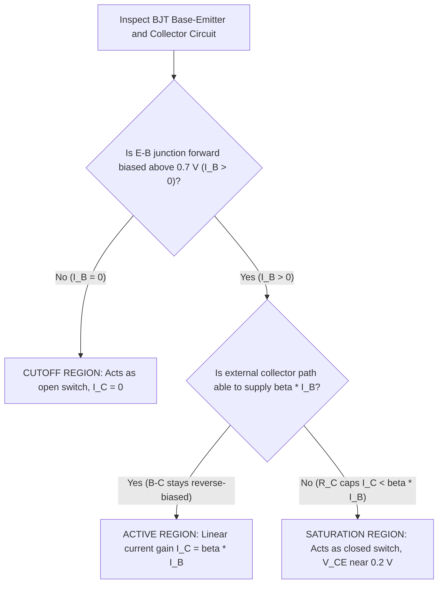

# Transistors

> [!info] Document Metadata
> **Course:** `=this.course` | **Topic:** `=this.topic` | **Status:** `=this.status`

**Tags:** #[[Computer Science]] #[[NSETRON]] #[[Electronics]] #[[Transistors]]

---

## Exam-Oriented Concept Summary

- **Bipolar Junction Transistor (BJT) Structure:**
  - A BJT is a 3-terminal, 2-junction semiconductor device (**Base `B`**, **Collector `C`**, **Emitter `E`**) built either as **NPN** (thin $p$-type base sandwiched between $n$-type emitter and collector) or **PNP** (thin $n$-type base between $p$-type emitter and collector).
  - **Schematic Symbol Rule:** Look at the **emitter arrow**: **NPN** points **outward** (*Not Pointing iN*); **PNP** points **inward** (*Pointing iN Proudly*).
  - **Why Two Discrete Diodes Cannot Make a Working Transistor:** Although a BJT is often *modeled* conceptually as two opposing P-N junctions (E-B and B-C), wiring two separate packaged diodes back-to-back cannot produce transistor current gain because real BJT action requires one continuous crystal with an **extremely thin, lightly doped base layer** so carriers injected from the emitter sweep across into the reverse-biased collector instead of recombining.
- **Three Regions of Operation:**
  1. **Cutoff Region:** Base-emitter junction is zero-biased or reverse-biased ($V_{BE} < 0.7\text{ V}$ for Si, $I_B = 0\text{ A}$). Collector current $I_C \approx 0\text{ A}$; the transistor acts as an **open electronic switch** (Lab 5 Part 1 with switch open).
  2. **Active (Linear) Region:** Base-emitter is forward-biased ($\approx 0.7\text{ V}$ Si) while base-collector is reverse-biased. Small changes in $I_B$ control proportionally large changes in $I_C = \beta I_B$ ($H_{FE} = I_C / I_B$, typically $10$ to $1000$). Used for analog **current/signal amplification** (Lab 5 Part 2: bright collector LED vs. dim base LED). Overdriving an amplifier pushes it toward cutoff/saturation, causing nonlinear distortion.
  3. **Saturation Region:** Both E-B and B-C junctions are forward-biased; the transistor conducts as much current as the **external supply voltage and circuit resistors permit** ($V_{CE} \approx 0\text{--}0.2\text{ V}$), acting as a **closed switch**. As shown in Lab 5 Part 2, replacing the $1\text{ k}\Omega$ collector resistor with $33\text{ k}\Omega$ caps $I_C$ externally so apparent circuit gain drops to $\sim 3$, forcing **saturation**.
- **Diode-Connected Transistor (Base Shorted to Collector):**
  - Shorting the **Base and Collector together** leaves only the Base-Emitter P-N junction active. Once forward voltage exceeds $\sim 0.7\text{ V}$, it conducts in one direction with **no current gain**—functioning exactly as a single silicon diode (used in IC manufacturing where fabricating transistors is uniform).
- **Three Basic BJT Amplifier Configurations:**
  - **Common Emitter (CE):** Emitter at AC ground; input at Base, output at Collector. **Highest gain**, **$180^\circ$ phase inversion**.
  - **Common Base (CB):** Base at AC ground; input at Emitter, output at Collector. **In phase** ($0^\circ$), lower gain, high stability for RF amplifiers.
  - **Common Collector (CC / Emitter Follower):** Collector at AC ground; input at Base, output at Emitter. **In phase** ($0^\circ$), **high input impedance, low output impedance** (used for broadband impedance matching).

---

## Key Formulas

| Formula Name | Expression | Units | When to Use |
| :--- | :--- | :--- | :--- |
| Emitter Current (KCL) | $I_E = I_C + I_B$ | $\text{A}$ (or $\text{mA}$) | Relating all three BJT terminal currents ($I_E \approx I_C$ when $\beta$ is large) |
| DC Current Gain ($\beta$ or $H_{FE}$) | $\beta = H_{FE} = \frac{I_C}{I_B}$ | dimensionless | Computing collector current from base current in the active region (range $10\text{--}1000$) |
| Dynamic Current Amplification | $\beta_{\text{ac}} = \frac{\Delta I_C}{\Delta I_B}$ | dimensionless | Small-signal slope along the linear active transfer curve |
| Lab 5 Part 1 / 2 Base Current | $I_B = \frac{V_S - V_{BE} - V_{\text{LED,base}}}{R_B}$ | $\text{A}$ (or $\text{mA}$) | Calculating base drive current ($V_{\text{LED,base}} = 0$ if no LED is in base path) |
| Collector Saturation Limit | $I_{C,\text{sat}} \approx \frac{V_S - V_{\text{LED}} - V_{CE,\text{sat}}}{R_C}$ | $\text{A}$ (or $\text{mA}$) | Checking whether external collector resistance limits $I_C < \beta I_B$ (saturation) |

---

## Worked Numerical Examples

### Example 1: Active-Region Current Gain ($H_{FE}$ / $\beta$) Calculation
(a) A BJT draws a base current of $I_B = 0.5\text{ mA}$ and produces a collector current of $I_C = 35\text{ mA}$. Calculate its static forward current gain $H_{FE}$ ($\beta$) and its emitter current $I_E$.
(b) In Lab 5 Part 1, a $9\text{ V}$ battery feeds a closed switch and a $10\text{ k}\Omega$ base resistor into an NPN silicon BJT ($V_{BE} = 0.7\text{ V}$), while the collector drives a $1\text{ k}\Omega$ resistor and LED ($V_{\text{LED}} = 1.5\text{ V}$). Estimate $I_B$ and verify whether a transistor with $\beta = 100$ enters saturation (assuming $V_{CE,\text{sat}} \approx 0.2\text{ V}$).

**Solution (a):**
1. Static current gain:
   $$H_{FE} = \frac{I_C}{I_B} = \frac{35\text{ mA}}{0.5\text{ mA}} = 70$$
2. Emitter current:
   $$I_E = I_C + I_B = 35\text{ mA} + 0.5\text{ mA} = 35.5\text{ mA}$$

**Solution (b):**
1. Base current when switch is closed:
   $$I_B = \frac{9\text{ V} - 0.7\text{ V}}{10,000\ \Omega} = \frac{8.3\text{ V}}{10,000\ \Omega} = 0.83\text{ mA}$$
2. Unconstrained active collector current if $\beta = 100$: $\beta I_B = 100 \times 0.83\text{ mA} = 83\text{ mA}$.
3. Maximum collector current allowed by the external collector circuit ($R_C = 1\text{ k}\Omega$, $V_{\text{LED}} = 1.5\text{ V}$, $V_{CE,\text{sat}} \approx 0.2\text{ V}$):
   $$I_{C,\text{sat}} = \frac{9\text{ V} - 1.5\text{ V} - 0.2\text{ V}}{1000\ \Omega} = \frac{7.3\text{ V}}{1000\ \Omega} = 7.3\text{ mA}$$
   Because $7.3\text{ mA} < 83\text{ mA}$, the transistor saturates cleanly and switches the collector LED fully ON!

### Example 2: Lab 5 Part 2 — Saturation & Effective Gain Drop (`1k` vs. `33k` Collector Resistor)
In Lab 5 Part 2, a $9\text{ V}$ supply closes a switch to two parallel LED paths entering an NPN transistor: the Base path has $R_B = 100\text{ k}\Omega$ in series with $\text{LED}_{\text{left}}$ ($V_{\text{LED}} = 1.5\text{ V}$, $V_{BE} = 0.7\text{ V}$); the Collector path has $R_C$ in series with $\text{LED}_{\text{right}}$ ($V_{\text{LED}} = 1.5\text{ V}$, $V_{CE,\text{sat}} \approx 0.2\text{ V}$). Compare $I_B$ with $I_{C,\text{sat}}$ and the resulting effective circuit gain $I_C / I_B$ when (a) $R_C = 1\text{ k}\Omega$ and (b) $R_C = 33\text{ k}\Omega$.

**Solution:**
1. Base current through $\text{LED}_{\text{left}}$ and $100\text{ k}\Omega$:
   $$I_B = \frac{9\text{ V} - 1.5\text{ V} - 0.7\text{ V}}{100,000\ \Omega} = \frac{6.8\text{ V}}{100,000\ \Omega} = 0.068\text{ mA} = 68\ \mu\text{A}$$
2. Case (a) $R_C = 1\text{ k}\Omega$:
   $$I_{C,\text{sat}} = \frac{9\text{ V} - 1.5\text{ V} - 0.2\text{ V}}{1000\ \Omega} = 7.3\text{ mA}$$
   Effective circuit ratio $I_C / I_B = 7.3\text{ mA} / 0.068\text{ mA} \approx 107$ (if $\beta > 107$, transistor saturates at $7.3\text{ mA}$ and $\text{LED}_{\text{right}}$ is dramatically brighter than $\text{LED}_{\text{left}}$).
3. Case (b) $R_C = 33\text{ k}\Omega$:
   $$I_{C,\text{sat}} = \frac{7.3\text{ V}}{33,000\ \Omega} \approx 0.221\text{ mA}$$
   Effective circuit gain drops to:
   $$\frac{I_C}{I_B} = \frac{0.221\text{ mA}}{0.068\text{ mA}} \approx 3.25 \approx 3$$
   This matches the saturation behavior observed in Lab 5 (`1 kOhm -> 33 kOhm` drops current gain to roughly `3`).

---

## Laboratory Recap

### Laboratory Activity #05: Transistors
- **Objective:** Demonstrate BJT operation as an electronic switch (cutoff vs. saturation), current amplification ($\beta$) and external-resistance saturation, and diode-connected BJT behavior.
- **Materials & Instruments:** $9\text{ V}$ supply, breadboard, pushbutton switch, NPN BJT transistor (observe flat housing side for E-B-C pinout), resistors ($1\text{ k}\Omega$, $3.3\text{ k}\Omega$, $10\text{ k}\Omega$, $33\text{ k}\Omega$, $100\text{ k}\Omega$), 2 LEDs, jumper wires.
- **Numbered Procedure:**
  1. **Part 1 (Electronic Switch):** Connect $+9\text{ V}$ through $1\text{ k}\Omega$ and an LED (flat side toward transistor) into Collector `C`, Emitter `E` to GND, and $+9\text{ V}$ through the pushbutton switch and $10\text{ k}\Omega$ resistor into Base `B`. Observe LED with switch open vs. pressed.
  2. **Part 2 (Current Gain & Saturation):** Place the switch directly after $+9\text{ V}$ feeding two branches: Base branch (`100k` $\to \text{LED}_{\text{left}} \to B$) and Collector branch (`1k` $\to \text{LED}_{\text{right}} \to C$, $E \to \text{GND}$). Press switch and compare brightness of the two LEDs; optionally replace `1k` with `33k` to observe current-limited saturation (gain $\approx 3$).
  3. **Part 3 (Diode-Connected Transistor):** Wire a jumper directly shorting Base `B` and Collector `C` together (`+9V` $\to$ switch $\to (B+C)$, then $E \to 3.3\text{ k}\Omega \to \text{LED} \to \text{GND}$). Press the switch and observe LED conduction.
- **What Is Observed:** LED ON/OFF switching in Part 1, Base LED vs. Collector LED brightness ratio in Part 2, and one-way diode conduction in Part 3.
- **Expected Readings or Behavior:**
  - **Part 1:** Switch open $\to I_B = 0$, LED stays dark even though collector loop is wired to $9\text{ V}$ (cutoff / open switch). Switch closed $\to I_B$ flows, turning on large $I_C$ so LED lights brightly.
  - **Part 2:** Collector LED (`right`) glows far brighter than Base LED (`left`) because small base current is amplified into large collector current ($I_C \gg I_B$). Swapping $1\text{ k}\Omega \to 33\text{ k}\Omega$ externally restricts collector current to $\sim 3\times I_B$ (saturation).
  - **Part 3:** Shorting B and C eliminates current amplification and turns the transistor into a single silicon diode ($0.7\text{ V}$ threshold), lighting the emitter LED cleanly.
- **Typical Sources of Error:** Misidentifying flat-side pinout (reversing E and C destroys gain or prevents turn-on), inserting all three BJT legs into the same 5-hole column, or reversing LED cathode orientation.
- **Conclusion Statements:** A BJT operates as a voltage/current-controlled switch (cutoff vs. saturation) or linear current amplifier ($I_C = \beta I_B$), saturates when external circuit resistances cap $I_C$ below $\beta I_B$, and behaves as a diode when Base and Collector are tied together.

---

## Circuit & Procedure Diagrams

### Lab 5 Schematics (Parts 1, 2, and 3)

```text
Part 1 (Electronic Switch):            Part 2 (Amplifier / Gain & Saturation):
  +9V ---+---[ 1k ]---(>| LED)---+       +9V ---[ SW ]---+---[ 100k ]---(>| LED_L)---+
         |                       | C                     |                           | B
         +--[ SW ]--[ 10k ]--+--B| NPN                   +---[ 1k (or 33k) ]--|>|----+ C
                                 | E                                          LED_R  | NPN
                                GND                                                  | E
                                                                                    GND

Part 3 (Base-Collector Shorted = Diode Mode):
          +------+
          |      | C
  +9V--SW-+---B--| NPN
                 | E
                 +---[ 3.3k ]---(>| LED)--- GND
```

### BJT Operating Region Decision Flow



---

## Exam Traps & Quick-Recall Checklist

- **Lab 5 Part 1 vs. Part 2 Behavior:**
  - **Part 1 (No base current $\implies$ LED dark):** Transistor acts as an **open electronic switch** (cutoff), blocking collector current because $I_B = 0$.
  - **Part 2 (Collector LED brighter than Base LED):** Demonstrates **current amplification (gain)** where small base current controls much larger collector current.
- **Saturation cause trap:** Saturation does **not** mean $\beta$ became infinite—it means external supply voltage and collector resistance $R_C$ limit $I_C$ below $\beta I_B$, flattening $I_C$ against further $I_B$ increases (e.g., swapping $1\text{ k}\Omega \to 33\text{ k}\Omega$ drops effective gain to $\sim 3$).
- **NPN vs. PNP arrow:** Arrow **out** = **NPN**; arrow **in** = **PNP** (all bias polarities reversed).
- **Diode-connected BJT (B tied to C):** Acts like a single $0.7\text{ V}$ **diode** with **no current gain**; conversely, wiring two discrete diodes together **cannot** build a working transistor because they lack a single thin shared base crystal.
- **Common Emitter phase:** Common Emitter provides maximum gain and **$180^\circ$ phase inversion**; Common Collector (Emitter Follower) provides **high $Z_{\text{in}}$, low $Z_{\text{out}}$**, and $0^\circ$ phase shift for impedance matching.

---

## Multiple Choice Questions

1. In Laboratory Experiment 5 Part 1, a $9\text{ V}$ battery is connected across a collector resistor, an LED, and the collector-emitter path of an NPN BJT. When the base switch is open ($I_B = 0$), the LED stays dark. What role is the transistor performing?
    - **A)** A voltage regulator clamping the supply at $0.7\text{ V}$
    - **B)** An open electronic switch blocking collector current because base current is zero
    - **C)** A reverse-biased Zener diode
    - **D)** A full-wave rectifier converting DC to AC

2. In Laboratory Experiment 5 Part 2, a student observes that the LED in the **collector** path glows significantly brighter than the LED in the **base** path. Which fundamental transistor property is demonstrated?
    - **A)** Voltage division across equal parallel resistors
    - **B)** Current amplification (gain), where a small base current controls a much larger collector current
    - **C)** Capacitive energy storage between emitter and base
    - **D)** Thermal runaway due to negative resistance

3. What happens in Laboratory Experiment 5 Part 3 when the Base (`B`) and Collector (`C`) terminals of an NPN transistor are wired directly together?
    - **A)** The transistor explodes from an internal collector-to-emitter short
    - **B)** Current gain $\beta$ doubles to amplify emitter current
    - **C)** The transistor behaves like a single diode with a $\approx 0.7\text{ V}$ forward drop and no current gain
    - **D)** The transistor enters permanent cutoff and blocks all forward current

4. [MSQ] Which of the following statements accurately explain BJT structure, operating regions, and the two-diode misconception? (Select all that apply)
    - **A)** In an NPN schematic symbol, the emitter arrow points outward
    - **B)** Combining two discrete packaged diodes back-to-back cannot create a working transistor because transistor gain requires an ultra-thin shared base region in one crystal
    - **C)** In the saturation region, external circuit resistances and supply voltage limit collector current rather than the transistor's internal $\beta$
    - **D)** A Common Emitter amplifier keeps its output signal $0^\circ$ in phase with its input

5. [MSQ] Which of the following match the three BJT amplifier configurations correctly? (Select all that apply)
    - **A)** Common Emitter: highest gain and $180^\circ$ phase inversion
    - **B)** Common Collector (Emitter Follower): high input impedance and low output impedance for impedance matching
    - **C)** Common Base: input at emitter, output at collector, in-phase with stable RF operation
    - **D)** Common Base: highest current gain and $180^\circ$ phase shift

6. In Lab 5 Part 2, replacing the $1\text{ k}\Omega$ collector resistor with a $33\text{ k}\Omega$ resistor reduces the effective circuit current gain to roughly $3$. Which operating region is the transistor pushed into?
    - **A)** Cutoff
    - **B)** Reverse breakdown
    - **C)** Saturation
    - **D)** Open-loop oscillation

7. [INPUT] A bipolar transistor in the active region has a base current of $I_B = 0.25\text{ mA}$ and a collector current of $I_C = 30\text{ mA}$. Calculate its static forward current gain $H_{FE}$ ($\beta$).

8. [INPUT] Given $I_B = 0.5\text{ mA}$ and $I_C = 35\text{ mA}$, calculate the total **emitter current** $I_E$ in milliamperes ($\text{mA}$).

9. [BLANK] Complete the BJT operating-region table below:

| Operating Region | E-B Junction Bias | B-C Junction Bias | Switch / Amplifier Behavior |
| :--- | :--- | :--- | :--- |
| Cutoff | Reverse / Zero | Reverse | {{1}} switch ($I_C \approx 0$) |
| Active | {{2}} | Reverse | Linear current amplifier ($I_C = \beta I_B$) |
| Saturation | Forward | {{3}} | Closed switch ($I_C$ limited by external $R_C$) |

10. When an AC input signal to a BJT amplifier is made too strong, driving the transistor into saturation and cutoff during portions of the cycle, what unwanted effect occurs?
    - **A)** Resonance cancellation
    - **B)** Overdrive, causing nonlinear waveform distortion and potential overheating
    - **C)** Automatic conversion from NPN to PNP operation
    - **D)** Infinite input impedance

### Answer Key & Explanations

1. **B)** With zero base current ($I_B = 0$), the E-B junction is off (cutoff), blocking C-E conduction just like an open switch.
2. **B)** Even a tiny base current ($I_B \approx 68\ \mu\text{A}$) controls a much larger collector current ($I_C$), making the collector LED visibly much brighter than the base LED.
3. **C)** Shorting Base to Collector leaves only the forward-biased Base-Emitter P-N junction ($V_{BE} \approx 0.7\text{ V}$), removing transistor action so it acts identically to a diode.
4. **A, B, C)** NPN arrow points outward; discrete diodes lack the thin shared base crystal needed for carrier injection across to the collector; saturation occurs when external $R_C$ caps $I_C < \beta I_B$. Common Emitter inverts output by $180^\circ$.
5. **A, B, C)** CE gives highest gain + $180^\circ$ inversion; CC (emitter follower) matches high $Z_{\text{in}}$ to low $Z_{\text{out}}$ in phase; CB stays in phase with high RF stability.
6. **C)** With $33\text{ k}\Omega$ in the collector path, external circuit resistance—not $\beta$—caps collector current, driving the BJT into saturation.
7. **[120; 120.0]** $\beta = H_{FE} = I_C / I_B = 30\text{ mA} / 0.25\text{ mA} = 120$.
8. **[35.5; 35.5 mA; 35.5mA]** By KCL at the transistor node, $I_E = I_C + I_B = 35 + 0.5 = 35.5\text{ mA}$.
9. **[1: Open/open; 2: Forward/forward; 3: Forward/forward]** Cutoff acts as an Open switch; Active requires Forward E-B and Reverse B-C; Saturation has both E-B and B-C Forward-biased.
10. **B)** Overdrive pushes the operating point out of the linear active slope into saturation/cutoff, clipping and distorting the output waveform while risking overheating.

## References & Navigation

- **Previous Topic:** [[AC Circuits]]
- **Next Topic:** [[Oscilloscope]]
- **Related Notes:** [[Diodes]], [[Sensor Controls, Comparator and Voltage Divider]], [[Written Exam Coverage and Formula Sheet]]
