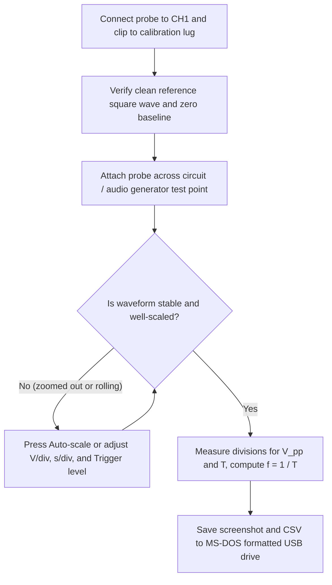

# Oscilloscope

> [!info] Document Metadata
> **Course:** `=this.course` | **Topic:** `=this.topic` | **Status:** `=this.status`

**Tags:** #[[Computer Science]] #[[NSETRON]] #[[Electronics]] #[[Oscilloscope]]

---

## Exam-Oriented Concept Summary

- **What an Oscilloscope Measures:**
  - Unlike a digital multimeter (which gives a single averaged/RMS number), an oscilloscope displays a live **time-domain graph**: **instantaneous voltage ($V$) on the vertical axis** versus **time ($t$) on the horizontal axis**.
  - **DC vs. AC Trace:** Pure **DC** appears as a flat horizontal line offset vertically from $0\text{ V}$; **AC** alternates periodically above and below zero (or a DC bias), revealing exact waveform shape (sine, square, triangle, pulse), ripple, peak-to-peak amplitude $V_{pp}$, and period $T$.
  - **Time-Domain vs. Frequency-Domain Analysis:** Both an oscilloscope and a spectrum analyzer can probe the same circuit node simultaneously without damaging it, producing **different displays** because an oscilloscope plots amplitude vs. **time** while a spectrum analyzer plots amplitude vs. **frequency**.
- **Calibration, Scaling & Triggering:**
  - **Mandatory Pre-Measurement Calibration:** Always hook the probe tip (and ground clip) to the scope's front-panel **calibration terminal** (reference square wave) to reset baseline shifts and verify probe scaling before probing external circuits.
  - **Vertical & Horizontal Scales:** Vertical scale is set in **$\text{Volts/div}$**; horizontal time-base is set in **$\text{s/div}$** ($\text{ms/div}$, $\mu\text{s/div}$). Manual mis-scaling zooms too far out or clips the wave off-screen; **Auto-scale** quickly locks onto Channel 1 (`CH1`), after which manual fine-tuning improves precision.
  - **Time-Base Behavior:** Keeping horizontal time-base ($\text{s/div}$) fixed while **increasing input signal frequency $f$** shortens period $T = 1/f$, causing cycles to **compress horizontally** so **more complete periods fit across the screen**.
- **Signal-to-Noise Ratio (SNR) & Uniform Quantization:**
  - **Low SNR on Scope:** As noise power increases relative to signal power (low **SNR**), the clean waveform trace becomes **fuzzy, thick, and distorted**, making edges and zero-crossings hard to distinguish.
  - **Sampling & Uniform Quantization (ADC):** Digital oscilloscopes and digital audio systems sample analog waveforms at rate $f_s \ge 2 f_{\max}$ (Nyquist criterion) and round continuous analog voltages onto $L = 2^n$ **discrete finite voltage levels** ($n$-bit resolution). Rounding to discrete steps turns a smooth analog sine wave into a **staircase waveform**.
  - **Bit-Depth Impact:** Reducing quantization resolution (e.g., from $16\text{-bit}$ with $2^{16} = 65,536$ levels down to $1\text{-bit}$ with $2^1 = 2$ levels) introduces **severe quantization distortion**, collapsing the signal into a coarse 2-level binary square-like representation.

---

## Key Formulas

| Formula Name | Expression | Units | When to Use |
| :--- | :--- | :--- | :--- |
| Period from Screen Divisions | $T = N_{\text{horiz\_div}} \times (\text{Time/div})$ | $\text{s}$ ($\text{ms}$, $\mu\text{s}$) | Reading signal period directly from oscilloscope horizontal graticule |
| Frequency from Period | $f = \frac{1}{T}$ | $\text{Hz}$ ($\text{kHz}$, $\text{MHz}$) | Converting measured period into signal frequency (and vice versa) |
| Peak-to-Peak Voltage | $V_{pp} = V_{\max} - V_{\min} = N_{\text{vert\_div}} \times (\text{Volts/div})$ | $\text{V}$ | Reading full vertical span of a waveform from grid divisions |
| Sine Peak & RMS from $V_{pp}$ | $V_p = \frac{V_{pp}}{2},\quad V_{\text{rms}} = 0.707\, V_p = \frac{V_{pp}}{2\sqrt{2}}$ | $\text{V}$ | Relating oscilloscope peak-to-peak span to DMM RMS voltage for pure sine waves |
| Number of Quantization Levels | $L = 2^n$ | levels | Finding discrete voltage steps for an $n$-bit uniform quantizer / ADC |
| Minimum Sampling Rate (Nyquist) | $f_{s,\min} = 2 f_{\max}$ | $\text{Hz}$ | Minimum sampling rate required to digitize a band-limited analog signal |

---

## Worked Numerical Examples

### Example 1: Lab 6 Rigol Square Wave & Sine Wave Measurements
Verify the recorded Rigol oscilloscope measurements from Laboratory Activity #06:
(a) **Captured Square Wave ($30.0\text{ kHz}$ test):** Timebase $= 10.0\ \mu\text{s/div}$, Vertical $= 500\text{ mV/div}$, scope reports $T = 33.30\ \mu\text{s}$ and $V_{pp} = 2.52\text{ V}$. Verify the frequency $f$ and the approximate horizontal/vertical division counts.
(b) **Captured Sine Wave ($249\text{ Hz}$ test):** Timebase $= 1.00\text{ ms/div}$, Vertical $= 1.00\text{ V/div}$, scope reports $T = 4.020\text{ ms}$ and $V_{pp} = 8.04\text{ V}$. Verify $f$, peak amplitude $V_p$, and RMS voltage $V_{\text{rms}}$, plus the audio generator check at $f = 200\text{ Hz}$.

**Solution (a) Square Wave:**
1. Frequency from period $T = 33.30\ \mu\text{s} = 33.30 \times 10^{-6}\text{ s}$:
   $$f = \frac{1}{33.30 \times 10^{-6}\text{ s}} \approx 30,030\text{ Hz} \approx 30.0\text{ kHz}$$
   Matches the Rigol screen readout (`Freq = 30.0 kHz`).
2. Grid divisions spanned:
   $$N_{\text{horiz}} = \frac{33.30\ \mu\text{s}}{10.0\ \mu\text{s/div}} = 3.33\text{ div}, \quad N_{\text{vert}} = \frac{2.52\text{ V}}{0.50\text{ V/div}} = 5.04\text{ div}$$

**Solution (b) Sine Wave:**
1. Frequency from period $T = 4.020\text{ ms} = 4.020 \times 10^{-3}\text{ s}$:
   $$f = \frac{1}{4.020 \times 10^{-3}\text{ s}} \approx 248.76\text{ Hz} \approx 249\text{ Hz}$$
   Matches the Rigol readout (`Freq = 249 Hz`).
2. Grid divisions, peak, and RMS voltage:
   $$N_{\text{vert}} = \frac{8.04\text{ V}}{1.00\text{ V/div}} = 8.04\text{ div}, \quad V_p = \frac{8.04\text{ V}}{2} = 4.02\text{ V}, \quad V_{\text{rms}} = 0.707 \times 4.02\text{ V} \approx 2.84\text{ V}$$
3. Audio generator cross-check at $f = 200\text{ Hz}$:
   $$T = \frac{1}{200\text{ Hz}} = 0.005\text{ s} = 5\text{ ms}$$

### Example 2: Screen-Scale Compression & Uniform Quantization Levels
(a) An oscilloscope time-base is fixed at $2.0\text{ ms/div}$ across a $10\text{-division}$ wide screen (total display window $= 20\text{ ms}$). How many full cycles are visible when the signal frequency changes from $100\text{ Hz}$ to $250\text{ Hz}$?
(b) Compare the number of discrete voltage levels produced by a $4\text{-bit}$ uniform quantizer versus a $1\text{-bit}$ quantizer.

**Solution:**
1. At $100\text{ Hz}$: $T = 1/100 = 10\text{ ms}$, so visible cycles $= \frac{20\text{ ms}}{10\text{ ms}} = 2\text{ cycles}$.
2. At $250\text{ Hz}$: $T = 1/250 = 4\text{ ms}$, so visible cycles $= \frac{20\text{ ms}}{4\text{ ms}} = 5\text{ cycles}$ (horizontal compression!).
3. Quantizer discrete levels ($L = 2^n$):
   - $4\text{-bit}$: $L = 2^4 = 16\text{ levels}$
   - $1\text{-bit}$: $L = 2^1 = 2\text{ levels}$ (coarse binary steps, severe distortion).

---

## Laboratory Recap

### Laboratory Activity #06: Oscilloscope
- **Objective:** Operate, calibrate, scale, and interpret a digital oscilloscope (`Rigol`) using its built-in reference calibration wave and an external audio signal generator, and capture screenshots/CSV data.
- **Materials & Instruments:** Digital storage oscilloscope (Rigol, Channel 1 probe), audio frequency signal generator, oscilloscope calibration lug, USB flash drive (formatted as **MS-DOS** / FAT32 for Rigol compatibility).
- **Numbered Procedure:**
  1. Power on the oscilloscope and attach the probe to `CH1`.
  2. Connect probe tip and ground clip to the scope's **calibration terminal** to verify a clean reference square wave and clear baseline offsets.
  3. Connect the audio generator output to `CH1` and supply voice-range AC test frequencies (e.g., $200\text{ Hz}$, $249\text{ Hz}$, plus $30.0\text{ kHz}$ square wave test).
  4. Adjust horizontal time-base (`s/div`) and vertical scale (`V/div`), or press **Auto-scale** to center and stabilize `CH1` if zooming distorts/clips the trace.
  5. Measure $V_{pp}$ ($V_{\max} - V_{\min}$), period $T$, and frequency $f$, cross-checking $T = 1/f$.
  6. Export screen captures and raw CSV waveform data to an MS-DOS-formatted USB drive.
- **What Is Measured:** Waveform shape (square vs. sine vs. flat DC line), period $T$, frequency $f$, and peak-to-peak voltage $V_{pp}$ (square-wave capture: $30.0\text{ kHz}$, $33.30\ \mu\text{s}$, $2.52\text{ V}_{pp}$; sine-wave capture: $249\text{ Hz}$, $4.020\text{ ms}$, $8.04\text{ V}_{pp}$).
- **Expected Readings or Behavior:** AC waveforms oscillate symmetrically around baseline while pure DC renders as a flat horizontal line; measured $T$ matches $1/f$ calculated from the generator frequency.
- **Typical Sources of Error:** Skipping probe calibration (causing baseline DC offset errors), incorrect manual vertical/horizontal scaling zooming out or distorting traces, improper trigger level causing rolling traces, and incompatible USB filesystem format preventing data export.
- **Conclusion Statements:** Proper probe calibration and matched time/voltage scaling are mandatory prerequisites for accurately visualizing AC vs. DC waveforms, measuring $V_{pp}$, and confirming $T = 1/f$.

---

## Circuit & Procedure Diagrams

### Oscilloscope Graticule Reading & Uniform Quantizer Staircase

```simulator:scope-quantizer
Oscilloscope Display (e.g., 1.00 V/div vert, 1.00 ms/div horiz):
  +4V |   .---.           .---.
  +2V |  /     \         /     \
   0V |-/-------\-------/-------\---
  -2V |          \     /
  -4V |           '---'
  V_max = +4.02 V
  V_pp  = V_max - V_min = 8.04 V
  T     = 4.02 div * 1.00 ms/div = 4.02 ms
  f     = 1 / 4.02 ms = 249 Hz
  V_min = -4.02 V

Uniform Quantizer Effect (Continuous Sine -> Discrete Staircase):
  Analog Sine:   _/-\_        Quantized:   _|--|_
                /     \                  _|      |_
```

### Oscilloscope Calibration & Measurement Workflow



---

## Exam Traps & Quick-Recall Checklist

- **Time-base fixed + frequency increases:** Higher $f$ means **smaller $T$**, so cycles **compress horizontally** and **more cycles appear** on screen (amplitude does NOT stretch vertically).
- **Oscilloscope vs. Spectrum Analyzer at Same Node:** Both can probe the exact same point in a circuit without harming it; they show different screens because the scope displays **time domain** ($V$ vs. $t$) while the spectrum analyzer displays **frequency domain** ($|S(f)|$ vs. $f$).
- **Low SNR appearance:** Noise adds random voltage spikes on top of the trace, making the oscilloscope waveform look **fuzzy and distorted**, NOT turning it into a clean square wave or doubling its frequency.
- **Quantization staircase cause:** Rounding continuous analog amplitudes to **finite discrete voltage levels** creates the staircase shape; dropping from $16\text{-bit}$ ($65,536$ levels) to $1\text{-bit}$ ($2$ levels) produces severe quantization distortion.
- **Peak vs. Peak-to-Peak:** Do not confuse $V_p$ (centerline to peak) with $V_{pp}$ (trough to peak): $V_{pp} = 2 V_p$.

---

## Multiple Choice Questions

1. On an oscilloscope display, you double the frequency of an incoming sine wave while keeping the horizontal time-base ($\text{ms/div}$) and vertical scale ($\text{V/div}$) fixed. What visual change appears on the screen?
    - **A)** The waveform amplitude stretches vertically to twice its height
    - **B)** The cycles compress horizontally, displaying twice as many periods across the screen
    - **C)** The sine wave flattens into a straight DC line
    - **D)** The waveform widens horizontally so half as many cycles appear

2. As environmental noise increases relative to signal power (creating a low Signal-to-Noise Ratio, or SNR), how does the signal trace change on an oscilloscope?
    - **A)** The signal frequency automatically doubles
    - **B)** The waveform trace becomes fuzzy and distorted, obscuring original signal features
    - **C)** The sine wave turns into a pure triangular wave
    - **D)** The vertical amplitude collapses strictly to zero

3. Why does a smooth analog sine wave take on a stepped "staircase" shape after passing through a uniform quantizer?
    - **A)** High-frequency harmonics flip the sine wave phase by $180^\circ$
    - **B)** Continuous analog voltage amplitudes are rounded to finite, discrete digital voltage levels
    - **C)** The oscilloscope probe is uncalibrated
    - **D)** AC signals convert into magnetic flux inside the CRT

4. [MSQ] Which of the following statements about oscilloscope operation and quantization are correct? (Select all that apply)
    - **A)** Mandatory probe calibration against the reference square-wave terminal helps eliminate baseline shifts before circuit testing
    - **B)** Reducing digital audio quantization from $16\text{-bit}$ to $1\text{-bit}$ causes severe quantization distortion by limiting output to only 2 levels
    - **C)** A DC voltage appears on an oscilloscope as a flat horizontal line offset from $0\text{ V}$ rather than an alternating wave
    - **D)** A spectrum analyzer and an oscilloscope cannot probe the same circuit point because doing so damages the signal source

5. [MSQ] In the recorded Lab 6 Rigol oscilloscope captures, which statements accurately match the measured waveform values? (Select all that apply)
    - **A)** For the square-wave capture, a period of $33.30\ \mu\text{s}$ corresponds to a frequency of approximately $30.0\text{ kHz}$
    - **B)** For the sine-wave capture, a period of $4.020\text{ ms}$ corresponds to a frequency of approximately $249\text{ Hz}$
    - **C)** At $1.00\text{ V/div}$ vertical scale, $V_{pp} = 8.04\text{ V}$ spans roughly $8.04$ vertical divisions
    - **D)** At $200\text{ Hz}$, one full cycle period equals $50\text{ ms}$

6. [INPUT] An oscilloscope horizontal time-base is set to $2.5\text{ ms/div}$, and one complete sine-wave cycle spans exactly $4\text{ horizontal divisions}$. What is the frequency $f$ of the sine wave in **Hertz** ($\text{Hz}$)?

7. [INPUT] An oscilloscope vertical scale is set to $2.0\text{ V/div}$, and a symmetric sine wave spans $6\text{ vertical divisions}$ from negative trough to positive peak. Calculate its **RMS voltage** $V_{\text{rms}}$ in Volts (using $V_{\text{rms}} = 0.707\, V_p$, rounded to two decimal places).

8. [INPUT] How many discrete quantization amplitude levels $L$ exist in an $8\text{-bit}$ uniform analog-to-digital quantizer?

9. [BLANK] Complete the Lab 6 oscilloscope measurement summary table using $T = 1/f$ and $V_{pp} = 2 V_p$:

| Waveform | Period $T$ | Frequency $f$ | $V_{pp}$ | Vertical Scale ($\text{V/div}$) | Divisions Spanned (Vert) |
| :--- | :--- | :--- | :--- | :--- | :--- |
| Square wave (`30 kHz` test) | $33.30\ \mu\text{s}$ | {{1}} $\text{kHz}$ | $2.52\text{ V}$ | $0.50\text{ V/div}$ | {{2}} |
| Sine wave (`249 Hz` test) | {{3}} $\text{ms}$ | $249\text{ Hz}$ | $8.04\text{ V}$ | $1.00\text{ V/div}$ | $8.04$ |

10. Why must a USB flash drive be formatted in **MS-DOS (FAT)** when saving waveforms during Laboratory Activity #06?
    - **A)** To double the Rigol oscilloscope sampling rate to $2\text{ GSa/s}$
    - **B)** Because the Rigol oscilloscope firmware only recognizes an MS-DOS (FAT) filesystem to export screenshots and CSV waveform files
    - **C)** To prevent quantization distortion inside the probe
    - **D)** To convert time-domain plots into spectrum analyzer CSVs

### Answer Key & Explanations

1. **B)** Doubling frequency halves period $T = 1/f$. With horizontal $\text{s/div}$ unchanged, each cycle occupies half as many horizontal divisions, packing twice as many cycles across the display.
2. **B)** Noise adds random voltage perturbations onto the trace, making the displayed line fuzzy and obscuring signal transitions.
3. **B)** Uniform quantization maps continuous analog voltages onto a finite set of evenly spaced discrete levels, creating step transitions ("staircase" appearance).
4. **A, B, C)** Probe calibration checks compensation and baseline; $1\text{-bit}$ allows only $2^1 = 2$ levels (severe distortion); pure DC draws a flat line. Oscilloscopes and spectrum analyzers can probe the same node simultaneously to show time vs. frequency domains.
5. **A, B, C)** $1/(33.30\ \mu\text{s}) \approx 30.0\text{ kHz}$, $1/(4.020\text{ ms}) \approx 249\text{ Hz}$, and $8.04\text{ V}/1.00\text{ V/div} = 8.04\text{ div}$. At $200\text{ Hz}$, $T = 1/200 = 5\text{ ms}$ (not $50\text{ ms}$).
6. **[100; 100.0; 100 Hz; 100Hz]** $T = 4\text{ div} \times 2.5\text{ ms/div} = 10\text{ ms} = 0.01\text{ s}$. Therefore $f = 1/0.01 = 100\text{ Hz}$.
7. **[4.24; 4.242; 4.24 V; 4.24V]** $V_{pp} = 6 \times 2.0\text{ V} = 12.0\text{ V} \implies V_p = 6.0\text{ V}$. Thus $V_{\text{rms}} = 0.707 \times 6.0\text{ V} = 4.242\text{ V} \approx 4.24\text{ V}$.
8. **[256; 256 levels]** $L = 2^8 = 256$ levels.
9. **[1: 30/30.0; 2: 5.04; 3: 4.02/4.020]** $1/(33.30\ \mu\text{s}) \approx 30.0\text{ kHz}$; $2.52\text{ V}/0.50\text{ V/div} = 5.04\text{ div}$; $1/(249\text{ Hz}) \approx 4.016\text{ ms} \approx 4.02\text{ ms}$ (scope displays $4.020\text{ ms}$).
10. **B)** The Rigol oscilloscope firmware recognizes MS-DOS (FAT) filesystems to export screencaptures and CSV traces.

## References & Navigation

- **Previous Topic:** [[Transistors]]
- **Next Topic:** [[Ampacity and Wiring]]
- **Related Notes:** [[AC Circuits]], [[Principles of Communication]], [[Written Exam Coverage and Formula Sheet]]
