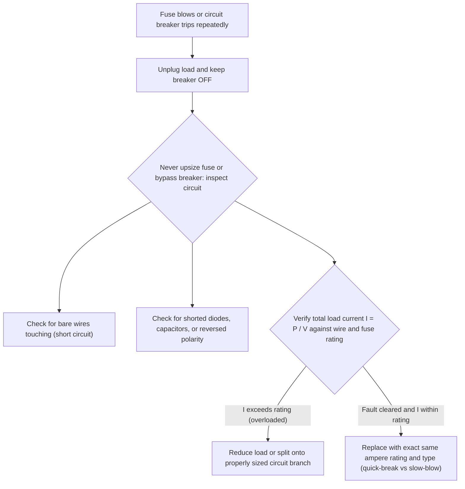

# Ampacity and Wiring

> [!info] Document Metadata
> **Course:** `=this.course` | **Topic:** `=this.topic` | **Status:** `=this.status`

**Tags:** #[[Computer Science]] #[[NSETRON]] #[[Electronics]] #[[Ampacity and Wiring]]

---

## Exam-Oriented Concept Summary

> **Source Scope Note:** The course module page references an external video (`https://youtu.be/1EE-uz0cjn8`) with no accompanying local PDF or lab manual in `Staging/NSETRON`. Accordingly, this note synthesizes every wiring, gauge, conductor-resistance, grounding, and overcurrent protection rule present in the local course sources (Malestrom Ch. 2 & 21, `Basic Electrical Theory.pdf`, `NSETRON_AC_P1`, and `NSETRON_AC_P2`). Specific NEC/PEC numeric ampacity-per-AWG current rating tables were not included in the local course files and are omitted rather than guessed.

- **Ampacity Definition & Conductor Sizing Physics:**
  - **Ampacity** is the maximum electrical current (in amperes) a conductor can carry continuously without exceeding its safe thermal / insulation temperature rating.
  - Because real copper wire has nonzero resistance $R_{\text{wire}}$, current produces thermal power loss $P_{\text{loss}} = I^2 R_{\text{wire}}$ and voltage drop $V_{\text{drop}} = I R_{\text{wire}}$ along the conductor.
  - **American Wire Gauge (AWG) Rule (Malestrom Ch. 2, Table 2-1):** As the **AWG gauge number increases** (e.g., AWG #12 $\to$ AWG #24), the wire diameter becomes **smaller** (thinner), so **resistance per kilometer ($\Omega/\text{km}$) increases** steeply and safe current capacity decreases. Conversely, **smaller AWG numbers** (e.g., AWG #4, #6, #10) correspond to **thicker conductors** with much lower $\Omega/\text{km}$ and higher ampacity.
- **High Voltage Enables Smaller Wires (`NSETRON_AC_P1`):**
  - Because power equals $P = V \cdot I$, delivering a fixed wattage at **higher voltage** reduces the required current ($I = P/V$). Lower current cuts $I^2 R$ heating in the line, allowing utilities and power systems to use **smaller, lighter conductors** (at the tradeoff of requiring stronger electrical insulation and clearance).
- **2-Wire vs. 3-Wire Grounded AC Wiring (Malestrom Ch. 21, `NSETRON_AC_P2`):**
  - **Utility Service Entry (`AC_P2`):** Pole-mounted center-tapped transformers deliver `Hot` and `Ground`/`Neutral` lines into a service meter and main circuit breaker panel (e.g., `200 A` main breaker feeding branch breakers).
  - **Two-Wire AC Systems:** Have two flat slots; **polarized** two-wire outlets widen one slot for the grounded neutral conductor, while the narrower slot carries hot voltage.
  - **Three-Wire AC Systems:** Add an independent **`D`-shaped third-wire earth ground** wired directly to exposed metal equipment enclosures and terminated at an earth ground rod. Never cut off or defeat the third ground prong!
- **Overcurrent Protection — Fuses & Circuit Breakers (`Basic Electrical Theory`, Malestrom Ch. 21):**
  - **Placement:** Both fuses and circuit breakers are placed **in series** with the hot/primary conductor so tripping breaks the entire loop current.
  - **Fuses (One-Time Sacrificial):** Soft metal strip/wire engineered to melt open above its rated current (e.g., $1\text{ A}$, $5\text{ A}$, $15\text{ A}$, $20\text{ A}$). Available as **quick-break** (straight wire; trips rapidly on surges) and **slow-blow** (spring-loaded; tolerates brief motor/capacitor startup inrush before melting).
  - **Circuit Breakers (Resettable):** Perform the same series overcurrent disconnection using a trip switch/button that resets once the fault cools.
  - **Critical Safety Rule:** Never replace a blown fuse or tripped breaker with a higher-ampere unit or bypass it (the "penny in the fuse box" hazard); doing so lets excessive current overheat building/circuit wiring and ignite a fire.

### Solid Copper Wire Resistivity by AWG (Malestrom Ch. 2, Table 2-1)

| Wire Size (AWG #) | Room-Temp Resistivity ($\Omega/\text{km}$) | Relative Thickness & Use Context |
| :---: | :---: | :--- |
| 2 | 0.52 | Very heavy feeder / service entrance |
| 4 | 0.83 | Heavy feeder conductor |
| 6 | 1.3 | Heavy appliance / subpanel feeder |
| 8 | 2.7 | High-current branch circuits |
| 10 | 3.3 | Medium-heavy branch wiring |
| 12 | 5.3 | Standard $20\text{ A}$ branch circuits |
| 14 | 8.4 | Standard $15\text{ A}$ lighting/outlet branch |
| 16 | 13 | Lamp cords / light-duty leads |
| 18 | 21 | Low-voltage control / instrument wiring |
| 20 | 34 | Signal / breadboard-class hookup |
| 22 | 54 | Common breadboard jumper / small-signal hookup |
| 24 | 86 | Light signal / telecom twisted pair |
| 26 | 140 | Fine signal / ribbon cable |
| 28 | 220 | Very fine wire-wrap / light coil |
| 30 | 350 | Ultra-fine wrapping / miniature coil |

---

## Key Formulas

| Formula Name | Expression | Units | When to Use |
| :--- | :--- | :--- | :--- |
| Conductor Wire Resistance | $R_{\text{wire}} = r_{\text{km}} \cdot L_{\text{km}}$ | $R_{\text{wire}}$ ($\Omega$), $r_{\text{km}}$ ($\Omega/\text{km}$), $L_{\text{km}}$ ($\text{km}$) | Computing resistance of one-way or round-trip ($2L$) copper cable runs from Table 2-1 |
| Line Voltage Drop | $V_{\text{drop}} = I \cdot R_{\text{wire}}$ | $\text{V}$ | Checking voltage lost across supply and return feeder wires under load current $I$ |
| Conductor Heating Power Loss | $P_{\text{loss}} = I^2 R_{\text{wire}}$ | $\text{W}$ | Computing heat generated in wiring (explains why doubling $I$ quadruples wire heating!) |
| Load Current from Power & Voltage | $I = \frac{P}{V}$ | $\text{A}$ | Sizing wire/fuse rating for resistive loads or comparing $110\text{ V}$ vs. $220\text{ V}$ current draw |

---

## Worked Numerical Examples

### Example 1: Cable Voltage Drop & Heating Loss Using AWG Table 2-1
A DC load draws $5.0\text{ A}$ through a two-wire copper cable extending $50\text{ m}$ from the power supply to the equipment (total conductor length $= 2 \times 50\text{ m} = 100\text{ m} = 0.10\text{ km}$). Using Malestrom Table 2-1, compare the total wire resistance, voltage drop, and $I^2 R$ heat wasted in the cable if wired with (a) **AWG #22** ($54\ \Omega/\text{km}$) versus (b) **AWG #12** ($5.3\ \Omega/\text{km}$).

**Solution (a) AWG #22:**
1. Round-trip conductor length: $L_{\text{total}} = 2 \times 0.050\text{ km} = 0.10\text{ km}$.
2. Total cable resistance:
   $$R_{\text{wire,22}} = (54\ \Omega/\text{km})(0.10\text{ km}) = 5.4\ \Omega$$
3. Voltage drop and power dissipated in the wire:
   $$V_{\text{drop,22}} = (5.0\text{ A})(5.4\ \Omega) = 27.0\text{ V}, \quad P_{\text{loss,22}} = (5.0\text{ A})^2 (5.4\ \Omega) = 25 \times 5.4 = 135\text{ W}$$
   (Severe drop and dangerous heating—AWG #22 is far too thin for a $5\text{ A}$, $50\text{ m}$ run!)

**Solution (b) AWG #12:**
1. Total cable resistance:
   $$R_{\text{wire,12}} = (5.3\ \Omega/\text{km})(0.10\text{ km}) = 0.53\ \Omega$$
2. Voltage drop and wire heating:
   $$V_{\text{drop,12}} = (5.0\text{ A})(0.53\ \Omega) = 2.65\text{ V}, \quad P_{\text{loss,12}} = (5.0\text{ A})^2 (0.53\ \Omega) = 25 \times 0.53 = 13.25\text{ W}$$
   Switching from AWG #22 to thicker AWG #12 cuts both voltage drop and wire heating by more than $10\times$.

### Example 2: Conductor Current & Fuse Selection at $110\text{ V}$ vs. $220\text{ V}$ (`AC_P1` + Ch. 21)
A resistive workshop heater is rated at $1650\text{ W}$. Calculate the operating current at (a) $110\text{ V}$ AC and (b) $220\text{ V}$ AC, and state why the $110\text{ V}$ wiring experiences $4\times$ higher $I^2 R$ heat loss in an identical wire gauge.

**Solution:**
1. Operating current at $110\text{ V}$:
   $$I_{110} = \frac{1650\text{ W}}{110\text{ V}} = 15.0\text{ A}$$
2. Operating current at $220\text{ V}$:
   $$I_{220} = \frac{1650\text{ W}}{220\text{ V}} = 7.5\text{ A}$$
3. Heating ratio for identical wire resistance $R_{\text{wire}}$:
   $$\frac{P_{\text{loss,110}}}{P_{\text{loss,220}}} = \frac{I_{110}^2 R_{\text{wire}}}{I_{220}^2 R_{\text{wire}}} = \left(\frac{15.0\text{ A}}{7.5\text{ A}}\right)^2 = 2^2 = 4$$
   Doubling supply voltage halves current and reduces wire $I^2 R$ heat dissipation by a factor of $4$, allowing thinner conductors and a lower-ampere protective breaker/fuse.

---

## Laboratory Recap

- **Scope Note:** Module 09 has **no assigned laboratory experiment** in the course module schedule or `Staging/NSETRON`.
- **Practical Lab Wiring Tie-Ins:**
  - Breadboard hookup jumpers (typically AWG #22 solid copper) carry negligible resistance over a few centimeters ($54\ \Omega/\text{km} \approx 0.054\ \Omega/\text{m}$), yet poor socket seating or corroded leads add contact resistance (noted in Group 8 Lab 2).
  - External bench DC power supplies and transformer primaries must use series fuses matched to safe current limits, and exposed metal enclosures must retain an intact three-wire earth ground.

---

## Circuit & Procedure Diagrams

### Three-Wire Grounded AC System with Series Overcurrent Protection

```text
  Utility Hot ----[ Fuse / Breaker (Series) ]----[ Power Switch ]----+
                                                                     |
  Utility Neutral (Polarized Wide Slot) -------------------------+ [ Load / Tx Primary ]
                                                                 |   |
  Earth Ground (3rd D-Pin) =====> [ Exposed Metal Chassis ]      +---+
```

### Wiring Protection & Overcurrent Triage Flow



---

## Exam Traps & Quick-Recall Checklist

- **Inverse AWG numbering trap:** **Larger AWG number = thinner wire = higher resistance = lower ampacity** (AWG #30 is hair-thin; AWG #2 is massive feeder cable).
- **Two-way wire length trap:** When calculating voltage drop across a cable feeding a remote load, multiply distance by **$2$** (supply wire + return wire)!
- **$I^2 R$ squared sensitivity:** Doubling current through a wire increases heating by **$4\times$**, not $2\times$.
- **Fuse upsizing danger:** Replacing a repeatedly blowing $5\text{ A}$ fuse with a $20\text{ A}$ fuse or a bypass ("penny in the fuse box") does NOT fix the fault—it turns the building wiring into the melting element.
- **Quick-break vs. slow-blow:** Use quick-break for delicate semiconductors/general electronics; use slow-blow where brief startup surges (large filter capacitors or motors) occur without signaling a short.

---

## Multiple Choice Questions

1. According to the American Wire Gauge (AWG) system in Malestrom Table 2-1, how do wire thickness and resistance per kilometer change as the AWG number increases from `#12` to `#24`?
    - **A)** Wire thickness increases and resistance per kilometer decreases
    - **B)** Wire thickness decreases and resistance per kilometer increases
    - **C)** Wire thickness increases and resistance per kilometer increases
    - **D)** Both wire thickness and resistance remain constant across all AWG numbers

2. Why must a fuse or circuit breaker always be wired **in series** with the hot conductor rather than in parallel across the load?
    - **A)** Placing it in series forces all circuit current through the protective element so melting or tripping opens the entire path
    - **B)** Placing it in parallel doubles the supply voltage
    - **C)** Fuses only detect excessive voltage, not excessive current
    - **D)** Series placement converts AC into DC automatically

3. If a $5\text{ A}$ quick-break fuse blows immediately every time a power supply is powered on, what should a technician NEVER do?
    - **A)** Inspect the rectifier diodes and filter capacitors for short circuits
    - **B)** Check for reversed polarity or shorted wiring downstream
    - **C)** Replace the $5\text{ A}$ fuse with a $20\text{ A}$ fuse or metal jumper to stop it from blowing
    - **D)** Verify whether a slow-blow fuse of the same $5\text{ A}$ rating is specified for startup surge

4. [MSQ] Which of the following statements accurately describe three-wire AC grounding and conductor sizing principles? (Select all that apply)
    - **A)** The `D`-shaped third prong of a three-wire AC outlet provides an independent earth ground connected to exposed metal chassis surfaces
    - **B)** Transmitting the same power at higher voltage lowers current ($I = P/V$), allowing smaller conductors to be used
    - **C)** Defeating or cutting off the third ground prong is safe as long as the outlet is polarized
    - **D)** Doubling current through a fixed-resistance wire quadruples $I^2 R$ heating loss

5. [MSQ] Which faults or conditions can cause a series fuse or circuit breaker to blow repeatedly? (Select all that apply)
    - **A)** Short-circuited filter capacitors or burned-out shorted rectifier diodes
    - **B)** Bare power conductors touching each other due to damaged insulation
    - **C)** Connecting a polarized device or electrolytic capacitor backward across the supply
    - **D)** Operating an open-circuited switch with zero current flowing

6. [INPUT] Using Malestrom Table 2-1, an AWG `#20` solid copper wire has a resistivity of $34\ \Omega/\text{km}$. Calculate the total resistance (in ohms) of a $250\text{ m}$ **single-conductor** length of AWG `#20` copper wire.

7. [INPUT] A pair of AWG `#14` copper wires ($8.4\ \Omega/\text{km}$) runs $100\text{ m}$ from a DC supply to a remote load (total round-trip wire length $= 200\text{ m} = 0.20\text{ km}$) carrying $10\text{ A}$. Calculate the total **power lost as heat** in the wiring ($P_{\text{loss}} = I^2 R_{\text{wire}}$) in watts.

8. An appliance draws $10\text{ A}$ on a $120\text{ V}$ circuit. If an identical wattage appliance is redesigned for $240\text{ V}$, how much current does it draw?
    - **A)** $20\text{ A}$
    - **B)** $10\text{ A}$
    - **C)** $5\text{ A}$
    - **D)** $2.5\text{ A}$

9. [BLANK] Complete the AWG solid-copper resistivity comparison table from Malestrom Table 2-1:

| AWG Gauge # | Resistivity ($\Omega/\text{km}$) | Thicker or Thinner than AWG `#14` ($8.4\ \Omega/\text{km}$)? |
| :---: | :--- | :--- |
| `#10` | {{1}} | {{2}} |
| `#22` | {{3}} | Thinner |

10. Why does a slow-blow fuse differ structurally and functionally from a quick-break fuse?
    - **A)** A slow-blow fuse typically includes an internal spring alongside its wire/strip so brief startup surges do not trip it prematurely
    - **B)** A slow-blow fuse only operates on DC circuits
    - **C)** A slow-blow fuse resets itself automatically with a push button
    - **D)** A quick-break fuse carries $10\times$ its labeled ampere rating continuously

### Answer Key & Explanations

1. **B)** Higher AWG gauge numbers indicate thinner wires with smaller cross-sectional area, raising resistance per kilometer (e.g., `#12` is $5.3\ \Omega/\text{km}$ while `#24` is $86\ \Omega/\text{km}$).
2. **A)** Series placement ensures total circuit current flows through the fuse/breaker so exceeding its rating breaks the supply path cleanly.
3. **C)** Upsizing a fuse beyond the circuit's safe wire/component rating lets hazardous fault current continue flowing, risking fire or equipment destruction.
4. **A, B, D)** Three-wire outlets ground exposed metal enclosures via the `D`-shaped earth prong; higher voltage reduces $I$ for thinner wires; $P_{\text{loss}} = I^2 R$ scales with the square of current. Never defeat or cut the ground prong.
5. **A, B, C)** Shorted diodes/capacitors, bare-wire shorts, and reverse-polarity shorts draw excessive surge current and blow fuses; an open switch has $I = 0\text{ A}$ and cannot blow a fuse.
6. **[8.5; 8.50; 8.5 ohm; 8.5 ohms]** $L = 250\text{ m} = 0.25\text{ km}$, so $R_{\text{wire}} = 34\ \Omega/\text{km} \times 0.25\text{ km} = 8.5\ \Omega$.
7. **[168; 168.0; 168 W; 168W]** Total wire resistance $R_{\text{wire}} = 8.4\ \Omega/\text{km} \times 0.20\text{ km} = 1.68\ \Omega$. Heat loss $P_{\text{loss}} = I^2 R = (10\text{ A})^2 (1.68\ \Omega) = 168\text{ W}$.
8. **C)** At constant power $P = V I$, doubling voltage from $120\text{ V}$ to $240\text{ V}$ halves current from $10\text{ A}$ to $5\text{ A}$.
9. **[1: 3.3; 2: Thicker/thicker; 3: 54]** Per Malestrom Table 2-1, AWG `#10` is $3.3\ \Omega/\text{km}$ (lower gauge = thicker wire than `#14`), and AWG `#22` is $54\ \Omega/\text{km}$.
10. **A)** Slow-blow fuses contain a spring mechanism with the fusible link so brief capacitive/motor startup currents do not cause nuisance trips, whereas quick-break fuses use a straight strip/wire to trip rapidly.

## References & Navigation

- **Previous Topic:** [[Oscilloscope]]
- **Next Topic:** [[Sensor Controls, Comparator and Voltage Divider]]
- **Related Notes:** [[Basic Electrical Theory]], [[AC Circuits]], [[Written Exam Coverage and Formula Sheet]]
