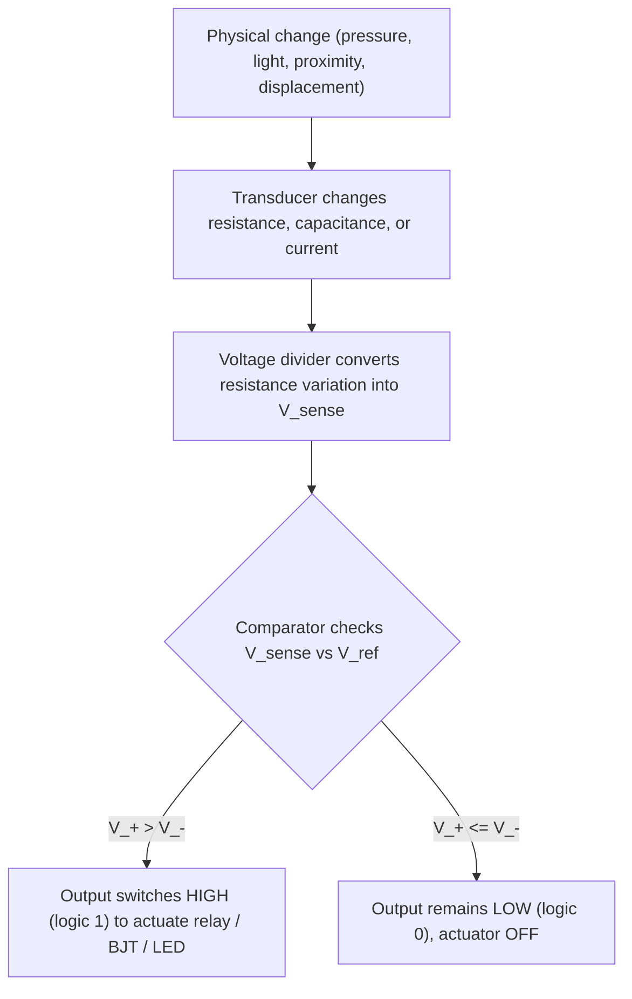

# Sensor Controls, Comparator and Voltage Divider

> [!info] Document Metadata
> **Course:** `=this.course` | **Topic:** `=this.topic` | **Status:** `=this.status`

**Tags:** #[[Computer Science]] #[[NSETRON]] #[[Electronics]] #[[Sensor Controls, Comparator and Voltage Divider]]

---

## Exam-Oriented Concept Summary

- **Voltage Divider Networks:**
  - A series chain of resistors $R_1, R_2, \dots, R_n$ across supply $V_S$ produces stepped intermediate voltages relative to ground proportional to the sum of resistances below each tap point:
    $$V_{\text{out}} = V_S \frac{R_{\text{bottom}}}{R_{\text{top}} + R_{\text{bottom}}}$$
  - **Ratio Principle:** Output voltage depends strictly on the **resistance ratio**, not absolute $\Omega$ scale—unless a low-impedance load attaches to the tap.
  - **Design & Loading Rule (Stiff Divider):** Choose total divider resistance $R_{\text{total}} = R_{\text{top}} + R_{\text{bottom}}$ as small as the power supply current budget comfortably allows so any downstream load draws negligible current compared to the divider bleed current and does not sag $V_{\text{out}}$.
- **Operational Amplifiers & Voltage Comparators:**
  - **Operational Amplifier (Op-Amp):** High-gain linear IC with two inputs (**non-inverting `+`**, output in phase; **inverting `-`**, output $180^\circ$ out of phase), one output, and dual supply rails. Using an external feedback resistor between output and `-` creates **closed-loop negative feedback**, reducing extreme open-loop gain to prevent oscillation and noise.
  - **Comparator IC:** Compares two input voltages ($V_A$ and $V_B$, or $V_+$ and $V_-$) **without negative feedback** (open-loop saturation):
    - When $V_A > V_B$ (i.e., $V_+ > V_-$), output snaps **HIGH** (logic 1, e.g., $\approx +5\text{ V}$ in TTL-compatible comparators, or $+V_{\text{rail}}$).
    - When $V_A \le V_B$ (i.e., $V_+ < V_-$), output snaps **LOW** (logic 0, e.g., $\le +2\text{ V}$ TTL low threshold, or $0\text{ V}$/$-V_{\text{rail}}$ depending on comparator IC).
  - **Actuation Role:** Comparators act as analog-to-digital threshold detectors that trigger **relays, BJTs, or LEDs** whenever a physical variable crosses a chosen setpoint.
- **Transducers and Sensors:**
  - **Transducer:** Converts energy from one domain to another (e.g., acoustic, light, pressure, motion $\leftrightarrow$ electrical).
  - **Sensor:** Combines one or more transducers to detect/measure physical quantities (pressure, proximity, light, texture, angle).
  - **Key Transducers & Sensors Covered:**
    - **Wave Transducers:** Dynamic coil-and-magnet (sound), electrostatic capacitor-plate (sound), piezoelectric quartz/ceramic (audible + **ultrasonic** $20\text{--}100+\text{ kHz}$), IR/visible (`IRED` emitter + photodiode or self-generating photovoltaic cell, line-of-sight).
    - **Elastomer Pressure Sensor:** Conductive foam whose **electrical resistance decreases** when compressed, increasing circuit current.
    - **Capacitive Pressure & Proximity Sensors:** Force narrows plate spacing $d \implies$ capacitance rises $\implies$ LC oscillator frequency drops. Proximity sensors detect conductive/semiconductive objects (metal, saltwater, tissue) better than dry insulators (wood, plastic, glass) and are vulnerable to **body capacitance**.
    - **Photoelectric Proximity Sensor:** Modulates the light beam (e.g., $1000\text{ Hz}$) and uses a tuned amplifier so **ambient sunlight or room lamps are ignored** (fails on non-reflective dark objects or angled mirrors).
    - **Texture Sensor:** Laser + multiple photodetectors distinguish **shiny** (narrow specular reflection at incidence angle) from **matte** (scattered diffuse reflection across all sensors).
    - **Optical Shaft Encoder:** Two LEDs + two photodetectors + slotted chopping wheel determine both step count and rotation direction (CW vs. CCW).
- **Sensor + Voltage Divider + Comparator Control Loop:**
  - Placing a **variable resistive sensor** (such as an elastomer pad, potentiometer, photoresistor, or thermistor) in one leg of a voltage divider converts resistance change $\Delta R$ into a changing sense voltage $V_{\text{sense}}$. Feeding $V_{\text{sense}}$ to one comparator input and a fixed resistor-divider reference $V_{\text{ref}}$ to the other input triggers a digital HIGH/LOW output when the physical stimulus crosses the threshold!

---

## Key Formulas

| Formula Name | Expression | Units | When to Use |
| :--- | :--- | :--- | :--- |
| 2-Resistor Voltage Divider | $V_{\text{out}} = V_S \frac{R_{\text{bottom}}}{R_{\text{top}} + R_{\text{bottom}}}$ | $\text{V}$, $\Omega$ | Finding unloaded tap voltage between $R_{\text{top}}$ (to $+V_S$) and $R_{\text{bottom}}$ (to GND) |
| Multi-Tap Voltage Divider | $V_k = V_S \frac{\sum_{i=1}^k R_i}{\sum_{i=1}^n R_i}$ | $\text{V}$, $\Omega$ | Finding potential $V_k$ at tap $P_k$ relative to ground |
| Divider Total Current | $I_{\text{div}} = \frac{V_S}{R_{\text{top}} + R_{\text{bottom}}}$ | $\text{A}$ | Sizing $R_{\text{total}}$ to satisfy power supply current limit ($R_{\text{total}} = V_S / I_{\text{max}}$) |
| Comparator Switching Rule | $V_{\text{out}} = \begin{cases} \text{HIGH (1)}, & V_+ > V_- \\ \text{LOW (0)}, & V_+ < V_- \end{cases}$ | $\text{V}$ | Determining whether comparator turns ON or OFF an output LED, relay, or BJT |
| Capacitive LC Sensor Frequency | $f_r = \frac{1}{2\pi\sqrt{L C}}$ | $\text{Hz}$ | Showing why increased capacitance (closer plates) lowers oscillator frequency |

---

## Worked Numerical Examples

### Example 1: Voltage Divider Design & Current Sizing
A $9.0\text{ V}$ DC battery (negative terminal grounded) must supply a fixed reference voltage $V_{\text{ref}} = +2.5\text{ V}$ to a comparator input.
(a) Design $R_{\text{bottom}}$ and $R_{\text{top}}$ if total divider resistance is $R_{\text{total}} = 1000\ \Omega$, and compute the current drawn.
(b) Redesign $R_{\text{bottom}}$ and $R_{\text{top}}$ if the divider is allowed to draw $I_{\max} = 100\text{ mA}$ for stiffer voltage regulation.

**Solution (a):**
1. Required resistance ratio:
   $$\frac{R_{\text{bottom}}}{R_{\text{total}}} = \frac{V_{\text{ref}}}{V_S} = \frac{2.5\text{ V}}{9.0\text{ V}} \approx 0.2778 \quad (\text{or } 0.28 \text{ rounded to two decimals})$$
2. With $R_{\text{total}} = 1000\ \Omega$:
   $$R_{\text{bottom}} = 0.2778 \times 1000\ \Omega \approx 277.8\ \Omega \quad (280\ \Omega \text{ when rounding ratio to } 0.28)$$
   $$R_{\text{top}} = 1000\ \Omega - 277.8\ \Omega = 722.2\ \Omega \quad (\text{or } 720\ \Omega \text{ using } 0.28)$$
3. Current drawn:
   $$I_{\text{div}} = \frac{9.0\text{ V}}{1000\ \Omega} = 0.0090\text{ A} = 9.0\text{ mA}$$

**Solution (b):**
1. Convert $100\text{ mA} = 0.100\text{ A}$ and compute $R_{\text{total}}$:
   $$R_{\text{total}} = \frac{9.0\text{ V}}{0.100\text{ A}} = 90\ \Omega$$
2. Apply the exact ratio ($2.5/9.0 = 0.2778$):
   $$R_{\text{bottom}} = \frac{2.5}{9.0} \times 90\ \Omega = 25\ \Omega, \quad R_{\text{top}} = 90\ \Omega - 25\ \Omega = 65\ \Omega$$
   Exact check: $V_{\text{ref}} = 9.0 \times \frac{25}{25 + 65} = 9.0 \times \frac{25}{90} = 2.50\text{ V}$!

### Example 2: Resistive Sensor Divider Driving a Comparator Threshold
A resistive pressure sensor (elastomer pad) has $R_{\text{sensor}} = 10\text{ k}\Omega$ when uncompressed and drops to $R_{\text{sensor}} = 2.0\text{ k}\Omega$ when pressed hard. It is placed as the **bottom resistor** ($R_{\text{bottom}} = R_{\text{sensor}}$) in series with a fixed $R_{\text{top}} = 6.0\text{ k}\Omega$ resistor across $V_S = 12\text{ V}$. The divider output $V_{\text{sense}}$ feeds the **inverting (`-`) input** of a comparator, while the **non-inverting (`+`) input** receives a reference $V_{\text{ref}} = 5.0\text{ V}$. Determine $V_{\text{sense}}$ and the comparator output state when (a) uncompressed and (b) pressed hard.

**Solution:**
1. **Uncompressed ($R_{\text{sensor}} = 10\text{ k}\Omega$):**
   $$V_{\text{sense}} = 12\text{ V} \times \frac{10\text{ k}\Omega}{6.0\text{ k}\Omega + 10\text{ k}\Omega} = 12\text{ V} \times \frac{10}{16} = 7.5\text{ V}$$
   Compare inputs: $V_+ = 5.0\text{ V} < V_- = 7.5\text{ V} \implies$ Comparator output is **LOW (logic 0)**.
2. **Pressed hard ($R_{\text{sensor}} = 2.0\text{ k}\Omega$):**
   $$V_{\text{sense}} = 12\text{ V} \times \frac{2.0\text{ k}\Omega}{6.0\text{ k}\Omega + 2.0\text{ k}\Omega} = 12\text{ V} \times \frac{2}{8} = 3.0\text{ V}$$
   Compare inputs: $V_+ = 5.0\text{ V} > V_- = 3.0\text{ V} \implies$ Comparator output switches **HIGH (logic 1)**, triggering the actuator or indicator!

---

## Practical Divider & Comparator Design Checks

- **Laboratory Circuit Connections:**
  - The $50\text{ k}\Omega$ potentiometer wired across outer pins with a middle wiper (Lab 1 & Lab 2) is physically a single-component adjustable **voltage divider** when one outer pin goes to $+V_S$ and the other to GND.
  - A comparator's digital HIGH/LOW output commonly drives the base resistor of an NPN BJT switch (Lab 5 Part 1 topology) to switch higher-current relays, motors, or LEDs.

---

## Circuit & Procedure Diagrams

### Sensor Voltage Divider + Comparator Control Circuit

```text
  +V_S ----+------------------------+
           |                        |
        [ R_top ]               [ R_ref_top ]
           |                        |
           +---> V_sense ---->(+)   |        Comparator
           |                  |  \  |        (Open-Loop)
     [ R_sensor ]             |   \ |------> V_out (HIGH if V_sense > V_ref,
     (Variable R)     V_ref-->(-) /          else LOW -> drives BJT/Relay/LED)
           |                  |  /
  GND -----+------------------+----- [ R_ref_bot ] --- GND
```

### Sensor-to-Comparator Actuation Pipeline



---

## Exam Traps & Quick-Recall Checklist

- **Divider resistor order trap:** Always check which resistor sits on the **ground side** ($R_{\text{bottom}}$) versus the **supply side** ($R_{\text{top}}$)! Putting the wrong resistor in the numerator gives $V_S - V_{\text{out}}$ instead of $V_{\text{out}}$.
- **Loading a voltage divider:** Connecting a low-resistance load directly to a high-resistance voltage divider lowers the effective bottom resistance in parallel, pulling $V_{\text{out}}$ downward.
- **Op-Amp vs. Comparator feedback:** Linear op-amp amplifiers require **negative feedback** (closed loop) to stay stable; **comparators** run open-loop so the output rails sharply between HIGH and LOW.
- **Photoelectric modulation trick:** Ambient sunlight is steady (unmodulated), so modulating an IR/visible proximity emitter at e.g. $1000\text{ Hz}$ lets the receiver amplifier reject sunlight and room lights.
- **Body capacitance vs. elastomer:** Capacitive pressure/proximity sensors suffer false triggers near grounded human hands or conductive objects (**body capacitance**), whereas **elastomer** resistive pads are immune to body capacitance.

---

## Multiple Choice Questions

1. A voltage divider consists of $R_{\text{top}} = 3.0\text{ k}\Omega$ connected to $+12\text{ V}$ and $R_{\text{bottom}} = 1.0\text{ k}\Omega$ connected to ground. What is the unloaded output voltage at the node between them?
    - **A)** $9.0\text{ V}$
    - **B)** $4.0\text{ V}$
    - **C)** $3.0\text{ V}$
    - **D)** $6.0\text{ V}$

2. Why must a voltage divider network generally avoid using excessively large resistor values when feeding a real circuit load?
    - **A)** Large resistors create inductance that blocks DC voltage completely
    - **B)** If total divider resistance is too high, current drawn by the attached load upsets the resistance ratio and pulls the tap voltage down
    - **C)** Large resistors convert the comparator into an AC oscillator
    - **D)** Small resistors make the divider independent of supply voltage

3. On an ideal comparator IC, the non-inverting input (`+`) is at $4.2\text{ V}$ while the inverting reference input (`-`) is held at $2.5\text{ V}$. What state does the comparator output take?
    - **A)** HIGH (logic 1), because $V_+ > V_-$
    - **B)** LOW (logic 0), because $V_+ > V_-$
    - **C)** Zero volts regardless of input voltage
    - **D)** Linear half-supply ($1.7\text{ V}$) proportional to the difference

4. [MSQ] Which of the following statements accurately match electronic sensor and transducer principles? (Select all that apply)
    - **A)** Piezoelectric transducers can operate at ultrasonic frequencies ($20\text{ kHz}$ to $>100\text{ kHz}$) better than dynamic or electrostatic transducers
    - **B)** An elastomer pressure sensor exhibits lower electrical resistance when mechanically compressed
    - **C)** A capacitive proximity sensor detects dry wood and glass much more easily than metal or living tissue
    - **D)** An optical shaft encoder uses two LEDs, two photodetectors, and a chopping wheel to sense both rotation increment and direction

5. [MSQ] Which statements correctly describe operational amplifiers and photoelectric proximity sensors? (Select all that apply)
    - **A)** Negative feedback connects an op-amp's output to its inverting (`-`) input to stabilize closed-loop gain
    - **B)** A signal entering an op-amp's inverting (`-`) input emerges $180^\circ$ out of phase
    - **C)** Photoelectric proximity sensors modulate their light beam (e.g., at $1000\text{ Hz}$) so ambient sunlight does not trigger false detections
    - **D)** A matte surface reflects a laser beam back only along the single angle equal to the angle of incidence

6. [INPUT] A $12\text{ V}$ DC supply feeds a 2-resistor voltage divider where $R_{\text{top}} = 2.2\text{ k}\Omega$ and $R_{\text{bottom}} = 3.3\text{ k}\Omega$ (to ground). Calculate the unloaded output voltage $V_{\text{out}}$ in Volts.

7. [INPUT] You must design a voltage divider from a $15\text{ V}$ supply to obtain $+5.0\text{ V}$ relative to ground while drawing exactly $50\text{ mA}$ total divider current. Calculate the required **ground-side resistor $R_{\text{bottom}}$** in ohms.

8. [INPUT] A 4-resistor series voltage divider (`R1`, `R2`, `R3`, `R4` from ground upward) has $R_1 = 100\ \Omega$, $R_2 = 22.0\ \Omega$, $R_3 = 33.0\ \Omega$, and $R_4 = 47.0\ \Omega$ across an $18.0\text{ V}$ battery. What is the voltage $V_3$ measured from node `P3` (above $R_1 + R_2 + R_3$) to ground, in Volts rounded to two decimal places?

9. [BLANK] Complete the sensor physics comparison table below:

| Sensor / Transducer | Measured Quantity | Electrical Parameter That Changes | Key Limitation / Edge Case |
| :--- | :--- | :--- | :--- |
| Elastomer pad | Mechanical force | {{1}} decreases | Needs compression contact |
| Capacitive pressure sensor | Mechanical force | Capacitance {{2}} (oscillator $f$ drops) | Fooled by {{3}} capacitance |
| Texture sensor | Surface finish (shiny vs. matte) | Reflected light scatter across detectors | Affected by relative sensor motion |

10. Why does a capacitive pressure sensor's LC oscillator frequency **drop** when an object compresses the dielectric foam between its two metal plates?
    - **A)** Decreasing plate spacing increases capacitance $C$, which lowers resonant frequency $f_r = 1/(2\pi\sqrt{LC})$
    - **B)** Increasing plate spacing decreases capacitance, raising inductance
    - **C)** Compressing dielectric foam converts the capacitor into a short circuit
    - **D)** Resistance rises to infinity and stops oscillation

### Answer Key & Explanations

1. **C)** $V_{\text{out}} = 12\text{ V} \times \frac{1.0}{3.0 + 1.0} = 12 \times 0.25 = 3.0\text{ V}$.
2. **B)** A divider fixes tap voltage reliably only when the divider current significantly exceeds the current drawn by the downstream circuit; very high divider resistors sag when loaded.
3. **A)** When the non-inverting input exceeds the inverting input ($4.2\text{ V} > 2.5\text{ V}$), the open-loop comparator saturates HIGH (logic 1).
4. **A, B, D)** Piezoelectric crystals excel at ultrasonic frequencies; compressing conductive elastomer lowers its resistance; optical shaft encoders use dual LEDs/detectors + chopping wheel for step and direction. Capacitive proximity sensors detect conductive materials (metal/tissue) easily and poorly sense dry insulators (wood/glass).
5. **A, B, C)** Negative feedback stabilizes closed-loop op-amp gain; inverting input flips phase $180^\circ$; modulated light beams let receivers ignore unmodulated sunlight/lamps. Specular single-angle reflection applies to *shiny* surfaces, whereas *matte* surfaces scatter light to all sensors.
6. **[7.2; 7.20; 7.2 V; 7.2V]** $V_{\text{out}} = 12 \times \frac{3.3}{2.2 + 3.3} = 12 \times \frac{3.3}{5.5} = 12 \times 0.6 = 7.2\text{ V}$.
7. **[100; 100.0; 100 ohm; 100 ohms]** Total resistance $R_{\text{total}} = 15\text{ V} / 0.050\text{ A} = 300\ \Omega$. Since $V_{\text{out}}/V_S = 5.0/15 = 1/3$, $R_{\text{bottom}} = (1/3) \times 300\ \Omega = 100\ \Omega$ (and $R_{\text{top}} = 200\ \Omega$).
8. **[13.81; 13.8; 13.81 V; 13.8V]** $R_{\text{total}} = 100 + 22 + 33 + 47 = 202\ \Omega$. Sum below `P3` $= 100 + 22 + 33 = 155\ \Omega$. Thus $V_3 = 18.0 \times (155 / 202) \approx 13.812\text{ V} \approx 13.81\text{ V}$.
9. **[1: Resistance/resistance; 2: increases/rises; 3: body/Body]** Compression lowers elastomer resistance; closer plates increase capacitive pressure sensor $C$ and lower LC frequency; nearby conductors create unwanted body capacitance.
10. **A)** Reducing plate gap $d$ raises capacitance $C$, and since $f_r = 1/(2\pi\sqrt{LC})$, higher $C$ lowers the LC oscillator frequency.

## References & Navigation

- **Previous Topic:** [[Ampacity and Wiring]]
- **Next Topic:** [[Principles of Communication]]
- **Related Notes:** [[Resistors]], [[Capacitors]], [[Transistors]], [[Written Exam Coverage and Formula Sheet]]
