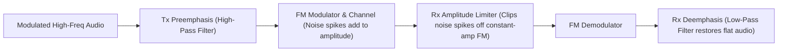

# Principles of Communication

> [!info] Document Metadata
> **Course:** `=this.course` | **Topic:** `=this.topic` | **Status:** `=this.status`

**Tags:** #[[Computer Science]] #[[NSETRON]] #[[Electronics]] #[[Principles of Communication]]

---

## Exam-Oriented Concept Summary

- **Communication System Architecture (`Frenzel Ch. 1`):**
  - Core path: **Information Source $\to$ Transmitter $\to$ Communication Channel (Medium) $\to$ Receiver $\to$ Recovered Information**. A **transceiver** combines both Tx and Rx (telephones, modems, handheld radios).
  - **Impairments:** **Attenuation** degrades signal strength proportionally to the square of distance ($1/d^2$ in free space); **noise** is random unwanted electrical energy entering through the channel.
  - **Transmission Modes:** **Simplex** (one-way: broadcast AM/FM radio, TV); **Half-Duplex** (two-way, one party at a time: CB/police/amateur radio); **Full-Duplex** (simultaneous two-way: telephone).
  - **Baseband vs. Broadband:** Baseband sends raw information directly; broadband modulates a high-frequency RF **carrier** for antenna radiation. **Multiplexing** shares one medium across multiple signals via **FDM** (frequency) or **TDM** (time).
  - **EM Spectrum & Wavelength:** $\lambda = \frac{3 \times 10^8}{f}$ ($\text{m}$). Key bands: ELF ($30\text{--}300\text{ Hz}$), VF ($300\text{--}3000\text{ Hz}$), VLF (up to $20\text{ kHz}$), LF ($30\text{--}300\text{ kHz}$), MF ($300\text{--}3000\text{ kHz}$), HF ($3\text{--}30\text{ MHz}$), VHF ($30\text{--}300\text{ MHz}$), UHF ($300\text{--}3000\text{ MHz}$), SHF ($1\text{--}30\text{ GHz}$), EHF ($30\text{--}300\text{ GHz}$).
- **Amplitude Modulation — AM (`Frenzel Ch. 3` & `Lab 8 Part I–II`):**
  - The modulating signal $V_m \sin(2\pi f_m t)$ varies the instantaneous **amplitude** of a constant-frequency carrier $V_c \sin(2\pi f_c t)$, traced by its **envelope**.
  - **Modulation Index ($m$):** $m = \frac{V_m}{V_c} = \frac{V_{\max} - V_{\min}}{V_{\max} + V_{\min}}$ (percentage $= 100 m$). Valid range is $0 \le m \le 1$. When **$m > 1$ (e.g., $m = 1.5$)**, **overmodulation** occurs—causing severe envelope distortion, phase reversals, harsh audio, and failure of simple diode envelope detectors!
  - **Sidebands & Spectrum:** Single-tone modulation yields an Upper Sideband ($f_{\text{USB}} = f_c + f_m$) and Lower Sideband ($f_{\text{LSB}} = f_c - f_m$), occupying total bandwidth $\text{BW} = f_{\text{USB}} - f_{\text{LSB}} = 2 f_m$. Square-wave AM (**ASK**) produces odd-harmonic sidebands (3rd, 5th, 7th...) causing **splatter** interference.
  - **AM Power & Variants:** $P_T = P_C\left(1 + \frac{m^2}{2}\right)$ and $P_{\text{USB}} = P_{\text{LSB}} = \frac{P_C m^2}{4}$. Even at $100\%$ modulation ($m = 1$), **$2/3$ of transmitted power stays in the uninformative carrier**! Switching off the carrier DC offset ($\hat{s} = 0$ in LabAlive) creates **DSB-SC** (Double-Sideband Suppressed Carrier via a balanced modulator); removing one sideband too creates **SSB** (narrower BW, concentrated power, less fading); **VSB** partially trims one sideband (analog TV video).
- **Frequency & Phase Modulation — FM & PM (`Frenzel Ch. 5` & `Lab 8 Part III`):**
  - **FM:** Carrier **amplitude stays constant** while instantaneous carrier frequency shifts proportionally with modulating voltage (**frequency deviation $\Delta f_{\max}$ or $f_d = k_m \hat{m}$**); modulating frequency $f_m$ sets the **deviation rate**.
  - **PM vs. Indirect FM:** Phase modulation shifts carrier phase in proportion to amplitude, so frequency deviation grows with *both* modulating amplitude and $f_m$; inserting a $1/f$ RC low-pass **predistorter** converts PM into **indirect FM**. Digital equivalents: **FSK** (frequency tones) and **PSK/BPSK** (phase shifts).
  - **FM Modulation Index ($\beta$ or $m_f$) & Bessel Bandwidth:**
    $$\beta = m_f = \frac{\Delta f_{\max}}{f_m} = \frac{k_m \hat{m}}{f_m}$$
    Standard FM broadcast allows $\Delta f_{\max} = 75\text{ kHz}$ and $f_m = 15\text{ kHz} \implies m_f = 5$. **Narrowband FM (NBFM)** has $m_f < \pi/2 \approx 1.57$. Using Bessel tables, counting significant sideband pairs $N$ with amplitude $> 0.01$ ($1\%$) gives $\text{BW} = 2 f_m N$. At **$\beta \approx 2.405$** (first zero of $J_0(\beta)$), the **carrier amplitude vanishes ($J_0 = 0$)** in the spectrum analyzer!
  - **Why FM Beats AM Against Noise:** Atmospheric/electrical noise spikes distort signal **amplitude**. AM receivers read amplitude directly, whereas FM receivers pass the constant-amplitude carrier through **clipper limiter circuits** that slice off amplitude noise spikes before frequency demodulation. FM also provides the **capture effect** (rejecting weaker co-channel interferers) and **preemphasis** (Tx high-pass boost) + **deemphasis** (Rx low-pass restore) to protect high audio frequencies from noise. Tradeoff: FM uses **wider bandwidth** than AM.

---

## Key Formulas

| Formula Name | Expression | Units | When to Use |
| :--- | :--- | :--- | :--- |
| Wavelength-Frequency Relation | $\lambda = \frac{c}{f} = \frac{3 \times 10^8}{f}$ | $\lambda$ ($\text{m}$), $f$ ($\text{Hz}$) | Converting carrier frequency to free-space wavelength |
| AM Modulation Index | $m = \frac{V_m}{V_c} = \frac{V_{\max} - V_{\min}}{V_{\max} + V_{\min}}$ | dimensionless ($0\text{--}1$) | Computing AM depth from signals or scope peaks/troughs ($\%m = 100 m$) |
| AM Sidebands & Bandwidth | $f_{\text{USB}} = f_c + f_m,\quad f_{\text{LSB}} = f_c - f_m,\quad \text{BW}_{\text{AM}} = 2 f_m$ | $\text{Hz}$ ($\text{kHz}$, $\text{MHz}$) | Finding spectrum frequencies and occupied AM bandwidth |
| AM Total & Sideband Power | $P_T = P_C\!\left(1 + \frac{m^2}{2}\right),\quad P_{\text{USB}} = P_{\text{LSB}} = \frac{P_C m^2}{4}$ | $\text{W}$ | Calculating carrier vs. sideband RF power ($P_T = I_t^2 R$) |
| FM Modulation Index (Lab 8) | $\beta = m_f = \frac{\Delta f_{\max}}{f_m} = \frac{k_m \hat{m}}{f_m}$ | dimensionless | Computing FM index from modulator sensitivity $k_m$ ($\text{kHz/V}$), peak $\hat{m}$ ($\text{V}$), and $f_m$ |
| FM Bandwidth (Bessel Sidebands) | $\text{BW}_{\text{FM}} = 2 f_m N$ | $\text{Hz}$ ($\text{kHz}$) | Finding occupied FM bandwidth from $N$ significant sidebands ($>1\%$) in Bessel table |
| Preemphasis / Deemphasis Cutoff | $f_L = \frac{1}{2\pi R C}$ | $\text{Hz}$ | Determining receiver deemphasis low-pass corner frequency |

---

## Worked Numerical Examples

### Example 1: AM Sidebands, Bandwidth, Modulation Index & Power (`Frenzel Ch. 3` + `Lab 8 Part I`)
(a) An AM broadcast station operates at carrier $f_c = 980\text{ kHz}$ with a maximum modulating audio tone of $f_m = 5\text{ kHz}$ (Frenzel Ch. 3 example). Find $f_{\text{USB}}$, $f_{\text{LSB}}$, and total bandwidth $\text{BW}$.
(b) In Lab 8 Part I (`image1.png`), the LabAlive AM modulator sets carrier amplitude $1.9\text{ V}$ at $f_c = 20.0\text{ MHz}$, DC carrier offset $\hat{s} = 1.0\text{ V}$, message amplitude $1.4\text{ V}$ at $f_m = 1.0\text{ MHz}$, and modulation index $m = 0.5$: verify the spectrum analyzer sideband frequencies $f_{\text{LSB}}$ and $f_{\text{USB}}$ shown on screen ($19\text{ MHz}$ and $21\text{ MHz}$) and compute total AM power if carrier power is $P_C = 100\text{ W}$ at $m = 0.5$.

**Solution (a):**
1. Sideband frequencies:
   $$f_{\text{USB}} = 980\text{ kHz} + 5\text{ kHz} = 985\text{ kHz}, \quad f_{\text{LSB}} = 980\text{ kHz} - 5\text{ kHz} = 975\text{ kHz}$$
2. Bandwidth:
   $$\text{BW} = f_{\text{USB}} - f_{\text{LSB}} = 985 - 975 = 10\text{ kHz} \quad (= 2 \times 5\text{ kHz})$$

**Solution (b):**
1. Spectrum sidebands for $f_c = 20.0\text{ MHz}$ and $f_m = 1.0\text{ MHz}$:
   $$f_{\text{LSB}} = 20.0 - 1.0 = 19.0\text{ MHz}, \quad f_{\text{USB}} = 20.0 + 1.0 = 21.0\text{ MHz}$$
   (Matches LabAlive Spectrum Analyzer display peaks at `19`, `20`, and `21 MHz`!)
2. Total AM power for $P_C = 100\text{ W}$ and $m = 0.5$:
   $$P_T = 100\left(1 + \frac{0.5^2}{2}\right) = 100(1 + 0.125) = 112.5\text{ W}$$
   Each sideband carries $P_{\text{USB}} = P_{\text{LSB}} = \frac{100(0.25)}{4} = 6.25\text{ W}$.

### Example 2: FM Modulation Index, Bessel Bandwidth & Carrier Null (`Frenzel Ch. 5` + `Lab 8 Part III`)
(a) In Lab 8 Part III(a), the FM modulator has modulation constant $k_m = 1.0\text{ kHz/V}$, modulating sine amplitude $\hat{m} = 2.0\text{ V}$, and modulating frequency $f_m = 1.0\text{ kHz}$ around $f_c = 1.0\text{ MHz}$. Compute peak deviation $\Delta f_{\max}$, modulation index $\beta$, and bandwidth $\text{BW}_{\text{FM}}$ using the Bessel table ($N = 4$ significant sidebands at $\beta = 2.0$).
(b) In Lab 8 Part III(b), what value of modulation constant $k_m$ causes the carrier component on the spectrum analyzer to vanish ($\beta \approx 2.405$ where $J_0(\beta) = 0$) while keeping $\hat{m} = 2.0\text{ V}$ and $f_m = 1.0\text{ kHz}$?

**Solution (a):**
1. Peak frequency deviation:
   $$\Delta f_{\max} = k_m \hat{m} = (1.0\text{ kHz/V})(2.0\text{ V}) = 2.0\text{ kHz}$$
2. Modulation index:
   $$\beta = \frac{\Delta f_{\max}}{f_m} = \frac{2.0\text{ kHz}}{1.0\text{ kHz}} = 2.0$$
3. From Frenzel Fig. 5-8 Bessel table for $\beta = 2.0$, there are $N = 4$ significant sideband pairs ($J_1 = 0.58, J_2 = 0.35, J_3 = 0.13, J_4 = 0.03 > 0.01$; matching the 4 pairs at $\pm 1, \pm 2, \pm 3, \pm 4\text{ kHz}$ in LabAlive `image3.png`!):
   $$\text{BW}_{\text{FM}} = 2 f_m N = 2(1.0\text{ kHz})(4) = 8.0\text{ kHz}$$

**Solution (b):**
1. The first Bessel carrier null ($J_0(\beta) = 0$) occurs at $\beta \approx 2.405$.
2. Solve $\beta = \frac{k_m \hat{m}}{f_m}$ for $k_m$:
   $$k_m = \frac{\beta \cdot f_m}{\hat{m}} = \frac{2.405 \times 1.0\text{ kHz}}{2.0\text{ V}} \approx 1.2025\text{ kHz/V} \approx 1.20\text{ kHz/V}$$

---

## Laboratory Recap

### Laboratory Activity #08 (Internally Titled `#07`): Analog Modulation (AM and FM) using LabAlive
- **Objective:** Simulate AM, AM Envelope Detection, and FM in LabAlive to observe time-domain waveforms (`Oscilloscope`) alongside frequency-domain sidebands (`Spectrum Analyzer`) while varying $m$, carrier offset $\hat{s}$, $f_c$, $f_m$, waveforms, and FM $\beta$.
- **Software & Instruments:** LabAlive simulation suite (`am/` and `fm/` experiments), built-in Signal Generators, Carrier Oscillator, AM/FM Modulator, Rectifier Envelope Detector, Time-Domain Oscilloscope / Complex Oscilloscope, and Frequency-Domain Spectrum Analyzer $|S(f)|$.
- **Numbered Procedure:**
  1. **Part I (Amplitude Modulation):** Open LabAlive AM modulator; inspect block diagram (`m(t)` $\to$ gain `km` $\to$ `+` $\hat{s}$ $\to$ $\times$ $\cos\omega t$ $\to$ `s(t)`), oscilloscopes, and $|S(f)|$. Set $m = 0.5$, then $m = 1.5$, then $m = 1.0$. Disable carrier offset $\hat{s}$ to produce DSB-SC on $|S(f)|$. Re-enable $\hat{s}$, vary carrier amplitude/frequency and message amplitude/frequency, and switch message waveform to **sawtooth**.
  2. **Part II (AM Envelope Detector):** Select **Speech** waveform; increase modulation index to $m = 4$ (severe overmodulation); undo and switch off $\hat{s}$ (envelope distortion because DSB-SC lacks carrier); undo and set carrier frequency to $60\text{ kHz}$; undo and shift carrier phase to $60^\circ$.
  3. **Part III (FM Transmission):** Set default $f_c = 1\text{ MHz}$, $k_m = 1\text{ kHz/V}$, $\hat{m} = 2\text{ V}$, $f_m = 1\text{ kHz}$ (yielding $\beta = 2$). Vary $k_m$ until the carrier spike at $0\text{ Hz}$ offset vanishes in $|S(f)|$ ($\beta \approx 2.405$). Increase message amplitude $\hat{m}$ and watch the Complex Oscilloscope and sideband spread.
- **What Is Observed / Measured:** Envelope depth/clipping ($m = 0.5, 1.0, 1.5, 4.0$), carrier peak vs. USB/LSB sidebands on $|S(f)|$, DSB-SC suppression when $\hat{s}$ turns off, demodulated Speech fidelity, FM $\beta = 2$ sidebands ($\pm 1$ to $\pm 4\text{ kHz}$), and carrier-null $\beta \approx 2.405$.
- **Expected Readings or Behavior:**
  - $m = 0.5$: clean $50\%$ envelope; $m = 1.0$: envelope touches zero cleanly; $m = 1.5$ or $m = 4$: severe overmodulation clipping/phase reversal distorting envelope recovery.
  - Turning off $\hat{s}$ removes the center carrier line in $|S(f)|$, creating DSB-SC (which breaks a simple rectifier envelope detector).
  - Sawtooth waveform generates multiple harmonic sideband clusters on $|S(f)|$.
  - In FM, increasing $\hat{m}$ or $k_m$ widens sidebands and changes carrier amplitude via $J_0(\beta)$ while keeping FM envelope amplitude constant.
- **Typical Sources of Error:** Forgetting to undo previous Part II parameter changes before testing the next step (`undo the previous settings`), confusing time-domain oscilloscope view with frequency-domain spectrum analyzer axes, or mistaking $k_m$ ($\text{kHz/V}$) units when solving $\beta$.
- **Conclusion Statements:** AM encodes intelligence in carrier amplitude ($BW = 2f_m$, fails under $m > 1$ or $\hat{s}=0$ for diode detection), while FM encodes intelligence in constant-amplitude frequency deviation ($\beta = k_m \hat{m}/f_m$, Bessel sidebands, superior amplitude-noise immunity via limiters).

---

## Circuit & Procedure Diagrams

### LabAlive AM & FM Block Diagrams + Time vs. Frequency Domain

```text
LabAlive AM Modulator Chain:
  m(t) ---> [ Gain km ] ---> ( + ) ---> ( x ) ---> s(t)
                               ^          ^
                             s_hat    cos(wt) Carrier
                 (Off = DSB-SC)

AM Envelope (Time Domain) & Spectrum (Frequency Domain):
  m = 0.5..1.0:  V_max / V_min envelope smooth    |   |S(f)|:  LSB      Carrier    USB
  m > 1.0:       Overmodulated, phase reversals   |            f_c-f_m    f_c    f_c+f_m

LabAlive FM Modulator Chain:
  m(t) ---> [ FM Modulator (km, f_c = 1 MHz) ] ---> s(t) Constant Amplitude, Varying Frequency
```

### FM Noise-Suppression Receiver Flow (`Frenzel Ch. 5`)



---

## Exam Traps & Quick-Recall Checklist

- **AM Overmodulation ($m > 1$, e.g., $m = 1.5$):** Produces **envelope distortion and phase reversals**, making simple diode envelope detection inaccurate and audio garbled.
- **FM vs. AM visual distinction on oscilloscope:** FM keeps **constant peak amplitude** while cycle spacing (frequency) compresses and expands; AM keeps **constant carrier frequency** while peak amplitude (envelope) swells and shrinks.
- **Why FM resists atmospheric noise:** Natural electrical noise changes **amplitude**; AM relies on amplitude, whereas FM receivers **clip off** amplitude variations in a **limiter** and extract information solely from frequency shifts.
- **Scope + Spectrum Analyzer on same circuit point:** Completely safe and valid—they produce **different screen displays** because the scope plots **time** on the horizontal axis while the spectrum analyzer plots **frequency** on the horizontal axis.
- **LabAlive Waveforms (`Reviewer Q27` note):** `Lab 8` explicitly assigns `Sine`, `DC`, `Sawtooth`, and `Speech` (sampled audio waves); consult the full LabAlive Signal Generator dropdown (outside local docs) to verify whether `Triangular` is also built-in alongside `Square` and sampled speech audio.
- **Bessel carrier null ($\beta \approx 2.405$):** Carrier disappears on $|S(f)|$ NOT because transmission stopped, but because all RF power shifted into the FM sidebands ($J_0(2.405) = 0$).

---

## Multiple Choice Questions

1. In Amplitude Modulation (AM), what happens when the modulation index $m$ is increased above $1.0$ (such as $m = 1.5$)?
    - **A)** The carrier frequency doubles automatically
    - **B)** Overmodulation occurs, distorting the envelope with phase reversals and preventing accurate envelope detection
    - **C)** Bandwidth shrinks to zero Hertz
    - **D)** The signal converts cleanly into Narrowband FM

2. Visually comparing an FM signal and an AM signal on a time-domain oscilloscope, how do their waveforms differ?
    - **A)** FM amplitude stays constant while frequency varies; AM amplitude varies (forming an envelope) while carrier frequency stays constant
    - **B)** FM signals are always square waves while AM signals are always sawtooth waves
    - **C)** AM frequency varies constantly while FM amplitude varies constantly
    - **D)** FM contains no carrier frequency component at any modulation index

3. Why is Frequency Modulation (FM) inherently more resistant to lightning, motor spikes, and atmospheric noise than Amplitude Modulation (AM)?
    - **A)** FM waves travel faster than light in air
    - **B)** Electrical noise adds amplitude spikes that corrupt AM, whereas FM receivers use limiter circuits to clip amplitude noise and recover data purely from frequency changes
    - **C)** FM transmitters operate with zero carrier power
    - **D)** AM signals cannot pass through coaxial cables

4. Can a spectrum analyzer probe the exact same node in a circuit as an oscilloscope at the same time?
    - **A)** No, connecting both instruments simultaneously short-circuits and destroys the circuit
    - **B)** Yes, and both screens will draw identical plots because both use time on the horizontal axis
    - **C)** Yes, and they will show different screen displays because an oscilloscope uses time on the horizontal axis while a spectrum analyzer uses frequency
    - **D)** No, circuits may contain either an oscilloscope or a spectrum analyzer, never both

5. [MSQ] Which of the following statements about Single-Sideband (SSB), DSB-SC, and FM noise-suppression techniques are true? (Select all that apply)
    - **A)** In standard full-carrier $100\%$ AM, two-thirds of transmitted power sits in the carrier, which carries no information
    - **B)** Turning off the carrier offset $\hat{s}$ in LabAlive produces a Double-Sideband Suppressed Carrier (DSB-SC) signal
    - **C)** Preemphasis boosts high-frequency audio at the FM transmitter and deemphasis attenuates it back to flat response at the receiver to improve high-frequency SNR
    - **D)** Narrowband FM (NBFM) is defined by modulation index $m_f > 5$

6. [INPUT] An AM signal viewed on an oscilloscope has peak envelope voltage $V_{\max} = 12\text{ V}$ and trough envelope voltage $V_{\min} = 4\text{ V}$. Calculate the modulation index $m$ as a decimal.

7. [INPUT] An AM radio transmitter operating at carrier frequency $f_c = 1200\text{ kHz}$ is modulated by a $6\text{ kHz}$ audio tone. Calculate the total occupied AM **bandwidth** in kilohertz ($\text{kHz}$).

8. [INPUT] Using the LabAlive FM formula $\beta = \frac{k_m \hat{m}}{f_m}$, calculate the modulation index $\beta$ when modulation constant $k_m = 2.5\text{ kHz/V}$, modulating signal amplitude $\hat{m} = 3.0\text{ V}$, and modulating frequency $f_m = 1.5\text{ kHz}$.

9. [BLANK] Complete the Lab 8 / Frenzel communication comparison table below:

| Parameter / Concept | Amplitude Modulation (AM) | Frequency Modulation (FM) |
| :--- | :--- | :--- |
| Parameter varied by $m(t)$ | Carrier {{1}} | Carrier {{2}} |
| Bandwidth formula (single tone $f_m$) | $2 f_m$ | $2 f_m N$ (where $N$ is significant {{3}} count) |

10. What is the **capture effect** in an FM receiver?
    - **A)** The ability to convert a square wave into a sine wave using a capacitor
    - **B)** The tendency of an FM receiver to lock onto the stronger signal and reject weaker interfering signals on the same frequency
    - **C)** Overmodulation distortion when $\beta > 1$
    - **D)** Using two antennas to double transmission distance

### Answer Key & Explanations

1. **B)** For $m > 1$ ($V_m > V_c$), the modulating envelope drops past zero and flips phase, preventing an envelope detector from recovering the original waveform cleanly.
2. **A)** In FM, carrier amplitude remains constant while instantaneous cycle frequency shifts with $m(t)$; in AM, carrier frequency remains fixed while peak amplitude follows the $m(t)$ envelope.
3. **B)** Noise spikes distort amplitude; FM receivers run the received signal through amplitude limiters that strip noise spikes without affecting zero-crossing frequency shifts.
4. **C)** Both instruments have high-impedance inputs and can probe the same test node safely, rendering time-domain voltage (oscilloscope) vs. frequency-domain spectral magnitude (spectrum analyzer).
5. **A, B, C)** At $m=1$, $P_C / P_T = 1 / 1.5 = 2/3$; removing $\hat{s}$ yields DSB-SC; preemphasis/deemphasis protects treble audio against FM noise. NBFM is $m_f < \pi/2 \approx 1.57$ (not $> 5$).
6. **[0.5; 0.50]** $m = \frac{V_{\max} - V_{\min}}{V_{\max} + V_{\min}} = \frac{12 - 4}{12 + 4} = \frac{8}{16} = 0.50$.
7. **[12; 12.0; 12 kHz; 12kHz]** $f_{\text{USB}} = 1206\text{ kHz}$, $f_{\text{LSB}} = 1194\text{ kHz}$, so $\text{BW} = 2 f_m = 2(6\text{ kHz}) = 12\text{ kHz}$.
8. **[5; 5.0]** $\Delta f_{\max} = (2.5\text{ kHz/V})(3.0\text{ V}) = 7.5\text{ kHz}$, so $\beta = 7.5 / 1.5 = 5.0$.
9. **[1: amplitude/Amplitude; 2: frequency/Frequency; 3: sidebands/sideband]** AM varies amplitude; FM varies frequency; $N$ counts significant Bessel sideband pairs ($>1\%$).
10. **B)** The FM capture effect suppresses weaker co-channel interference in favor of the stronger FM carrier.

## References & Navigation

- **Previous Topic:** [[Sensor Controls, Comparator and Voltage Divider]]
- **Next Topic:** [[PCB Design and Machine Project 2]]
- **Related Notes:** [[Oscilloscope]], [[AC Circuits]], [[Written Exam Coverage and Formula Sheet]]
